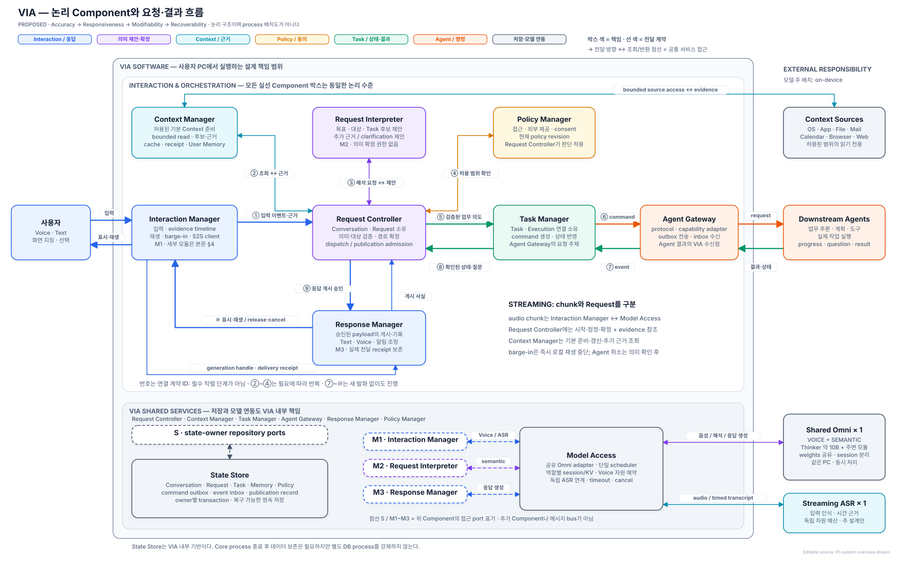

# VIA Software Architecture

> **필수 읽기와 준수:** 이 저장소의 과제 의도와 판단 기준은 [INTENT.md](INTENT.md)에 있다. 설계, QA와 DP 검토, 구현과 평가, 문서와 발표 작업을 시작하기 전에 반드시 읽고 따른다. LLM과 automation은 [AGENTS.md](AGENTS.md)의 작업 규칙도 함께 따른다. 아래 날짜별 기록의 과거 지침과 현재 원칙을 구별한다.

> **2026-10-22 DP44를 포함한 공통 QA v3:** [공통 평가 v3와 사례 원장](docs/architecture/12-decisions/decision-packages/qa-common-synthetic-v3-20261022/README.md)에 Text 이력, Voice/Screen과 별도 Voice Delivery의 3층, 9구성, 26사례군을 통합했다. 기존 v2의 49개 값을 보존하고 DP44의 공통 QA 14개와 별도 첫 음성 지연 2개를 추가했다. 공통 QA01은 화면 표시이며 음성과 평균하거나 대체하지 않는다. DP44의 정확도는 고정 정답 제어 조건이고 수신 Agent 비용은 미모델링이다. 문서, JSON, Excel과 HTML 및 검토 범위는 같은 자료에서 연결하며 모두 가상 작성 평가다.

> **2026-10-21 DP2, DP3, DP5 공통 QA 층별 비교:** [공통 평가 v2와 사례 원장](docs/architecture/12-decisions/decision-packages/qa-common-synthetic-v2-20261021/README.md)에 Text 이력과 Voice/Screen의 18개 사례군, 7구성과 QA01~07의 같은 의미 및 층별 관측 기준을 정리했다. 49개 대표값, 준비 비용, 메모리와 조건부 개별 선택을 재검토했다. 서로 다른 profile의 값과 DP 결합 효과는 합산하지 않는다. [DP2와 DP5 v1](docs/architecture/12-decisions/decision-packages/qa-common-synthetic-20261021/README.md)은 보존하며 모두 가상 시나리오 기반 설계 평가로 이전 실측과 구별한다.

> **2026-10-20 공통 평가의 기술 중단 후 부분 결과:** 승인된 대표315회와 별도 보완126회 중258회가 종료됐다. 동결 분석은257회 기술 인증,1회 미인증,183회 미실행으로 구분했다. 종료 제어 pipe 경합으로 중단했고 재시작하지 않았다. 이전 비용을 포함한 환산 비용은$7.3272788/$40이며 미확정·예약은0이다. [17의 부분 실측·전체24셀 판정·한계](docs/architecture/12-decisions/decision-packages/seven-problem-review/17-presentation-results.md#12-기술-중단-후의-최종-부분-집계)를 먼저 읽는다. 두 모집단의 예정 분모와 이전 실패를 보존하며 완주 결과나 최종 승자로 제시하지 않는다. QA04의42변경·630회귀는 별도로 완료했다.

> **2026-10-19 이전 발표 캠페인의 재검토 완료:** [17 QA 우선순위별 결과](docs/architecture/12-decisions/decision-packages/seven-problem-review/17-presentation-results.md)와 [편집 가능한 30장 발표자료 안내](docs/presentations_files/four-dp-final-20261019/README.md)를 먼저 읽는다. QA01→QA02→QA03→QA04→QA05→QA06의 고정 순서로 재검토한 권고는 발표 번호 기준 **DP1 조건부 A, DP2 B, DP3 정규화 출력 계약의 조건부 A, DP4 조건부 C**다. DP1/DP4의 QA01 우열은 미확정이며, 추가 실제 모델 비교96회와 응답 재생을 분리했다. [16 추가 실행 계약](docs/architecture/12-decisions/decision-packages/seven-problem-review/16-presentation-selection-contract.md), [추가 증거](results/architecture-evaluation/current/four-dp-presentation-20261019/README.md)에 범위와 이력을 남겼다. 아래 이전 권고와 실패·원값은 보존한다.

> **증거의 발행 구성과 복원:** [evidence 패키지 안내](results/architecture-evaluation/current/four-dp-poc-evidence-20261019/README.md)는 초기·보완 두 캠페인의 비캐시 원시와 실패·동결 기록을 분할 보존한다. 작은 보고서는 바로 읽고, 전체 raw·replay·동결 자료가 필요하면 [API 없는 복원·재현 순서](benchmark/architecture/four_dp_poc_v2/FINAL-REPRODUCTION.md)를 따른다. 실제 commit/push 상태는 Git 이력으로 확인하며 아래의 과거 미발행 기록은 당시 이력이다.

> **2026-10-19 이전 보완 캠페인의 측정과 발표 근거:** [15 보완 PoC 결과](docs/architecture/12-decisions/decision-packages/seven-problem-review/15-corrected-poc-results.md)와 [10 발표 원고](docs/architecture/12-decisions/decision-packages/seven-problem-review/10-presentation-outline.md)에 보존한다. 10개 기본안 120회, A2/A4/B4 보완 27회와 공통 원문 표현 진단 9회를 완료했다. 교정·calibration을 포함한 당시 전체 수행은 229회, Qwen 1,274회, 고정 단가 환산 $2.3201984다. 당시 권고는 01A, 02B, 04B+B4이며 05는 반복 인계의 조건 보존을 우선하면 B, 수신자 읽기와 시간·비용을 우선하면 C였다. [14 계약과 수정 이력](docs/architecture/12-decisions/decision-packages/seven-problem-review/14-corrected-poc-contract.md)에 수정 이유를 남겼고 실패·원시·이전 세대를 보존했다. 첫 callback과 목표 완료, 실제 변경 모듈, 단계별 비용과 역할별 메모리를 구분한다. 아래 초기 결론과 미측정 설명은 이전 작업 이력이다.

> **2026-10-18 PoC 사용자 리뷰 후 정정:** [13 측정 해석과 최소 재실험](docs/architecture/12-decisions/decision-packages/seven-problem-review/13-poc-user-review-and-remeasurement.md)을 먼저 읽는다. [초기 결과](docs/architecture/12-decisions/decision-packages/seven-problem-review/12-poc-results.md)의 10개 기본안 120회와 보완·진단 15회, Qwen 579회와 정가 환산 $0.7207640은 보존한다. QA01/03의 사건·목표 모집단, 근거 공급의 완료 계약과 인계의 후채택 측정 경계를 보완해야 하므로 A/A/A/C와 02 A1을 최종 QA 비교 결론으로 확정하지 않는다. 이번 감사에서 새 모델 호출은 없다. [당시 실행 재생](results/architecture-evaluation/current/four-dp-qwen37-20261018/evidence-browser.html). 코드 개발·실행은 사용자 지정 GPT-6.1 Sol High sub-agent들이 수행했다. 아래 미측정 설명은 이전 단계 이력이다.

> **2026-10-18 일곱 문제 최종 분석:** [최종 DP 세트와 자료 안내](docs/architecture/12-decisions/decision-packages/seven-problem-review/README.md). 근거 공급, 후속 입력의 의미 판단 실행, 화면과 발화 지칭, Agent 간 업무 인계를 주요 DP로 선정했다. DP-44, Agent 선택과 DP-42는 독립 상세 설계로 남겼다. 기본안과 선택 후 tactic, 공식 구현 근거, QA 손익과 조건, 비교/방안별 상세 그림을 제공한다. 분석에 따른 권고이며 사용자 대안 채택이나 측정된 승리가 아니다. 과정의 QA coverage 부족도 명시했다. 아래 기록은 이전 단계의 이력이다.

> **공통 평가 시나리오 작성 완료:** [공통 28개 목록과 QA별 관측 수량](docs/architecture/12-decisions/decision-packages/qa-candidate-package/common-scenarios.md)을 기준으로 [품질 요구사항 표](docs/architecture/12-decisions/decision-packages/qa-candidate-package/quality-requirements-table.md)의 두 표와 QA01~09 측정 조건을 통합했다. 실제 자료 제작과 PoC 실행은 별도다.

> **QA 조사 자료와 발표 준비:** [QA별 조사 상세 기록](docs/architecture/12-decisions/decision-packages/qa-candidate-package/research-notes/README.md)에 출처의 수치와 조건 및 적용 논리와 한계를 보존했다. [QA01~09 한 장 설명 페이지 구성안](docs/architecture/12-decisions/decision-packages/qa-candidate-package/slide-page-plan.md)에서 9개 QA의 상단 표와 목표 도출 및 산식과 예시 및 전체 점수표와 발표자 노트를 확인한다. 현재 QA 정의와 목표 제안은 기존 상세안을 따른다. **후속 정정: QA02는 ReALM 참조 93% / QA04는 ARGO 근거 3개 / QA05는 공통 28개 묶음의 gpt-realtime과 Luna 견적 $2.55이며 QA06은 사용자 지정 시스템 요구사항 512 MB와 RAM-v3-MB 점수를 적용한다.**

> **현재 QA와 DP 논의 (2026-10-14):** [VIA 핵심 QA와 DP 평가 계획](docs/architecture/12-decisions/decision-packages/03-03-qa-dp-evaluation-plan.md)을 먼저 읽는다. **[기존 6개 QA와 추가 3개 상세안](docs/architecture/12-decisions/decision-packages/qa-candidate-package/README.md)**에 정의와 목표 근거 및 0~6점과 예시 및 DP 예상과 PoC 범위와 독립 리뷰를 모았다. 수치는 사용자 검토용 제안이며 미측정이다. 현재 네 DP가 양성과정의 차별화 조건을 충족했다고 해석하지 않는다. 최신 합의와 다음 검토는 중심 문서 및 [작업 계획](docs/architecture/12-decisions/decision-packages/00-workplan.md)을 따른다. 아래 이전 작업 기록과 구별한다.

> **현재 작업 (2026-10-03):** 기존 `target-architecture/`는 기능 전반을 검토한 [Reference Architecture](docs/architecture/12-decisions/target-architecture/README.md)다. 최종 목표 구조로 선택한 상태가 아니다.
> **Decision Reconstruction / Stage 4**에서 중요한 기능 문제를 서로 다른 두 구조로 비교한다. 두 안 모두 참조 구조와 달라도 된다.
> 최신 결과는 [여섯 구조 비교 가이드](docs/architecture/12-decisions/decision-packages/04-30-comparison-guide.md)다. 구현, 측정 및 최종 DP 선정은 하지 않았다.
> **2026-10-04 추가:** 31은 ReAct 적용 전으로 복원했다. 새 모델 중심 ReAct 대 모델 틀/코드 완성 비교는 [04-41](docs/architecture/12-decisions/decision-packages/04-41-request-resolution-control.md)에서 읽는다.

이 저장소는 Samsung PC용 **Voice Interaction Agent(VIA)**의 소프트웨어 아키텍처를 정의하고 검증한다.

VIA는 사용자가 PC에서 Voice·Text·화면 interaction을 하나의 연속된 대화로 이어가도록 돕는다. 바로 답할 수 있는 요청은 직접 처리하고, 조사·문서 작성·Application 조작처럼 실제 업무 수행이 필요한 요청은 적절한 Downstream Agent에 위임한다. 사용자는 Agent별 대화창이나 실행 ID를 직접 관리하지 않고 VIA를 통해 질문, 진행 상황, 추가 지시, 취소, 결과를 주고받는다.

이 과제의 핵심은 특정 Model이나 Agent를 선정하는 것이 아니다. **사용자 interaction과 여러 Agent의 실행을 일관되게 연결하려면 VIA 내부의 책임·상태·계약·process boundary를 어떻게 나누어야 하는가**를 정의하고, 후보 Architecture를 같은 조건에서 비교하여 근거 있는 결정을 남기는 것이 목적이다.

## VIA가 제공하려는 사용자 경험

VIA는 다음 경험을 하나의 Conversation 안에서 연결해야 한다.

- Voice와 Text로 질문하고, 입력 방식을 바꾸거나 Voice를 다시 연결해도 앞 대화를 이어간다.
- 현재 화면, 선택 영역, pointer, focused window와 이전 대화·업무를 이용해 “이 부분”, “아까 그 파일” 같은 표현을 이해한다.
- 일반 지식이나 범위가 명확한 자료는 직접 설명하고, 그 답변을 이어 “이 내용으로 발표자료를 만들어줘”처럼 실제 업무를 맡길 수 있다.
- 한 발화에 포함된 독립·순차·조건·데이터 의존 요청을 구분하고 그 관계를 보존한다.
- 여러 장기 업무가 동시에 진행되어도 각 업무의 질문, 승인, 진행 상황, 결과를 올바른 Task에 연결한다.
- Voice Response 도중 끼어들어 질문을 바꾸거나, 특정 업무만 수정·취소하고, 확인된 처리 상태를 전달받는다.
- 허용한 정보와 User Memory를 확인·변경·삭제하고, 접근 실패나 Agent 장애가 발생하면 확인된 상태와 가능한 다음 행동을 안내받는다.

전체 사용자 행동과 완료 조건은 [Representative Use Cases](docs/architecture/05-representative-use-cases.md)에 정의되어 있다. 이 문서는 18개 대표 Use Case를 고정하지만 특정 Component, Model, 알고리즘이나 처리 순서를 미리 선택하지 않는다.

## System boundary

VIA는 사용자와 여러 Downstream Agent 사이의 **Agent-neutral Interaction & Orchestration 계층**이다.

| 영역 | 책임 |
| --- | --- |
| **VIA** | Voice/Text interaction, 화면·대화 Context, 요청 이해, direct response, Conversation/Task 상태, Agent 선택·위임, progress·clarification·approval·result 연결 |
| **Downstream Agent** | 업무별 reasoning, planning, Tool 선택·실행, open-ended research, 외부 업무 상태를 변경하는 Action |
| **AI Model Runtime** | S2S와 VIA semantic inference를 제공하는 local/remote dependency. 호출·연결·교체 구조는 범위 안이고 Model 내부 구현·학습은 범위 밖 |
| **Context Source** | 정책상 허용된 화면, OS, file, mail, calendar, browser, public web 정보. VIA가 읽을 수 있지만 외부 업무 Action을 대신 수행하지는 않음 |

책임 경계의 기본 원칙은 다음과 같다.

> **Bounded Read / Search / Understand → VIA에서 수행 가능** / **Open-ended Research / 업무 Reasoning / Plan / Act → Downstream Agent**

예를 들어 지정한 문서나 일정처럼 대상과 범위가 명확한 read-only 조회는 VIA가 직접 처리할 수 있다. 반면 새로운 Source를 탐색·선별·종합하는 조사, 업무 수행 방법의 계획, 파일·메일·일정·Application·Web service의 상태를 변경하는 작업은 Downstream Agent에 맡긴다. VIA 자신의 Conversation, Task, 설정과 허용된 User Memory 관리는 외부 업무 Action과 구분한다.

정확한 책임 범위는 [System Mission & Boundary](docs/architecture/01-system-mission-and-boundary.md)와 [Fixed Architecture Scope](docs/architecture/03-fixed-architecture-scope.md)가 기준이다.

## Interaction과 업무가 연결되는 방식



[draw.io 편집 원본](docs/architecture/12-decisions/target-architecture/diagrams/01-system-overview.drawio)

VIA는 사용자 입력을 하나 이상의 논리적 Request로 정리하고, 필요한 Context와 관련 Task를 식별한다. 정보가 부족하면 Clarification을 요청하고, 충분하면 S2S Direct Response, VIA Core Direct Response 또는 Downstream Agent Handling 중 적절한 경로로 연결한다. Agent의 진행·질문·결과도 원래 Conversation과 Task로 돌아온다.

이 그림은 논리적 책임 관계를 나타낸다. 내부 활동은 후보 Architecture에 따라 순차·병렬·streaming·반복으로 수행될 수 있으며, 각 상자가 반드시 하나의 Component나 process를 뜻하지 않는다. 상세 흐름은 [Canonical Interaction Flow](docs/architecture/04-canonical-interaction-flow.md)를 따른다.

## 서로 다른 lifecycle을 분리한다

VIA는 음성 연결, 대화, 요청, 사용자 업무와 Agent 실행을 하나의 `session`으로 뭉뚱그리지 않는다.

| 개념 | 의미 |
| --- | --- |
| **Voice Connection** | 지금 실시간 Voice 입출력이 연결되어 있는가 |
| **Conversation** | 지금까지 사용자와 VIA가 무슨 이야기를 했는가 |
| **VIA Request** | 이번 User Turn에서 VIA가 처리해야 하는 하나의 논리적 요청 |
| **VIA Task** | 여러 Request에 걸쳐 계속 상태를 추적해야 하는 사용자의 업무 목표 |
| **Agent Execution** | 해당 업무가 Downstream Agent에서 실제로 수행되는 실행 |

Voice Connection이 끝나도 Conversation이나 Task는 끝나지 않는다. Direct Response도 Conversation에 남으며 이후 업무 요청의 Context가 될 수 있다. 하나의 VIA Task가 여러 Agent Execution과 연결될 수 있지만, 사용자가 보는 Task identity는 특정 Agent의 thread나 run ID에 종속되지 않는다. 자세한 정의는 [Terms](docs/architecture/02-terms.md)에 있다.

## 고정된 Architecture 원칙

- VIA software 자체와 Voice Runtime은 사용자 PC에서 실행한다. Model과 다른 dependency는 local 또는 remote일 수 있다.
- 목표 VIA는 **on-device Omni 1개를 음성·semantic 두 역할이 공유**한다. 역할별 Context·session·권한은 분리하고 모델 가중치는 복제하지 않는다. Semantic 처리 중에도 발화 수신·인식을 유지한다. 경량 Streaming ASR을 독립 입력 근거 경로로 두는 주 설계와 전체 자원 비용은 [공유 모델 설계](docs/architecture/12-decisions/target-architecture/shared-omni-runtime.md)를 따른다.
- Voice와 Text는 같은 논리적 Conversation, Context와 Task 체계를 공유한다.
- 모든 user-facing 응답은 Text로 Chat UI와 Conversation에 남기고, Voice가 활성화되어 있으면 즉시 알아야 할 핵심을 짧게 말한다.
- S2S Direct Response도 VIA Conversation의 일부다. 기록을 위해 같은 Request를 Core에서 다시 실행하거나 중복 응답하지 않는다.
- 사용자가 명시한 복합 요청의 순서·조건·의존 관계는 VIA가 보존한다. 업무를 달성하기 위한 domain planning과 Tool 선택은 Agent 책임이다.
- VIA Task와 Agent Execution identity를 분리하고, 여러 업무의 비동기 event가 서로 섞이지 않게 연결한다.
- Context 접근·외부 제공은 Policy와 Consent를 따르며, 사용자가 확인·변경·삭제할 수 있는 User Memory를 지원한다.
- 재시작 후에는 확인 가능한 기록과 외부 상태를 사용해 업무를 재연결하고, 상태 확인 없이 변경 작업을 중복 실행하지 않는다.
- 특정 Downstream Agent가 VIA의 Conversation, Task identity나 최상위 orchestration을 소유하지 않는다.

## 이 저장소에서 Architecture를 만드는 방법

01~11은 제품 목적과 범위, 사용자 행동, 품질 기준과 검증 경계를 정의한다. 12에서는 기능 전반을 다룬 참조 구조를 활용하여 중요한 문제와 품질 충돌을 찾고, 서로 다른 실제 구조의 손익을 비교한다. 아래 target 설계 단계는 참조 구조를 만든 이력이며 이후 비교의 한 안을 고정하지 않는다.

```text
System mission and fixed scope
  → representative Use Cases and change scenarios
  → quality attribute and metric definition
  → target Architecture definition
  → structural choices, steelman candidates and ASR review
  → strong alternatives and falsifiable rationale
  → measurement and revalidation
```

12번 작업은 다음 순서로 진행한다.

1. **Target Architecture Definition** — QA-19 semantic accuracy, QA-09 responsiveness, QA-29 modifiability, QA-39 reliability/recoverability 순으로 우선하되 네 ASR을 모두 고려한 완성 구조를 설계하고 합의한다.
2. **Decision Reconstruction** — 중요한 책임·계약·상태·호출·배치 선택과 steelman 후보를 구체화하면서 ASR의 추가·변경 및 비교 기준을 함께 정의한다. 현재 네 ASR은 최종 비교 목록으로 고정하지 않는다.
3. **Rationale & Falsification** — 각 선택의 강한 현실적 대안, 재검토하여 정의한 ASR의 독립적인 결과와 trade-off, 비용, 대안이 유리한 조건과 반증 조건을 적는다.
4. **Measurement & Revalidation** — 결과 전에 계약을 동결하고 선택한 구조가 기대한 특성을 실제로 가지는지 검증한다.

Model·Agent·Context·저장 계약이 바뀌어도 사용자 기능을 유지할 수 있는지도 같은 기준으로 검토한다. 공통 비교 조건은 [Fixed Assumptions](docs/architecture/06-fixed-assumptions.md), 변경 시나리오는 [Intentional Variables](docs/architecture/07-intentional-variables.md), 측정 원칙은 [Measurement Guide](docs/architecture/11-measurement/README.md)에 정의되어 있다.

## 현재 상태

- `docs/architecture/`는 현재 시스템 정의와 Architecture 기준선이다.
- 대표 Use Case와 고정 범위, 주요 내부 구조는 목표 설계 기준선으로 정리되어 있다. 구조 선택의 상대적 품질과 실제 장비 적합성은 아직 평가하지 않았다.
- QA catalog는 네 core QA와 상세 measurement·diagnostic QA로 구성된다. Core QA의 system target과
  score band proposal을 작성했고 Shared Spine·mock profile·DP별 applicability와 함께 freeze 전이다.
- QA-09, QA-19, QA-29, QA-39를 핵심 Architecture Significant Requirement(ASR)로 확정했다. 이 분류는 측정 완료나 특정 후보의 승리를 뜻하지 않는다.
- 기존 VIA-DP-01~18과 Core DP 6개는 이전 decision-first 작업의 active reference로 보존한다. 새 목표 Architecture를 이 번호에 맞추거나 다시 매핑하지 않으며, 새 Decision Package는 전체 구조 합의 후 목표 Architecture에서 추출한다.
- 새 Core-ASR generation의 active candidate와 result는 아직 없다. 이전 reference runner·candidate·result는 archive에 보존하며 현재 QA 값이나 winner로 해석하지 않는다.
- 기존 ADR의 accepted/deferred 상태와 재검증 caveat는 유지한다.

따라서 `NOT_IMPLEMENTED`, `NOT_RUN`, `N/A`, `BLOCKED`를 과거 결과로 채우거나 draft를 확정된 제품 Architecture로 설명하면 안 된다. 최신 세부 상태는 [Architecture Baseline](docs/architecture/README.md), [Measurement Guide](docs/architecture/11-measurement/README.md), [Current Evaluation Results](results/architecture-evaluation/current/README.md), [Architecture Decisions](docs/architecture/12-decisions/README.md)에서 확인한다.

## Start here

처음 접속한 사람과 LLM은 아래 **최소 경로만 먼저** 읽는다. 첫 문서인 INTENT.md의 원칙을 반드시 읽고 적용한 뒤 과제의 고정 기능, 핵심 QA, 핵심 DP와 바로 다음 작업을 확인한다. 필요한 상세 문서는 그다음에 연다.

1. [SW Architect 과제의 의도와 판단 원칙](INTENT.md) — 문제 탐색, QA와 DP 관계, 대안 선택과 보완, QA02와 새 QA07의 평가 경계
2. [Architecture Baseline](docs/architecture/README.md) — 현재 기준선과 문서 위계
3. [System Mission & Boundary](docs/architecture/01-system-mission-and-boundary.md) — VIA의 목적과 VIA/Agent 책임 경계
4. [Fixed Architecture Scope](docs/architecture/03-fixed-architecture-scope.md)와 [Representative Use Cases](docs/architecture/05-representative-use-cases.md) — 모든 후보가 제공해야 할 기능과 사용자 완료 조건
5. [Target Architecture](docs/architecture/12-decisions/target-architecture/README.md) — 검토 완료 기준선과 확정 범위, 후속 작업
6. [Architecture Decisions](docs/architecture/12-decisions/README.md) — 목표 구조에서 Decision Package를 도출하는 12번 작업 흐름

다음 문서는 해당 작업을 할 때만 추가로 읽는다.

| 작업 | 추가 문서 |
| --- | --- |
| 용어·논리 흐름 확인 | [Terms](docs/architecture/02-terms.md), [Canonical Interaction Flow](docs/architecture/04-canonical-interaction-flow.md) |
| 비교 조건·변화 시나리오 확인 | [Fixed Assumptions](docs/architecture/06-fixed-assumptions.md), [Intentional Variables](docs/architecture/07-intentional-variables.md) |
| QA 정의·요구 추적 | [Quality Attributes](docs/architecture/08-quality-attributes/README.md), [Traceability](docs/architecture/09-traceability.md), [Architecture Element Definition](docs/architecture/10-element-definition.md) |
| 측정 의미·기존 계약 확인 | [Measurement](docs/architecture/11-measurement/README.md) |
| 목표 구조·새 rationale 작업 | [Architecture Decisions](docs/architecture/12-decisions/README.md) |
| 이전 DP·기존 결정 확인 | [Previous Decision Inventory](docs/architecture/12-decisions/dp-executive-summary.md), [ADRs](docs/adr/README.md) |

처음부터 기존 18개 DP에 맞춰 목표 구조를 만들지 않는다. 기존 DP, 상세 QA catalog와 archive는 현재 설계의 누락·제약·provenance를 확인할 때만 읽는다.

저장소를 수정하는 LLM과 automation은 먼저 [AGENTS.md](AGENTS.md)를 읽어야 한다.

## Repository map

| 경로 | 역할 |
| --- | --- |
| [`docs/architecture/`](docs/architecture/README.md) | active Architecture 기준선 |
| [`docs/adr/`](docs/adr/README.md) | accepted/deferred Architecture Decision Record |
| [`docs/references/`](docs/references/README.md) | 출처와 참고자료; 요구사항이나 결정 자체는 아님 |
| [`benchmark/architecture/`](benchmark/architecture/README.md) | measurement contract, fixture, runner와 analyzer |
| [`prototypes/candidates/`](prototypes/candidates/README.md) | 후보 Architecture 구현 |
| [`results/architecture-evaluation/current/`](results/architecture-evaluation/current/README.md) | 현재 계약으로 생성한 evaluation evidence |
| [`scripts/architecture/`](scripts/architecture/README.md) | active 문서·구조 검증 도구 |
| `*/archive/` | superseded generation과 historical provenance; 현재 요구·계약·결과가 아님 |

## Development

`architecture-ci`는 active 문서의 링크·용어·QA catalog를 검사한다. Active candidate
workspace는 목표 Architecture 합의와 target-derived 검증 계약 승인 뒤 만든다. 그때 해당 source에 맞는
fmt·lint·test job을 CI에 함께 추가한다. 이 검사는 Architecture 합의나 성능 주장을 자동으로 결정하지 않는다.

```bash
.venv/bin/python scripts/architecture/check_active_markdown_links.py
.venv/bin/python scripts/architecture/check_active_terminology.py
.venv/bin/python scripts/architecture/check_qa_catalog.py
```

작업 규칙은 [AGENTS.md](AGENTS.md), 사람 기여 절차는 [CONTRIBUTING.md](CONTRIBUTING.md)를 따른다.
