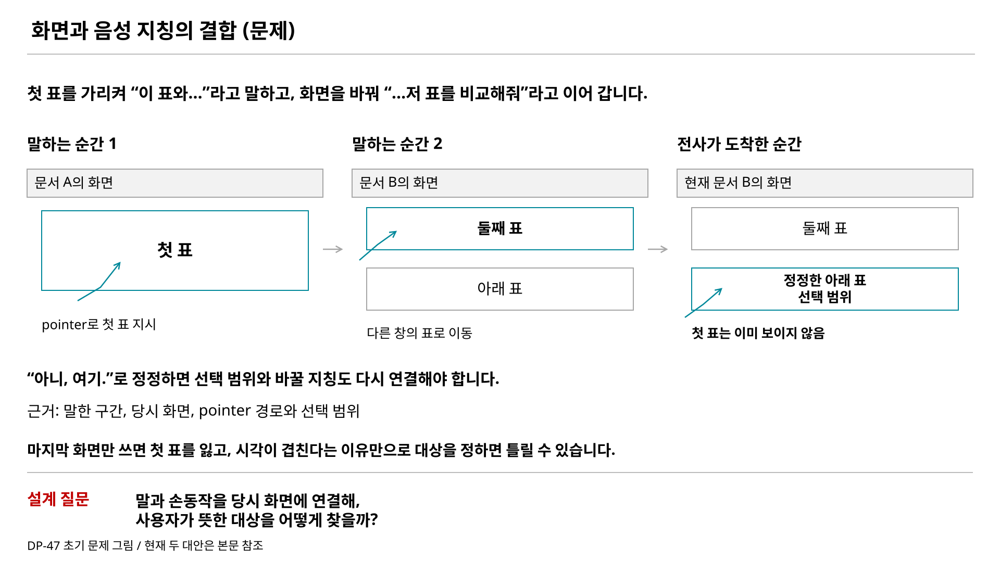
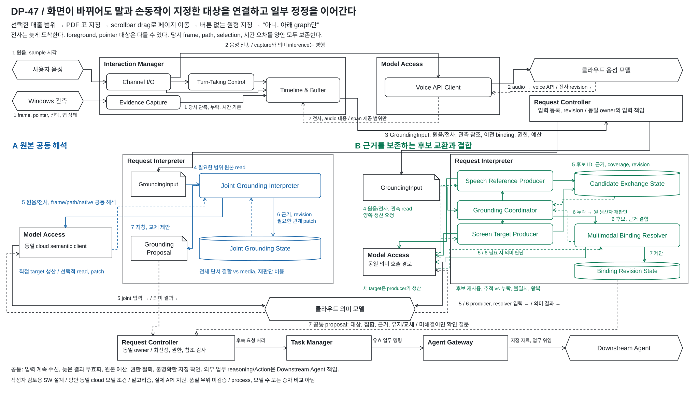
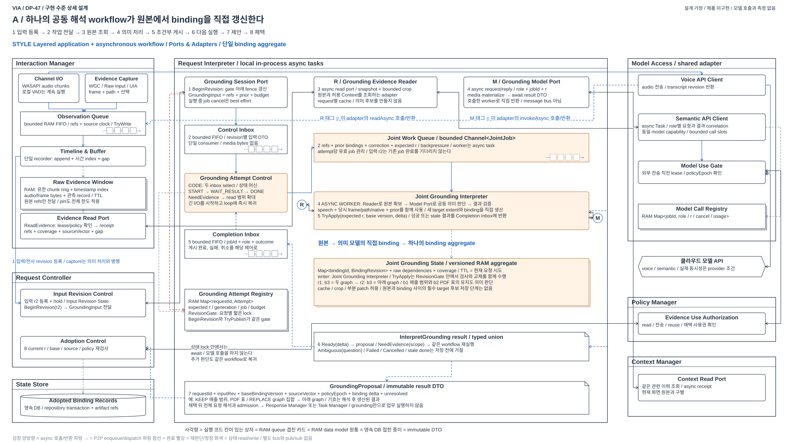
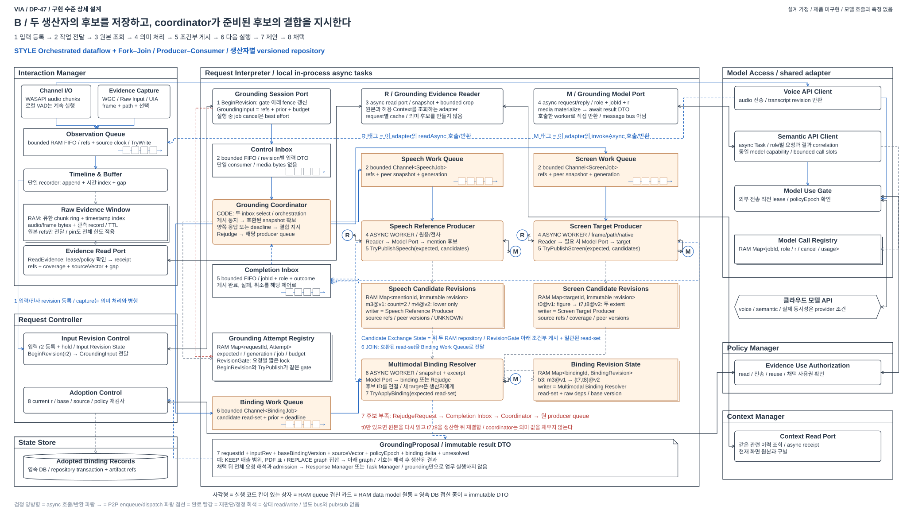
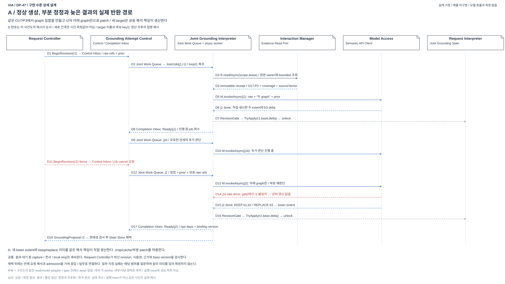
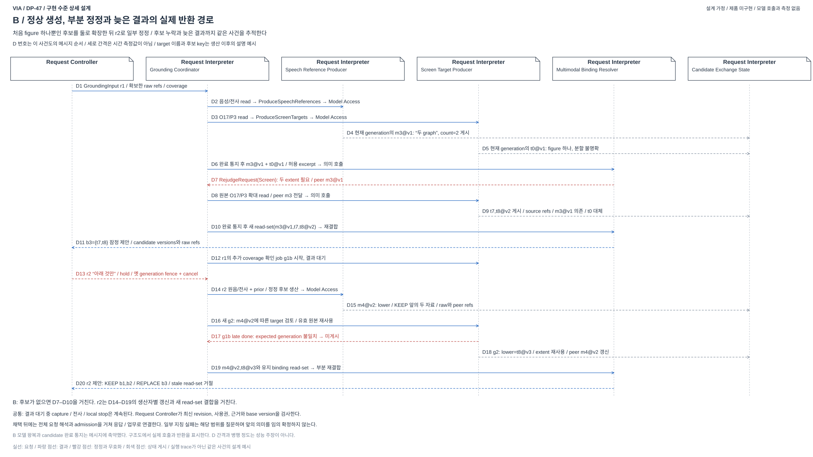

# 04-47. 화면과 음성 동기화 — 연속 조작 중 지칭 해석

> 상태: **사용자 지정 DP-47 / 두 설계 대안 구체화와 작성자 반복 검토 / 사용자 검토에 제시 / 승자 미선정 / 미구현 / 미측정** / 2026-10-14
> [현재 작업 기록](./00-workplan.md)과 [중요 문제 원장 P-02](./01-00-problem-coverage.md#p-02)를 따른다. 기존 46의 A/B나 45의 확장 구조에서 출발하지 않는다.

**비교할 두 안은 A: 원본 공동 해석과 B: 근거를 보존하는 후보 교환과 결합이다.** A는 말과 화면 행동의 원본을 같은 해석 책임에서 읽어 지칭을 직접 생산한다. B는 발화의 지칭 후보와 화면과 동작의 대상 후보를 별도 생산자가 관리하고, 결합 판단이 이 후보를 연결하거나 생산자에게 다시 판단하도록 요청한다. 둘 다 필요한 원본을 유지하고 부분 정정, 추가 조회, 병행 입력을 지원한다.

핵심 선택은 **현재 지칭 판단의 정상 경로에 별도 생산자가 관리하는 중간 후보 계약을 둘 것인가**다. 하나는 관계 전체를 같이 보기 쉽고 조정이 적으며, 다른 하나는 후보별 재사용과 오류 추적을 구조로 만든다. 반대로 A는 모델에 전달하는 media 범위와 재판단 부담, B는 후보 누락과 불일치와 추가 왕복을 감수한다. 품질 우위는 아직 가설이다.

읽는 순서: 아래 문제와 핵심 주장 → [MAIN §6](#6-main-같은-관측에서-다른-해석-구조) → [구현 수준 상세도 §8.5](#85-구현을-가정한-상세-구조와-실행-계약) → [동일 장면 §9](#9-같은-사용자-장면을-두-구조로-따라간다) → 품질, 전환, 반증. 조사와 탐색의 근거는 [공식 구조 자료](./dp47-structure-references.md), [16개 사고실험과 8개 탐색 방향](./dp47-design-experiments.md), [반복 리뷰 기록](./dp47-design-review.md)에 둔다.

## 0. 이 문서에서 모든 DP-47 그림을 확인한다

DP-47의 모든 그림은 아래 본문에 직접 표시한다. 편집용 draw.io와 PNG도 각 그림 바로 아래에서 연다.

| 그림 | 본문 위치 | 설명 |
| --- | --- | --- |
| 초기 문제 설명 | [§1 문제 배경](#1-via에서-왜-중요한가) | 화면이 바뀐 뒤 전사가 도착하고 지칭을 정정하는 상황 |
| 두 설계의 전체 비교 | [§6 MAIN](#6-main-같은-관측에서-다른-해석-구조) | 공통 입력 취득, A/B 내부 판단과 공통 채택 및 위임 |
| A 구현 수준 구조 | [§8.5.2](#852-a-원본에서-binding을-생산하는-실행-구조) | 원본 read, 공동 의미 호출과 반환, 상태 patch와 채택 |
| B 구현 수준 구조 | [§8.5.3](#853-b-후보-생산과-결합을-분리한-실행-구조) | 생산자별 후보 게시, 결합의 준비 조건, 원 생산자 재판단 |
| A 정상 생성과 정정 사건도 | [§8.5.4](#854-같은-정정의-실행-순서와-늦은-결과) | 원본에서 직접 만든 binding의 부분 patch와 옛 결과 폐기 |
| B 정상 생성과 정정 사건도 | [§8.5.4](#854-같은-정정의-실행-순서와-늦은-결과) | 후보 누락의 확장, peer revision 갱신과 재결합 |

**앞으로의 관리 규칙:** 새 DP-47 그림을 만들면 이 표에 등록하고 해당 본문에 SVG를 삽입한다. draw.io와 PNG가 있으면 같은 자리에서 링크한다. 보조 문서나 그림 폴더에만 추가한 상태로 완료하지 않는다. `generate_screen_voice_grounding_diagram.py --check`는 관련 SVG가 본문에서 빠지지 않았는지도 검사한다.

## 1. VIA에서 왜 중요한가

**VIA에서는 사용자가 말한 문장만이 요청 입력이 아니다. 발화와 함께 한 지시, 선택, 손동작과 그때의 화면이 사용자가 뜻한 대상을 만든다.** 사용자는 대상 이름이나 파일 경로를 완성한 뒤 말하기보다 화면을 보며 “이것과 저것”, “이 부분만”, “아니, 여기”라고 한다. 이 행동은 [UC-03과 UC-04](../../05-representative-use-cases.md#uc-03)의 고정 요구다.

예를 들어 스프레드시트에서 선택해 둔 매출 범위를 가리키며 “이 매출 범위를”라고 말하고, PDF의 표를 가리키며 “여기 작년 실적하고 비교해줘”라고 이어간다. PDF의 스크롤바를 드래그해 다음 페이지로 이동한 뒤 두 그래프 주위로 pointer를 움직이며 “이 두 그래프도 같이”라고 한다. 이어 “아니, 아래 그래프만. 처음 매출 범위는 그대로”라고 정정한다. 전사가 도착할 때는 사용자가 메일 앱으로 이동했을 수 있다. VIA는 과거 선택, 클릭 없는 지칭, 페이지 이동, 집합 지정과 일부 교체를 같은 요청에 연결해야 한다.

대표 장면의 실제 사용자 행동, 관측 가능한 자료와 올바른 결과는 [DP-47 대표 장면](./dp47-grounding-scenario.md)에 정리한다. Windows에서 입력을 얻는 API, 제공되는 정보와 한계는 [DP-47 입력 취득 자료](./dp47-windows-observation-sources.md)를 따른다. 앱 이름이나 페이지 번호, 대상 기호를 후보에게 정답으로 미리 제공하지 않는다.

이 문제를 잘못 풀면 문장의 목표를 올바르게 이해해도 다른 자료를 Downstream Agent에 전달한다. 실제 업무의 작성이나 분석이 정확해도 사용자의 요청은 실패한다. 사용자가 화면에서 자연스럽게 지정한 대상을 매번 이름과 경로로 다시 설명하게 만드는 것도 VIA의 interaction 가치를 줄인다. 따라서 화면과 음성의 결합은 입력 편의 기능을 넘어 요청 정확성을 좌우하는 SW 설계 문제다.

다른 제품도 이런 기능을 가질 수 있다. 여기서 주장하는 VIA의 특성은 독점적인 신기능이라는 뜻이 아니라, **PC의 화면 interaction과 연속 발화를 직접 요청 근거로 사용해야 한다는 VIA의 책임**이다.

[편집 원본](./diagrams/screen-voice-grounding-background.drawio) / [PNG](../../../presentations_files/dp-background/screen-voice-grounding-background.png). 이 초기 그림은 화면 전환과 늦은 전사가 만드는 문제를 단순화해 보여준다. 위 대표 장면은 여기에 사전 선택, 클릭 없는 지칭, 페이지 드래그, 원형 집합 지정과 부분 정정을 포함한다. 현재 두 설계는 §6에서 비교한다.

## 2. 풀어야 할 문제와 성공 조건

**설계 질문:** 사용자가 말하며 가리키고 선택하고 화면을 바꾸며 정정할 때, VIA는 각 지칭 표현을 당시의 의도한 대상과 연결하고 유효한 요청 해석에 어떻게 사용할 것인가?

동기화에는 서로 다른 세 처리가 포함된다. 원본의 시점을 대응시키는 처리, 그 시점의 화면과 동작에서 가능한 대상을 찾는 처리, 발화의 의미와 정정 관계를 고려해 의도한 대상을 판단하는 처리다. 이들을 반드시 별도 Component나 직렬 단계로 나눈다는 선택은 아직 하지 않는다. 시각이 겹친다는 사실만으로 사용자의 의도가 정답으로 확정되지는 않는다.

| 대표 장면 | 보존해야 할 결과 |
| --- | --- |
| 선택한 뒤 “이 부분”이라고 발화 | 남아 있는 사전 선택과 발화의 관계를 사용한다. 기록하지 않은 과거 동작을 복원했다고 가정하지 않는다 |
| 두 곳을 순서대로 가리키며 “여기와 여기” | 지칭별 대상과 각각의 시점, 창 및 문서를 구별한다 |
| drag나 원형 경로로 여러 대상을 지정 | 단일 대상, 범위 또는 집합의 후보와 근거를 표현한다. 우연한 이동을 의도적 지정으로 단정하지 않는다 |
| 스크롤, 창 전환, 객체 이동 후 늦은 전사 도착 | 나중 화면의 같은 좌표를 당시 대상의 근거로 대체하지 않는다 |
| “이 부분, 아니 저 부분만”으로 정정 | 교체한 대상과 유지할 지시를 구별하고 정정 전 후보의 후속 사용을 막는다 |
| 시간 근거나 화면 일부가 누락 | 모르는 범위와 모호함을 남기고 필요한 확인을 요청한다. 자동 성공으로 보고하지 않는다 |

명확한 장면에서는 대상, 집합, 범위와 보존 및 수정 역할이 사용자의 지시와 일치해야 한다. 본질적으로 모호한 장면에서는 어떤 근거가 부족한지에 맞는 확인을 해야 한다. 확인 질문을 많이 하는 것으로 정확성 문제를 모두 회피하거나, 근거 없는 한 후보를 빠르게 내는 것으로 응답성을 만족했다고 주장하지 않는다.

## 3. SW적으로 고민해야 하는 이유

### 3.1 사용자가 동의한 세 핵심 설계 포인트

**첫째, 사용자가 지정한 대상을 판단할 근거가 어떤 형태로 남는가?** 첫 페이지의 표는 화면에서 사라진다. 원형 pointer 경로를 마지막 좌표 하나로 줄이면 두 graph를 둘러싼 행동을 잃는다. 현재 활성 앱만 남기면 옆 창을 가리킨 사실도 잃는다. 따라서 화면 변화 뒤에도 지칭을 판단할 정보를 남겨야 한다. 원본 이미지와 경로를 직접 사용할지, 근거를 가리키는 중간 후보를 정상 해석의 입력으로 사용할지에 따라 정보 손실과 처리 비용이 달라진다.

**둘째, 말과 화면 행동을 연결하는 판단을 어떻게 조직하는가?** 같은 마우스 이동도 “이 두 graph”와 함께라면 집합 지정일 수 있고, scrollbar 조작 중이면 페이지 이동일 수 있다. 선택 상태, pointer 경로, 화면 내용과 말이 서로를 설명한다. 어떤 정보가 어떤 처리에 전달되고, 서로 의존하는 판단이 어디에서 만나며, 무엇을 중간 결과로 주고받는지가 SW 구조의 질문이다. 모델은 의미를 판단하는 dependency로 두고, SW는 협력과 상태와 호출 계약을 소유한다.

**셋째, 정정할 때 무엇을 유지하고 무엇을 다시 판단하는가?** “graph는 아래 것만”은 graph 집합을 바꾸지만 처음 지정한 매출 범위와 작년 실적 표는 유지한다. 이를 위해 지칭 표현과 대상과 원본의 연결을 관리해야 한다. 전체 관계를 보며 patch하는 구조와 별도 후보의 수정에 따라 결합을 갱신하는 구조는 필요한 중간 상태와 재실행 경로가 다르다. 어느 쪽도 영향 없는 조건을 잃거나 정정 전 지칭을 후속 처리에 사용하면 안 된다.

세 질문은 정확성에 필요한 근거를 얼마나 남기는지, 모델에 얼마나 전달하는지, 정정 시 얼마나 다시 처리하는지의 충돌로 이어진다. 이것을 먼저 해결한 뒤 interface, 동시 실행, timeout과 완료 조건을 검수한다. 일반적인 구현 체크리스트 자체를 DP의 주요 가치로 삼지 않는다.

### 3.2 공통으로 풀어야 할 기술 제약

음성, 전사, 화면과 입력 장치 사건은 같은 속도와 순서로 들어오지 않는다. 클라우드 전사 도착 시각은 실제 발화 시각이 아니며 로컬 VAD는 단어별 지칭 시각을 제공하지 않는다. 화면과 pointer는 해석이 끝나기 전에 바뀔 수 있다. 실제 취득 시점, 제공되는 시간 정보와 오차, 화면 또는 문서 identity를 함께 관리해야 한다.

또한 새로운 근거가 기존 지칭 후보를 바꿀 수 있다. 늦은 전사 revision이나 선택 완료가 왔을 때 어느 표현과 대상 관계를 다시 판단할지, 영향 없는 관계는 유지할지, 이미 진행한 처리를 어디에서 차단할지 정해야 한다. 원본 버퍼에 시각만 붙이는 것으로 이 문제 전체가 해결되지는 않는다.

| 탐색해야 할 구조적 질문 | 왜 품질에 영향을 주는가 |
| --- | --- |
| 발화와 행동을 어떤 단위의 해석 근거로 연결할 것인가 | 발화 전체를 한 화면에 묶으면 복수 지칭을 잃을 수 있고, 지나치게 잘게 나누면 관계와 정정 범위의 조정 부담이 커진다 |
| 당시 화면에서 대상 후보를 누가 어떤 입력으로 만들며 언어 해석과 어떻게 협력할 것인가 | 화면 구조가 있는 앱과 없는 앱에서 지원 범위가 달라지고, 후보 생성의 정보 손실이나 의미 오판이 최종 대상에 영향을 준다 |
| 화면 변화, 선택 완료와 전사 정정을 어떤 상태로 보존하고 재판단할 것인가 | 전체 재처리와 국소 수정의 정확성, 대기, 모델 비용 및 상태 관리 부담이 달라진다 |
| 근거가 늦거나 모호할 때 무엇을 기다리고 무엇을 확인할 것인가 | 빠른 추측, 추가 대기와 사용자 재지정 사이에서 정확성과 interaction 비용이 충돌한다 |
| 최종 지칭 해석과 후속 처리를 어떤 유효성 경계로 연결할 것인가 | 정정 전 대상이나 현재 화면의 다른 대상을 업무 요청에 사용하지 않도록 해야 한다 |

이 표는 completeness 검사다. 아래 대안은 같은 장면을 다른 입력, 중간 후보, 재판단 경로로 해결한다. 특정 buffer owner, 호출 횟수, capture 주기나 Module 이름의 차이만으로 주요 DP를 만들지 않는다.

## 4. 중요한 품질 충돌

[현재 품질 정의](./03-02-quality-attribute-definitions.md)의 의미를 유지하며 다음 인과를 탐색한다. 새 점수, 목표 또는 측정 계약을 여기서 확정하지 않는다.

| 품질 | 이 문제에서 드러나는 충돌 |
| --- | --- |
| 요청 처리 정확성 | 당시 근거와 여러 지칭의 구별을 충분히 보존하는 것, 모호함을 성급히 해소하지 않는 것과 정정 반영 |
| 상호작용 응답시간 | 사용자 입력과 즉시 제어를 유지하면서 지칭 근거의 도착, 확인과 해석을 기다리는 비용 |
| VIA 요청 처리시간 | 추가 관측 조회, 대상 해석과 재판단, 확인 질문으로 늘어나는 처리 경로 |
| 모델 사용 비용 | 화면 입력의 범위와 해석 호출, 정정으로 폐기된 처리와 재시도 비용 |
| 변경 용이성 | 전사의 시간 계약, 화면 정보원과 앱별 관측 형식이 바뀔 때 결합 책임에 미치는 영향 |
| 로컬 메모리 사용량 | 당시 화면과 동작, 여러 후보 및 revision을 유지하는 데 필요한 bounded 상태와 대기 자료 |

더 많은 원본이나 후보를 남기면 구별 근거를 늘릴 수 있지만 상태와 처리 비용도 증가한다. 더 일찍 준비하면 후속 대기를 줄일 수 있지만 잘못된 잠정 결과와 폐기 비용이 생긴다. 구조별 실제 경로를 정의하기 전에는 어느 선택의 우세도 단정하지 않는다.

## 5. 기존 주제와의 경계

- **44:** 입력과 외부 업무 사건의 후속 실행을 연결한다. 새 주제는 말과 화면 행동으로 사용자가 뜻한 대상을 만드는 문제다. 44의 실행 완료만으로 지칭 정확성이 확보되지 않는다.
- **45:** 과거 대화와 업무를 가로지르는 맥락의 구성 및 재사용이다. 새 주제의 중심을 과거 기억의 요청별 조회 또는 공통 게시로 바꾸지 않는다. 과거 자료가 필요하면 같은 허용 Context 조건으로 사용한다.
- **42:** 대화, 요청, 질문, 업무와 외부 실행의 수명 및 상태 권한이다. 새 주제의 관측과 지칭 후보 수명은 후속 계약으로 연결할 수 있지만 통합 Core 또는 독립 서비스 선택을 미리 계승하지 않는다.
- **41:** 주요 DP에서 제외된 범용 해석 제어 비교다. 필요한 요청 이해 기능은 남되 모델 주도와 코드 주도의 A/B를 새 주제의 대안으로 자동 복사하지 않는다.
- **43:** 요청의 의도, 대상, Task 연결, 관계, 정정, 처리 방향을 통합하거나 기능별로 나누는 범용 요청 해석 비교다. 47은 그중 화면 지칭을 풀기 위해 필요한 실제 음성과 관측 입력, 후보 coverage와 상호 재판단을 다룬다. B의 음성 생산자는 Task 연결이나 전체 업무 정정 범위를 소유하지 않는다. 43의 전반적인 기능 분할을 선택했다고 47의 후보 교환 구조가 자동 결정되지 않는다.
- **32와 46:** 이전 탐색의 범위와 제외 또는 보존 상태를 유지한다. 32의 기록 소유권 비교와 46의 요청별 관계 구성 또는 생산 및 게시 비교를 새 A/B로 가져오지 않는다. 고정 UC는 현재 요구의 근거이고 이전 A/B는 현재 선택의 근거가 아니다.

업무의 분석, 계획, 앱 조작과 외부 상태 변경은 Downstream Agent 책임이다. 새로운 시선이나 카메라 입력, 앱별 plugin 의무화, 상시 화면 수집이나 새 learned helper를 전제하지 않는다. 기존 [공통 실행 계약](./04-40-common-execution-contract.md)의 로컬 VIA와 클라우드 모델 조건에서 시작하며, 모델 내부 알고리즘과 학습은 이 저장소 범위 밖이다.

## 6. MAIN: 같은 관측에서 다른 해석 구조

[편집 원본](./diagrams/choice47-structure.drawio) / [PNG](./diagrams/choice47-structure.png). 검정은 공통 책임, 파랑은 A의 내부 기제, 초록은 B의 내부 기제다. 실선은 요청/전달, 점선은 결과다. 상자는 Component/Module 이름, 접힌 문서는 교환 자료, 원통은 owner의 임시 상태다. 이 그림은 process 수나 cloud 모델 수의 비교가 아니다.

상단은 같은 입력 취득 경로, 가운데는 Request Interpreter 내부의 실제 대체 구조, 하단은 같은 채택 및 후속 처리다. A의 직접 공동 해석과 B의 필수 후보 교환은 동일한 공통 pipeline의 이름만 바꾼 것이 아니다. B는 별도 후보의 생성, 재생산이 없으면 새로운 target을 최종 제안에 사용할 수 없다. A는 그 중간 권위 없이 원본에서 새 target을 직접 생산한다.

MAIN의 번호는 아래 호출 흐름과 맞춘다. 1–3은 공통 입력 흐름이며 inference의 완료를 기다리지 않고 계속된다. A/B 각각의 4–7은 해당 안의 해석과 제안 경로다. 도착 순서나 고정 호출 횟수를 뜻하지 않는다. 공통 취득 경로의 상세는 [입력 자료](./dp47-windows-observation-sources.md)와 [04-40](./04-40-common-execution-contract.md)를 따른다.

Request Controller는 입력 등록과 채택 책임을 확대하여 반복 표시했다. Model Access도 voice 및 안별 semantic 연결을 확대하여 반복 표시한 같은 Component다. 새로운 owner나 추가 process를 뜻하지 않는다. 원음 구간은 Channel I/O에서 Timeline & Buffer로 보존하며 VAD의 시작/종료 후보와 구별한다.

### 6.1 왜 이 두 구조를 대안으로 잡았는가

공동 입력을 모델에 전달하는 공개 코드와, 입력별 부분 해석을 생산한 뒤 결합하는 실제 시스템이 있다. 아래는 **자료에서 확인한 구조와 DP-47에 적용한 설계 추론을 구별한 근거**다. 설치하거나 실행해 검증한 결과는 아니다.

| 참고 자료와 근거 종류 | 자료에서 확인한 구조 | DP-47과의 연결 및 한계 |
| --- | --- | --- |
| [Google Gemini Live API Web Console의 ControlTray.tsx](https://github.com/google-gemini/live-api-web-console/blob/main/src/components/control-tray/ControlTray.tsx) / 공개 구현 코드 | 마이크 audio와 화면 또는 webcam frame을 같은 live client의 `sendRealtimeInput` 경로로 전달한다 | A의 공동 모델 입력 경로를 뒷받침한다. 별도 지칭/대상 후보의 의미 생산을 필수 단계로 두지 않는다. VIA의 과거 원본 조회, pointer/선택과 부분 정정 계약까지 구현했다는 근거는 아니다 |
| [QuickSet 원 논문 §2–3, Figure 6](https://aclanthology.org/P97-1036.pdf) / 실제 구현된 시스템의 설명 | 음성의 부분 의미와 pen gesture의 복수 해석을 별도로 생산하고 multimodal integration agent가 결합한다 | B의 후보 생산과 결합 구조에 가장 가까운 선례다. pen과 지도 명령을 임의 PC 앱, 클릭 없는 pointing으로 확대할 수 없다. 이 조사에서 실행 가능한 공개 소스는 확인하지 않았다 |
| [Microsoft OmniParser의 /parse/ 구현](https://github.com/microsoft/OmniParser/blob/master/omnitool/omniparserserver/omniparserserver.py) / 공개 구현 코드 | screenshot을 입력받아 구조화된 `parsed_content_list`와 주석 이미지를 반환한다 | B의 Screen Target Producer가 명시적인 중간 자료를 제공하는 구현 형태를 뒷받침한다. 음성과의 결합 구현은 아니며 모든 표, graph, native range를 제공한다고 가정하지 않는다 |
| [W3C Multimodal Architecture and Interfaces §5–6](https://www.w3.org/TR/mmi-arch/) / 구조와 interface 표준 | modality 처리와 조정 책임을 구별하고 시작, 완료, 취소 및 context의 lifecycle event를 정의한다 | B의 Grounding Coordinator가 실행과 결과 전달을 코드로 관리하는 참고다. 표준 자체는 실행 가능한 구현이 아니며 후보의 의미상 충분 여부를 코드로 판정할 근거도 아니다 |
| [Microsoft Psi의 Stream Fusion and Merging §2.3–3.1](https://github.com/microsoft/psi/wiki/Stream-Fusion-and-Merging) / 공개 framework의 공식 연산 설명 | 현재 도착한 자료만 결합하는 방식과 발생 시각에 맞는 자료를 기다리는 방식을 구별한다 | 양안의 Timeline & Buffer, 늦은 관측과 기다림 계약에 연결된다. 시간 결합은 지칭 의도를 확정하지 않으며 A/B의 차별 근거도 아니다 |

이 선례에서 비교할 가치가 있는 차이는 **공동 원본에서 지칭을 직접 만드는 경로와, 별도 생산한 부분 의미를 최종 판단의 입력으로 삼는 경로**다. A에서는 중간 후보의 누락 때문에 판단이 막히는 단계를 줄일 수 있다. B에서는 표현, 대상과 결합의 중간 결과를 따로 재사용하고 수정할 수 있지만 후보 누락, 불일치와 왕복 비용을 감수한다. 이 손익을 검토하기 위해 두 안을 잡았다. 선례의 존재가 어느 안의 품질 우위를 입증하지는 않는다.

**VIA에 맞추어 추가한 설계:** 지나간 화면과 pointer 경로의 원본 유지, 지칭별 binding의 부분 정정, B의 원 생산자 재판단과 revision/coverage 계약은 위 구현을 그대로 옮긴 것이 아니다. 대표 장면의 페이지 이동, 집합 지칭과 “아래 것만, 나머지는 그대로”를 처리하기 위해 추가했다. 구체적인 소스 읽기 위치와 세 핵심 설계 포인트별 근거의 강도는 [조사 기록 §2.1–2.2](./dp47-structure-references.md#21-실제로-읽을-코드와-구조)에 둔다.

## 7. 공통 입력과 결과 계약

### 7.1 정보는 실제 얻은 범위에서만 제공한다

| 자료, owner | 제공하는 것 | 제공하지 않는 것 |
| --- | --- | --- |
| Interaction Manager / Channel I/O, Turn-Taking Control | audio sample 구간, 시계 기준과 capture 공백, 로컬 VAD 시작/종료 후보. 원음은 허용 기간 동안 보존 | VAD가 단어별 시각 또는 지칭 의미를 정하지 않는다 |
| Interaction Manager / Evidence Capture | frame 원본 참조, capture 시각, 창/monitor/좌표 기준, pointer/button/wheel 관측, 이용 가능한 foreground/focus/선택 자료와 조회 구간 | 현재 조회로 과거 selection을 복원하지 않는다. Raw Input 이동량을 정확한 과거 화면 좌표로 취급하지 않는다 |
| Interaction Manager / Timeline & Buffer | 관측 구간 ID, source별 원래 시각/도착 시각/오차, 순서, revision, 누락, 유효 범위, 제한된 원본 조회 | 미래에 모든 stream 자료가 다 도착했다는 전역 보장이나 semantic binding을 생산하지 않는다 |
| Model Access | cloud voice transcript partial/final과 로컬 audio의 대응, 실제 제공한 span과 제약. 모든 의미 호출, cancel, usage의 대응 | cloud 도착 시각을 단어 시각으로 변환하지 않는다. 서버 session을 VIA 원본 상태로 삼지 않는다 |
| Context Manager / Policy Manager | 허용된 관련 context 및 근거 사용 범위, 정책 version. 상세 조회는 45의 선택과 독립 | DP-47에서 공통 screen memory를 새로 선택하거나 외부 도메인 reasoning을 수행하지 않는다 |

양안은 동일한 취득 범위, 수집 품질, 원본 보존 한도와 모델 capability를 받는다. 발화 시작에 관측을 시작하며 최초 selection 상태를 읽을 수 있다. 상시 수집이나 기록되지 않은 발화 전 화면 복원을 요구하지 않는다. 실제 첫 관측까지의 공백은 남긴다. 원본과 전달 사본, 임시 상태는 전체 memory 한도에 포함한다.

단어 span이 없으면 지칭 시간은 가능한 구간으로 남는다. 원음 공동 입력이 지원되면 양쪽에서 사용할 수 있고, 지원되지 않으면 양쪽 모두 전사+알려진 구간을 사용한다. 시간/이미지 대응이 부족한 장면의 미해결을 숨기지 않는다. 양안의 screen/voice 동기화 알고리즘을 서로 다르게 고정하여 품질 차이를 만들지 않는다.

1. Channel I/O는 audio를 계속 받고 Turn-Taking Control이 로컬 VAD 시작을 알린다. Evidence Capture가 허용된 화면, 조작 관측을 시작하고 Timeline & Buffer에 전달한다.
2. Model Access는 audio를 cloud voice 모델에 전송하고 transcript revision을 로컬 audio 구간에 대응시켜 Timeline & Buffer에 반환한다. 의미 처리 중에도 입력과 관측 수신은 계속된다.
3. Request Controller가 입력/revision을 등록하고, Request Interpreter에 `GroundingInput`을 준다. 입력은 원음/전사와 관측의 참조 및 허용 조회, 이전 유효 binding과 policy/예산이다. 정답 target ID, 교체 범위와 미래 발화는 미리 주지 않는다.

### 7.2 공통 출력은 근거가 있는 지칭 제안이다

`GroundingProposal`은 다음 자료를 포함한다. 구현 schema의 최종 freeze는 아니다.

- 입력/request revision, 처리한 관측 범위와 source version 및 gap.
- 지칭 표현별 원문 구간, 단일 대상/집합/범위의 연결과 의미상 역할. 표현의 시간은 정확 / 추정 / 불명확을 구별한다.
- target의 native reference가 실제 있으면 그 범위, version, 없으면 당시 frame의 시각적 extent와 허용 snapshot 참조. figure 전체와 내부 graph를 구별한다. 서로 다른 page의 같은 좌표는 같은 target ID가 아니다.
- binding별 원본 근거와 경쟁 후보 또는 미해결 이유. 파생 결과는 독립 source evidence로 세지 않는다.
- 기존 binding에 대한 유지/교체/추가/제거의 제안, 그 근거, 영향 재검토 범위. 별도 발화의 정정이면 이전 채택 binding version을 참조한다.
- 확신할 수 없는 지칭의 확인 질문 제안. 최종 허가, Task 생성과 외부 전달은 포함하지 않는다.

snapshot 기반 target은 외부 앱에서 나중에 클릭할 수 있는 stable selector가 아니다. VIA는 지정 근거를 허용 artifact로 전달할 수 있으며 외부 업무 Action이나 최신 문서 조작은 Downstream Agent가 자신의 경계에서 확인한다. 원본이 없는데 경로나 cell 주소를 모델이 만들어냈다면 binding을 유효 자료로 취급하지 않는다.

## 8. 두 안의 실제 실행과 임시 상태

### 8.1 A — 원본 공동 해석

Request Interpreter 내부 **Joint Grounding Interpreter**가 원음/전사, 당시 frame, native selection, pointer/button 경로와 app 상태를 함께 읽고 표현↔대상을 직접 제안한다. 하나의 함수나 단 한 번의 모델 호출을 강제하지 않는다. 내부 도구와 specialist 도움을 사용할 수 있지만, 별도 생산자가 관리하는 target 후보가 최종 판단의 필수 관문은 아니다.

4. Joint Grounding Interpreter는 GroundingInput에서 필요한 관측 범위를 선택하고 원본을 bounded read한다. 처음에는 넓은 맥락과 실제 취득 상태를 보고, selection 범위, pointer 주변 crop, 전후 frame을 사용할 수 있다. 제외한 구간과 정보 손실은 남긴다.
5. Joint Grounding Interpreter → Model Access → 동일 cloud semantic 모델: 공동 해석 입력과 이전 binding/정정 원문을 전달한다. 모델 결과 → Model Access → Joint Grounding Interpreter: 새 binding, 수정 제안과 불확실성을 반환한다. 코드 경로의 native 자료 조회는 모델 호출이 아니다.
6. Joint Grounding Interpreter가 **Joint Grounding State**에 원본 참조, 잠정 binding/revision과 dependency를 유지한다. 추가 근거가 필요하면 제한 내 read와 같은 책임의 재판단을 한다. 정정은 바뀐 binding만 patch할 수 있고 영향이 넓으면 공동 관계를 다시 판단한다. 모든 원본, 모델 입력을 매번 전체 재처리해야 한다는 가정을 두지 않는다.
7. Joint Grounding Interpreter → Request Controller: GroundingProposal 또는 미해결, 확인 질문을 반환한다. 원본에서 새 target을 만들고 기존 후보를 바꾼 의미 책임은 이 모듈에 있다.

**A의 강점 가설:** 말, 손동작, UI 상태의 서로 다른 단서를 중간 표현에서 먼저 자르지 않고 같은 판단에서 사용할 수 있다. 새 유형의 지칭도 공통 모델/입력 계약 범위에서 직접 처리하며 후보 소유, 교환 조정이 적다. 특히 후보가 자주 틀리거나 전사가 넓은 구간으로만 대응될 때 현실적인 선택 이유가 있다.

**A의 비용:** 화면과 말의 필요한 범위가 넓으면 media 전달, 입력 비용과 판단 부담이 커진다. 부분 rejudge가 있어도 무엇을 다시 볼지와 보존할지는 동일 책임에서 판단해야 한다. 잘못된 binding의 원인을 speech/target/fusion별로 분리하는 데 추가 진단이 필요하다. B처럼 후보 contract를 실제로 도입하면 구조는 hybrid 또는 B 계열로 바뀐다.

### 8.2 B — 근거를 보존하는 후보 교환과 결합

Request Interpreter 내부에 **Speech Reference Producer**, **Screen Target Producer**, **Grounding Coordinator**, **Multimodal Binding Resolver**를 둔다. producer는 임시 후보를 생산, 수정하고 resolver는 이 후보 사이의 지칭 연결을 판단한다. 모든 의미 판단이 code rule로 바뀌는 구조가 아니다. 동일 cloud semantic dependency를 역할별 필요한 입력으로 사용한다. 추가 helper 모델이나 per-app Agent는 요구하지 않는다.

4. Grounding Coordinator가 GroundingInput을 원음/전사의 **지칭 후보 생산 요청**과 frame/selection/path의 **화면과 동작 후보 생산 요청**으로 전달한다. 두 생산은 병행할 수 있다. 초기 후보는 언어 또는 화면만으로 확정할 수 없는 값을 `미결정`으로 남긴다. speech는 표현/집합 수/정정 관계의 후보를, screen은 target extent와 navigation/designation 등 동작 해석의 경쟁 후보를 생산한다.
5. 각 producer는 native read나 필요할 때 Model Access → cloud semantic 모델로 후보를 생산하고, **Candidate Exchange State**에 후보 ID, revision, 원본 참조, coverage, 경쟁 관계를 제출한다. native selection 관측은 사실일 수 있어도 “사용자가 그 범위를 뜻했다”는 값은 후보다. screen 후보는 단일 객체뿐 아니라 visual region, 집합의 후보를 지원한다.
6. Grounding Coordinator → Multimodal Binding Resolver: 같은 입력/정책 조건에서 사용 가능한 양쪽 후보와 원본 excerpt 참조를 전달한다. resolver는 필요 시 Model Access를 통해 의미 결합을 판단한다. 시간 overlap, confidence, ID 일치는 code에서 의미 정답을 증명하지 않는다. 후보가 부족하거나 모순이면 resolver가 `RejudgeRequest`를 내고 Coordinator가 원 생산자에 전달한다. “두 graph” 정보를 받은 Screen Target Producer가 기존 한 figure를 분리할 수 있고, 실제 target 종류/집합을 받은 Speech Reference Producer도 표현 해석을 수정할 수 있다. 코드는 재판단 대상의 참조, 버전, 실행만 조정하며 의미를 몰래 채우지 않는다.
7. Multimodal Binding Resolver가 결합 후보와 사용한 producer version을 **Binding Revision State**에 기록하고 GroundingProposal을 Request Controller에 반환한다. source/mention이 바뀌면 관련 후보와 binding을 재판단한다. 영향 범위가 불확실하면 범위를 넓혀 전체 관계를 점검한다.

**B의 필수 제약:** resolver는 존재하지 않는 target을 최종 결과에 직접 만들어 넣지 않는다. 새 대상, 분할/범위가 필요하면 Screen Target Producer가 원본에서 생산해야 한다. 지칭/정정 후보가 틀리면 Speech Reference Producer가 다시 생산한다. 이를 건너뛰어 원본에서 최종 binding 전체를 직접 만들면 A형 우회를 추가한 hybrid이며 순수 B의 비용, coverage로 계산하지 않는다.

**B의 강점 가설:** 같은 request에서 여러 지칭이 같은 화면 범위를 쓰거나 반복 정정하는 경우 target/mention 후보를 필요한 단위로 재사용할 수 있다. source의 부족, target 생산 오류, 표현 오류와 결합 오류를 계약에서 구별해 검토하기 쉽다. 여러 정보원과 지칭 유형의 변경을 producer contract에 국소화할 선택 이유가 있다. 다만 A도 cache, 부분 수정, 진단을 가질 수 있어 이 이익은 측정 없이 독점적이라고 주장하지 않는다.

**B의 비용:** 후보 누락과 조기 범위 축소가 최종 결합을 막을 수 있다. 원본 재조회와 후보 확장과 여러 revision의 왕복이 필요하다. 호출의 startup, output, 재시도와 중간 candidate metadata도 비용과 memory에 포함한다. 더 작은 자료를 resolver에 줘도 producer가 원본을 읽은 비용은 사라지지 않는다.

### 8.3 모델 호출의 입력과 조건

| 호출 경로 | 필요한 input | 발생 조건과 공통 제한 |
| --- | --- | --- |
| 공통 음성 | audio sample와 protocol 대응 | capture 동안 streaming. 원음/span capability는 같은 provider 조건 |
| A 공동 지칭 해석 | 필요한 원음/전사, frame/path/native 관측, 이전 binding | 입력 revision을 해석할 때. 추가 read, 정정 시 재호출 가능; 항상 한 호출이라는 주장 없음 |
| B 지칭 후보 생산 | 원음/전사, 이전 mention/binding 및 받은 screen 후보 정보 | 새 표현, 정정 또는 peer 정보로 재판단할 때 |
| B target 후보 생산 | 관련 frame/path/native 관측 및 받은 지칭 제약 | native 관측만으로 후보 자료를 만들 수 없거나 visual/행동 의미가 필요할 때. 매 frame 호출 아님 |
| B 지칭 결합 | mention/target 후보, 필요한 원본 excerpt, 이전 binding | 충분한 후보가 있거나 모순/부족을 판단할 때. semantic 불확실성을 code confidence threshold로 대체하지 않음 |

역할별 호출은 동일 capability와 같은 예산/동시성 조건을 사용한다. 병행 실행이 가능한지와 provider/session 한도는 미확인이다. B의 producer→resolver 또는 재판단 왕복은 실제 실행 dependency로 남으며 API 호출을 합쳐 batching할 수 있어도 중간 자료의 권위, 수정 계약은 유지된다. API 값과 호출 개수는 측정 전에 확정하지 않는다.

### 8.4 실제 교환 계약과 결과의 단위

| 계약 | 입력 → 반환 | 실패와 미완료의 의미 |
| --- | --- | --- |
| 공통 `ReadEvidence` | 관측 구간/범위, 좌표/시간 기준, 사용권 → 유효 원본 참조, 실제 coverage, 오차, gap | 만료/철회/미관측을 서로 구별. 조회가 원본을 새로 만드는 것은 아님 |
| A `InterpretGrounding` | GroundingInput, 이전 binding, 수정 원문 → 직접 생산한 GroundingProposal | 추가 read 요구, 미해결 지칭 또는 질문. 중간 target vocabulary를 미리 충족해야 한다는 조건 없음 |
| B `ProduceSpeechReferences` | 원음/전사 revision, 이전 지칭, peer 후보 참조 → 지칭 표현, 수/집합, 정정 역할의 경쟁 또는 부분 후보 | 단어 시각/의미가 미결정이면 가능한 범위와 부족한 값을 남김. Task/전체 업무 의미를 대신 결정하지 않음 |
| B `ProduceScreenTargets` | 허용 frame/path/native 관측, 지칭 제약 후보 → native/visual 범위, 집합, 동작 후보와 근거/coverage | target 없음과 후보 생산 실패를 구별. 전달하지 않은 범위, 판단 못한 시점은 `NOT_COVERED` |
| B `ResolveBindings` | 양쪽 후보 참조/version, 관련 excerpt, 이전 binding → 후보를 참조하는 GroundingProposal 또는 RejudgeRequest | target을 직접 새로 생성하지 않음. 모호함과 source gap, candidate miss를 구별 |
| B `RejudgeRequest` | 원 생산자, 미해결 결합 질문, 참조한 후보/peer version, 추가로 필요한 원본 범위 → 새 후보 revision 또는 확대 불가/질문 | Coordinator가 이 의미 질문을 전달하고 source/예산을 확인. producer의 새 의미를 code로 대체하지 않음 |

candidate key는 `producer generation + 후보 ID + revision`이다. native object ID가 아니다. source 참조, 사용한 peer 후보 version, 경쟁 후보인지 집합 구성원인지, 지원 범위와 미지원 부분을 함께 보낸다. crop의 extent는 원본 frame의 좌표 기준과 연결한다. figure를 둘로 다시 나누면 새 후보와 교체 관계를 생산하며, 옛 ID만 유지해서 같은 대상이라고 선언하지 않는다.

예를 들어 실제 producer가 “이 두 graph”의 mention `m3`과 frame `o17`에 근거한 visual target 후보 `t7`, `t8`을 생산했다고 하자. B의 결합 `b3`는 `m3 → {t7, t8}`과 사용한 revision을 기록한다. “아래 것만”으로 `m4`가 오면 screen/mention 후보를 다시 판단하고 `b3`의 교체와 다른 binding의 유지를 제안한다. A는 `o17`의 pixels/path와 두 표현을 공동 해석하여 같은 최종 연결을 직접 생산할 수 있다. **이 키와 연결은 생산 이후 자료의 예이며 후보 입력에 정답으로 제공하지 않는다.** 두 안 모두 내용, extent가 잘못되었을 가능성을 원본과 확인을 통해 다룬다.

최종 schema/serialize 방식, SDK, matcher나 지칭 분류 알고리즘은 선택하지 않았다. 이 계약은 어떤 처리의 결과가 다른 처리의 준비 조건인지, 누가 수정해야 하는지와 어떤 정보 손실을 공개해야 하는지를 정한다.

### 8.5 구현을 가정한 상세 구조와 실행 계약

§6의 두 의미 처리 구조를 **구현할 수 있는 코드, queue, data model과 저장 경계**로 구체화한다. 아래 네 그림은 설계 가정이며 실제 제품이나 실행 trace가 아니다. reference와의 연결은 §6.1과 [구조 조사](./dp47-structure-references.md)에 있다.

공통 30개 요소의 위치와 크기를 맞춘 두 구조도에서 안별 기제를 살구색으로 표시했다. **A는 원본을 함께 읽는 비동기 workflow와 하나의 binding aggregate, B는 생산자별 작업 queue와 후보 repository를 coordinator가 결합하는 dataflow**다. 같은 원본과 모델을 사용하더라도 정상 실행에서 거치는 자료와 후속 작업의 준비 조건이 다르다. 코드 모듈마다 process나 모델을 하나씩 두지 않는다.

#### 8.5.1 공통 실행 기반과 그림의 읽는 법

구현 가정은 Request Interpreter 내부 모듈을 **같은 로컬 process의 비동기 task**로 실행하는 것이다. 이 영역의 queue는 용량이 제한된 메모리 FIFO이며 수신자가 지정된 point-to-point 전달이다. C#으로 옮긴다면 `Channel<T>`, 비동기 함수와 immutable record로 표현할 수 있다. 이는 가능한 구현 대응이며 SDK나 언어의 최종 선택은 아니다. Request Controller 등 주변 Component의 서비스 분리는 DP-42의 계약에 따라 port 바깥에서 달라질 수 있다.

| 그림 기호 | 실제 구현 가정 | 읽는 방법 |
| --- | --- | --- |
| 일반 사각형 | 코드 module, 비동기 worker 또는 adapter 함수 | 내부에 CODE, ASYNC WORKER와 책임을 표시한다. worker의 모델 대기는 capture나 제어 loop를 점유하지 않는다 |
| 작은 칸이 있는 상자 | `bounded Channel<T>`에 대응하는 RAM FIFO | 화살표의 발신자가 enqueue하고 지정 consumer가 읽는다. 큰 원음이나 이미지 대신 job DTO와 원본 참조를 운반한다 |
| 겹친 카드 | RAM Map, immutable revision 및 dependency index | 저장 필드, 의미 writer와 수명을 명시한다. 프로세스 종료 뒤 복구되는 DB를 뜻하지 않는다 |
| 원통 | 기존 State Store의 영속 DB 기록 | 채택된 binding과 artifact 참조를 repository transaction으로 기록한다. 임시 raw와 candidate를 전부 DB에 쓰는 구조가 아니다 |
| 접힌 종이 | immutable DTO 또는 결과 union | 입력, outcome과 GroundingProposal의 실제 필드를 표시한다 |
| R, M 원형 port | 위쪽의 같은 Grounding Evidence Reader와 Grounding Model Port를 호출하는 연결 표기 | R은 `readAsync`, M은 `invokeAsync`의 요청/반환이다. 같은 문자의 모든 port가 위쪽의 동일 adapter를 사용하며 추가 instance나 message bus가 아니다 |
| 검정 양방향, 파랑 실선/점선, 회색 점선 | 각각 async 호출/반환, queue 전달/완료, 상태 접근 | 빨강은 정정과 재판단 경로다. 양방향 선의 await 동안 thread나 상태 lock을 붙잡지 않는다 |

**Message bus와 pub/sub를 넣지 않은 이유:** 작업을 받을 역할과 결과를 회수할 제어 모듈이 이미 정해져 있다. 한 작업을 여러 subscriber에 방송해야 하는 요구가 없어, 지정 queue와 상관 ID가 있는 응답으로 표현했다. B의 candidate 게시도 자기 RAM repository 갱신과 Coordinator에게 보내는 완료 통지다. 외부 broker, subscriber discovery와 durable message delivery는 이 비교의 필수 요소가 아니다.

| 공통 owner와 구현 단위 | 처리 및 실제 상태 | 실행과 수명 계약 |
| --- | --- | --- |
| Interaction Manager / Channel I/O, Turn-Taking Control, Evidence Capture | WASAPI 원음, 로컬 VAD, Windows.Graphics.Capture frame과 Raw Input, 실제 노출된 UIA 선택을 수집 | 원음의 전송과 전사는 Model Access의 Voice API Client 경로다. 의미 처리 중에도 capture와 local stop을 계속한다 |
| Interaction Manager / Timeline & Buffer | callback이 Observation Queue에 원본 참조와 시각을 TryWrite하고 단일 recorder가 record와 시간 index를 만든다. Raw Evidence Window는 유한 chunk ring과 metadata Map | frame은 보존에 필요한 수명 복사를 한다. ring에서 사라진 내용을 ref만으로 복원할 수 없다. 한도 초과와 관측 누락은 gap으로 남긴다 |
| Interaction Manager / Evidence Read Port | 허용 구간을 읽어 immutable `EvidenceReadReceipt`를 반환 | 실제 refs, coverage, clock error, sourceVector와 useLease를 반환한다. pin도 byte/시간 한도를 넘기지 못하며 사용권 철회가 우선한다 |
| Request Controller / Input Revision Control | 입력 r2를 등록하고 기존 결과 사용을 hold한다. Grounding Session Port의 `BeginRevision(r2)`를 거쳐 새 GroundingInput 전달 | 입력 등록과 무효화를 의미 작업의 완료 뒤로 미루지 않는다. 외부 업무 취소는 별도 기존 계약이다 |
| Request Interpreter / Grounding Session Port, Grounding Attempt Registry | 요청별 RAM registry에 expected input revision, generation, 실행 job, deadline과 예산을 둔다 | BeginRevision이 **RevisionGate의 짧은 요청별 lock** 아래 현재성을 먼저 바꾼다. 이후 Control Inbox에 입력을 보내고 이전 job의 취소를 요청한다 |
| Request Interpreter / Control Inbox와 Completion Inbox | 새 입력과 제어, 작업 outcome을 별도 유한 FIFO에 넣는다. Attempt Control 또는 Coordinator가 단일 consumer | 제어 loop는 짧게 상태를 바꾸고 worker를 시작한다. 모델이나 queue 여유를 기다리는 작업을 loop 안에서 길게 수행하지 않는다 |
| Request Interpreter / Grounding Evidence Reader, Grounding Model Port | 원본/관련 Context read와 모델 입력의 구성 및 결과 반환을 감싼 adapter | Reader는 bounded crop/cache와 원본 좌표 대응을 보존한다. Model Port는 role/job/revision을 붙이고 실제 media를 materialize한다 |
| Model Access / Semantic API Client, Model Use Gate, Model Call Registry | 한정된 in-flight slot, jobId별 역할/취소/usage Map, provider client | 전송 직전 Policy Manager의 사용권을 검사한다. cancel 뒤에도 결과가 올 수 있다. 결과의 의미와 후보 게시 권한은 호출 worker에 있다 |
| Request Controller / Adoption Control, State Store | 최신 revision, hold, source/정책, base binding version 및 B의 read-set을 검사한 뒤 채택 기록을 저장 | DB engine과 전체 저장 구조는 기존 State Store 계약을 따른다. 채택 뒤 전체 요청 해석과 admission을 거쳐 응답 또는 업무로 이어진다 |

제어 모듈은 Control Inbox와 Completion Inbox를 함께 기다리고 짧은 handler로 처리한다. 역할 queue에는 TryWrite로 제출하며 포화 시 유한 pending 목록에 남겨 다음 처리 기회를 기다린다. 제어 loop가 가득 찬 역할 queue를 await한 채 완료 통지를 읽지 못하는 순환 대기를 만들지 않는다.

수집용 callback과 의미 작업 queue를 직접 같은 대기 경로로 묶지 않는다. worker 수와 각 queue의 용량은 유한 설정값이며 후속 자원 검증에서 수치를 정한다. worker를 무제한 생성해 queue 밖에 대기 자료를 쌓는 구현은 허용하지 않는다. 원음/frame payload, crop, API 전송 사본, 대기 job과 candidate를 모두 메모리 비용에 포함한다.

#### 8.5.2 A: 원본에서 binding을 생산하는 실행 구조

[편집 원본](./diagrams/dp47-implementation-a.drawio) / [PNG 3840×2160](./diagrams/dp47-implementation-a.png)

**Architectural style은 layered application의 비동기 workflow다.** Grounding Attempt Control은 실행을 조정하고, Joint Grounding Interpreter는 의미 결과를 생산하며, Reader와 Model Port는 외부 의존성을 감싼다. 적용한 pattern은 Producer–Consumer queue, Ports & Adapters와 versioned aggregate다. Grounding Attempt Control이 자체적으로 대상 의미를 판단하는 것은 아니다.

| 번호 | 구현 요소와 실행 | 결과와 다음 단계 |
| --- | --- | --- |
| 1 | Grounding Session Port가 BeginRevision을 수행하고 GroundingInput을 Control Inbox에 넣는다 | registry의 현재 revision을 먼저 갱신해 옛 job 결과를 차단한다 |
| 2 | Grounding Attempt Control이 `JointJob`을 Joint Work Queue에 넣는다 | bounded async worker가 읽는다. 제어 loop는 새 입력과 완료를 계속 처리한다 |
| 3 | Joint Grounding Interpreter가 R port로 원본과 관련 Context를 읽는다 | 유효 receipt와 필요한 crop, 이전 binding을 확보한다. 없는 자료는 gap으로 남긴다 |
| 4 | Joint Grounding Interpreter가 M port로 공동 의미 판단을 요청하고 await한다 | 원음/전사, 당시 frame/path/native와 정정 원문에서 새 target extent와 binding delta를 직접 생산한다 |
| 5 | worker가 `TryApply(expectedInputRev, baseVersion, delta)`를 호출한다 | RevisionGate 아래 현재성/근거 검사를 통과한 결과만 Joint Grounding State에 반영한다 |
| 6 | typed outcome을 Completion Inbox로 돌려보낸다 | Ready면 제안, NeedEvidence면 같은 workflow의 범위 확장, Ambiguous면 해당 지칭의 확인으로 이어진다 |
| 7–8 | 유효 GroundingProposal을 Adoption Control에 반환한다 | 마지막 현재성 검사와 영속 채택은 공통 경로다 |

Joint Grounding State는 현재 요청의 `Map<bindingId, BindingRevision>`와 원본 dependency를 가진 **RAM aggregate**다. Joint Grounding Interpreter가 binding의 의미 writer다. Attempt Control은 실행 메타데이터만 바꾼다. A도 유효 crop/cache와 binding을 재사용하고 일부만 patch할 수 있다.

예를 들어 r2의 “아래 graph만”을 받으면 이전 b1, b2, b3와 유효 O17/P3를 읽어 `KEEP b1,b2 / REPLACE b3`를 제안한다. lower extent를 별도 Screen Target Producer가 먼저 게시해야 하는 조건은 없다. 유지 범위가 불명확하면 공동 판단 범위를 넓히며 코드가 자동으로 나머지 의미를 확정하지 않는다.

#### 8.5.3 B: 후보 생산과 결합을 분리한 실행 구조

[편집 원본](./diagrams/dp47-implementation-b.drawio) / [PNG 3840×2160](./diagrams/dp47-implementation-b.png)

**Architectural style은 Coordinator가 제어하는 dataflow다.** 두 producer 경로로 작업을 나누고, 준비된 후보 snapshot을 결합 작업에 전달하는 Fork–Join에 재판단 feedback이 있다. Producer–Consumer queue와 생산자별 versioned repository가 협력 계약을 구현한다. 의미 모듈들이 공용 저장소를 마음대로 수정하는 구조로 두지 않는다.

| 번호 | 구현 요소와 실행 | 결과와 다음 단계 |
| --- | --- | --- |
| 1–2 | Grounding Coordinator가 Speech Work Queue와 Screen Work Queue에 typed job을 넣는다 | 원음/전사 refs와 frame/path/native refs를 역할별로 전달한다. 같은 입력의 두 생산은 자원이 허용하면 병행한다 |
| 3–4 | 각 async worker가 R로 필요한 원본을 읽고 M으로 필요한 의미 판단을 수행한다 | speech는 지칭 표현/수/정정 역할, screen은 extent/집합/동작의 후보를 만든다. native 자료의 단순 변환에는 모델 호출을 강제하지 않는다 |
| 5 | 각 producer가 `TryPublishSpeech` 또는 `TryPublishScreen`을 호출한다 | RevisionGate 아래 source/peer/generation을 검사해 자기 RAM repository에 immutable revision을 게시한 뒤 Completion Inbox로 완료 통지한다 |
| 6 | Coordinator가 `ReadSnapshot`으로 일관된 read-set을 만들고 Binding Work Queue에 넣는다 | Multimodal Binding Resolver가 후보와 허용 excerpt를 읽고 M으로 결합을 판단한다. 코드의 준비 조건은 아래와 같다 |
| 7 | Resolver가 `TryApplyBinding` 뒤 GroundingProposal을 반환하거나 Completion Inbox로 RejudgeRequest를 보낸다 | 후보 부족이면 Coordinator가 원 producer queue에 재생산 job을 넣는다. Resolver가 없는 target을 직접 생산하지 않는다 |
| 8 | Adoption Control이 공통 조건과 사용한 candidate read-set을 검사한다 | 의미상 충분성과 정답 여부는 ID/version 일치로 증명하지 않는다 |

**Coordinator가 결합을 시작하는 코드 조건:** 해당 입력의 필요한 생산 경로가 candidate, UNKNOWN, NOT_COVERED 또는 실패 상태를 반환했거나 기다림 deadline이 도달해야 한다. 현재 source와 peer 의존이 호환되는 snapshot을 얻고 결합 예산이 남아 있으면 BindingJob을 넣는다. deadline에는 미도착 영역을 명시한 부분 snapshot을 넘길 수 있다. 후보 수나 confidence가 특정 값이라는 이유로 의미상 충분하다고 판정하지 않는다. 충분한 의미인지, 어떤 후보가 더 필요한지는 Resolver의 결과다.

Candidate Exchange State는 **Speech Candidate Revisions와 Screen Candidate Revisions라는 두 RAM repository의 논리적 묶음**이다. 물리적으로 요청별 메모리 컨테이너에 둘 수 있지만 쓰기 API를 producer별로 제한한다. Coordinator는 version, 의존, 준비 상태를 조회하며 후보의 의미 값을 대신 쓰지 않는다. Resolver의 binding은 별도 Binding Revision State에 둔다.

예를 들어 `m3@v1: count=2`와 `t0@v1: figure 하나`만 있으면 Resolver가 `RejudgeRequest(Screen, peer=m3@v1, scope=O17/P3)`를 반환한다. Coordinator는 Screen Work Queue에 재생산 job을 넣고, Screen Target Producer는 원본에서 `t7,t8@v2`를 생산한다. 게시 완료 통지 뒤 새 read-set의 BindingJob이 실행된다. 표현 해석이 틀린 경우에는 Speech Work Queue로 돌아간다. 이것이 A와 다른 **정상 실행의 후보 게시와 재생산 의존**이다.

#### 8.5.4 같은 정정의 실행 순서와 늦은 결과

두 사건도는 같은 원본에서 graph 집합을 만든 뒤 r2 “아래 것만”이 들어오는 장면을 추적한다. 모델 대기, queue 전달, RAM 게시와 완료 통지를 구별했다. D 번호와 세로 간격은 실행시간 측정값이 아니다.

[편집 원본](./diagrams/dp47-revision-a.drawio) / [PNG 3840×2160](./diagrams/dp47-revision-a.png)

A의 D11에서 BeginRevision(r2)가 fence를 바꾼다. D14의 j1b 결과는 Joint Grounding Interpreter의 조건부 게시에서 거절된다. D15의 현재 결과만 D16의 TryApply를 통해 Joint Grounding State를 갱신한다. 추가 원본이 필요하면 같은 R port를 다시 사용한다.

[편집 원본](./diagrams/dp47-revision-b.drawio) / [PNG 3840×2160](./diagrams/dp47-revision-b.png)

B의 D9–D13은 결합 결과가 원 producer queue로 돌아가 후보를 확장하고 다시 결합하는 왕복이다. D17의 r2 뒤에는 m4@v2를 게시하고 그 peer를 반영한 t8@v3를 만든 뒤 D25에서 결합한다. D22의 옛 g1b 결과는 repository를 갱신하지 않고 stale 완료만 알린다. extent 재사용이 유효하면 새 모델 호출 없이 dependency 검증과 새 revision으로 재사용할 수 있다. 영향이 불명확하면 원본부터 다시 판단한다.

#### 8.5.5 queue, 게시와 data model의 구체 계약

| 실제 요소 | 용량, writer와 일관성 | 과부하, 정정과 종료 |
| --- | --- | --- |
| Observation Queue | source callback들이 쓰고 recorder 하나가 읽는 유한 RAM FIFO | TryWrite 실패 시 callback을 막지 않고 source별 gap 구간과 counter를 별도 metadata에 남긴다. 버린 payload 참조를 회수한다. local VAD/stop 제어는 이 queue의 처리를 기다리지 않는다 |
| Control Inbox | request/revision이 있는 유한 FIFO, 하나의 제어 consumer | 먼저 revision fence를 바꾼 뒤 enqueue한다. queue가 차면 등록 owner의 bounded pending 상태로 비동기 대기하거나 admission 실패를 반환한다. 명령을 조용히 버리지 않는다 |
| Joint / Speech / Screen / Binding Work Queue | 역할별 bounded FIFO와 유한 수의 async worker. `requestId, inputRev, jobId, generation, refs, peerReadSet, deadline`의 immutable job | 실행 직전 다시 현재성을 검사한다. 이미 대체된 job은 모델 호출 없이 종료하며 현재 job을 밀어내는 무제한 task 생성은 허용하지 않는다 |
| Completion Inbox | 여러 worker가 쓰고 Attempt Control 또는 Coordinator 하나가 읽는 유한 FIFO | candidate/결과 게시 후 완료 통지. 꽉 차면 worker의 완료 전송만 await하고 제어 loop와 capture를 막지 않는다. 정상 실행 중 완료를 버리지 않는다. process crash 후 재전달을 보장하는 durable queue는 아니다 |
| Grounding Attempt Registry와 RevisionGate | 요청별 expected revision, generation, job 상태, 예산과 deadline Map. 하나의 짧은 lock이 BeginRevision과 게시 검사/교체를 직렬화 | lock 안에서 모델, 원본 조회, DB, queue write를 await하지 않는다. 취소 성공 여부와 무관하게 fence가 옛 결과 사용을 막는다 |
| A Joint Grounding State | binding delta, 원본 참조와 base version을 TryApply에서 함께 검증/교체 | 영향 없는 binding을 유지할 수 있다. 요청 종료 시 임시 상태를 회수하고 채택 결과는 State Store에 남긴다 |
| B candidate repositories | producer별 의미 쓰기 API. `candidateId, revision, sourceRefs, peerVersions, coverage, alternatives`의 immutable record | TryPublish와 ReadSnapshot은 같은 요청 gate를 사용한다. 정정 후 후보 재사용도 source/peer 유효성을 확인하며 단순히 새 revision 번호만 붙여 유효하다고 하지 않는다 |
| B Binding Revision State | Resolver만 binding 의미를 쓴다. 사용한 candidate read-set, raw dependency와 base version을 기록 | TryApplyBinding에서 read-set의 현재 사용 가능성을 재검사한다. 후보 변경으로 invalid한 결과는 재결합하며 반복 budget이 끝나면 미해결을 반환한다 |
| GroundingProposal과 영속 채택 | 요청된 입력 revision, binding delta, 근거 및 B의 read-set을 DTO로 반환. Adoption Control이 repository transaction을 사용 | input/base/policy가 바뀌면 채택을 거절한다. DB 완료 뒤 기존 후속 처리를 진행한다. DB rollback이 외부 Agent 작업을 되돌린다는 뜻은 아니다 |

게시 API의 검사는 producer나 모델의 의미를 새로 결정하지 않는다. **producer가 만든 의미 값을 현재 요청에 반영해도 되는지 확인하고, 검사와 교체를 한 임계 구역에서 수행하는 코드**다. 모든 writer가 같은 gate를 거쳐야 r2 등록과 r1 게시가 엇갈려 최신 상태를 덮어쓰는 일을 막을 수 있다. 최종 Adoption Control 검사는 이 중간 게시 검사를 대체하지 않는다.

이번 구체화에서 선택한 local queue, 요청별 lock과 RAM 구조는 두 의미 구조를 설명하기 위한 구현 가정이다. 두 안의 차이를 queue 유무, actor 수나 DB 개수로 설명하지 않는다. A는 원본에서 binding을 직접 만들고, B는 원 producer가 게시한 후보를 필수 입력으로 결합한다. B에 raw-to-final 우회를 추가하면 §12의 hybrid로 기록한다.

## 9. 같은 사용자 장면을 두 구조로 따라간다

| 같은 사용자 사건 | A의 근거, 판단 경로 | B의 후보, 교환 경로 |
| --- | --- | --- |
| 선택한 매출 범위 pointing | selection snapshot, frame/path와 “이 매출 범위”를 함께 읽어 첫 binding 제안 | 화면 생산자가 선택 범위/pointing window 후보, 음성 생산자가 표현 후보; resolver가 첫 binding 제안 |
| PDF 8페이지 표 pointing | 이동 전 frame과 표현을 직접 연결 | 당시 frame의 표 target 후보와 새 mention 연결. 둘 다 선택한 매출 범위 유지 |
| scrollbar drag 후 page9 | button/path와 전후 화면, 말을 함께 보고 navigation을 target 지정과 구별 | screen 생산자가 navigation/designation 경쟁 후보; 추가 speech와 scene 변화로 재판단. 지나간 객체 전부를 target에 추가하지 않음 |
| 버튼 없는 circle, “이 두 graph” | 경로와 pixels를 함께 판단하여 두 graph 집합 제안 | 집합 지칭 후보를 screen 생산자에 전달, graph 둘의 extent/집합 후보 생산, resolver가 관계 결합 |
| “아니, 아래 것만…나머지는 그대로” | 원문, 기존 binding과 아래 graph 근거를 사용해 해당 집합 patch 및 영향 확인 | 수정 범위 mention 후보와 아래 graph target 후보 갱신; resolver가 기존 graph binding 교체 및 다른 둘 유지 제안 |
| mail 활성화 후 전사 final | 현재 mail 대신 보관한 원본에서 최신 input version의 proposal 구성 | 당시 source 참조와 최신 producer version으로 proposal 구성. 메일의 새 관측을 과거 target과 합치지 않음 |

정답 설명용 대상 기호와 페이지 번호는 [대표 장면](./dp47-grounding-scenario.md)의 사람용 설명이다. 후보에게 미리 전달하지 않는다. 두 안이 위 경로로 최종 지정 자료를 생산할 수 있도록 설계했지만 실제 해석 성능은 확인하지 않았다. 더 어려운 변형과 반론은 [E01–E16](./dp47-design-experiments.md)에 있다.

## 10. 현재성, 기다림, 정정, 실패와 자료 수명

### 10.1 공통 채택과 사용 경계

Request Controller는 proposal의 request/input revision, 원본/정책 사용권과 참조 존재, 필요한 binding의 완료 또는 질문 상태를 검사한다. B에서는 producer version과 결합 근거의 호환도 확인한다. **이 검사는 의미 정답의 증명이 아니다.** 의미는 interpreter의 제안이며 부족하면 질문한다. 구조 유효성만 통과한 추측을 정확한 요청이라고 부르지 않는다.

새 발화/정정은 공통 44 계약에 따라 미전송 해석/응답, 위임을 hold하고 현재 version을 바꾼다. 이미 외부로 보낸 업무의 수정/취소는 44, 42, Agent Gateway의 실제 확인 경로를 따르며, DP-47 proposal 취소가 외부 변경을 되돌렸다는 뜻은 아니다. 채택된 지칭은 필요한 context artifact와 요청 해석에 사용되고, domain 업무는 Downstream Agent에 연결된다.

### 10.2 같은 장애와 지원 범위

| 상황 | A | B | 공통 완료 조건 |
| --- | --- | --- | --- |
| 늦은 frame/UIA, 전사 revision | 해당 원본 범위를 추가 read하여 재판단 | 해당 source의 후보를 재생산하고 관련 결합 재판단 | source별 available coverage와 deadline을 보며 필요한 만큼 기다린다. 전체 source가 영원히 완료되길 기다리지 않음 |
| 잘못되거나 빠진 후보 | 공동 해석에서 target와 범위를 다시 판단 | producer에 새 target/범위 생산 요구 | 없던 관측은 복원하지 않는다. 제한 내 판단 불가면 해당 지칭 확인 |
| 후보/의미 불일치 | 기존, 새 binding과 원본을 함께 재검토 | 경쟁 후보, 생산자 version과 원본 excerpt를 교환 | 중간 의미를 사실로 단정하지 않으며 중요 관계는 전체 점검 가능 |
| inference timeout, 지속되는 왕복 | 제한 내 retry 또는 확인/중단 | producer별 retry, 왕복 한도 후 확인/중단 | 무한 반복 금지, capture는 계속, 미완성 target으로 위임 금지 |
| source gap, 예산 초과, 원본 만료 | gap을 binding 상태에 반영 | 파생 후보의 증거 유효성도 갱신 | 필요한 근거가 없으면 사용자 재지정/자료 확인. 원본이 사라졌어도 사용 가능한 허용 snapshot이 있는지 구별 |
| 권한 철회, 자료 삭제 | 원본/전달 사본/잠정 binding 신규 사용 차단 | 같은 처리 + candidate/교환 자료/파생 참조 신규 사용 차단 | 삭제된 근거의 summary/candidate로 우회하지 않음. 이미 cloud 제공한 자료의 회수 가능성은 provider 계약에 따름 |
| producer/해석 시도 crash | 원본이 살아 있으면 같은 입력에서 재판단 | 원본, 유효 peer 후보가 살아 있으면 필요한 생산 재시도 | 실제 process 분리, 내구 저장 없이는 서로 다른 recovery 우위 주장 없음 |
| 원본 owner/PC crash | RAM 원본 복원 보장 없음 | 동일 | 채택 artifact/기록과 새 관측으로 가능한 범위만 복구. 전체 PC replay를 약속하지 않음 |

native selection, click 없는 pointing, circle 집합, page 이동과 부분 정정을 **양쪽 지원 목표**로 둔다. 개별 API/모델의 실제 coverage는 미검증이다. 특정 앱의 missing UIA를 자동 미지원으로 처리하지 않고 허용 pixels 기반 경로를 두되, pixels로도 범위가 모호하면 질문한다.

### 10.3 자료의 수명과 소유

| 상태 | 소유와 수명 | 정정, 종료, 회수 |
| --- | --- | --- |
| 공통 음성/관측 원본 | Interaction Manager / Timeline & Buffer, bounded 관측 구간. source 제공 완료와 실제 capture 종료는 별개 | 발화 종료 후에도 허용한 처리/정정 기간까지 남길 수 있음. 한도, 철회가 참조 유지보다 우선 |
| A Joint Grounding State | Request Interpreter, 현재 해석/revision의 임시 상태 | 이전 binding과 원본 dependency를 보존하며 patch. 새 version 결과만 채택 가능 |
| B Candidate Exchange State | Request Interpreter 내부 producer별 후보 ownership, Coordinator는 참조와 version, coverage 관리 | source/peer revision에 따른 stale 표시와 원 producer 재생산. Coordinator가 producer 의미를 덮어쓰지 않음 |
| B Binding Revision State | Request Interpreter / Multimodal Binding Resolver, 현재 후보 version에 근거한 잠정 binding | 후보 갱신에 따라 관련 binding 재판단. 반복 의존이 있어도 같은 version 무한 재생산 금지 |
| 채택 binding, 필요 artifact | Request Controller가 채택 의미와 허용 artifact를 보존. 실제 저장은 State Store 계약 | 전체 raw/candidate를 Conversation에 영구 보관하지 않음. 기록된 지칭의 삭제와 이후 사용권은 기존 policy에 따름 |

B의 후보는 current request/revision의 파생 자료이며 전역 scene inventory나 45의 공통 memory 원본이 아니다. process, DB 배치를 이 비교의 추가 축으로 묶지 않는다. raw를 하나만 보관하는 참조/copy 절약은 양안 모두 가능하다.

producer의 후보가 peer 정보를 사용해 바뀐 경우에도 원본 source와 peer 후보 version을 각각 기록한다. Grounding Coordinator는 한 재판단에서 읽은 version 집합을 남기고, 더 늦게 도착한 옛 producer 결과로 새 후보를 덮어쓰지 않는다. 순환 의존이 안정되었다고 code가 의미 정답을 선언하지 않는다. 동일 조건의 반복, 왕복 한도 또는 불명확한 영향은 결합 책임의 확대 재판단이나 확인으로 끝낸다.

## 11. 여섯 QA와 13개 관점의 조건부 손익

현재 [여섯 QA](./03-02-quality-attribute-definitions.md)의 정의와 01→02→03→04→05→06 우선순위를 유지한다. 아래는 영향 경로이며 P21 목표, 점수나 실제 결과를 새로 계산하지 않는다. 화면과 동작을 실제로 포함하는 DP-47 fixture는 미동결이다.

| QA / 적용 | A를 선택할 이유와 비용 | B를 선택할 이유와 비용 |
| --- | --- | --- |
| ASR-QA-01 요청 처리 정확성 / PRIMARY | 원본, 말, 동작의 전체 단서를 함께 사용할 수 있음. 넓은 입력에서 지칭 혼동과 부분 정정 오류 가능 | 근거 있는 후보별 coverage/교체를 검사하기 쉬움. 후보 누락/잘못된 분할/상호 모순이 정확성 상한을 만들 수 있음 |
| ASR-QA-02 상호작용 응답시간 / PRIMARY | 조정 단계 적음. 필요한 근거와 inference를 기다리는 지연 | 준비된 후보의 빠른 readback 가능. 최초 생산과 왕복은 유효 응답을 늦출 수 있음. 로컬 stop은 공통 regression |
| ASR-QA-03 VIA 요청 처리시간 / PRIMARY | 같은 관계를 한 책임에서 완성. 큰 media input/재판단은 비용 | 생산 병행, 재사용 가능. producer→resolver 및 재생산 dependency와 queue 대기가 추가됨 |
| ASR-QA-04 모델 사용 비용 / PRIMARY | 필요한 raw/crop/patch만 사용 가능. 넓은 원음, images 반복 전달 부담 | subset 후보 재사용 가능. 생산, 결합, 왕복 호출과 output, 실패/폐기 비용도 합산 |
| ASR-QA-05 변경 용이성 / PRIMARY | 통합 입력/판단 계약으로 새 지칭 수용. source별 규칙, prompt가 공동 판단에 영향 | source/gesture/mention 변경을 해당 contract로 제한 가능. 새 의미가 양쪽, fusion을 관통하면 schema/소비자/회귀도 변경 |
| ASR-QA-06 로컬 메모리 / PRIMARY | raw와 잠정 binding, media 전달 staging 비용 | 같은 raw + candidate, dependency, revision, 전달 staging 비용. raw를 빨리 삭제해 유리하게 만들지 않음 |

| 관점 | A 영향 경로 | B 영향 경로 |
| --- | --- | --- |
| V-01 정확성 | joint binding, revision과 source 시점 혼동 | candidate coverage와 fusion, producer revision의 일치 |
| V-02 적절성 | 모호한 지칭에 대한 targeted 확인. 큰 입력에서 놓치면 재설명 비용 | 후보 기반으로 구체적인 확인 가능. vocabulary/후보 부족을 반복 재선택으로 떠넘길 위험 |
| V-03 완전성 | 모든 고정 지칭 행동의 공동 원본 경로, 실제 모델 지원 미확인 | native/visual region/set 후보와 양방향 재생산 경로, 실제 모델 지원 미확인 |
| V-04 반응성 | 공동 inference/추가 read의 대기; capture/local stop 유지 | 후보 생산, 왕복의 대기; capture/local stop 유지 |
| V-05 완료 시간 | 필요한 전체 의미 완성 경로 | 병행 producer 후 fusion, revision dependency 경로 |
| V-06 자원, 수용량 | media input, encode/copy, call concurrency | 같은 raw + metadata, 호출/왕복. parallel이 provider capacity를 초과할 수 있음 |
| V-07 복구 | 살아 있는 원본에서 interpretation 재시도 | producer별 재생산 가능, 서로 다른 version 정리 필요. process isolation 우위는 없음 |
| V-08 변경, 모듈성 | 통합 판단과 input adapter의 변경 범위 | producer/consumer/fusion schema 변경의 실제 범위 |
| V-09 분석, 시험 | 입력/출력/binding trace로 검토. 내부 오판 원인 분리 부담 | 후보/coverage/derivation별 trace 가능. 후보 진단이 모델 판단의 설명을 증명하지 않음 |
| V-10 기밀성 | 허용 원본/crop의 cloud 제공과 사본 추적 | 작은 resolver input 가능하지만 producers도 읽고 제공함. 파생 참조, 철회 전파 추가 |
| V-11 상호운용, 공존 | OS/source/voice/model capability 대응, capture 부하 | 동일 source + candidate schema간 의미 보존, 추가 staging/call 부하 |
| V-12 조작, 오류 방지 | 무엇을 연결했는지 binding 기반 확인과 최신 정정 제어 | 후보별 범위 표시 가능, 과도한 확인/잘못된 후보 선택 유도 위험 |
| V-13 설치 | 동일 Windows/API clients, 추가 local model 없음 | 같은 dependency, 내부 module/schema 추가. 독립 service나 helper 설치 이익/비용을 만들지 않음 |

시간/비용의 구조 설명은 `A: 필요한 공동 읽기, 해석, 재판단` 대 `B: 후보 생산의 병행 경로 + 결합 + 추가 왕복`이다. input bytes/token, output, call startup와 queue/cancel 낭비를 모두 포함해야 한다. 직렬 합으로 병행 시간을 부풀리거나 후보가 작다는 이유로 생산 비용을 제외하지 않는다.

## 12. 선택할 조건, 저비용 전환과 반증

| 조건 | 선택 이유 |
| --- | --- |
| 지칭이 자유롭고 단서가 넓게 얽히며 후보 누락/재분할이 흔함 | A의 공동 원본 판단과 적은 조정이 유리할 수 있음 |
| 동일 관측을 여러 표현, 정정에서 재사용하고 source/gesture 변화와 원인 분석이 중요함 | B의 producer contract, 후보 revision, 재사용이 추가 조정비를 정당화할 수 있음 |
| 대부분 짧은 단일 지칭이고 A의 crop/cache/patch가 충분함 | B의 주요 품질 이익이 작을 수 있음. 별도 major pair 자격도 재검토 |
| B의 candidate miss와 반복 교환이 커짐 | 후보 방식의 시간/비용 가설이 무너질 수 있음 |

가장 저렴한 **A→B** 전환은 Request Interpreter 내부에 producer/resolver를 넣고 공통 GroundingProposal를 유지하는 것이다. 주변 Component, Task 원장과 source 취득을 바꿀 필요는 없다. 그러나 후보 identity/coverage, 생산 revision, 교환과 재생산, 복수 version 결합이라는 정상 내부 계약은 새로 설계해야 한다. screen helper와 cache만 추가하고 최종 target을 여전히 공동 해석기가 생산하면 A의 강화다.

가장 저렴한 **B→A** 전환은 새 request부터 producer 관문을 생략하고 원본과 이전 binding을 직접 공동 해석하는 것이다. 임시 candidate migration은 필요 없으며 주변 채택 계약은 유지된다. 기존 resolver가 producer를 대신해 target을 생산하게 하고 partial correction, 근거 부족 처리를 raw 기준으로 바꾸는 핵심 판단 경로는 교체된다. 전체 제품 redesign이나 데이터 이동 비용을 과장하지 않는다.

두 경로를 request별로 선택하는 hybrid도 가능하다. 주변 integration은 공유하고 두 해석 기제를 실제로 유지하는 비용이 든다. **조합 가능성을 부정하여 구조 차이를 키우지 않는다.** [전환 사고실험](./dp47-design-experiments.md#4-가장-싼-전환으로-반박한다)의 결과, 현재는 Request Interpreter 내부의 실질적인 경쟁 대안으로 제시한다. final major DP 자격과 되돌림 비용은 실증되지 않았다.

반증 조건은 A의 작은 보완으로 B의 중요한 이익을 얻는 경우, B의 재생산/왕복이 이익을 상쇄하는 경우, A가 큰 media 부담에 비해 정보 손실을 줄이지 못하는 경우, 내부 변경이 국소 adapter 수준이고 중요한 QA 차이가 작은 경우다. 어느 조건도 이번 사고실험으로 성공/실패했다고 판정하지 않는다.

## 13. 완료한 자료와 실제 검증 범위

- VIA의 직관적인 배경, 사용자가 동의한 세 핵심 설계 질문과 실제 취득 자료를 연결했다.
- 단순 공동 입력부터 여덟 방향을 탐색하여 강한 A/B의 입력, 모델 조건, 중간 상태, 정정, 실패, 채택, 수명 계약을 작성했다.
- 16개 사고실험, 양방향 최소 전환, 여섯 QA와 13개 관점, 유리한 조건과 반증을 검토했다.
- [리뷰 기록](./dp47-design-review.md)에 작성자 반론과 보완 및 문서와 그림 검사 결과를 구별해 기록한다.

**완료의 의미는 사용자 검토가 가능한 두 SW 설계와 설명 자료의 완성이다.** 실제 Windows/앱/API capability, 모델 grounding 품질, 성능/비용 우위와 선택 결과는 검증하지 않았다. 참조 Architecture, 다른 DP의 설계/측정과 기존 PPTX를 변경하지 않는다.
