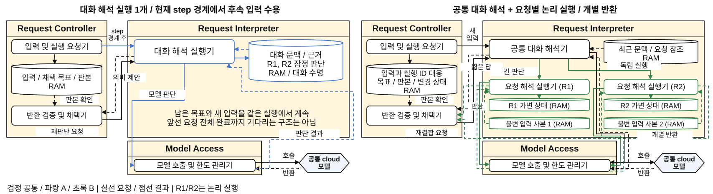
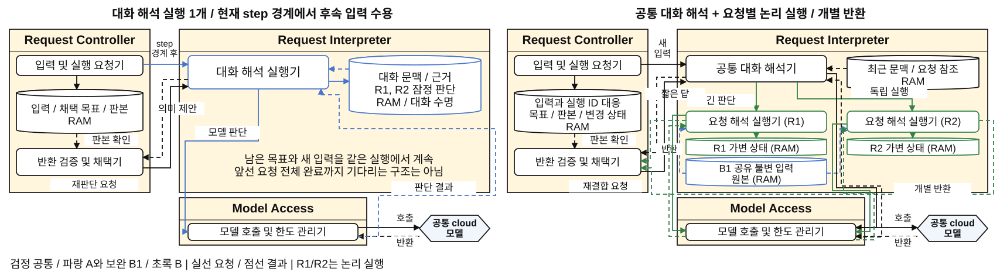
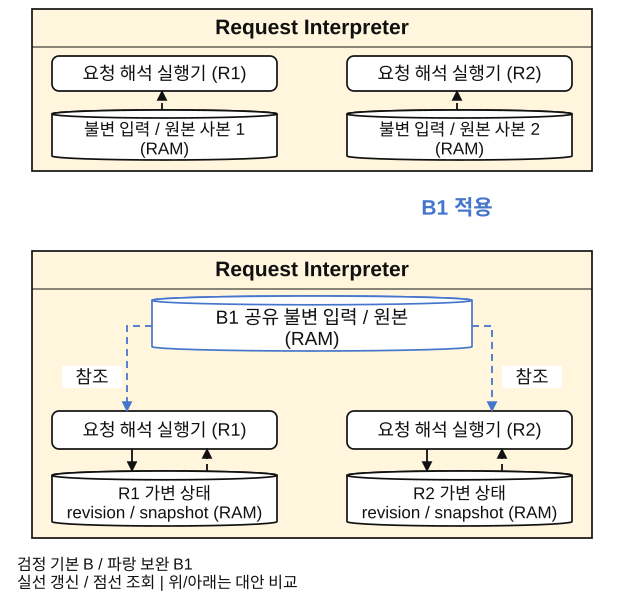
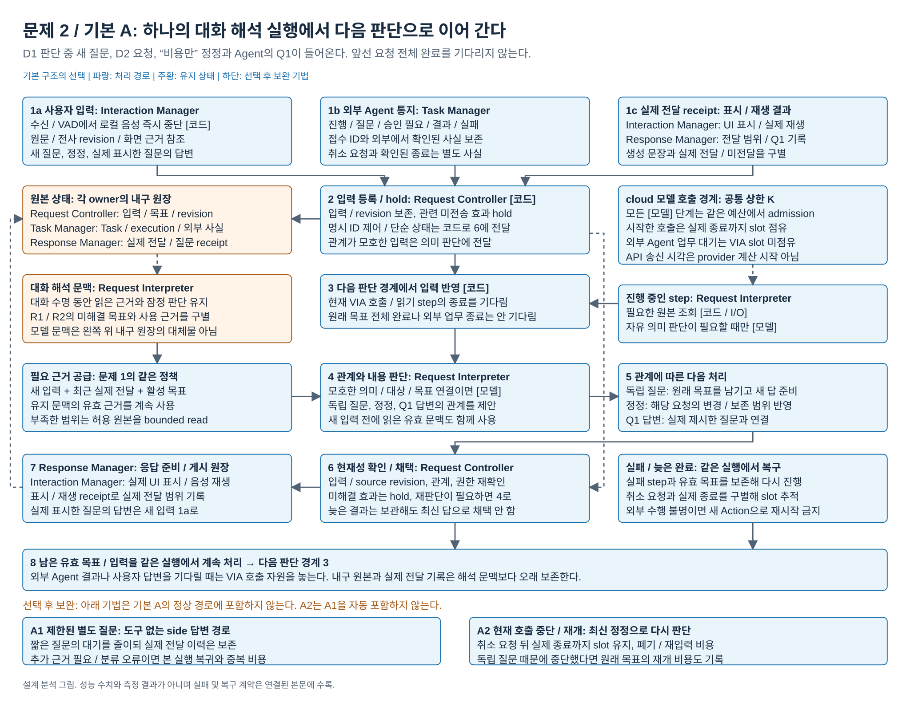
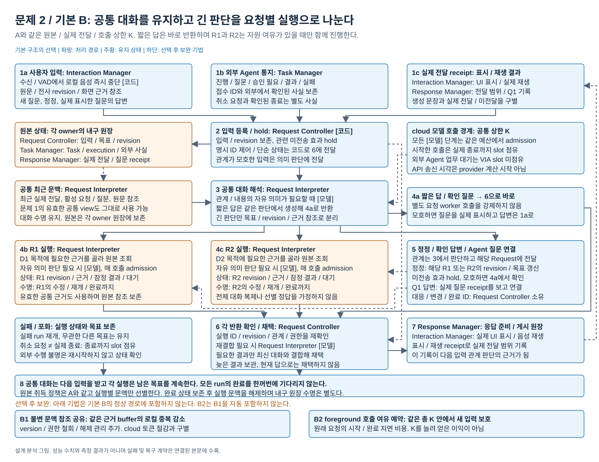

# 후속 입력의 의미 판단을 어느 실행에서 진행할 것인가

2026-10-22 통합 현재 편집본. 아래에는 기존 기본안과 최신 v10 구조 보정을 함께 둔다. 이번 이관은 설계, 수치, 권고 또는 채택 상태를 새로 결정하지 않는다.

[현재 문서 안내](README.md) / [공통 QA](../qa/README.md) / [평가와 시나리오](../evaluation/README.md) / [현재 발표](../presentation/README.md)

## 현재 구조 보정: 논리 실행과 공통 모델 호출

[기본 설계 본문](#기본-설계-본문과-당시-평가-상태)의 A는 하나의 대화 의미 실행을 이어 쓴다. 진행 중인 모델 또는 읽기 step이 끝나면 새 입력의 관계와 내용을 같은 문맥에서 판단한다. 앞선 요청 전체나 외부 Agent 업무가 끝날 때까지 기다리는 설계가 아니다.

B는 공통 대화 해석과 요청별 논리 실행을 분리한다. 공통 경로에서 짧은 답을 직접 반환할 수 있고, 긴 판단이 필요할 때 요청별 실행을 만든다. 모든 입력에 공통 해석 호출과 요청별 호출 두 개를 강제하지 않는다. 각 결과는 Request Controller의 반환 검증 및 채택기로 따로 돌아오며 모든 실행의 완료를 기다리는 합류 장벽이 아니다. 현재 관계와 맞지 않으면 필요한 재결합 또는 재판단을 요청한다.

각 해석 Module에서 Model Access의 모델 호출 및 한도 관리기로 실제 요청과 반환을 잇는다. A의 한 대화 실행과 B의 공통 대화 및 R1/R2 실행이 같은 모델 호출 한도를 쓴다는 점을 보인다. 호출 여유가 없으면 B의 병행 이익이 줄어든다는 기존 조건을 유지한다. R1/R2는 논리 실행이며 OS process 또는 모델 복제의 수가 아니다.

| 상태 소유자 | A | B 및 B1 |
| --- | --- | --- |
| Request Controller | 입력, 채택 목표와 판본 | 입력과 실행 ID의 대응, 목표와 판본, 변경 상태 |
| Request Interpreter | 대화 수명의 근거와 요청별 잠정 판단 | 공통 최근 문맥과 요청 참조, 실행별 가변 상태 및 입력 자료 |
| B1이 바꾸는 부분 | 해당 없음 | 실행별 불변 입력과 원본 사본을 공유 참조로 대체. R1/R2의 revision, snapshot, 대기 및 복구 상태는 개별 유지 |

B1은 기존 B의 입력 복제 부담을 줄이는 보완이다. 상태 공유 범위를 불변 자료로 제한한다. 별도 응답 재생의 메모리 관측을 기본 실측값의 전후 개선으로 연결하지 않으며, 새로운 QA01, QA03 또는 정확도 개선으로 확장하지 않는다.

<a id="dp2-comparison"></a>
### 4.1 발표 6쪽: 기본안 비교



[draw.io 원본](../design-review/diagrams/dp2-v10-comparison.drawio) / [PNG](../design-review/diagrams/dp2-v10-comparison.png)

<a id="dp2-selection"></a>
### 4.2 발표 7쪽: 선택 및 보완



[draw.io 원본](../design-review/diagrams/dp2-v10-selection.drawio) / [PNG](../design-review/diagrams/dp2-v10-selection.png)

<a id="dp2-detail"></a>
### 4.3 발표 8쪽: B1 상태 상세



[draw.io 원본](../design-review/diagrams/dp2-v10-tactic-detail-left.drawio) / [PNG](../design-review/diagrams/dp2-v10-tactic-detail-left.png)


## 기본 설계 본문과 당시 평가 상태

아래 날짜와 실행 전 표현은 원문의 당시 상태다. 현재 평가의 종류와 적용 범위는 위 평가 안내에서 구분한다. 기본 구조는 앞의 최신 보정과 함께 읽는다.

2026-10-18 / 문제 2 독립 설계 분석 / 초기 권고 B

아래 B 추천과 미측정 표시는 설계 분석 시점의 기록이다. [15 보완 PoC 결과](../../seven-problem-review/15-corrected-poc-results.md#dp02-결과--후속-입력의-의미-판단-실행)에서 실제 호출 중첩과 고정 분모의 완료, 실패를 확인하고 호출 여유가 있는 B를 권고한다. K=1에서는 병행 이익이 사라졌다. [12 초기 PoC](../../seven-problem-review/12-poc-results.md#4-후속-입력의-의미-판단-실행)의 A 선택은 정정 복구 누락과 목표 모집단 오류로 현재 결론에 사용하지 않는다. 기존 구조와 초기 권고 이력은 보존한다.

## 0. 비교 그림


[편집 원본](diagrams/problem02-interpretation-execution.drawio) / [PNG](diagrams/problem02-interpretation-execution.png) / [전체 그림 안내](../../seven-problem-review/diagrams/README.md)

[기본 A 상세도](#detail-a) / [기본 B 상세도](#detail-b)

상세도는 입력, 번호 순서의 처리, 상태 owner와 수명, 조건부 모델, 정정/실패 경로를 표시한다. 하단 tactic은 기본에 자동 포함되지 않는다.

## 1. 결정과 핵심 이유

**긴 자료 조회와 의미 판단은 요청별 실행으로 분리하고, 새 입력의 관계를 해석하는 공통 대화 경로를 유지하는 B를 추천한다.** VIA가 앞선 문서를 설명할 준비를 하는 동안 들어오는 독립 질문이나 다른 업무의 질문을 현재 모델 호출 뒤로 미루지 않을 수 있기 때문이다. 그 대가로 실행별 문맥과 반환 상태, 관계 전달 및 재결합 비용을 감수한다.

이 권고는 **앞선 VIA 의미 호출과 독립 입력이 겹치며, 같은 총 예산 안에서 둘 이상의 호출이 실제 진행할 수 있는 사용 조건**에 근거한다. 외부 Agent가 장시간 업무를 수행한다는 사실만으로는 B가 유리하지 않다. 그 외부 대기에는 VIA 모델 호출을 붙잡아 두지 않으므로 A도 다른 입력을 처리할 수 있다. 호출 여유가 없거나 대부분의 해석이 짧으면 A의 문맥 재사용이 더 나은 선택일 수 있다.

핵심 trade-off는 **QA01 / QA03의 선행 판단 대기 감소 가능성 대 QA05의 문맥 / 재결합 비용과 QA06의 동시 상태 비용**이다. 네 축에 구조적 경로는 있지만 실측 차이나 점수 coverage는 아직 없다. QA02와 QA04의 우위를 이 비교의 필수 성공 근거로 만들지 않는다.

## 2. VIA의 문제와 용어

사용자가 D1을 설명해 달라고 한 뒤 VIA가 원본을 읽고 모델에 판단을 요청했다. 그동안 사용자가 “그건 계속하고 D2의 결론도 알려줘”라고 말하거나, 외부 메일 Agent가 수신인을 물을 수 있다. VIA는 새 입력에 응답하면서 원래 목표와 현재 조건을 보존해야 한다. **입력을 받는 것과 그 뜻을 판단하는 것이 같은 시각일 필요는 없다.**

| 표현 | 여기서의 정확한 의미 |
| --- | --- |
| 의미 판단 실행 | 원문과 근거, 잠정 판단을 유지하면서 모델 호출 / bounded read / 후속 판단을 이어가는 논리적 실행. OS thread나 process 하나와 같지 않음 |
| 같은 발화 안 정정 | “전체를, 아니 결론만”처럼 사용자가 뜻을 고침. VIA가 앞부분의 처리를 이미 시작했을 때만 실행 중 변경 사례. 시작 전이면 공통 입력 의미 처리 |
| 후속 발화 정정 | 별도 입력으로 이전 요청의 조건을 변경. 변경 대상과 보존할 조건을 판단해야 함 |
| 독립 질문 / 새 요청 | 앞선 목표를 바꾸지 않는 사용자의 추가 목표. VIA가 사용자에게 생성하는 확인 질문과 구별 |
| 사용자 확인 답변 | 실제 제시한 질문에 대한 새 사용자 입력. 도착한 최신 Agent 통지를 무조건 답변 대상으로 삼지 않음 |
| 외부 Agent 통지 | 진행, 추가 정보 요청, 승인 필요, 결과, 실패, 취소 확인 등 관측 사실. 완료만 뜻하지 않음 |
| ASR 부분 전사 교체 | 인식기의 근거 revision. 사용자 정정과 구별하며 이미 사용한 입력이면 영향받은 판단의 현재성을 확인 |

VIA는 요청 이해에 필요한 bounded read를 수행한다. domain planning과 외부 업무 실행을 자기 요청 실행으로 가져오지 않는다. 근거는 [공통 분석 기준](../../seven-problem-review/00-analysis-contract.md), [대표 UC-01/06/09~15/18](../../../../05-representative-use-cases.md)다.

## 3. 모든 안의 완료 조건과 비교 조건

1. 원문 입력과 revision, 미해결 목표, 실제 제시한 질문과 실제 표시 / 음성 전달 범위를 보존한다. 요청이나 Task 연결 정답은 입력으로 주지 않는다.
2. 해석 중에도 입력을 수신하고 사용자 발화 시작에 음성을 로컬에서 중단한다. 모호한 새 입력과 관련된 미전송 효과를 보류하고, 의미가 해소된 범위에서만 해제한다.
3. 오래된 결과는 관측 이력으로 남길 수 있지만 현재 revision의 답으로 자동 채택하지 않는다. 현재 권한, 근거 version과 취소 상태도 검사한다.
4. 음성 중단, VIA 호출 취소 요청, 실제 호출 종료, 외부 업무 취소 요청과 확인된 종료를 별도 사실로 남긴다. 불명인 외부 실행은 새 ID로 중복 시작하지 않는다.
5. 같은 cloud 모델, 호출 상한, 원본과 권한, 전체 로컬 RAM 조건을 사용한다. 단순 상태 코드 표시나 식별자가 명시된 제어는 양안 모두 코드로 처리할 수 있다. 모든 통지에 LLM을 강제하지 않는다.
6. queue와 실행 수, 완료 buffer에 상한을 두고 중요 입력 / 질문 / 결과를 임의 drop하지 않는다. 포화와 실패는 사용자에게 확인된 범위로 안내한다.
7. [근거 공급 문제](../../seven-problem-review/01-evidence-supply.md)의 근거 취득 정책, 원본 접근과 보존 조건을 양안에 같게 고정한다. B도 유지된 공통 대화 view에서 유효한 근거를 공급받을 수 있다. 이 비교를 위해 A만 유지 문맥을 제공하고 B의 근거를 없애지 않는다.

요청 완료는 정해진 목표의 상세 표시와 필요한 전체 음성 요약 준비까지다. 위임 목표에서 실제 Agent 결과 확인이 필요하면 그 사건까지 추적하지만 외부 업무 시간은 QA03에서 제외한다. 첫 수행 안내가 허용되는 목표는 양안 모두 실제 채택한 범위를 먼저 표시할 수 있다.

## 4. 기본안의 실행과 상태

### A. 하나의 대화 해석 실행에서 차례로 처리

```text
입력 / 통지 보존
    → 대화 해석 실행의 다음 판단 경계
    → 기존 근거 + 새 입력으로 관계와 내용 판단
    → 현재성 검사와 채택 → 실제 표시
    → 남은 유효 목표 계속
```

진행 중인 모델 호출 또는 읽기 단계가 끝나면 대기 입력을 같은 문맥에 반영한다. **앞선 요청 전체가 끝날 때까지 기다리지 않는다.** 새 독립 질문을 먼저 처리할 때 원래 목표와 잠정 상태를 보존한다. 외부 Agent 결과나 사용자 답변을 기다리는 동안에는 현재 호출 자원을 놓고 다른 입력을 처리할 수 있다.

대화별 해석 문맥에는 읽은 근거와 요청별 잠정 판단이 함께 있다. 채택된 목표 / 조건과 실제 전달 원본은 각각 Request Controller / Response Manager의 상태이며 모델 문맥이 원본은 아니다. 근거 부족이나 문맥 축소 후에는 같은 원본을 다시 읽을 수 있다.

A의 정상 이익은 같은 자료에 대한 후속 질문 / 정정에서 앞서 읽은 맥락을 연속해 사용하는 것이다. 모델 입력의 재사용이 실제로 요금 절감이 되는지는 provider의 입력 / cache 조건을 따로 센다. A는 하나의 거대 Module이나 긴 전역 lock을 뜻하지 않는다.

### B. 요청별 해석 실행과 공통 대화 조정

```text
입력 / 통지 보존 → 공통 대화 해석 → 짧은 답 / 확인 질문
                         ├→ R1 실행: 근거 읽기와 긴 판단
                         └→ R2 실행: 별도 근거 읽기와 판단
각 완료 → 현재 revision / 관계 / 권한 확인 → 필요한 재결합 → 실제 표시
```

공통 대화 해석은 최근 실제 전달과 활성 요청, 원문으로 새 입력의 관계를 판단한다. 짧은 질문은 이 자리에서 답할 수 있으므로 모든 입력에 router 호출과 worker 호출 두 개를 강제하지 않는다. 긴 읽기 / 판단이면 요청별 문맥과 실행을 만들고 다음 입력을 받을 수 있게 한다. 정정은 관계가 밝혀진 요청에 전달하며, 아직 모호하면 후보 관계를 보존하고 추가 근거 또는 확인을 구한다.

각 실행은 요청 revision, 사용 근거, 잠정 판단과 대기 조건을 가진다. Request Controller는 입력과 실행의 대응, 변경 / 완료 상태를 보존한다. 완료가 돌아왔을 때 현재 조건과 맞으면 채택하고, 불일치하면 보류 / 폐기 / 필요한 재판단을 한다. 같은 목표에 필요한 결과만 최신 대화와 다시 결합한다. 독립 실행마다 임의로 전체 대화를 복제하거나 모든 완료를 새 모델 호출로 요약하지 않는다.

B는 별도 process나 별도 모델을 요구하지 않는다. 공통 해석과 요청 실행들은 같은 모델 호출 예산을 경쟁한다. 요청 문맥이 분리돼도 미해석 입력의 관계를 이미 안다고 가정할 수 없으며, 기술적 revision 검사만으로 잘못 판단한 관계가 교정되지는 않는다.

### 공통 실패와 구조별 복구

| 사건 | A | B | 필수 최종 상태 |
| --- | --- | --- | --- |
| 현재 호출 실패 | 대화 실행의 실패 step과 유효 목표에서 재개 | 해당 요청 실행 실패를 공통 대화에 연결 | 다른 목표 보존, 이미 수행한 외부 Action 재시작 금지 |
| 정정 뒤 이전 결과 반환 | 시작 revision을 확인해 현재 판단에 사용 가능 범위를 결정 | 실행 ID / 요청 revision과 현재 관계를 확인 | 이전 조건을 최신 결과로 게시하지 않음 |
| 모델 호출 취소 불가 | 호출 비용은 남고 결과 사용을 막음 | 해당 실행이 점유한 자원을 실제 종료까지 추적 | 논리적 무효화만으로 호출 slot 반환했다고 가정하지 않음 |
| 연결 / Core 재시작 | 입력과 목표에서 하나의 해석 문맥 복구 | 요청별 ID와 상태를 대조하고 필요한 실행 재구성 | checkpointer와 외부 상태 확인 계약 없이 durable recovery 주장 금지 |

## 5. 같은 상황을 끝까지 비교

아래 S1~S6은 이 문서의 설계 장면이며 COMMON-28의 새로운 번호가 아니다. 같은 원본, 목표, 입력 순서, 총 호출 한도와 실제 전달 조건을 사용한다.

| 장면 | 공통 완료 조건 | 기본 A | 기본 B |
| --- | --- | --- | --- |
| **S1 쉬운 연속 질문**: D1 설명 뒤 “그 결론을 한 문장으로” | 이미 전달한 설명을 가리켜 후속 답 표시 | 같은 문맥에서 답 | 공통 대화에서 답. 요청 실행 추가 불필요 |
| **S2 긴 VIA 판단 중 독립 질문**: D1/D2 비교 판단 도중 “TCP와 UDP 차이도 알려줘” | 새 답과 원래 비교 둘 다 보존 | 현재 step 경계 뒤 새 질문 판단 | 호출 여유가 있으면 공통 대화가 먼저 판단. 반환 문맥의 추가 비용 |
| **S3 다른 자료의 새 요청**: D1 읽기 중 “D2 결론도 설명해줘” | 각 자료에 근거한 두 결과 | D1의 잠정 상태를 남기고 같은 실행으로 D2 처리 | R2 문맥을 만들어 독립 읽기 / 판단. 같은 자원 포화 시 둘 다 대기 |
| **S4 정정과 Agent 질문**: 비교 중 “비용만”, 메일 Agent 수신인 질문, 사용자 답변 | 비교 범위는 비용, 메일 답은 실제 질문에 연결 | 하나의 문맥에서 다음 경계에 관계 판단 | 공통 대화가 관계를 판단해 R1과 T1에 전달. 전달 / 재결합 비용 |
| **S5 포화**: 긴 요청들이 호출 한도를 사용 중 세 번째 질문 | 세 목표를 잃지 않고 실제 대기 안내와 결과 | 한 실행의 문맥 / 대기 상태 유지 | 실행은 분리돼도 여유가 없어 공통 해석 대기. B의 주 이익 소멸 가능 |
| **S6 외부 대기와 늦은 통지**: Agent 조사 중 일반 질문, 특정 Task 취소 뒤 늦은 결과 | 일반 답, 취소 확인 상태, 다른 Task 유지 | 외부 대기 동안 호출을 점유하지 않아 질문 가능 | 동일. 요청 분리만으로 외부 대기를 줄이지 못함 |

**S4의 실제 순서:** R1의 긴 판단 시작 → “비용만” 수신과 관련 미전송 효과 보류 → T1의 Q1 수신 / 저장 → VIA가 Q1을 실제 표시 → 사용자가 “김 대리에게” 답변 → R1의 이전 결과 반환. A는 첫 판단 경계 후 Q1을 처리하고, B는 호출 여유가 있으면 그 전에 처리한다. 답변 입력은 양안 각각의 Q1 실제 표시 뒤 동일한 사용자 지연으로 제공한다. 화면에 보이기 전 답변을 주어 B만 이롭게 만들지 않는다.

## 6. 세 주제의 독립성

### 문제 2와 DP-44의 2×2

| 조합 | 의미 실행과 다음 단계의 연결 |
| --- | --- |
| 문제 2 A + 44 A | 하나의 대화 문맥을 사용하는 의미 job들을 중앙 Dispatcher가 시작 / 회수 |
| 문제 2 A + 44 B | Stage들이 의미 입력을 연결하지만 같은 대화 의미 실행의 수용 순서를 지킴. Stage 수가 의미 실행 수가 되지 않음 |
| 문제 2 B + 44 A | Dispatcher가 공통 대화와 R1/R2 실행을 별도 job / continuation으로 관리. 중앙이라는 이유로 R1 전체 완료를 기다리지 않음 |
| 문제 2 B + 44 B | 공통 대화와 요청 실행의 결과를 Stage가 소비하고 join. 요청 문맥 수명과 단계 window는 별도 상태 |

### 문제 2와 DP-42의 2×2

| 조합 | 상태 / 서비스 조건 |
| --- | --- |
| 문제 2 A + 42 A | 하나의 의미 문맥, 모듈화한 통합 Core의 관련 상태 공동 확정 |
| 문제 2 B + 42 A | 여러 의미 실행, 같은 Core 안의 관련 상태 공동 확정 |
| 문제 2 A + 42 B | 대화 서비스에 하나의 의미 실행, 업무 서비스가 별도 접수 / 사실 소유 |
| 문제 2 B + 42 B | 대화 서비스에 여러 의미 실행, 업무 서비스와는 같은 독립 접수 계약 |

네 조합의 논리적 양립성을 설명한 것이며 실제 8개 전체 조합을 구현하거나 검증하지 않았다. 공통 의미 기능, 전체 호출 상한과 현재성 검사를 유지한 채 한 축씩 비교한다.

## 7. 실제 구현 근거와 VIA가 추가하는 것

고정 commit과 함수 위치는 [공식 근거 원장 E01~E05](../../../../../references/seven-problem-review/execution-lifecycle.md)에 있다.

| 참고 메커니즘 | 기본 구조에 준 근거 | 적용 한계 |
| --- | --- | --- |
| OpenClaw 같은 run steering | A의 동일 문맥과 다음 판단 경계 | 실행 중 도구 즉시 중단이나 VIA 정정 효력을 보장하지 않음 |
| OpenHands 수신 / step 분리와 I/O lock 해제 | A도 입력을 계속 받을 수 있다는 실제 근거 | background thread만으로 독립 의미 판단은 아님 |
| Deep Agents async thread / run | B의 별도 실행 식별과 완료 / update 경계 | 동일 VIA 대화로 질문 / 정정 재연결은 추가 설계 |
| Deep Agents Btw | A1의 도구 없는 별도 질문 | 주 checkpoint 불변. VIA는 실제 표시를 자기 이력에 저장 |
| Magentic-One shared ledger / 다음 참여자 | 동일 의미 문맥에서 다음 진행을 정하는 참고 | domain plan과 도구 실행은 VIA 범위 밖. 독립 사용자 입력 처리 증거 아님 |
| CrewAI async / Flow | 비동기 전달과 실행 의존을 따로 보아야 하는 대조 사례 | Flow 연결 자체는 문제 2 B의 요청 문맥 분리를 뜻하지 않음 |

## 8. QA 인과와 반증

다음 식은 같은 입력이 VIA에서 판단 가능해진 이후 경로를 설명한다. 실제 시간값을 대입한 예측이 아니다. 공통 전사와 수신 비용은 양안 원자료에 남긴다.

```text
A의 첫 표시까지 남은 시간 = W + H_A
B의 첫 표시까지 남은 시간 = H_B
B가 줄이는 시간 = W - (H_B - H_A)

W: 입력 도착 뒤 현재 VIA 모델 / 읽기 step의 경계까지 남은 대기
H: 실제 자원 admission, 문맥 준비, 관계 / 내용 판단, 채택, UI 표시 경로
```

`W`에 외부 Agent 업무 전체를 넣지 않는다. 한도가 포화되면 `H_B`에도 같은 선행 자원 의존이 생긴다. QA03은 실제 DAG를 입력 시작점에서 절단하고 외부 / 사용자 대기를 0으로 만든 기존 계산을 사용한다. 선행 호출의 잔여 구간을 dependency로 넣었다면 같은 queue 대기를 다시 더하지 않는다.

| QA | 기본 구조의 예상 차이 | 반증 / 비차별 조건 |
| --- | --- | --- |
| **QA01** | 겹침 S2/S4에서 B가 현재 의미 step 대기를 줄일 수 있음. 표시까지의 실제 경로 | 공통 해석이 길거나 slot이 없고 추가 문맥 준비가 W보다 큼. 첫 구체 안내를 양안 모두 이미 표시했다면 뒤의 차이는 이 QA에 미포함 |
| **QA03** | S3의 독립적인 VIA 읽기 / 판단 중첩과 S4의 관계 처리 앞당김 대 반환 재결합 비용 | 외부 대기만 길거나 request 의존이 실제로 순차이면 차이 없음. 원래 목표의 지연 악화도 함께 남김 |
| **QA05** | A의 유지 문맥 재사용 대 B의 실행 문맥 준비 / 반환 처리. 독립 자료가 많으면 B의 좁은 문맥이 더 저렴할 수도 있음 | `B의 분리 / 재결합 추가 사용량 + B의 요청별 입력 사용량 - A의 유지 문맥 입력 사용량`이 음수면 A 비용 우위 철회. 실제 rate / cache 적용 전 추정값으로 확정하지 않음 |
| **QA06** | B의 여러 활성 문맥, 요청별 직렬화와 대기 완료 상태 증가 가능. A도 미해결 목표와 근거를 보유 | 전체 로컬 동시 peak가 같거나 B의 짧은 문맥이 비용을 상쇄하면 차별 축 아님. cloud KV 제외, 512 MB 요구 유지 |
| **QA02** | 문맥 혼입과 분리 후 근거 누락의 실패 양상이 다를 수 있음 | 지칭 집합 정확도 우위는 미확인. Task / 질문 연결을 이 지표로 세지 않음 |
| **QA04** | 실행 대응 / 변경 전달 / 반환 계약 변경이 영향을 받을 수 있음 | C01~06은 같은 adapter에 끝날 수 있음. 실제 Rust patch 전 모듈 수나 우위 제시 안 함 |

QA01/03은 실제 첫 내용과 완료 경로의 산술평균이며 오답 시간을 그대로 기록하고 오류 표시를 붙인다. 정답이 나올 때까지 기다려 지연을 늘리지 않는다. 미응답을 삭제하지 않는다. QA05는 COMMON-28 전체 준비 / 폐기 / 재시도 / 음성 / 후속 청구를 포함한다. 이 작은 분석 장면의 비용을 전체 점수로 환산하지 않는다.

QA05/06에서 이 문제에 귀속하는 차이는 같은 근거 공급 정책 위에 추가한 실행별 문맥 준비 / 복제 / 반환과 실제 호출 입력 범위다. B가 좁은 입력을 구성하는 이익을 주장하려면 동일한 근거와 사용 가능 조건에서 그 실행 분리 때문에 달라진 부분을 보여야 한다. 근거 공급 문제의 유지 view 제거 또는 조회 정책 변경으로 생긴 절약을 이 문제의 구조 이익으로 옮기지 않는다. 하나의 호출에서 발생한 절약을 두 DP의 독립적인 절감량으로 합산하지 않는다.

**N-R 요청 관계 연결 정확도**는 별도 후보로 남긴다. 입력 revision의 최초 채택 관계 종류와 Request / Task / 질문 연결이 허용 정답 집합과 맞는지를 보며, QA02를 확장하지 않는다. 실행 분리만으로 정확도가 오르지 않으므로 주요 DP 포함을 N-R 차이에 의존시키지 않는다.

## 9. 선택 후 보완

번호는 자동 누적되지 않는다. 기본 B 대 B1, 기본 B 대 B2를 먼저 구별하며 결합은 B1+B2다. 모든 전후 값은 미측정이다.

| 보완 | 줄이려는 약점 / 목표 QA | 추가 처리 | 비용과 확인 조건 |
| --- | --- | --- | --- |
| **B1 불변 문맥 참조 공유** | 복수 실행의 로컬 buffer, QA06 | 같은 근거 조각은 공유하고 실행별 참조 / 변경분 유지 | version / 권한 철회 / 해제 관리와 직렬화 peak. 로컬 공유가 cloud 입력 토큰을 줄인다는 주장 금지 |
| **B2 foreground 호출 여유 예약** | 요청 실행이 공통 해석을 막는 포화, QA01 | 같은 총 호출 한도 안에서 새 입력용 여유를 남김 | 원래 요청의 시작 / 완료가 늦어짐. 새 질문이 드문 장면과 burst 모두에서 QA03 / QA05 확인 |
| A1 제한된 별도 질문 | A의 짧은 독립 질문 대기, QA01/03 | 도구 없는 side 답변과 실제 전달 기록 | 잘못된 독립 분류, 추가 자료 필요 시 본 실행 복귀와 중복 비용 |
| A2 현재 호출 중단 / 재개 | A의 정정 반영 대기, QA01/03 | 입력 보존 후 해당 판단을 취소하고 최신 입력으로 다시 판단 | 취소 완료 전 slot 보존, 폐기 토큰 / 재입력. 독립 질문이면 원래 목표 재개 비용 |

추천 B의 첫 보완 후보는 B2, 두 번째는 실제 RAM 중복이 있을 때 B1이다. B2의 예약은 실행 분리의 필수 기능이 아니라 포화 정책이다. A1에 장기 조회와 요청별 변경 / 완료 수명을 붙이면 기본 B로 접근하므로 작은 최적화로 숨기지 않는다.

## 10. 판정과 검증 가능한 변경 조건

### 최종 포함 판정

**주요 DP에 포함한다.** VIA 자체의 긴 의미 판단과 지속 입력이 겹칠 때 앞선 계산의 대기를 누구에게 부과할지 결정하며, model context와 활성 상태가 실제로 달라진다. 문제 2를 44의 중앙 / 단계 연결과 합치거나 44의 보완으로 내려놓지 않는다. 추천은 B지만 A가 불리한 전체 요청 동기 대기 모델이어야 성립하는 논리가 아니다.

**B를 선택하지 않을 조건:** 지원 provider가 실질적으로 하나의 의미 호출만 허용하고 bounded read도 매우 짧거나, 사용 패턴이 외부 업무 대기 중의 쉬운 질문에 집중돼 `W`가 거의 없다. 또는 반복 정정에서 B의 관계 전달 / 재결합 비용과 메모리가 이익보다 크면 A를 택한다. B2로 원래 요청을 계속 미루어 얻는 첫 응답 개선은 정당화 근거가 아니다.

### 이후 승인할 최소 검증 설계

- 한 대화, 두 문서와 최대 세 요청, 외부 Agent 두 개의 고정 사실 입력으로 S1~S6을 구성한다. 호출 한도 1 / 2를 양안 같게 적용하되 숫자는 비교 설정이며 실제 제품 처리량 주장이 아니다.
- S2/S4의 새 입력은 같은 논리적 모델 단계의 초반 / 중간 / 후반에 제공한다. 사용자 확인 답변은 각 안의 실제 Q1 표시 이후에만 제공한다. 숨긴 평가용 관계 정답을 후보에 전달하지 않는다.
- 먼저 같은 고정 모델 응답으로 실행 의존, 목표 보존, latest 검사와 실제 표시 경계를 확인한다. 이 단계는 의미 정확도나 실제 cloud 지연 평가가 아니다. 실제 모델 비교는 후속 승인과 고정 조건에서 따로 수행한다.
- 첫 표시와 기존 목표 완료, 모델 호출과 폐기 / 재시도, 현재 / 이전 revision의 채택, 모든 활성 상태의 동시 RAM을 함께 기록한다. 모델 API 요청 송신 시각을 provider 내부 실행 시작으로 간주하지 않는다.
- B가 S2/S4에서 `W`를 제거하지 못하거나, 가능한 병행 자체가 공유 자원 대기에서 사라지고 비용 / RAM의 상쇄 이익도 없으면 추천을 A로 변경한다. 반대로 A의 넓은 문맥 비용이 더 크면 A의 비용 이익 가설을 철회한다.

문서로 기본 선택과 반증 조건을 완성했으며 후보 구현, 모델 호출, 제품 테스트나 측정은 하지 않았다. 확정된 성능 coverage는 0개다.

## 부록. 방안별 상세 설계 그림

각 방안은 같은 기능 조건을 갖는다. 처리 순서와 상태/호출의 차이를 위 기본 비교 및 QA 표와 함께 읽는다.

<a id="detail-a"></a>

### 기본 A 상세도



[편집 원본](diagrams/problem02-A-detail.drawio) / [PNG](diagrams/problem02-A-detail.png)

<a id="detail-b"></a>

### 기본 B 상세도



[편집 원본](diagrams/problem02-B-detail.drawio) / [PNG](diagrams/problem02-B-detail.png)
