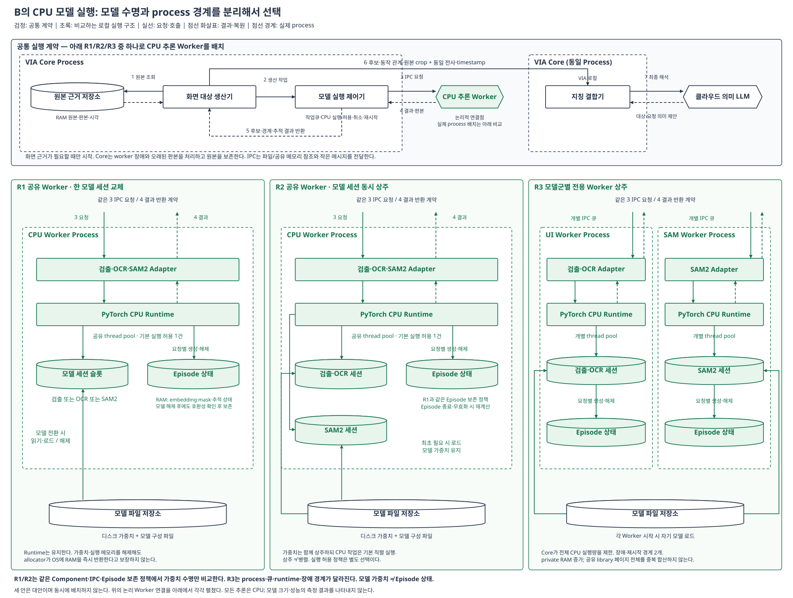

<a id="dp3-b-cpu-모델-실행-구조와-상주회수-대안"></a>
# DP3 B: CPU 모델 실행 구조와 상주, 회수 대안

2026-10-21 / 사용자 후속 지시: 이번 검토에서 512 MB 상한 적용 유보 / 설계 제안, 미구현, 미측정

**현재 비교 세트는 A, B-R1, B-R2, B-R3의 네 가지 완성 구성이다.** 사용자의 후속 제안에 따라 같은 grounding 문제의 구조 대안으로 함께 비교한다. [§11의 네 대안 비교](#11-a와-b-r1b-r2b-r3의-네-대안-비교)를 먼저 읽는다. 아래 R2 권고는 작성자의 검토 시작점이며 네 대안의 최종 선택이 아니다.

후속 [동일 시나리오 합성 QA 평가](../../seven-problem-review/dp3-grounding-architecture-20261021/synthetic-comparison/README.md)는 CPU 작업 가정과 원장으로 네 안의 수치를 계산하고 현재 QA 우선순위에서 A를 선택했다. 이는 그 가정 아래의 선택이며 실측 또는 제품 채택은 아니다.

R2는 별도 CPU 시각 worker에 공개 모델과 PyTorch를 두고, 필요한 모델을 처음 사용할 때 로딩한 뒤 활성 화면 상호작용 동안 유지한다. 두 모델을 RAM에 보관하는 것과 두 모델을 동시에 계산하는 것은 별개다. 모델 가중치, 입력별 영상, 추적 상태, runtime과 process의 수명도 각각 구별한다.

사용자의 현재 지시에 따라 **512 MB를 이번 설계의 상한이나 후보 배제 기준으로 쓰지 않는다.** 앞선 [소형 CPU 합성 예산](history/cpu-small-synthetic-budget.md)의 496 MB, 4초, 정확도 예시를 이번 구성의 성능으로 계승하지 않는다. QA06의 전체 VIA 동시 물리 RAM이라는 의미는 유지한다. 과거 정의, 점수, 결과와 다른 DP의 계약은 변경하지 않는다.

최신 발표용 구조는 [Component, 상태, 실행 계약](presentation-architecture-contract.md)과 [세 개의 구조 그림](design.md#현재-발표의-sw-구조-그림)에 정리했다. 기존 모델 구성, 수명 정책, QA 가정은 유지하고 책임과 process 배치를 구체화했다.

## 1. 실행 가능한 경로를 기준으로 모델 구성 고정

| 역할 | 이번 기준 모델 | 공개 크기와 실행 선택 |
| --- | --- | --- |
| OmniParser UI 후보 검출 | `icon_detect_v3`, YOLOv9-E 기반 | 공식 TorchScript artifact 약 **281 MB**. CPU FP32 경로를 사용한다. MIT이며 기존 작은 detector와 다름. |
| OCR | EasyOCR 한국어+영어 CPU 경로 | 검출, 인식 가중치를 별도로 포함한다. `gpu=False`, `quantize=False`로 첫 기준을 고정한다. 이것도 추가 learned weight이며 무료 메모리로 숨기지 않는다. |
| 아이콘 설명 | local Florence caption 미사용 | 최종 cloud 의미 LLM이 원본 crop과 후보를 함께 읽는다. UI 후보의 위치, OCR은 생산하되 local 자연어 설명을 의무화하지 않는다. |
| 필요한 정밀 분할/추적 | **SAM2.1 Hiera Tiny** | **38.9M parameter**, 공식 checkpoint 약 **156 MB**, CPU FP32 기준. |
| inference runtime | CPU PyTorch와 torchvision, 공개 모델 adapter | ONNX export와 INT8 변환 성공을 이 기본안의 선행 조건으로 두지 않는다. |

두 핵심 checkpoint 파일의 합은 약 437 MB이며 **실행 RAM 합계가 아니다.** OCR weights, Python/PyTorch, operator workspace, image embedding, video state와 frame buffer가 더 필요하다. SAM2 HF 디렉터리 합계 312 MB는 `.pt`와 `.safetensors` 두 사본을 포함한 것이며 선택한 형식 하나만 배포한다.

이전의 작은 `icon_detect`는 약 40.6 MB지만 AGPL-3.0이다. CPU 부담 최소화가 우선이면 이 별도 모델 구성을 비교할 수 있다. 이번 기준은 512 MB를 억지로 맞추지 않고 **상용 배포 조건을 고려한 MIT detector + 실제 최소 SAM2**로 정했다. v3가 가장 작은 detector라는 주장은 하지 않는다. 코드의 CC BY 4.0, OCR의 별도 license, SAM2의 Apache-2.0 등은 [앞선 license 구분](local-producer.md#7-라이선스와-상용-사용)을 유지한다.

공식 근거: [OmniParser v3 파일](https://huggingface.co/microsoft/OmniParser-v2.0/tree/main/icon_detect_v3), [CPU detector 구현](https://github.com/microsoft/OmniParser/blob/master/util/yolov9.py), [SAM2 모델 크기](https://github.com/facebookresearch/sam2#model-description), [Tiny checkpoint](https://huggingface.co/facebook/sam2.1-hiera-tiny/tree/main), [EasyOCR CPU API](https://www.jaided.ai/easyocr/documentation/)

## 2. 모델, runtime, executable, process는 다른 것

| 구성 | 실제 의미 | 이 안에서의 예 |
| --- | --- | --- |
| 모델 파일 | 학습된 숫자와 형식에 따라 계산 graph/구조 정보 | `model.pt`, `sam2.1_hiera_tiny.pt`, OCR weights, YAML |
| 모델 adapter | 입력 resize/좌표 변환, model 호출, decode/NMS, 결과 schema 변환 | OmniParser adapter, OCR adapter, SAM2 adapter |
| 추론 runtime | tensor 연산, CPU kernel, 메모리 할당, thread pool을 제공하는 라이브러리 | PyTorch CPU native libraries |
| 실행 프로그램 | adapter와 runtime을 시작하고 요청을 받는 프로그램 | bundled Python과 `via_vision_worker`, 또는 이를 감싼 executable |
| process | OS가 관리하는 주소 공간, 실행, 장애 경계 | VIA 본체와 별도의 시각 worker process |

**모델 파일을 실행하는 것이 아니라 worker 코드가 runtime을 통해 모델 파일을 로딩하고 계산한다.** runtime이 별도 서버여야 하는 것은 아니다. 한 process에 로딩된 runtime이 여러 모델을 실행할 수 있다.

OmniParser v3의 `.pt`는 `torch.jit.load`로 읽는 TorchScript 파일이다. SAM2의 `.pt` checkpoint는 공개 모델 코드, 설정으로 구조를 구성하고 weight를 읽는 방식이다. 확장자가 같다고 필요한 실행 코드가 같은 것은 아니다. [SAM2 builder](https://github.com/facebookresearch/sam2/blob/main/sam2/build_sam.py)

제품 설치물의 예는 다음과 같다. 아래는 패키징 설계이며 생성된 executable이 아니다.

```text
VIA/
  via.exe                         # Rust UI / 요청 제어 / 음성 연동
  vision/
    python/python.exe             # 제품에 동봉한 interpreter
    app/via_vision_worker/         # IPC, adapter, queue, 수명 관리
    lib/                          # CPU PyTorch / torchvision / OCR / SAM2 패키지
      sam2/configs/sam2.1/sam2.1_hiera_t.yaml
    models/
      manifest.json               # model·adapter 판본, hash, license
      icon_detect_v3/model.pt
      sam2.1_hiera_tiny.pt
      ocr/...
```

VIA 본체가 bundled `python.exe -m via_vision_worker`를 child process로 시작하고 named pipe로 통신하는 방식이 첫 구현 경로다. 모델 파일은 설치/업데이트 때 준비하고 사용자 요청마다 내려받지 않는다. `via-vision-worker.exe`로 포장해도 안에 interpreter/runtime/native libraries가 필요하다는 사실은 달라지지 않는다. Python console 출력과 IPC framing은 분리한다.

native Rust/C++ worker가 `onnxruntime.dll`과 `.onnx`를 호출하는 배포도 가능하다. 다만 모델 export, 출력 동등성, SAM의 영상 반복, 상태 계약과 전후처리를 옮기는 별도 작업이다. PyTorch 모델 전체가 `.onnx` 파일 하나로 자동 대체된다고 가정하지 않는다. [ONNX Runtime C 배포](https://onnxruntime.ai/docs/get-started/with-c.html)

## 3. 코드에서 실제로 호출되는 층

아래는 공식 API를 이용한 설명 코드이며 이 저장소에 구현, 실행한 worker가 아니다. 오류 처리, IPC, revision, 전처리를 생략한 전체 제품 코드로 사용하지 않는다.

```python
# worker startup: inference 전에 CPU thread 예산 설정
import torch
torch.set_num_threads(4)         # 설명용 예산, 최적값 또는 코어 예약 보장 아님
torch.set_num_interop_threads(1)

# 필요한 모델을 최초 사용할 때 load; 이후 dictionary/session으로 유지
detector = torch.jit.load(
    "models/icon_detect_v3/model.pt", map_location="cpu"
).eval()

from sam2.build_sam import build_sam2
from sam2.sam2_image_predictor import SAM2ImagePredictor
sam = build_sam2(
    "configs/sam2.1/sam2.1_hiera_t.yaml",
    "models/sam2.1_hiera_tiny.pt",
    device="cpu",
)
predictor = SAM2ImagePredictor(
    sam, max_hole_area=0, max_sprinkle_area=0
)

with torch.inference_mode():
    predictor.set_image(rgb_image)
    masks, scores, logits = predictor.predict(box=candidate_box)
```

detector 호출에는 공식 adapter의 letterbox, normalization, decode, NMS와 좌표 복원이 추가된다. `model(image)` 반환만으로 최종 UI 후보가 완성되는 것은 아니다. SAM2 image predictor는 image embedding 등 가변 상태를 갖는다. 같은 model weight를 사용하더라도 다른 요청의 predictor 상태를 섞지 않는다. 영상용 predictor도 모델 weight와 별도의 `inference_state`를 관리한다.

SAM2는 `device="cpu"`와 CUDA extension을 빌드하지 않는 공식 설치 경로가 있다. CUDA 기반 작은 구멍/점 제거 후처리를 끈 조건을 공통 모델 계약에 기록한다. 공식 설치 안내는 Linux 중심이고 Windows에서는 WSL을 권장하므로 **CPU 실행 API가 있다는 사실과 native Windows 제품 패키징을 검증했다는 사실은 구별한다.** 이번에 모델을 설치하거나 실행하지 않았다. [공식 설치](https://github.com/facebookresearch/sam2/blob/main/INSTALL.md), [CPU thread API](https://docs.pytorch.org/docs/stable/generated/torch.set_num_threads.html)

## 4. B에 필요한 논리적 구성과 소유 상태

아래는 이번 비교의 책임 이름이며 Reference Architecture의 Component를 개명하거나 전부 별도 서버로 만드는 것이 아니다.

| 구성 | 소유 책임/상태 | 주요 관계 |
| --- | --- | --- |
| 화면 대상 생산기 | 어떤 역사 구간, capability로 후보를 생산/확장할지 제어 | 원본 근거 저장소, 모델 실행 제어기, 지칭 결합기 |
| 모델 실행 제어기 | worker 기동/건강 상태, CPU admission, queue, 모델 load/회수 정책, 실행 generation | worker IPC, 요청 취소, 모델 manifest |
| 모델 adapter | 모델별 전후처리, 좌표, schema 변환 | runtime과 현재 model session |
| 모델 session 저장 | 로딩된 가중치와 모델 실행 객체, 사용 중 참조 | adapter, 실행 제어기 |
| episode 상태 저장 | frame/embedding/mask/track의 요청별 상태와 수명 | SAM adapter, source/input revision, close/rebuild |
| 대상, 동작 기록 | 후보 ID, 경계, 시간 대응, 기하 관계, 불확실성과 원본 참조 | producer가 갱신, binder가 읽음 |

이름이 여러 개라고 executable이 여러 개인 것은 아니다. 첫 구현에서는 실행 제어기의 제품 측 부분은 Rust, adapter/session/episode 관리의 실행 부분은 worker에 두고 명확한 IPC 계약으로 연결한다. queue/broker를 위해 별도 메시지 서버나 영구 graph DB를 추가할 필요는 없다.

IPC의 최소 요청은 `job_id, request_id, input_revision, source_revision, capability, frame_refs, coordinate_transforms, seed_or_prompt, model_generation`이다. 응답은 같은 판본과 `candidate_or_mask_refs, uncertainty, model_version, error`를 포함한다. 실제 frame은 공유 메모리 핸들 또는 권한이 확인된 local 파일 참조로 전달하고, 긴 영상, mask 전체를 JSON에 반복 복사하지 않는다. shared buffer의 소유자, 읽기 완료, 해제 acknowledgement도 계약에 포함한다.

`EnsureModel`, `RunUI`, `RunSegment`, `RunTrack`, `CloseEpisode`, `ReleaseModel`, `Cancel`, `Shutdown`은 서로 다른 동작이다. 외부 의미 모델은 별도 cloud 의존이며, local producer의 raw 확대, 후보 확장 계약은 유지한다.

## 5. 네 가지 수명을 따로 관리한다

| 상태 | 무엇이 남는가 | 다시 사용할 때 드는 비용 |
| --- | --- | --- |
| process 없음 | 디스크의 프로그램/가중치와 VIA가 보존한 원본/결과 | process 시작 + interpreter/import + runtime + 모델 load |
| runtime만 유지 | process, runtime/thread pool, model weight 없음 | 모델 생성/가중치 load/초기화 |
| 모델 유지, episode 없음 | runtime과 detector/OCR/SAM weight, session | 입력 decode, 전처리, embedding/추적 상태 생성 |
| 모델과 현재 episode 유지 | 위 상태 + 관련 frame/embedding/memory bank | 재사용 가능한 부분을 제외한 새 추론 |

모델 상주가 모든 영상, 추적 tensor의 무기한 보존을 뜻하지 않는다. `CloseEpisode`는 큰 입력 상태의 수명을 끝내되 모델은 남길 수 있다. `reset_state` 호출 하나가 영상, feature까지 포함한 모든 RAM을 회수한다는 보장은 없다. 참조 제거 후에도 allocator가 메모리를 보관할 수 있으므로 “해제 API 완료”와 “실제 RAM 반환”은 다른 관측이다.

강제 회수가 필요하면 worker 종료가 그 process의 private 메모리를 반환하는 경계가 된다. OS file cache나 다른 process와 공유된 페이지까지 전부 사라지는 것은 아니다. process 종료 비용과 재기동은 다음 요청 지연에 포함한다.

## 6. 실제로 비교할 세 실행 구성

R1/R2/R3은 새 DP 번호나 기존 A/B의 개명이 아니다. B 내부의 실행 구성 비교 표기다.



[편집 가능한 draw.io](history/diagrams/runtime-residency.drawio) ,  [생성 소스](../../seven-problem-review/dp3-grounding-architecture-20261021/diagrams/generate_runtime.py)

| 항목 | R1 공유 worker, 필요 모델 적재 | R2 공유 worker, 모델 상주 | R3 모델군별 전용 worker, 상주 |
| --- | --- | --- | --- |
| process | 시각 worker 1개 | 시각 worker 1개 | UI worker와 SAM worker 2개 |
| runtime | 하나 유지, model session 교체 | 하나에서 여러 session 유지 | process별 runtime, allocator, thread pool |
| model RAM | 현재 필요한 stage 중심 | detector/OCR/SAM 가중치 유지 | 모델군별로 가중치 유지 |
| queue/CPU | 공유 queue와 한 시각 stage admission | 공유 queue와 한 시각 stage admission을 기본으로 함 | 각 queue + 전체 CPU admission/배분 |
| 반복 요청 | load/init 반복 가능 | 이미 준비된 모델 재사용 | 해당 worker 모델 재사용 |
| episode | 별도 공통 보존 정책. model unload만으로 자동 폐기하지 않음 | R1과 같은 보존 정책으로 residency 효과를 비교 | 각 worker의 scene state, 공통 source 판본으로 연결 |
| 실패 | worker 실패 시 전체 시각 실행 재기동 | 같은 실패 영향, 상주 session도 함께 손실 | 한 worker 실패의 process 영향 분리. 의존 작업까지 성공하는 것은 아님 |
| 대가 | 모델 전환, 재로딩, 회수 관리 | 상주 RAM, 긴 작업의 공유 queue 대기 | private RAM, IPC, 배포, 회복 계약 증가 |

**R1과 R2는 같은 Component 배치와 IPC로 구현할 수 있다.** 차이는 모델 상태 수명과 실행 전제다. R3에서는 process와 장애, 업데이트 경계, 개별 queue가 실제로 추가된다. 상주 여부 하나만으로 Component가 자동으로 하나에서 둘로 바뀌지 않는다.

세 축은 독립적이다: (1) 필요 적재/상주, (2) 공유/전용 process, (3) 순차/제한 병렬 실행. 예를 들어 **한 process에 둘 다 상주 + 순차 계산**은 자연스러운 조합이다. 공유 적재와 전용 상주만 비교해 중간 조합을 숨기지 않는다.

R3에서 runtime 코드의 디스크 사본이나 공유 물리 페이지를 무조건 두 배로 계산하지 않는다. process별 private 객체, allocator, 상태와 실제 사본은 추가될 수 있다. 같은 checkpoint가 두 worker에 각각 로딩되면 해당 weight의 중복도 따로 확인한다.

## 7. 동일 사건에서 시간 차이가 생기는 위치

사용자가 두 카드를 가리켜 요청하고, 화면 이동 뒤 “아니, 이건 빼고”라고 정정하는 장면이다. native 변환이 없어 SAM이 필요한 경우로 둔다.

1. 공통 화면 gate 이후 UI 후보가 필요하다. R1은 UI 모델 load 후 생산한다. R2/R3도 최초 사용이면 load하며 상주 이후 요청에서만 이를 생략한다.
2. 시간 대응이 필요해 SAM을 호출한다. R1은 UI model session과 작업공간을 회수하고 SAM을 load한다. 별도 보존 중인 episode는 자동 폐기하지 않는다. R2는 이미 로딩된 SAM이 있으면 CPU 실행권을 받아 실행한다. R3도 seed가 UI 결과에 의존하면 기다려야 한다.
3. binder가 후보 누락으로 UI 확대를 요청한다. R1은 UI 모델을 다시 load할 수 있다. R2는 기존 모델로 실행하며 필요한 원본을 읽는다. R3는 UI worker를 호출한다.
4. 후속 정정에서 같은 이미지 embedding/track이 유효하면 재사용할 수 있다. 모델만 남기고 episode를 닫았다면 R2도 embedding을 다시 계산해야 한다. R1도 같은 보존 정책 아래 유효한 embedding/track과 작은 후보 기록을 재사용할 수 있다.

```text
요청 지연 = queue + [process/runtime 준비] + [모델 load/session 준비]
           + 입력 준비 + 추론 + [버린 episode의 재구성]
           + 결과 전달 + cloud 의미 해석/채택
```

대괄호 부분은 해당 상태가 없을 때만 발생한다. **모델 상주 자체가 제거하는 것은 모델 load, session 초기화 비용이다.** embedding, 추적 상태의 재계산 절감은 별도의 episode 보존 정책 효과이며 모델 상주 효과로 중복 귀속하지 않는다. R1도 model weight를 내린 동안 유효 episode를 보존할 수 있다. 재로딩 후 같은 모델 판본, 전처리, source에 호환되는지 확인해 재사용하고, 호환되지 않으면 재생산한다. R1/R2의 residency 효과만 비교할 때 episode 보존 조건은 동일하게 둔다.

CPU의 본 추론량은 상주만으로 줄지 않는다. OS file cache로 두 번째 load가 빨라도 모델 구성, tensor 초기화가 사라진 것으로 보지 않는다. memory pressure로 paging이 생기면 상주가 오히려 느릴 수 있다. startup preload는 비용을 앱 시작이나 유휴 구간으로 옮기는 것이며 전체 비용을 없애지 않는다. weight preload는 지칭 의미를 미리 확정하는 speculative execution과 다르다.

메모리의 비교 구조는 다음과 같다. 수치 추정식이 아니라 비용 귀속을 설명하는 식이다.

```text
R1: 공통 runtime + 현재 stage weight/작업공간 + 보존 episode/결과 + 전환 임시 상태
R2: 공통 runtime + 모든 resident weight + 현재 stage 작업공간 + 보존 episode/결과
R3: process별 private runtime/state + 각 weight + 동시에 활성화한 작업공간 + IPC 상태
```

항상 전체 VIA의 동시 physical RAM peak를 본다. 유휴 RAM만 줄었다고 QA06 peak가 같은 폭으로 줄었다고 주장하지 않는다. SAM activation, 영상 cache가 peak를 지배하면 weight 교체의 상대 이익은 작을 수 있다.

<a id="8-시간메모리-배분이-실제로-바꾸는-계약"></a>
## 8. 시간, 메모리 배분이 실제로 바꾸는 계약

### CPU 시간과 작업 admission

- 시각 stage를 시작하기 전에 실행권을 얻는다. 기본 R2에서는 한 시각 stage만 실행하되 내부 tensor 연산은 설정한 CPU thread pool을 쓸 수 있다. ASR는 독립된 실행, thread 예산으로 계속 동작한다.
- `set_num_threads(4)`는 네 코어를 독점 예약하는 명령이 아니다. OS는 다른 앱과 ASR도 scheduling한다. 필요하면 affinity/priority를 별도 정책으로 적용하고 실제 음성 입력 지연을 확인해야 한다.
- SAM 영상은 frame 또는 작은 batch 경계에서 취소, 새 input revision, 대기 작업을 확인한다. 하나의 긴 native 연산을 임의의 짧은 시간 단위로 안전하게 선점할 수 있다는 가정은 하지 않는다.
- 독립된 요청은 병렬화할 수 있지만 한 요청에서 UI 후보를 SAM seed로 쓰는 의존은 유지된다. worker를 둘로 늘려도 그 의존이 사라지지 않는다.
- ONNX로 후속 전환하더라도 세션별 기본 thread pool 경쟁을 관리해야 한다. 공통 thread pool과 allocator 공유는 가능한 구현 수단이다. [thread 관리](https://onnxruntime.ai/docs/performance/tune-performance/threading.html), [allocator 공유](https://onnxruntime.ai/docs/performance/tune-performance/memory.html)

### RAM 배분과 수명

- resident weight 예산, 활성 추론 workspace, episode frame/object 상태를 구별한다. “모델별 1 GB”는 보통 메모리를 물리적으로 잘라 주는 것이 아니라 admission, 회수, 할당 제한 계약이다.
- 사용 중 참조가 있는 model/episode는 회수하지 않는다. 새 작업의 예상 메모리가 부족하면 기다리게 하거나 사용하지 않는 episode/session을 닫는다. 어떤 처리를 지연, 재구성했는지 기록한다.
- 원본은 공통 보존 계약을 유지한다. 영상 구간을 잘라 처리하더라도 필요한 근거를 버리거나 구간 사이의 객체 동일성을 임의로 이어 붙이지 않는다. 연결이 불확실하면 확장/재추적한다.
- source/input revision과 model generation을 결과에 붙인다. worker를 재시작한 뒤 도착한 옛 generation의 결과는 채택하지 않는다. 원본, seed를 이용한 재생산을 허용하되 빈 후보를 정상 성공으로 반환하지 않는다.

**작은 모델보다 영상 상태가 더 큰 경우도 있다.** 공식 SAM2의 기본 frame loader는 `N×3×1024×1024` FP32 배열을 만든다. 이 배열 하나만 frame당 12 MiB, 60 frame이면 720 MiB(약 755 MB)다. 이는 공식 코드에서 계산한 크기이며 VIA 실행 측정이 아니다. runtime, activation, mask, weight는 별도다. async frame loading도 이미 읽은 frame을 계속 cache할 수 있어 상수 메모리 streaming을 자동 보장하지 않는다. 따라서 관련 clip 범위와 episode 수명이 명시적인 Architecture 계약이어야 한다. [공식 loader](https://github.com/facebookresearch/sam2/blob/main/sam2/utils/misc.py)

## 9. QA와 DP 판단

아래는 **같은 B 모델, 정밀도, 입력, 보완 경로**에서 R1과 R2를 비교한다. A 원본 직접 해석 대 B의 정확도 가설과 섞지 않는다.

| QA | 필요 적재 R1과 상주 R2의 예상 |
| --- | --- |
| QA01 첫 응답 | 반복 화면 지칭, 후속 정정에서 R2가 load/init을 줄임. 최초 사용에는 준비 비용이 남음. |
| QA02 지칭 정확도 | 상주 정책 자체는 구조적 동점. 회수한 상태를 같은 원본에서 복원하면 정확도가 낮아지는 것이 필연이 아님. |
| QA03 VIA 처리시간 | R2가 재로딩, model session 초기화를 줄임. episode 보존/재계산 조건은 R1과 동일하게 비교. CPU 추론, queue, ASR 경합은 계속 포함. |
| QA04 실제 Rust 변경 모듈 수 | 같은 Component에 정책만 달라질 수 있어 우열 미확정. R3의 독립 교체 이익과 IPC/복구 계약 변경 비용은 같은 변경 과제로 판단. |
| QA05 청구 모델 사용 비용 | 같은 cloud 요청이면 구조적 동점. CPU 전력, local RAM을 cloud 요금으로 환산하지 않음. |
| QA06 최대 RAM | R1의 적은 resident weight가 이익. 실제 전체 peak는 영상 상태, workspace, load overlap에 좌우됨. 512 MB 상한은 이번 비교에 적용하지 않음. |
| 새 QA07 요청 의미 정확도 | 같은 입력과 해석을 유지하면 상주만으로 정확도 우위 없음. |

timeout, 누락, 재시도나 불완전 복구가 다르면 관측 정확도에도 차이가 날 수 있지만, 이를 상주의 본질적 의미 이해 우위로 만들지 않는다. 실패를 그대로 기록하고 공통 완료/복구 계약을 적용한다. QA01/03의 공통 ASR 발화 중 완료분과 기존 외부/사용자 대기 제외 규칙을 유지한다.

**기존 DP3의 A/B는 해석 책임과 중간 표현의 비교이고, 이번 문제는 B의 자원, 상태, 장애 경계 비교다.** 이번 구조는 QA01, 03과 QA06의 실제 손익이 뚜렷하므로 중요한 실행 설계로 다룰 가치가 있다. 같은 worker의 TTL 설정 차이만으로 별도 주요 DP를 확정하지 않는다. 공유 교체 worker와 독립 상주 worker의 큐, 복구, 배포 계약이 실제 제품의 중요한 차이를 만드는지까지 확인하면 별도 구조 후보로 발전시킬 수 있다. 정확도 차이를 꾸며 coverage를 채우지 않는다.

## 10. 이번 기준 권고

1. 공개 FP32 모델 + CPU PyTorch를 별도 시각 worker 하나에 배치한다. UI/capture/ASR 본체에 무거운 시각 호출을 직접 끼워 넣지 않는다.
2. **R2를 기본 실행 구성으로 검토한다.** 각 모델은 처음 필요한 시점에 로딩하고 활성 화면 상호작용 동안 유지한다. 현재 producer/binder 작업과 사용 중 참조가 모두 끝난 뒤 session은 유휴 정책에 따라 유지, 회수하고, episode는 별도 close 계약으로 관리한다. 모든 앱 요청마다 두 모델을 강제로 실행하거나 시작 시 둘 다 무조건 preload하지 않는다.
3. 두 모델군이 로딩된 뒤에도 한 시각 stage씩 실행하는 CPU admission을 기본으로 둔다. concurrency 확대는 실제 독립 작업과 CPU 여유를 확인한 후 별도로 적용한다.
4. 모델 session과 episode 상태의 수명을 분리한다. 같은 장면의 유효 embedding은 재사용하지만 종료한 영상의 tensor를 무기한 보존하지 않는다.
5. 장기 유휴, memory pressure 시 미사용 session을 회수하고, 실제 반환이 필요하면 worker를 종료한다. 그 뒤 요청은 cold-start로 기록한다. 임의 TTL이나 성능 수치를 지금 고정하지 않는다.
6. 독립 장애 복구, 다른 runtime 요구, 동시 workload가 실제로 중요해질 때 R3로 분리한다. Component 수를 늘리는 것 자체를 설계 이익으로 삼지 않는다.

이 권고는 작성자 설계 제안이며 A/B 승자, 제품 채택, CPU 성능 측정이 아니다. 새 model run, export, 패키징, 설치, commit/push는 수행하지 않았다. [검토 기록](review.md)에 공식 근거 조사와 구조 검토의 범위를 구분한다.

## 11. A와 B-R1/B-R2/B-R3의 네 대안 비교

사용자는 R1/R2/R3을 A와 함께 비교하는 네 가지 대안을 제안했다. **같은 사용자 문제를 해결하는 완성된 Architecture 구성으로 네 안을 한 DP에서 비교하는 것이 적절하다.** B 내부 실행 설계라는 이유로 비교 대상에서 제외하지 않는다. 해석 구조, 모델 수명, process 배치, 동시 실행은 독립 축이므로 각 완성 구성에 포함된 선택과 실제 효과의 원인을 공개한다.

공통 질문은 **“당시 화면, 음성을 연결하기 위한 시각 해석을 어디서 수행하고, 그 실행 자원과 상태를 어떻게 소유, 유지할 것인가?”**다. A의 원본 직접 해석과 B의 생산자, 후보 기록, 결합 계약은 유지한다. 새로운 DP 번호, QA 정의, 우선순위, 제품 승자나 측정 결과를 확정하지 않는다.

| 완성 대안 | 구조 | 선택할 이유 | 받아들이는 비용 |
| --- | --- | --- | --- |
| A | 원본 화면, 행동 이력을 cloud 의미 LLM이 직접 해석 | 로컬 시각 생산 대기와 추가 모델 상주를 피하고, 모델이 원본에서 자유롭게 후보를 구성 | 복잡한 화면의 경계, 동일성, 집합 해석을 의미 모델에 맡김. 확대, 재조회와 입력 비용 가능 |
| B-R1 | local 시각 생산 + 공유 worker에서 필요 모델 교체 | B의 명시적인 시각 후보를 활용하면서 resident weight를 줄임 | 모델 교체, 재로딩과 회수 관리 |
| B-R2 | local 시각 생산 + 공유 worker에 모델 유지 | B의 후보 구조와 반복 로딩 절감, 공통 runtime, 큐 관리 | 상주 RAM, 공유 실행권, 장애 경계 |
| B-R3 | local 시각 생산 + UI/SAM 전용 worker에 모델 유지 | worker별 장애, 재시작, runtime 격리. 독립 작업의 자원 배분 | 추가 private 상태, IPC, 큐, 복구 계약, CPU 경합 관리 |

### 11.1 QA01~07 비교

아래는 구조적 예상과 조건이며 실측 순위가 아니다. B 세 안의 모델, 정밀도, 후보 생성, 원본 보완, episode 보존은 동일하다. A도 원본 crop, 조회, 재사용과 독립 조회 병렬화를 할 수 있다. cloud 의미 모델, S2S와 local ASR/timestamp는 공통이다. CPU 총예산을 같게 두고 모든 대안의 음성 입력 지속을 포함한다.

| QA | A | B-R1 | B-R2 | B-R3 |
| --- | --- | --- | --- | --- |
| QA01 첫 응답 | 쉽게 해석되는 신규 화면에서 local 생산 선행 단계가 없어 유리할 가능성 | 생산에 더해 cold load/모델 교체가 첫 구체적 채택 내용 표시를 지연할 수 있음 | 반복 사용에서 load/init 절감. 첫 cold 요청은 비용 남음 | warm 단일 의존 요청에서는 R2 대비 자동 우위 없음. 독립 작업의 대기 분리 시 개선 가능 |
| QA02 지칭 정확도 | 원본을 직접 읽음. 전문 후보 누락에 갇히지 않는 이점과 밀집 화면 해석 오류 가능성 | 전문 경계, 추적, 공간 관계가 오류를 줄이는 장면에서 A 대비 유리할 가설 | 같은 모델, 근거이면 R1과 구조적 동점 | 같은 모델, 근거이면 R1/R2와 구조적 동점 |
| QA03 VIA 처리시간 | 쉬운 신규 요청에서 선행 생산 비용 없음. 반복 raw 해석, 재조회가 길면 불리해질 수 있음 | 같은 B 처리에 모델 재로딩 비용 추가 | 반복 사용에서 R1의 load/init 비용 절감 | 독립 작업이 겹치면 queue 지연 감소 가능. 한 요청의 producer 의존은 유지 |
| QA04 실제 Rust 변경 모듈 수 | 모듈이 적다는 이유만으로 우승하지 않음. 동일 변경 과제로 확인 | 공통 producer/adapter/수명 계약의 변경 범위 확인 | R1과 같은 Component일 수 있어 차이 미확정 | process 분리는 Rust 수정 수 감소를 보장하지 않음. IPC/schema/감독 변경도 포함 |
| QA05 청구 모델 사용 비용 | 직접 전달 이미지와 확대, 추론 재호출 비용 | 후보화로 cloud 입력, 재호출이 줄면 A보다 낮을 가능성. 긴 후보, crop은 반대 효과 | 같은 cloud 입력, 호출이면 R1과 동점 | 같은 cloud 입력, 호출이면 R1/R2와 동점 |
| QA06 전체 VIA 최대 RAM | 추가 시각 모델, runtime 없이 유리한 기본 방향. 원본 buffer와 전체 peak는 포함 | B 중 resident weight 절감 | 여러 weight를 유지하는 비용 | process별 private 상태, allocator, IPC가 추가될 수 있음. 공유 페이지를 무조건 중복 계산하지 않음 |
| 새 QA07 요청 의미 정확도 | 대상, 조건, 이전 요청 관계 전체를 직접 해석 | 대상 오류가 줄어 전체 요청 정답으로 이어지는 경우 개선 가능 | 같은 의미 입력이면 R1과 동점 | 같은 의미 입력이면 R1/R2와 동점 |

QA02와 QA07의 같은 대상 개선을 서로 독립적인 두 이익으로 계산하지 않는다. B의 정확도 우위는 detector 누락, 잘못된 분할, track drift가 작고 전문 시각 처리가 실제 오류 원인을 줄이는 조건의 가설이다. R1/R2/R3의 상주, 격리만으로 정확도 순위를 만들지 않는다. 오류, timeout이 발생한 시도는 보존하되 정상 완료의 모델 이해 능력과 운영 실패 원인을 구별한다.

QA01은 일반 접수 안내가 아니라 첫 구체적 채택 내용의 실제 UI 표시 경계를 따른다. 오답 최초 표시도 시간과 오류를 함께 보존하며 이후 정답 시각으로 소급 교체하지 않는다. QA03과 QA05는 기존 전체 목표, 활동 묶음 경계를 유지하고, 처리 경로와 단일 요청 값은 원인 진단으로 구분한다. QA06은 512 MB 상한 적용을 이번 검토에서 유보하지만 실제 물리 RAM 측정 의미는 유지한다.

### 11.2 B-R3의 독자적 장점과 교차 조합

**단일 요청의 UI 후보 → SAM → 최종 결합은 R3에서도 순차 의존이다.** R2 대비 병렬 속도 이익을 자동 부여하지 않는다. 예를 들어 이전 장면의 SAM 작업이 실행되는 동안 별도 요청의 짧은 UI 검출이 필요하고 두 작업의 데이터 의존이 없을 때, R3는 UI worker에 별도 CPU 예산을 배정할 수 있다. R2 기본 순차 구성은 다음 양보 경계까지 기다린다. 같은 CPU 총예산을 나누면 각 stage가 느려질 수도 있으므로 큐 대기 감소와 처리시간 증가를 함께 비교한다.

이 동시 실행은 R3만의 고유 기능이 아니다. R2도 제한 병렬을 구현할 수 있다. **R2 제한 병렬이라는 교차 조합을 비교하면 병렬 admission의 효과와 process 분리의 효과를 분리할 수 있다.** 이것이 가능하다는 이유로 순차 기본안과 전용 worker 기본안의 비교를 폐기하지도 않는다.

R3 고유의 가장 명확한 이점은 **SAM worker의 native crash 또는 강제 종료, 재시작이 UI worker의 주소 공간과 상주 모델을 직접 제거하지 않는 것**이다. 이미 SAM 결과가 필요한 작업은 여전히 영향을 받지만, 독립적인 UI 작업까지 모두 재기동할 필요가 줄어든다. 서로 호환되지 않는 runtime 판본을 독립 유지하는 조건에도 가치가 있다. 이는 신뢰성, 운영 격리의 이점이며 현 QA04 변경 모듈 수로 바꿔 점수화하지 않는다. QA01~07 밖의 보조 판단 근거로 따로 공개한다. OS 전체 메모리 부족이나 공통 source 장애까지 격리한다고 주장하지 않는다.

### 11.3 비교에 필요한 사용 장면과 현재 판단

네 안 모두 같은 쉬운 native 선택, 신규 복합 화면, 같은 장면의 연속 지칭, 정정, 긴 유휴 뒤 재사용, 서로 독립된 화면 작업의 중첩을 검토한다. 별도 장애 장면에서는 SAM worker의 실패, 회수를 다룬다. cold와 warm의 비율이나 중첩 작업의 빈도를 승자를 만들기 위해 바꾸지 않고 조건별 결과와 공통 집계를 함께 보존한다.

**네 대안 모두 비교 세트에 유지한다.** A는 낮은 local 자원 부담과 짧은 선행 경로, B-R1은 전문 시각 처리와 낮은 상주량, B-R2는 전문 시각 처리와 반복 응답성, B-R3는 자원, 장애 경계의 독립성이 선택 이유다. 주요 설명 축은 QA01/03, QA02, QA06이며 QA05는 조건부, QA04는 실제 변경 시나리오로 확인할 축이다. 새 QA07은 대상 개선과 중첩을 표시한다. 모든 QA에서 네 가지 서로 다른 순위를 만들 필요는 없다.

직전의 R2는 검토 시작점으로 남기되 전체 우승으로 확정하지 않는다. 특히 독립 작업, runtime, 장애 격리의 필요가 약하면 R3가 R2보다 불필요하게 복잡할 수 있고, 전문 후보 생산이 A보다 정확하지 않으면 B 계열의 선택 이유도 약해진다. 이 반증 조건을 포함하는 것이 네 대안의 정당한 비교다.
