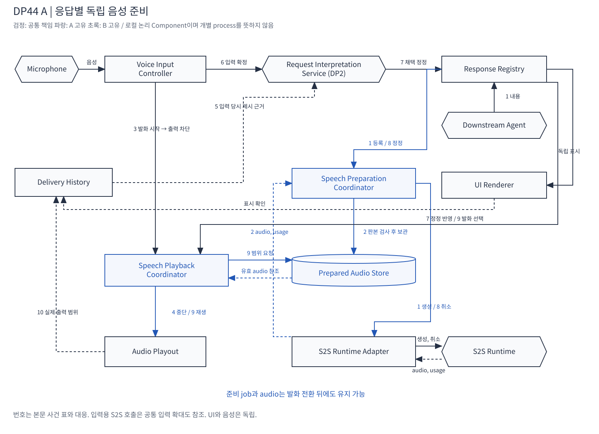
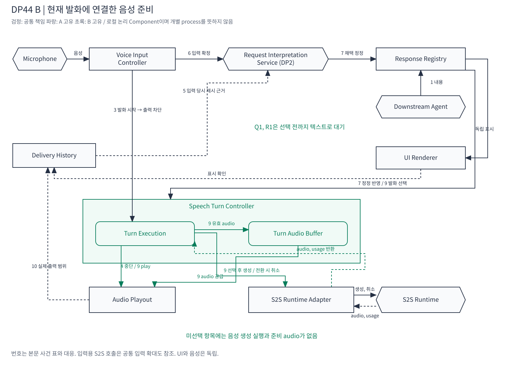
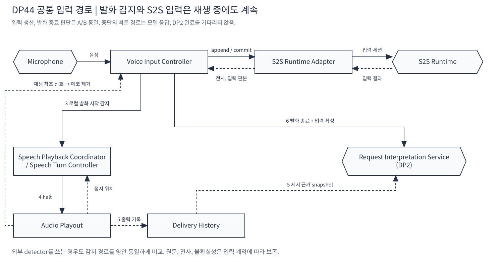
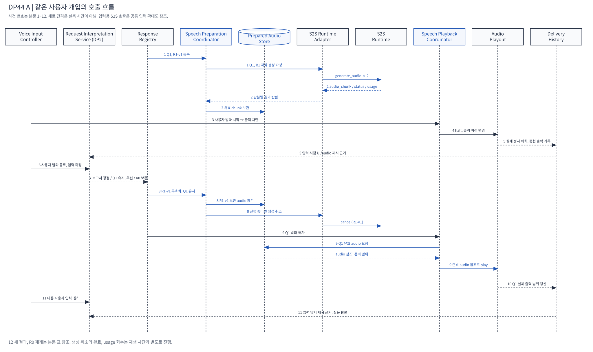
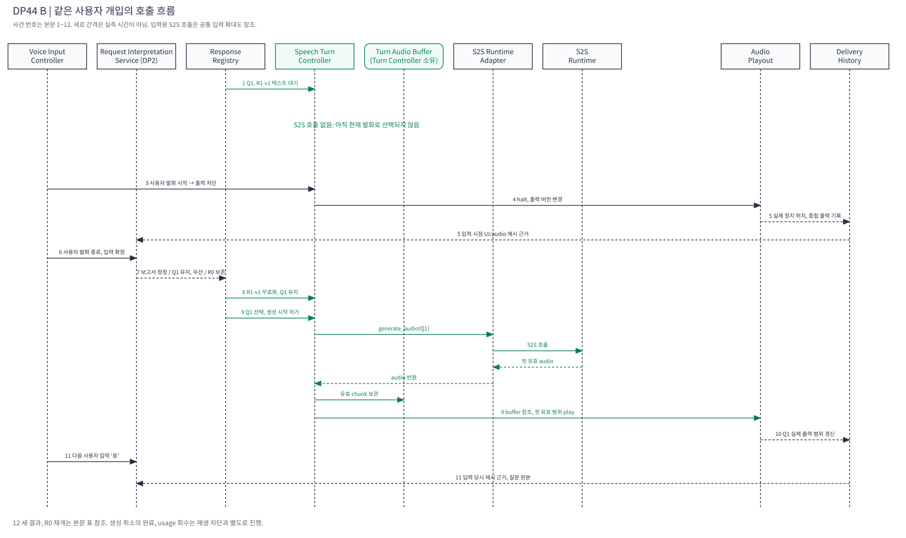

# DP44 상세 비교: 응답별 음성 준비와 현재 발화 실행

2026-10-22 통합 현재 편집본. 기본 비교는 응답별 독립 음성 준비 A와 현재 발화에 연결한 음성 준비 B다. 최신 책임, 호출과 전달 계약은 같은 폴더의 [발표 구조 계약](presentation-architecture-contract.md)에 있다.

**현재 공통 QA01은 첫 구체적 채택 내용의 화면 표시다. 오답의 최초 표시도 실제 시각과 오류를 보존한다. 실제 첫 음성 시작은 별도 지표로 보고한다.** 아래의 설계 당시 “음성 QA01”은 해당 탐색의 조건부 지표명이며 공통 QA01을 바꾸거나 화면 값과 평균하지 않는다. 이 경계는 [최신 발표 계약 §5](presentation-architecture-contract.md#5-같은-시나리오와-qa)와 [공통 QA](../qa/README.md)를 따른다.

[문서 안내](README.md) / [평가와 시나리오](../evaluation/README.md) / [현재 발표](../presentation/README.md)

> **당시 통합 발표 v9:** [발표 설계 계약과 7개 그림](presentation-architecture-contract.md)에 A/B Component, 입력 확정, 정정과 재개, 가상 QA 비교를 정리했다. 당시 기존 29장에 DP44 7장을 추가한 36장 구성이며 현재 발표는 [통합 발표 안내](../presentation/README.md)를 따른다.

> **2026-10-22 후속 평가:** [구체적인 시나리오와 가상 QA 비교](../../seven-problem-review/dp44-local-voice-execution-20261021/synthetic-comparison-20261022/README.md)에서 이 기본안들을 80개 평가 입력과 90개 목표로 비교했다. 작성 가정에서는 A를 조건부 권고하며 화면과 음성의 QA01을 따로 기록했다. 아래는 설계 당시의 분석이며 후속 수치도 실측이나 사용자 채택은 아니다.

> 2026-10-21 / DESIGN_ANALYSIS / 미구현, 미측정, 미선정
>
> 사용자 요청에 따라 A/B의 로컬 SW Component, S2S 호출, 사용자 끼어들기, 정정, 재개와 대화 이력 갱신을 구체화한다. OpenAI Realtime API를 기능 참고로 사용하는 자체 구현이며 완전 호환은 요구하지 않는다. [이전 논의 §0.3](../../seven-problem-review/dp44-conversation-delivery-reset-20261021.md#03-로컬-sw가-소유하는-발화와-음성-실행-구조)를 상세화한다. 당시 조건부 음성 비교에서 QA01이라고 표기한 값은 **실제 첫 음성 시작**이다. 현재 공통판에서는 이를 별도 첫 음성 지표로 구분한다. 기존 UI 종료점, 점수, COMMON-28, Reference Architecture와 ADR은 변경하지 않는다.

**결정할 것은 음성 생성 실행의 수명이다.** A는 응답별 생성 실행과 산출물이 발화 차례를 넘어 살아 있다. B는 현재 선택된 발화에 생성 실행을 연결하고, 미선택 응답은 텍스트로 보관한다. A는 다음 음성의 준비 대기를 줄이고, B는 말하기 전에 변경된 내용의 음성 생산을 피한다. 생성, 재생, 정정, 이력의 상태 계약이 이 차이를 구현한다.

| 그림 | 보여주는 것 | 편집 원본 |
| --- | --- | --- |
| [공통 입력](#41-공통-입력-경로) | 마이크, 입력용 S2S 호출, 즉시 중단과 제시 근거 | [draw.io](diagrams/common-input.drawio) |
| [A 구조](#2-a-응답별-독립-음성-준비) | 독립 준비 실행, 음성 보관, 별도 재생 | [draw.io](diagrams/a-components.drawio) |
| [B 구조](#3-b-현재-발화에-연결한-음성-준비) | 현재 발화 실행과 생성, 출력 연결 | [draw.io](diagrams/b-components.drawio) |
| [같은 사건의 A 흐름](#5-같은-시나리오의-사건별-추적) | 발화, 정정 중에도 유지되는 준비 | [draw.io](diagrams/a-sequence.drawio) |
| [같은 사건의 B 흐름](#5-같은-시나리오의-사건별-추적) | 정정 후 선택, 생성 의존 | [draw.io](diagrams/b-sequence.drawio) |

## 1. 같은 입력, 기능과 배치

### 1.1 공통 시나리오

- 다른 응답 **R0**가 재생 중이다. 처음에는 R0의 전체 음성이 이미 준비된 조건을 사용해 현재 생성 취소의 별도 효과를 섞지 않는다.
- 메일 Agent가 질문 **Q1**을 보낸다: “수신자는 김 대리인가요?”
- 보고서 Agent가 **R1-v1**을 보낸다: 5월 기준 보고서 결과와 전달할 음성용 텍스트.
- 사용자가 끼어든다: **“보고서는 6월 기준으로 다시 해줘. 메일 질문부터 들려줘.”**
- DP2는 같은 의미를 채택한다: 보고서 판본 변경, Q1 유지, 우선 전달, 무관한 R0 보존. 이후 “응”을 Q1에 대한 답으로 처리하는 단계도 추적한다.
- 새 6월 보고서 **R1-v2**의 업무 실행과 문안 생산은 Downstream Agent가 담당한다.

Q1을 빨리 읽는 장면과 R1-v1을 폐기하는 장면은 **같은 실행에 함께 발생한다.** A의 장점과 B의 장점을 서로 다른 유리한 사례에서만 가져온 비교가 아니다. 다만 사용 빈도나 실제 개선량은 측정하지 않았다.

### 1.2 공통 계약

| 항목 | 양안에 적용하는 조건 |
| --- | --- |
| 내용 생산 | Agent 또는 VIA의 해당 책임자가 확정한 `display_text`, `spoken_text`를 받는다. DP44용 문안 생성 LLM을 추가하지 않는다. |
| 의미 해석 | 같은 사용자 입력 근거와 같은 DP2 구현을 사용한다. 발화 감지 사건만으로 정정 범위를 추측하지 않는다. |
| UI | 동일한 판본, 권한 검사 뒤 독립적으로 표시한다. 음성 준비, 청취 완료를 UI의 선행조건으로 추가하지 않는다. |
| 입력 | 로컬 마이크 수집, 에코 제거, 발화 감지는 재생과 의미 처리 중에도 동작한다. 동일 detector와 종료 판단을 사용한다. |
| 모델 | 같은 S2S 모델, 설정, 음성, 입력 의미, 출력 조건, 같은 전체 실행 한도. 다중 접속을 허용하고 가중치를 복제하지 않는다. |
| 발화 | 하나의 출력 경로에서는 한 음성만 재생한다. 같은 선택 기준, 현재 판본, 권한, 사용자 발화 상태를 확인한다. |
| 보관 | 원본 텍스트와 실제 전달 기록은 양안 모두 보존한다. 이미 생성한 유효 잔여 음성은 양안 모두 재사용할 수 있다. |
| 비용 | 입력, 출력, 취소 후 도착, 폐기, 재시도, 문맥 비용을 포함한다. 단순 호출 횟수를 청구액으로 바꾸지 않는다. |
| 배치 | 제어와 기록은 로컬 SW. 모델의 로컬/원격 배치는 양안 같게 둔다. 자체 구현이라는 말로 모델 배치를 임의 확정하지 않는다. |

### 1.3 공통 Component

이 문서의 이름은 새 비교안의 논리적 Component다. Reference Architecture의 Component 이름을 축약, 개명한 것이 아니며 각각을 별도 OS process로 배치한다는 뜻도 아니다.

| Component | 책임과 소유 상태 | 주요 인터페이스 |
| --- | --- | --- |
| **Voice Input Controller** | 마이크 수집, 재생 신호를 참조한 에코 제거, 발화 시작, 종료, 입력 음성/전사 판본. 의미 해석은 하지 않음 | `speech_started`, `input_finalized`, `false_trigger` |
| **Response Registry** | 응답 ID, Task/Request, 내용 판본, 전달 의무, 취소, 정정, 원본 텍스트. 업무 사실은 원래 owner를 참조 | `admit`, `apply_revision`, `get_current`, `select_next` |
| **Audio Playout** | 오디오 장치, 현재 출력 시도 ID, 출력 버전, 재생 위치, 작은 장치 버퍼 | `play`, `halt`, `output_progress`, `output_stopped` |
| **Delivery History** | UI 표시와 실제 음성 출력 범위, 입력 시점의 제시 근거, 중복 방지용 사건 번호 | `record_display`, `record_audio`, `snapshot_for_input` |
| **S2S Runtime Adapter** | 모델 호출, 취소, usage, 응답 ID와 로컬 실행 ID 대응. 업무 도구 권한 없음 | `start_input`, `finish_input`, `generate_audio`, `cancel` |
| **Request Interpretation Service (DP2)** | 사용자 의미와 정정, 취소, 후속 입력 관계를 채택. 이번 비교에서는 내부 고정 | `interpret(input, presentation_snapshot)` → `adopted_relation` |

UI Renderer, Task owner, Downstream Agent 연결은 기존 책임과 계약을 유지한다. 여러 Component가 같은 응답 상태를 각각 덮어쓰지 않는다. Response Registry는 내용, 전달 의무, 출력 제어자는 현재 출력, Delivery History는 실제 제시 사실을 소유한다.

## 2. A: 응답별 독립 음성 준비



[편집 원본](diagrams/a-components.drawio), [PNG](diagrams/a-components.png)

### 2.1 추가 Component와 상태

| Component | 소유 상태와 동작 |
| --- | --- |
| **Speech Preparation Coordinator** | 음성 전달 의무가 있고 내용 사용이 허용된 응답을 받으면 준비 실행을 시작한다. 응답 판본별 job ID, 모델 response ID, 생성 범위, terminal status, 취소 상태, usage를 소유한다. |
| **Prepared Audio Store** | 응답 판본별 생성된 audio와 구간 대응 정보, 준비 범위, RAM 수용량, 참조 수. 첫 chunk부터 보관, 제공하며 전체 완료를 재생의 필수조건으로 만들지 않는다. |
| **Speech Playback Coordinator** | 현재 발화 선택, 재생 허가, 보류 이유, 중단된 응답의 이어 말할 위치. 준비 실행을 소유하지 않고 준비된 audio를 참조한다. |

**생성 경로:** Response Registry → Speech Preparation Coordinator → S2S Runtime Adapter → S2S. 반환 audio는 Adapter → Speech Preparation Coordinator에서 판본 검사 → Prepared Audio Store로 보관한다.

**재생 경로:** Speech Playback Coordinator → Prepared Audio Store → Audio Playout. `output_progress`는 Delivery History에 기록한다.

생성 경로가 먼저 끝나도 재생이 끝난 것은 아니다. 생성 순서 Q1→R1과 재생 순서 R1→Q1은 달라도 된다. 준비 실행에는 Task, 내용 판본을 넣고, 발화 문맥 의존 표현을 새로 만들도록 요청하지 않는다. 상대적 표현이 들어 있는 원문은 내용 생산 책임자가 명시한 문맥 의존성까지 유효성 검사한다.

### 2.2 준비 범위와 수용량

기본 A는 **현재 허용된 음성 전달 의무가 있는 응답**을 준비 대상으로 삼는다. 입력이 끝나기 전 사용자의 새 요청 의미를 추측해 준비하는 DP2 speculation과 다르다. 기본 구현에도 유한한 실행, RAM 한도가 필요하며 수치는 평가 전에 양안 공통 장비 조건과 함께 정한다. 준비 대기열에 있다는 이유로 아직 실행하지 않은 job 비용을 청구하지 않는다.

한도를 넘으면 내용, 전달 의무는 유지하고 준비 시작을 늦춘다. 준비 적중률을 높이는 예측과 다음 한 항목만 준비하는 정책은 A1 등의 보완으로 별도 비교한다. 모든 응답에 무한 RAM과 무제한 동시 호출을 준 A를 기본안으로 삼지 않는다.

### 2.3 정정의 처리

`Response Registry.apply_revision(R1, v1 → v2)`가 채택되면 R1-v1의 새 출력 허가를 먼저 막는다. 진행 중 job에는 취소를 보내고, 보관 audio는 읽기 참조가 해제되는 대로 회수한다. 늦게 도착한 구판 chunk는 판본 확인 뒤 폐기하고 usage는 계속 수집한다. Q1의 job, audio는 보존한다.

이 처리는 여러 준비 실행, 보관 결과와 현재 출력 사이에 걸친다. 원격 취소 완료를 기다린 후 구판 출력을 막는 방식은 사용하지 않는다. 출력 차단을 먼저 적용하고 자원 정리는 비동기로 진행한다.

## 3. B: 현재 발화에 연결한 음성 준비



[편집 원본](diagrams/b-components.drawio), [PNG](diagrams/b-components.png)

### 3.1 추가 Component와 상태

| Component | 소유 상태와 동작 |
| --- | --- |
| **Speech Turn Controller** | 현재 선택된 발화 실행, 응답 판본, S2S 생성 ID, 재생 시도 ID, 출력 위치, 중단, 재개 위치를 함께 소유한다. Response Registry의 미선택 항목은 아직 생성하지 않는다. |
| **Turn Audio Buffer** | Speech Turn Controller가 소유하는 내부 Module/메모리. 현재 생성된 음성을 출력에 공급하고 중단된 유효 잔여 구간을 보존한다. |

**경로:** Response Registry → Speech Turn Controller → S2S Runtime Adapter → S2S → Turn Audio Buffer → Audio Playout. `output_progress`는 동일한 Delivery History에 기록한다.

발화 가능한 응답을 선택하면 첫 audio부터 streaming 재생한다. 전체 음성이 준비될 때까지 기다리거나 발화를 끝낸 뒤에야 입력을 받는 구조가 아니다. 선택하지 않은 Q1, R1의 UI 표시, 판본 갱신은 계속된다.

### 3.2 전환과 재사용

사용자 발화가 시작되면 현재 출력만 즉시 멈춘다. 감지 직후 무조건 생성 전체를 파괴하지 않는다. 짧은 오감지에서 재생만 재개할 수 있도록 양안에 같은 임시 보류, 버퍼 한도를 둔다.

다른 응답으로 발화를 전환할 때 현재 생성이 아직 진행 중이면, 기본 B는 기존 생성 실행을 정리하고 남은 **생성 완료 음성**을 보존한다. 아직 만들지 못한 유효한 후반 내용은 나중에 해당 발화가 다시 선택될 때 생성한다. 정확한 내용 경계가 확인된 구간부터 재개하며 문장 중간을 임의로 잘라 다른 뜻을 만들지 않는다.

여기서 B가 기존 유효 audio까지 버리고 전체를 다시 생성해야 한다는 제한은 두지 않는다. Runtime이 생성 일시정지와 상태 재개를 제공한다면 추가 생성의 문맥 재입력 비용을 줄일 수 있다. 다만 OpenAI의 `response.cancel`을 같은 KV 상태에서의 pause/resume 기능으로 해석하지 않는다. 자체 Runtime의 pause를 사용하는 B2는 보존 실행 상태의 메모리와 실제 지원 계약까지 별도로 명시한다.

### 3.3 정정의 처리

미선택 R1-v1은 텍스트, 판본만 갱신하면 된다. R1의 준비 호출이 없으므로 해당 음성 job 취소, chunk 폐기, audio 회수가 발생하지 않는다. 현재 말하는 내용이 정정 대상이면 B도 생성 취소, 잔여 audio 무효화와 실제 전달 기록을 처리해야 한다.

이것이 B의 비용상 이익이다. 모든 정정이 무료라는 주장은 아니다. **말하기 전에 대기 항목을 정정하는 경우에 음성 준비 비용을 피한다.**

## 4. S2S 호출과 데이터 계약

### 4.1 공통 입력 경로



[편집 원본](diagrams/common-input.drawio), [PNG](diagrams/common-input.png)

마이크 음성은 양안에서 같은 입력 세션으로 계속 공급한다. 로컬 발화 감지와 입력 구간 기록을 사용하며, 발화 종료 후 인식 결과 또는 S2S가 제공한 입력 문구를 DP2에 연결한다. 모델이 제공하지 않는 입력 정제를 이미 구현된 기능이라고 가정하지 않는다. 원본, 전사 판본을 보존하고 입력 생산 계약은 두 안에서 같게 고정한다.

준비용 출력이 입력 세션의 “이미 사용자에게 말한 내용”으로 자동 들어가지 않도록 제어한다. 이 원칙은 A뿐 아니라 B의 생성 후 미재생 꼬리에도 적용된다. 자동 응답 생성은 꺼두고, 채택된 응답의 발화 시작은 로컬 코드가 결정한다.

### 4.2 자체 인터페이스 예시

아래는 설계용 의사 인터페이스이며 OpenAI에 그대로 전송하는 완성 JSON이나 구현된 SDK가 아니다.

```text
generate_audio(
  job_id, response_id, content_revision,
  spoken_text, voice_profile,
  context_ref, history_policy = EXTERNAL_DELIVERY_RECORD
) -> audio_chunk(job_id, chunk_seq, sample_range), generation_finished(status, usage)

play(audio_ref, response_id, content_revision, playback_attempt, output_epoch)
  -> output_progress(playback_attempt, sample_range, observed_at, evidence_class)

halt(output_epoch)
  -> output_stopped(playback_attempt, final_output_range, observed_at)

cancel(job_id)
  -> generation_finished(CANCELLED | COMPLETED | FAILED, usage)
```

- `content_revision`은 내용이 바뀔 때 바뀐다. 사용자 끼어들기 때문에 모든 응답의 내용 판본을 올리지 않는다.
- `output_epoch`는 지금 허가된 출력 시도를 구별한다. 끼어들기 때 이전 epoch의 장치 출력만 막으며 유효한 보관 audio를 무효화하지 않는다.
- 준비된 audio는 내용 판본에, 실제 출력 위치는 재생 시도에 연결한다. 같은 audio를 이어 재생하거나 재생성해도 이력을 중복 집계하지 않는다.
- chunk 수신, 장치 enqueue, 장치 실제 출력은 구별한다. product QA01은 loopback 등 실제 출력 관측을 사용하고, callback만 있으면 proxy로 표시한다.
- 문장/단어와 sample의 정밀 대응은 별도 capability다. 확인되지 않은 부분은 음성 참조와 불확실성으로 보존한다. 준비된 전체 텍스트를 들었다고 추정하지 않는다.

### 4.3 OpenAI에서 참고하는 기능과 자체 구현 책임

| 참고 기능 | 사용하는 설계 의미 | 그대로 있다고 가정하지 않는 것 |
| --- | --- | --- |
| VAD events와 자동 응답 설정 분리 | 감지, 발화 선택과 생성 trigger 분리 | 로컬 detector, 에코 제거가 자동 제공된다는 가정 |
| `response.create`, `conversation: "none"`, 개별 input | 기본 대화 기록에 쓰지 않는 준비 실행과 식별 | 실행마다 연결이나 모델 가중치를 복제해야 한다는 가정 |
| response ID 지정 `response.cancel` | 생성 취소를 개별 실행에 적용 | 로컬 재생 정지, 이미 생성된 audio 삭제, usage 환불 |
| `conversation.item.truncate` | 모델의 생성 이력과 실제 전달 범위 조정 | 정확한 부분 텍스트, 영구 VIA 대화 원장, 생성 pause |

공식 문서는 취소의 최종 상태를 `response.done`과 `status=cancelled`로 설명한다. `audio.done`이나 스트림 종료만으로 완전한 음성 준비 성공을 판단하지 않는다. 기본 대화 밖 실행도 모델 능력, 연결 방식별 출력 연동을 검증해야 하며, 이 문서는 자체 구현에 필요한 계약을 정의한 것이다. [OpenAI client events](https://developers.openai.com/api/reference/resources/realtime/client-events), [Realtime conversations](https://developers.openai.com/api/docs/guides/realtime-conversations)

### 4.4 기본 장면의 호출 원장

| 호출 또는 제어 | A | B |
| --- | --- | --- |
| 사용자 입력 음성의 전달, 확정 | 같은 입력 세션과 같은 음성 구간 | 동일 |
| 정정 의미 해석 | 같은 DP2 호출, 입력 근거 | 동일 |
| Q1 음성 생성 | 도착 후 준비 허용 시 `generate_audio(Q1)` | 정정 반영 뒤 Q1 선택 시 `generate_audio(Q1)` |
| R1-v1 음성 생성 | 도착 후 `generate_audio(R1-v1)`. 정정 시 결과 폐기 또는 실행 취소 | 선택 전에 정정되므로 호출 없음 |
| 새 R1-v2 음성 생성 | 새 결과 도착 후 준비 | 새 결과가 발화 대상으로 선택된 뒤 준비 |
| 사용자 발화 시 재생 중단 | 로컬 `halt`. 의미 해석용 추가 호출 없음 | 동일 |
| 업무 재위임 | 채택된 정정을 같은 Task owner가 같은 Agent로 전달 | 동일 |

이 장면에서 출력 준비 호출은 Q1, 구판, 새 판본의 3개 대 Q1, 새 판본의 2개지만, 이는 호출 흐름 설명이다. 호출 길이, usage, 취소 시점, 문맥 재사용 없이 이를 비용 비율로 환산하지 않는다. R0는 이미 준비된 공통 초기 상태이며 앞선 생성 비용은 전체 활동 원장에서 양안 모두 보존한다.

## 5. 같은 시나리오의 사건별 추적

두 사건도에서 1~12는 아래 표의 사건 번호다. 간격은 실측 시간을 뜻하지 않으며 비동기 생성은 다음 사건과 병행할 수 있다.



[편집 원본](diagrams/a-sequence.drawio), [PNG](diagrams/a-sequence.png)



[편집 원본](diagrams/b-sequence.drawio), [PNG](diagrams/b-sequence.png)

| 사건 | 공통 사용자, 업무 사실 | A의 호출, 상태 | B의 호출, 상태 | 비용, 관측 |
| --- | --- | --- | --- | --- |
| 1 | R0 재생 중 Q1, R1-v1 도착 | Registry 등록 후 각각 `generate_audio(Q1)`와 `generate_audio(R1-v1)` | Registry에 텍스트 등록. Q1, R1 호출 없음 | A의 선행 사용량 발생. 양안 UI는 독립 표시 |
| 2 | 아직 R0 재생 중 | Q1, R1 chunk를 Store에 수집. 준비 완료를 전달 완료로 기록하지 않음 | 대기 항목의 판본, 취소 사건은 처리 가능 | A의 audio RAM, 진행 중 실행 상태 |
| 3 | 사용자가 말을 시작 | 입력 Controller가 재생 경로에 빠른 차단 사건 전달 | 동일 | detector, 장치 정지 경로가 같으면 중단 속도 우위 없음 |
| 4 | R0 실제 재생 중단 | Playback Coordinator가 출력 epoch를 바꾸고 `halt`. R0 위치 보존 | Turn Controller가 동일 처리 | 모델 취소 응답, DB flush를 기다리지 않음 |
| 5 | 발화 수집 계속 | 시작, 중단 시각과 UI/audio 제시 근거를 입력 ID에 연결. Q1, R1 준비와 무음 상태 공존 | 같은 제시 근거. Q1, R1은 텍스트 유지 | 겹쳐 출력된 범위와 관측 오차 포함 |
| 6 | 발화 종료, 입력 확정 | 같은 입력 경로 완료 후 DP2 `interpret` | 동일 | 입력 확정, DP2 처리시간 H는 공통 |
| 7 | DP2가 관계 채택 | 보고서 v1 무효화, Q1 유지, R0 보존, Q1 우선 | 동일 의미, 판본 적용 | 정정의 의미 판단을 DP44가 재수행하지 않음 |
| 8 | 구판 전달 차단, 정리 | R1-v1 출력 금지 후 `cancel` 또는 완료 audio 폐기. 늦은 chunk 폐기, usage 회수. Q1 유지 | R1-v1 대기 텍스트 갱신. 취소할 R1 S2S 실행 없음 | B의 미사용 생성 비용 회피. R1 생성이 이미 끝났어도 A 비용은 남음 |
| 9 | 발화 조건 충족, Q1 선택 | 준비된 Q1의 첫 유효 범위로 `play`. 준비 부족이면 해당 chunk 대기 | 이 시점에 `generate_audio(Q1)` 호출, 첫 유효 chunk 뒤 `play` | QA01 차이 발생. `음성 준비 → 발화 허가`와 `발화 허가 → 음성 준비`의 차이 |
| 10 | Q1 실제 출력 | 출력 범위와 질문 연결을 Delivery History에 반영 | 동일 | Q1을 생성했다는 사실만으로 질문 청취, 승인을 기록하지 않음 |
| 11 | 사용자가 “응”이라고 답함 | 해당 입력 시점 UI/audio 근거와 질문 판본을 DP2에 제공. 채택 답변을 Task owner가 Agent에 전달 | 동일 | 여러 질문이 보이면 모호함도 보존. 최신 생성 응답 ID로 답변을 붙이지 않음 |
| 12 | 메일 처리 계속, R1-v2 도착, R0 이어 말하기 | R1-v2 준비는 다른 발화와 독립. R0 유효 잔여 음성 재사용 | R1-v2는 선택 시 생성. R0 기존 잔여 음성은 재사용 | 실제 최종 목표 완료 경로와 전체 사용량, RAM을 수집 |

Q1과 사용자 정정에 대한 구체적 응답은 동일한 의무 원장으로 연결한다. Q1이 정정 입력의 수행 의도를 전달하는 적절한 응답인지 별도 oracle로 확인한다. 그렇지 않으면 Q1을 정정 입력의 QA01 종료점으로 재사용하지 않고, 양안에 동일한 별도 수행 안내를 포함한다. Q1 자체의 QA01은 Agent 질문이 source에서 사용 가능해진 시점부터 잰다.

## 6. 중단, 재개에서 빠뜨리면 안 되는 계약

### 6.1 세 가지 중단을 나눈다

| 동작 | 즉시 결정할 수 있는 주체 | 의미 |
| --- | --- | --- |
| **재생 중단** | Voice Input Controller와 출력 제어자 | 사용자가 말하므로 현재 장치 출력을 멈춤 |
| **생성 취소** | 준비/발화 실행 소유자 | 더 만들 필요 없거나 유지 한도를 넘은 S2S 실행 중지 |
| **업무 취소, 정정** | DP2 채택 관계와 Task owner | 특정 Task와 Request 판본을 변경 |

첫 번째가 두 번째와 세 번째를 자동으로 뜻하지 않는다. “잠깐”과 잡음 때문에 모든 준비, 업무가 날아가는 구현을 A/B에 강제하지 않는다.

### 6.2 경합과 원자성

- 발화 감지 → 출력 epoch 갱신 → 장치 정지 요청은 짧은 로컬 제어 경로다. 긴 상태 처리 lock을 잡은 채 장치에 접근하지 않는다.
- 출력 허가는 `response_id, content_revision, output_epoch`를 함께 검사한다. 검사 후 enqueue 사이에 정정이 끼면 새 epoch의 장치 gate가 구판 frame을 거부한다. 이미 실제 출력된 구간은 되돌릴 수 없으므로 발생 시점과 전달 사실을 보존한다.
- 준비 job 상태는 `requested → generating → complete/cancelled/failed`로, 전달 상태는 `pending → playing → paused/delivered/withdrawn`으로 따로 둔다. `cancel_requested`는 취소 완료가 아니다.
- A의 출력 epoch 변경은 모든 준비 job의 내용 판본을 바꾸지 않는다. Q1의 유효 audio는 새 재생 시도로 다시 사용할 수 있다.
- output 장치가 정지한 최종 위치를 확인할 때까지 불확실 범위를 보존한다. 모든 이력 처리를 영구 DB에 flush할 때까지 DP2를 무조건 막는 동기 장벽을 추가하지 않는다. DP2에 필요한 일관된 메모리 snapshot과 내구화 순서는 구분한다.

### 6.3 짧은 감지, 추가 발화, 여러 번 끼어들기

| 장면 | A | B | 실제 차별화 여부 |
| --- | --- | --- | --- |
| 기침, 짧은 오감지 뒤 의미 있는 입력 없음 | R0 유효 위치에서 재생 재개 | 같은 이미 생성된 잔여 audio 재개 | 이것만으로 A의 속도 이익을 만들지 않음 |
| “잠깐, 메일 질문 먼저” 후 R0로 복귀 | R0 준비가 발화 전환을 넘어 계속될 수 있음 | R0 생성 완료분은 보존. 미생성 후반은 다시 선택 시 준비 | 생성이 미완료였고 pause 미지원이면 B에 추가 호출/문맥 처리 가능 |
| “그 설명 취소해” | 해석 전 재생만 중단. 채택 후 해당 응답의 준비, 보관도 폐기 | 해석 전 재생만 중단. 채택 후 현재 생성, 잔여 audio 폐기 | A의 다른 유효 응답을 일괄 취소하지 않음 |
| 일부 문단만 정정 | 원본, audio 구간 대응이 있는 유효 구간은 재사용, 영향 구간만 교체 가능 | 현재/잔여 buffer의 유효 구간도 동일하게 재사용 가능 | A만 부분 재사용을 허용해서 QA 이익을 만들지 않음 |
| 무음이지만 정정 해석 미완료 | 필요한 관계가 확정될 때까지 해당 출력 보류 | 동일 | 발화 끝과 재개 허가를 동일시하지 않음 |
| 사용자가 질문을 UI에서 먼저 보고 답함 | audio 미재생이어도 UI 제시 근거로 해석 가능 | 동일 | 음성 청취를 질문 답변의 필수조건으로 추가하지 않음 |

### 6.4 고장과 회복

- **S2S 실패:** 준비 실패는 전달 실패와 구별한다. A는 선택 전 재시도할 시간 여유가 있을 수 있으나 그 재시도 비용도 센다. B는 선택 후 실패가 발화 시작 경로에 드러난다. 새 reliability QA를 이 비교에 임의 추가하지 않고 기존 QA01/03/05의 실패와 비용으로 기록한다.
- **음성 연결 끊김:** 마이크, 재생 상태를 새 connection으로 재연결하고 Task와 UI 기록은 유지한다. A의 완성 audio 또는 B의 유효 buffer가 살아 있으면 재사용한다. 모델 연결이 끊겼다는 이유로 로컬 완성 audio를 버리지 않는다.
- **프로세스 재시작:** 양안의 동일한 durable response/delivery 기록으로 복원한다. RAM-only audio는 둘 다 사라질 수 있다. 확인되지 않은 마지막 출력 범위를 정확히 들었다고 추정하지 않는다. A만 durable audio를 설치해 복구 우위를 주장하지 않는다.
- **원본 권한 철회:** 두 안 모두 새 출력 차단을 우선한다. A는 준비, 저장 audio까지 해당 범위를 찾아 정리하며, B도 현재/잔여 audio를 정리한다. 권한 원본 owner와 사용자 거부 범위는 동일하다.

## 7. 대화 이력: 어느 시점에 무엇을 넣는가

양안 모두 **전달 의무 원장, 실제 제시 원장, 모델 문맥을 구별**한다. 데이터베이스 세 개를 강제하는 의미는 아니다.

| 시점 | 기록 | 기록하면 안 되는 주장 |
| --- | --- | --- |
| Agent Q1 수신 | Q1 텍스트, Task, 판본, 답변 필요 상태 | 사용자에게 이미 질문했음 |
| Q1 UI 표시 확인 | Q1이 해당 UI에 표시된 시각 | 사용자가 읽었음, 동의했음 |
| Q1 음성 생성 완료 | 내부 준비 상태와 산출물 참조 | Q1 전체를 사용자가 들었음 |
| Q1 실제 출력 | 재생 시도별 실제 출력 구간과 관측 클래스 | 실제 이해, 승인 |
| 새 사용자 발화 시작 | 그 시각 전의 제시 근거와 겹친 출력 구간을 연결 | 나중에 도착한 질문을 과거 입력의 유일 대상으로 사용 |
| 답변 의미 채택 | DP2의 질문/Task 연결, 채택 답변 | 출력 Controller가 “응”을 임의 승인으로 해석 |

입력 snapshot은 발화 시작 순간의 한 줄만 복사하지 않는다. 발화 동안의 UI 변화, 출력 중첩도 시간 정보와 함께 묶되 입력 이후의 사건과 구분한다. DP2가 필요한 정답을 미리 넣는 것이 아니라 실제 관측을 제공한다.

A는 여러 준비 결과가 이력에 새는 것을 막아야 하고 B는 현재 생성의 미재생 꼬리가 이력에 새는 것을 막아야 한다. 두 안 모두 올바르게 구현하면 QA02, 새 QA07은 동일한 근거를 받을 수 있다. 이력 동기화 버그를 구조 고유의 정확성 손실로 미리 가산하지 않는다. 모델의 생성 기록을 기본 대화에 쓰는 adapter를 선택했다면 실제 출력 범위와의 truncate/정리가 추가로 필요하며, 이 선택은 선행 준비 여부와 별도 축이다.

## 8. QA tradeoff의 인과와 크기

### 8.1 QA01: 실제 첫 음성

Q1 source 시각을 `t0`, A의 준비 시작을 `a`, 동일한 다음 발화 허가 시각을 `T`, S2S 첫 의미 있는 음성 준비시간을 `f`, 공통 출력 시작 비용을 `d`라 한다. Q1은 정정 뒤에도 유효하며 두 안에서 같은 내용이다.

```text
A의 Q1 첫 음성 시각 = max(T, a + f) + d
B의 Q1 첫 음성 시각 = T + f + d
A의 이익            = min(T - a, f)     [a <= T, 동일 f 가정]
QA01                = 각 첫 음성 시각 - t0
```

첫 chunk가 소리 없는 prefix이거나 내용과 무관한 인사이면 종료점이 아니다. 실제 첫 의미 단위의 시작 sample로 관측한다. 실제 사용자 발화, 이전 출력 대기는 이번 음성 QA01의 wall-clock에 남긴다. 별도 QA09의 청취 가능 시간으로 바꾸지 않는다.

단일 즉시 발화 상황에서 `a = T`면 이 이익은 0이다. A가 더 많은 job을 유지하는 overhead와 실제 runtime 성능 차이까지 포함하면 언제나 빠르다는 보장은 없다. 모델 자원 경합은 측정된 경우에만 반영하고 B 이익을 위해 만들어 넣지 않는다.

### 8.2 QA03: 준비와 정정 처리의 실행 의존

이번 구체화에서 가장 중요한 추가 경로다. `G`는 Q1의 **전체** 음성 준비시간, `H`는 입력 확정 후 정정 관계를 채택, 반영하는 공통 VIA 처리다.

```text
A: Q1 준비 G ───────────────┐
                            ├─ Q1 전달/후속 입력 → 목표의 나머지 처리
   입력 확정, 정정 반영 H ───┘

B: 입력 확정, 정정 반영 H → Q1 선택 → Q1 준비 G → 후속 처리
```

관련 두 경로가 같은 시작 이후 분기하고 최종 완료에 모두 필요한 구간에서는 **A=max(G,H), B=H+G**가 된다. 순수 사용자 발화, 재생 시간을 0으로 두어도 생성과 해석의 실제 의존 차이는 남는다. DP2를 바꾼 것이 아니라 DP44의 준비를 DP2 완료 앞에 독립적으로 배치한 차이다.

다만 이 식은 **해당 DAG 조각**에 대한 것이다. Q1이 첫 질문인 원래 메일 목표의 t0부터 답변, 위임, 최종 응답까지 계산한다. 정정 입력을 새 목표로 떼어 선행 준비를 공짜로 만들지 않는다. 준비가 원래 목표 t0보다 앞서 끝났다면 초기 상태로만 다루고 활동 비용은 QA05에 남긴다. 후속의 다른 긴 병행 경로가 전체 완료를 결정하면 이 조각의 감소가 목표 전체 QA03 감소로 이어지지 않을 수 있다.

**정정 없이 외부 Agent 결과를 기다리는 시간에 G를 겹친 것만으로는 QA03 이익이 아니다.** 외부 대기를 0으로 만들면 둘 다 G일 수 있다. 실제 허가 H와 준비 G의 선행 관계가 바뀌는지 확인해야 한다. [QA03 공식 계산 경계](../qa/qa03-via-processing-time.md#4-단일-산식과-병렬-처리)

### 8.3 QA05: 폐기 비용과 재개 비용이 서로 반대 방향이다

기본 장면에서 공통 비용을 C, Q1, 새 결과 R1-v2의 비용을 각각 CQ, CN, 폐기되는 R1-v1의 실제 준비 사용액을 CW라 하면:

```text
A = C + CQ + CN + CW + A 고유 추가 사용액
B = C + CQ + CN      + B 고유 추가 사용액
```

R1-v1을 아직 재생하지 않았고 다른 재사용, 문맥 차이가 없다면 B는 CW를 피한다. 일부만 생성했다면 그 실제 usage만 센다. 취소가 늦어 끝까지 생성됐다면 그 비용도 남는다.

반대로 긴 유효 응답을 여러 번 중단, 재개하고 현재 generation 상태를 보존할 수 없다면 B에 추가 문맥 입력, 미생성 후반 생성 호출이 생길 수 있다. 이미 생성한 유효 음성은 재사용하므로 전체 결과를 무조건 재생성한다고 가정하지 않는다.

```text
A - B = 미전달, 구판의 선행 생성 비용
        - A가 재사용하여 피한 추가 재개 비용
        + 기타 실제 모델 사용량 차이
```

따라서 B의 비용 우위는 **대기 중 대체, 철회가 많을 때** 강하고, 유효한 긴 응답의 재개가 반복되면 줄거나 뒤집힐 수 있다. 자연스러운 선택 이유가 양쪽에 존재한다.

현재 [QA05](../qa/qa05-model-cost.md)의 정의는 **실제 모델 청구 총금액**이다. 자체 무과금 모델이면 증가한 생성량을 임의 USD로 바꾸지 않는다. 모델 배치가 API 과금형이면 실제 usage, 단가로 비교하고, 자체 무과금형이면 청구액 차이는 없으며 생성량, 연산은 별도 진단이다. 기존 QA05의 의미를 로컬 전력이나 CPU 시간으로 변경하지 않는다.

### 8.4 QA06: 음성 저장과 실행 상태

```text
A의 추가 상주 후보 = 미재생 준비 audio + 독립 준비 job 상태 + 실제 추가 local KV/작업공간
B의 상주 후보      = 현재/중단 발화의 유효 buffer + 실제 보존한 실행 상태
```

텍스트 원본, 공통 모델 가중치, 같은 물리 audio 참조를 중복 계산하지 않는다. 원격 runtime의 KV는 로컬 QA06에 넣지 않는다. 자체 로컬 모델이면 양안 모두 같은 가중치와 실행 상태를 포함한다.

크기 감각을 위한 계산: 24 kHz, 16 bit, mono PCM은 초당 48,000바이트다. 미재생 30초 audio 한 개는 **1.44 MB**다. 이는 생성 속도나 실제 RAM 측정 결과가 아니다. 두세 개의 짧은 음성만으로 수백 MB의 QA06 우위를 주장할 수 없다. 전체 피크가 다른 작업에서 발생하면 audio 보관 차이가 QA06 최고값에 드러나지 않을 수도 있다.

### 8.5 QA04: 실제 변경 경계 검토

현재 정의는 실제 운영 Rust 모듈 변경 수다. 아래는 구현 전 **변경 영향 설계 검토**이며 모듈 개수나 점수가 아니다.

| 변경 요구 | A에서 확인할 계약 | B에서 확인할 계약 | 현재 판단 |
| --- | --- | --- | --- |
| C04: 일부 문단 교체, 다른 범위 보존 | Registry 범위 → 준비 job → 보관 audio → 현재 재생 위치 사이 판본, 구간 연결 | Registry 범위 → 현재/중단 발화 buffer → 재생 위치 연결 | A의 선행 산출물에 적용할 지점이 늘지만, 일반화된 무효화 계약이면 변경 파일 수는 같을 수 있음 |
| C06: 원본, 범위 철회, 무관한 사용 유지 | 현재 재생 외에 여러 준비 실행과 audio 참조 정리 | 현재/잔여 buffer와 대기 텍스트 정리 | B의 미선택 음성 실행이 없어 실행 중 정리 대상은 줄어듦. 실제 변경 모듈 우위는 미확정 |
| 새로운 출력 장치/재생 방식 | 준비 산출물 계약을 유지하고 Playback 쪽 교체 가능 | Turn Controller와 장치 adapter 결합 정도 확인 | A가 유리할 가능성도 있음. 기존 QA04 모집단 밖이면 진단으로만 남김 |

공통 필수 판본 검사나 부분 보존 기능을 일부러 빠뜨린 뒤 그 수정을 tactic, 변경 용이성 성과로 세지 않는다.

### 8.6 QA02, 새 QA07

DP44는 “응”, “아까 질문”, “계속”의 해석에 실제 제시 근거를 공급한다. 그러므로 **관련성은 직접 있다.** 하지만 이번 A/B는 지칭, 의미 판단 알고리즘과 필요한 근거를 같게 두므로 정확도 우열의 구조적 근거는 아직 없다. 이력 누락, 잘못된 시점 연결을 회귀 시험하며 정확도 차별화 coverage로 세지 않는다.

### 8.7 전체 판정

| QA | 기본 예상 | 손익의 원인 | 강도, 조건 |
| --- | --- | --- | --- |
| QA01 음성 | A 유리 | 생성 대기를 발화 허가 이전으로 이동 | 직접 인과. 유효 준비, 시간 여유가 있어야 함 |
| QA02 | 우열 근거 없음 | 동일 제시 근거와 의미 판단 | 관련, 회귀 대상 |
| QA03 | A 유리 가능 | 정정 처리 H와 준비 G의 병행 대 직렬 의존 | 실제 목표 임계 경로에 있어야 함 |
| QA04 | 미확정 | 독립 준비 상태 정리 대 현재 발화 내부 결합 | 구현 전 모듈 수를 만들지 않음 |
| QA05 | 대기 정정 장면에서 B 유리 | 폐기될 음성 호출 회피 | 과금형 모델. 반복 재개에서 반대 효과도 평가 |
| QA06 | A 추가 비용 경로, B 유리 가능 | 대기 audio, 추가 실행 상태 | 전체 상주 피크와 실제 크기 확인 필요 |
| 새 QA07 | 우열 근거 없음 | 동일 요청 의미 채택 경계 | 관련, 회귀 대상 |

**가장 강한 교환은 음성 QA01 대 과금형 QA05다. QA03에는 구체적 실행 의존 차이가 추가로 있고 QA06에는 실제 보관 비용 경로가 있다. 네 지표가 모두 큰 점수 차이를 낸다는 뜻은 아니다.** 특히 자체 무과금 배치에서는 QA05 차별화를 사용할 수 없다. 그 경우에도 A/B의 응답성과 자원 교환은 존재하지만 기존 핵심 QA에서 충분히 큰 반대편 이익인지 추가 확인이 필요하다.

## 9. 계산으로 확인하는 예시: 실측 아님

아래 숫자는 메커니즘을 설명하기 위해 둔 **가정값**이다. OpenAI 또는 자체 S2S 성능, 현재 QA 점수, COMMON-28 평균이나 제품 성능으로 사용하지 않는다.

| 값 | 설명용 가정 |
| --- | --- |
| Q1, R1 source와 준비 시작 | 0.00초 |
| 사용자 발화 | 0.20~1.20초 |
| 입력 확정, 정정 반영 H | 1.20~2.00초, 0.80초 |
| Q1 첫 의미 음성 준비 f | 호출 후 0.50초 |
| Q1 전체 음성 준비 G | 호출 후 1.20초 |
| 공통 출력 시작 d | 0.05초 |
| Q1 이후 재생, 사용자 답변 | 같은 사건 의존을 사용하며 QA03의 순수 사용자/재생 duration만 0 처리 |

- **QA01 Q1 사건:** A는 2.05초, B는 2.55초. 둘 다 source 0.00부터 계산한다. A의 이익 0.50초는 첫 음성 생성 지연을 가린 결과다.
- **QA03 관련 DAG 조각:** A는 max(1.20, 0.80)=1.20초, B는 0.80+1.20=2.00초. 공통 나머지 노드, 원래 목표 시작, 동시 경로를 포함한 전체 점수는 별도다. 실제 경과시간에서 사용자 발화 1초를 기계적으로 빼 만든 값이 아니다.
- **QA05:** A만 R1-v1을 준비했다면 그 실제 input/output usage가 추가된다. 예시 달러를 임의 배정하지 않는다.
- **QA06:** R1-v1의 미재생 PCM이 30초라면 해당 payload는 1.44 MB다. 전체 RAM 피크 차이는 이 값과 같다고 보장하지 않는다.

한 번의 실제 실행에서 빠른 Q1 전달과 R1-v1 폐기 비용이 함께 나타날 수 있다는 것을 확인하는 계산이다. 예측 정확도나 측정값을 만들어 tradeoff를 주장하지 않는다.

## 10. 반례, 선택 이유와 보완

| 조건 | 판단 |
| --- | --- |
| 단일 짧은 요청, 즉시 말할 수 있음 | A의 선행 시간 여유가 없으므로 QA01 차이는 작거나 없음 |
| 여러 결과가 대기하며 내용은 거의 유지 | A의 준비가 적중. QA01, 조건부 QA03에 유리하고 QA05 차이는 작음 |
| 사용자 정정, 진행 대체가 잦음 | B가 미사용 생성 회피. A는 준비 비용과 보관을 더 부담 |
| 긴 유효 응답을 여러 번 중단, 재개 | A의 산출물 재사용이 유리. B가 생성 상태를 보존 못하면 추가 호출이 생길 수 있음 |
| S2S 첫 의미 음성 지연이 매우 짧음 | A의 QA01 이익 상한 f가 작아짐 |
| 준비 수용량이 꽉 참 | A에서도 원하는 Q1이 준비되지 않을 수 있음. 실제 적중률과 공통 runtime 한도 포함 |
| 음성 OFF 또는 UI만 이용 | 음성 준비 의무가 없으면 두 안 모두 해당 생성 생략. A가 무조건 audio를 만드는 약한 기본안으로 만들지 않음 |

**작성자 판단:** 실제 첫 음성을 최우선으로 두고 여러 Agent 사건이 겹치는 VIA 사용을 중요하게 보면 A를 우선 검토할 이유가 충분하다. 그 대가는 전달 전에 무효화될 내용의 준비 비용이다. B는 내용 변경이 잦고 생성 비용, 상주 상태를 줄여야 할 때 선택할 수 있는 현실적 대안이다. 사용자 채택이나 실측 승자를 선언하지 않는다.

기본안 평가 후 별도로 볼 보완은 다음과 같다.

- **A1 — 제한된 다음 응답만 준비:** 적중 가능성이 높은 항목만 준비하여 낭비를 줄인다. 사용자 전환으로 준비하지 않은 항목이 선택되면 QA01 이익을 잃는다.
- **A2 — 음성 저장 방식 변경:** 압축, 파일 보관으로 RAM을 줄이고 decode/I/O와 실제 재생 시작 비용을 함께 확인한다. A1의 자동 누적안이 아니다.
- **B1 — 다음 응답 한 개 선행 준비:** 첫 음성 대기를 줄이는 대신 독립 준비 실행, 보관, 취소 계약을 추가한다. 준비량 1이라는 설정 전에 A의 핵심 실행 구조 일부를 도입했다는 사실을 밝힌다.
- **B2 — 생성 상태 pause/resume:** 지원 Runtime에서 중단된 생성 문맥을 보존한다. 새 문맥 재입력과 중복 생성을 줄이는 대신 보존 KV, 작업공간과 Runtime 연동 비용을 부담한다. 실제 지원, 메모리 비용은 미확인이다.

보완이 가능하다는 이유로 기본 A/B의 손익을 없애지 않는다. 반대로 이미 독립 준비 구조가 설치된 Runtime의 선행량 옵션을 별도 대형 Architecture처럼 포장하지 않는다.

## 11. 후속 검증에 필요한 관측과 반증

이번 작업은 문서, 그림, 설계 계산이다. 제품 구현, API 실행, 모델 사용, 측정 캠페인을 수행하지 않았다.

| 검증 | 필요한 관측 | 주장을 기각, 축소할 조건 |
| --- | --- | --- |
| QA01 | source 발생, 준비 시작, 첫 유효 audio 준비, 발화 허가, 실제 첫 출력 | 준비가 자주 빗나가거나 f가 작아 사용자 이익이 미미함 |
| QA03 | 원래 목표 ID, 실제 parent/resource edges, H/G, 최종 필수 상태, UI, 전체 audio 준비 | G가 실제 완료 경로 밖이거나 양안 의존이 같음 |
| QA05 | job별 전체 usage, 최종 status, 취소 이후 tail, 실제 단가 manifest | 구판 생산이 거의 없거나 B 재개 비용이 더 큼. 무과금형이면 청구액 비교 불가 |
| QA06 | 양안 전체 프로세스의 같은 시점 resident RAM, payload 참조와 실제 local runtime 상태 | payload가 작고 전체 피크를 바꾸지 않음 |
| 정정 경합 | 구판 chunk 지연 도착, play 검사와 enqueue 사이 정정, 연속 끼어들기 | 구판 재생, 무관한 Q1 폐기, 동일 의무 중복 전달 |
| 입력, 이력 | 발화 중 출력, UI-only 질문 답변, 둘 이상 질문, 부분 문장 중단 | 미재생 내용을 들은 것으로 기록, “응”을 최신 job에 잘못 연결 |
| 재개 | 완성/미완성 R0, 짧은 오감지, 모델 취소와 완료 경합 | 유효 음성을 불필요하게 모두 재생성하거나 미생성 범위를 완료로 표시 |

실측에서는 같은 시나리오, 내용, 발화 규칙, 모델, 수용량을 사용하고 미관측, 취소, 잘못된 전달도 남긴다. 필요한 경우 입력 뒤 사건은 “질문 실제 전달 뒤 사용자 답변”처럼 같은 인과 trigger로 정의한다. A/B의 출력 시점이 달라졌는데 사용자의 후속 답변을 무조건 같은 절대 시각에 넣어 한쪽만 질문 전에 답하게 만들지 않는다.

## 12. 근거와 검토 범위

- [INTENT.md](../../../../../../INTENT.md): 공통 필수 조건과 구현 수단, 기본안과 보완, 의미 정확성 경계.
- [대표 UC](../../../../05-representative-use-cases.md): UC-11 끼어들기, UC-13 비동기 통지, UC-14 여러 업무, UC-15 재연결.
- [QA01](../qa/qa01-first-response-latency.md), [QA03](../qa/qa03-via-processing-time.md), [QA04](../qa/qa04-change-scope.md), [QA05](../qa/qa05-model-cost.md), [QA06](../qa/qa06-local-memory.md): 기존 정의와 현재 비교의 변경 범위.
- [OpenAI Realtime conversations](https://developers.openai.com/api/docs/guides/realtime-conversations), [client events](https://developers.openai.com/api/reference/resources/realtime/client-events): 기능 존재와 경계의 참고. 2026-10-21 확인. VIA의 실제 모델 capability, 성능 입증이 아님.

그림은 [공통 생성 원본](../../seven-problem-review/dp44-local-voice-execution-20261021/diagrams/generate.py)에서 SVG와 편집 가능한 draw.io를 함께 만든다. PNG는 SVG를 렌더한 미리보기다. 문서의 수식, 링크와 그림 원본/미리보기를 점검한다. 이는 구조 구현, 사용자 입력 인식 품질, 음성 의미 보존, 실제 장치 지연, 모듈 변경 수의 검증을 대신하지 않는다.

2026-10-21 자체 검토: 로컬 링크, 5개 그림의 SVG/draw.io XML과 식별자, 소유 관계, PNG 렌더, 설명용 산술을 확인했다. 그림에서 가려진 내부 연결과 누락된 음성 보관, 반환 경로를 수정했다. QA05를 무과금 자체 모델의 연산량으로 바꾸지 않는 조건, QA03의 DAG 조각과 전체 목표 구분, 공통 유효 audio 재사용과 반복 재개의 반례를 점검했다. 독립 reviewer나 실제 제품 검증을 수행한 기록은 아니다.
