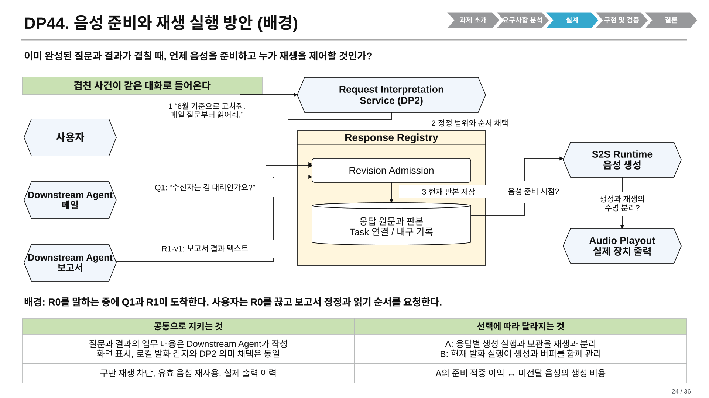
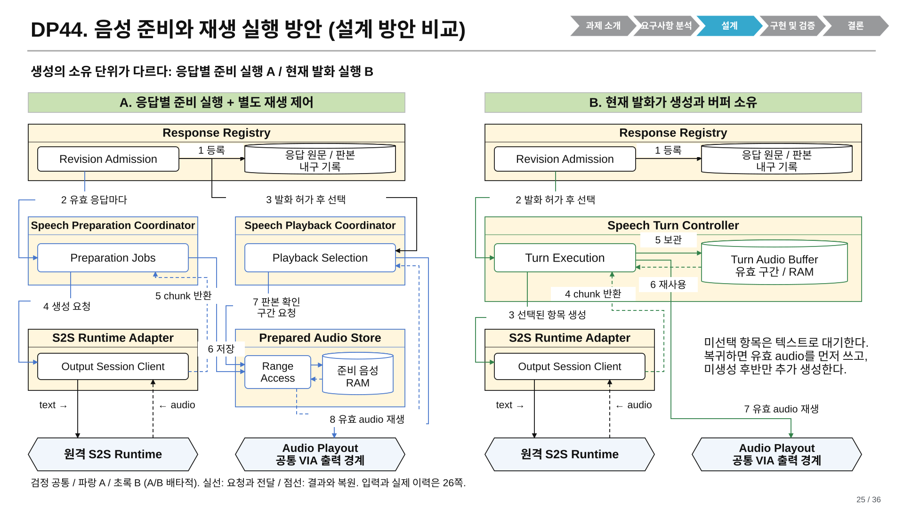
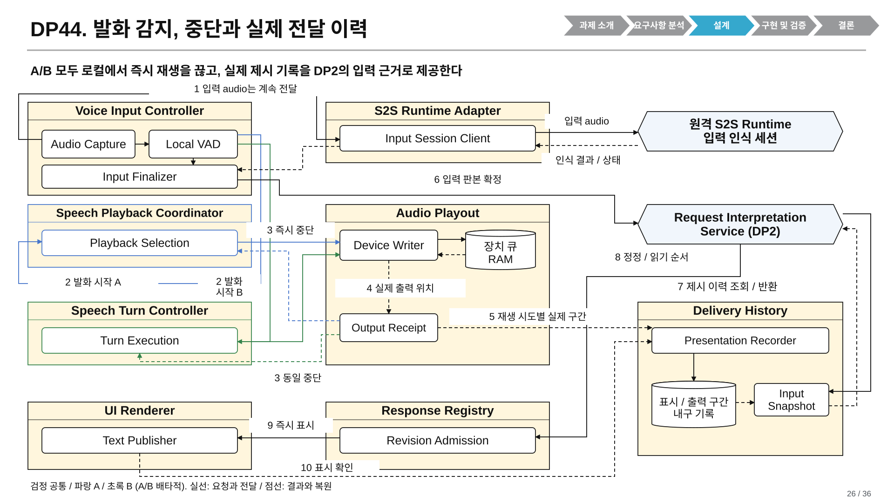
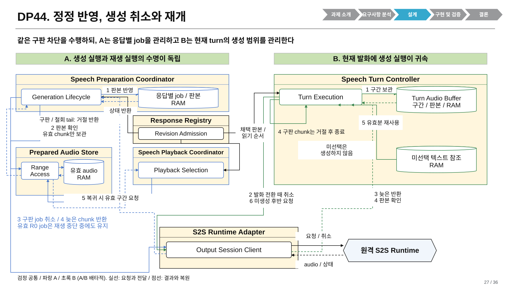
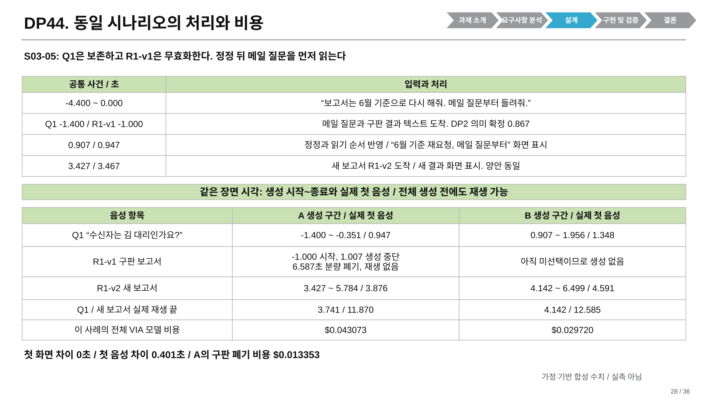
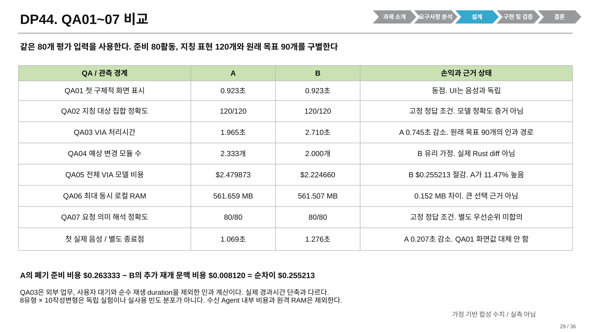
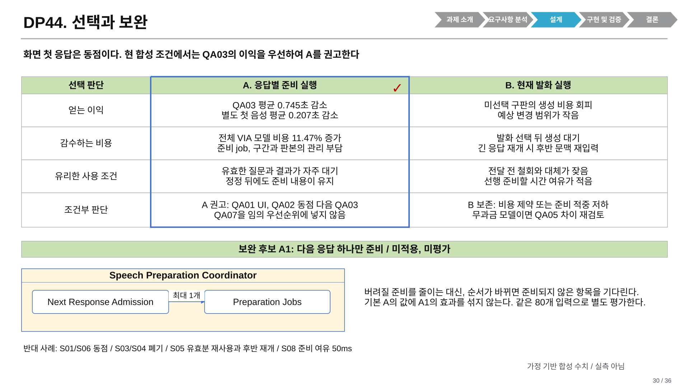

# DP44 통합 발표 v9 설계 계약

2026-10-22. 현행 설계는 [DP44 로컬 음성 실행](design.md)과 [DP44-DELIVERY-SYN-1.0](../../seven-problem-review/dp44-local-voice-execution-20261021/synthetic-comparison-20261022/README.md)이다. 이 문서는 그 내용을 기존 통합 발표 v8 뒤에 추가한 표현 계약이다. 새로운 측정, QA 정의 변경이나 채택 ADR이 아니다.

## 1. 범위와 산출물

- [통합 발표 v9](../presentation/sources/v10-snapshot/input-v9.pptx)는 총 36쪽이다. DP44 번호를 유지하고 24~30쪽에 7장을 추가한다.
- v8의 DP1~DP5 본문 1~23쪽은 같은 위치에, 역사 DP3 appendix 24~29쪽은 31~36쪽에 둔다. 기존 내용과 notes를 보존한다. footer와 appendix 구분장 notes의 명시적 현재 위치만 바꾼다.
- [발표 검토 기록](../../../../../presentations_files/dp1-dp4-reference-style-20261019/dp44-v9-review.md), [원장과 전달 경계](../../seven-problem-review/dp44-local-voice-execution-20261021/synthetic-comparison-20261022/handoff.md)를 함께 읽는다.
- 구현 원본은 `scripts/presentations/dp44_v9_pages.mjs`, 공통 Scene과 검사는 `dp44_v9_scene.mjs`, native PPTX와 SVG 및 draw.io 생성은 `build_dp44_v9.mjs`, 보존 삽입은 `package_dp44_v9.py`다.

## 2. 공통 입력과 책임

Downstream Agent가 Q1 질문과 R1 결과의 업무 문안을 작성한다. DP44는 별도의 문안 작성 LLM을 추가하지 않는다. S2S는 이미 채택된 텍스트를 음성으로 변환하는 의존성이다. 의미 판단은 양안에 동일한 DP2 결과를 공급하며 S2S에 tool 호출 권한을 주지 않는다.

Voice Input Controller의 Audio Capture는 중단 중에도 audio를 계속 공급한다. Local VAD가 발화 시작과 종료를 감지한다. S2S Runtime Adapter가 인식 결과와 상태를 반환하면 Input Finalizer가 발화 종료, 전사 판본과 입력 순서를 묶어 DP2에 확정 입력을 넘긴다. 원격 Runtime이 DP2를 직접 구동하지 않는다. Echo cancellation은 실제 장치 출력 참조를 쓰는 공통 입력 처리이며 두 안의 차이가 아니다.

발화 시작에는 현재 선택된 A의 Playback Selection 또는 B의 Turn Execution이 Audio Playout의 Device Writer에 halt를 전달한다. Output Receipt가 마지막 실제 출력 위치를 반환한다. 즉시 로컬 중단은 생성 취소나 업무 취소와 별개다. 작성 사례 S05의 80ms는 양안 공통 가정이며 실측값이 아니다.

Delivery History에는 UI Renderer가 확인한 표시와 Audio Playout이 확인한 실제 출력 구간만 들어간다. 생성 완료와 enqueue만으로 사용자가 들었다고 기록하지 않는다. Input Snapshot은 발화 전과 발화 중의 제시 사실을 시각으로 구별한다. 이해나 승인은 DP2가 판단하며 제시 기록 자체가 승인을 뜻하지 않는다.

## 3. 기존 발표 Component와의 관계

이번 이름은 DP44 비교의 논리 책임을 나타낸다. 기존 v8의 Component를 일괄 개명하거나 참조 Architecture를 교체하지 않는다. Component 개수는 OS process 수나 모델 가중치 복제 수가 아니다.

| DP44 비교의 정식 Component | 소유 책임 | 기존 영역과 연결할 경계 |
| --- | --- | --- |
| Voice Input Controller | capture, VAD, 입력 판본 확정 | Interaction Manager가 담당하는 입력 영역과 연동한다. 동일 이름의 대체물이 아니다. |
| Request Interpretation Service (DP2) | 고정된 의미 제안과 채택 경계 | Request Interpreter와 Request Controller의 기존 책임을 비교 경계로 묶어 표시한다. DP44가 그 내부를 바꾸지 않는다. |
| Response Registry | 응답 원문, 현재 판본과 전달 의무 | Task의 업무 완료나 Agent 실행 상태를 소유하지 않는다. |
| UI Renderer | 채택 내용 표시와 표시 확인 | 음성 준비를 기다리지 않는 UI 게시 경계다. |
| Audio Playout | 장치 큐와 실제 출력, halt receipt | Interaction Manager의 장치 출력 영역과 연결한다. |
| Delivery History | 실제 제시 사실과 입력별 조회 | 업무 이력과 생성 이력을 실제 전달 이력으로 치환하지 않는다. |
| S2S Runtime Adapter | 입력과 출력 세션의 모델 연동 | Model Access의 전체 기능을 개명한 것이 아니다. |
| Speech Preparation Coordinator | A의 응답별 준비 실행 | Preparation Jobs가 실행을 시작하고 Generation Lifecycle이 판본과 취소 수명을 관리한다. |
| Prepared Audio Store | A의 유효 audio 구간 조회와 보관 | Range Access는 능동 Module이며 audio payload는 RAM 원통이다. |
| Speech Playback Coordinator | A의 발화 선택과 재생 제어 | Playback Selection이 현재 판본을 확인하고 구간을 조회한다. |
| Speech Turn Controller | B의 현재 발화와 생성 실행 | Turn Execution은 능동 Module, Turn Audio Buffer는 수동 RAM 상태다. |

QA04의 기존 `concept::` 변경 단위는 설계 영향 가정이다. 발표 그림의 모든 상자 수를 QA04 값으로 다시 세지 않는다. Turn Audio Buffer의 상태 계약 변경을 코드 변경 단위로 가정했던 원장을 보존하되, 그림에서 능동 Component로 표현하지 않는다.

## 4. 생성, 취소와 재개

A는 유효한 응답마다 준비 실행을 만들며 현재 재생의 선택과 독립적으로 유지한다. B는 선택된 발화에 출력 생성을 붙이고 미선택 항목은 텍스트 참조로 둔다. 두 안 모두 동일한 원격 모델과 입력 해석, UI, 로컬 halt, 판본과 권한 검사를 사용한다. 기본 비교의 출력 생성 수용량은 최대 4개이고 audio RAM 상한은 16 MB이며 이 묶음은 상한에 도달하지 않는다.

1. Response Registry가 `(responseId, revision, range)`와 현재 전달 의무를 채택한다.
2. A의 Preparation Jobs 또는 B의 Turn Execution이 Output Session Client에 텍스트, 판본과 생성 식별자를 보낸다. 모델 호출의 context는 실제 제시 기록과 생성 작업 상태를 구별한다.
3. 반환 chunk는 해당 실행의 판본, 범위와 취소 표시를 확인한 뒤 보관한다. 구판 정정이나 철회로 무효화된 chunk는 늦게 오더라도 거절한다. 단순 발화 전환의 생성 취소는 내용 철회와 다르다. 같은 유효 판본의 취소 tail은 생성 종료가 확정될 때까지 보관하고 재사용할 수 있다. S05-05의 B는 이 tail을 포함한 21.525333336초를 보존하고 미생성 후반 14.468666664초만 요청한다. cancel 완료를 기다리느라 로컬 출력 차단을 늦추지 않는다.
4. 발화 전과 enqueue 시 같은 판본 epoch를 확인한다. 확인과 enqueue 사이 정정이 일어나면 Audio Playout이 구판 epoch를 거절한다. 그림의 API 경로는 이 코드 계약을 대신하는 성능 증거가 아니다.
5. 실제 발화가 끝나거나 중단되면 출력 구간을 기록한다. 전달되지 않은 생성 꼬리는 이력에 넣지 않는다.
6. S05의 발화 시작에는 양안이 즉시 재생을 중단하지만 의미 채택 때까지 유효 생성은 유지한다. Q1으로 실제 전환하면 A의 R0 준비는 계속되고 B의 R0 생성은 종료된다.
7. R0 복귀 시 양안 모두 생성해 둔 유효 audio를 재사용한다. B는 미생성 후반만 새로 요청하며 전체 R0를 재생성하지 않는다. 짧은 오감지 S06에서는 양안 모두 새 생성 없이 이어 재생한다.

새 보고서 업무는 기존 Task와 Agent 연결을 통해 Downstream Agent에 다시 위임된다. DP44가 보고서 내용을 자체 재작성하지 않는다. 원본 권한 철회는 두 안 모두 즉시 출력 차단하며 무관한 응답은 유지한다. 실패와 복구의 상세 계약은 [현행 설계](design.md)의 해당 절을 따른다.

## 5. 같은 시나리오와 QA

24쪽은 R0 재생 중의 일반 배경이다. 28쪽의 S03-05에는 R0 재생이 없으며 그 원장의 Q1, R1-v1, R1-v2 시각만 사용한다. 전체 음성 생성이 끝나기 전에도 유효 첫 chunk를 재생할 수 있으므로 생성 구간과 실제 첫 음성을 별도 열 값으로 읽는다. 5.784/6.499초는 새 보고서의 전체 생성 완료 시각이며 QA03 값이 아니다.

| 항목 | A | B | 해석 |
| --- | ---: | ---: | --- |
| QA01 화면 | 0.923초 | 0.923초 | 공통 대표 종료점 |
| 별도 첫 음성 | 1.069초 | 1.276초 | QA01 화면과 평균하거나 대체하지 않음 |
| QA02 | 120/120 | 120/120 | 고정 정답 fixture |
| QA03 | 1.965초 | 2.710초 | 원래 목표 90개의 인과 경로 |
| QA04 | 2.333개 | 2.000개 | 예상 개념 모듈, 실제 diff 아님 |
| QA05 | $2.479873 | $2.224660 | 준비, 폐기, tail과 후반 재개 포함 |
| QA06 | 561.659 MB | 561.507 MB | 같은 시점 합계의 최고값 |
| QA07 | 80/80 | 80/80 | 고정 정답 fixture |

모든 값은 **SYNTHETIC_AUTHORED_NOT_MEASURED**다. 8유형의 10작성변형은 통계적 독립 실험이나 실사용 빈도 조사값이 아니다. QA03은 외부 업무, 사용자 대기와 순수 재생 duration을 0으로 둔 인과 투영이며 물리 경과시간 절감과 동일하지 않다. QA04는 공통 범위 무효화 인터페이스에 따라 2.00/2.00이 될 수 있다. 원격 weights와 KV를 로컬 RAM에 넣지 않으며 0.152 MB를 큰 승패로 강조하지 않는다.

현재 비용 차이는 A의 폐기 준비 $0.263333에서 B의 추가 재개 문맥 $0.008120을 차감한 $0.255213이다. B도 실제 필요한 후반 음성을 생성하며 이 후반 전체를 중복 비용으로 계산하지 않는다. 수신 Agent 내부 업무 비용은 미모델링이다. 자체 무과금 모델에서는 이 USD 차이를 그대로 사용하지 않는다.

## 6. 조건부 선택과 보완

합의 순서에서 QA01 화면과 QA02는 고정 동점이므로 QA03의 0.745초 이익이 A 권고를 지지한다. 첫 음성 0.207초 이익은 추가 사용자 가치다. A의 11.47% 모델 비용 증가와 준비 상태 관리 부담을 받아들이는 조건부 작성자 권고이며, QA07 우선순위를 새로 만들거나 사용자 채택으로 표현하지 않는다.

B는 대기 항목의 정정과 철회가 잦거나 유효한 선행 준비 기회가 적을 때 유리하다. S01/S06의 동점, S03/S04의 A 폐기, S05의 B 재개 문맥, S08의 50ms 준비 여유를 보존한다. 준비 적중률, 모델의 첫 음성 지연, 취소 후 실제 사용량과 generation pause/resume 지원이 달라지면 재검토한다.

A1은 다음 응답 하나만 준비하도록 Preparation Jobs 앞에 Next Response Admission을 두는 후보이다. 생성과 저장 책임은 A를 유지한다. 준비 낭비를 줄이는 대신 순서 변경으로 선택된 항목이 준비되지 않을 수 있다. **미적용, 미평가**이며 기본 A 값에 전후 개선량을 더하지 않는다.

## 7. 그림과 생성 규칙

27쪽의 Response Registry는 26쪽과 같은 인스턴스를 반복 표시한다. Revision Admission이 판본을 두 안의 생성 owner에, 읽기 순서를 A의 Playback Selection에 실제 연결한다. 요청과 전달은 실선, 결과와 복원은 점선이다.

모든 그림은 같은 Scene에서 native PPTX, SVG와 draw.io를 만들고 SVG에서 PNG를 렌더한다. PPTX 화살표는 native 수동 경로와 화살촉이며 자동 재연결 connector라는 주장은 하지 않는다. draw.io의 연결은 실제 Module endpoint와 parent Component를 가진다. 아래 PNG는 SVG 파생 미리보기이며 실제 PPTX 렌더는 검토 자료 폴더에 따로 둔다.

| 발표 쪽 | 그림 | 역할 |
| --- | --- | --- |
| 24 | 01-background | 문제와 동일 사건 |
| 25 | 02-comparison | A/B 생성과 재생 소유 |
| 26 | 03-input-history | 입력 확정, halt와 실제 제시 이력 |
| 27 | 04-lifetimes | 구판 거절, 취소와 유효 구간 재개 |
| 28 | 05-scenario | S03-05 원장 |
| 29 | 06-qa | QA 대표값과 별도 첫 음성 |
| 30 | 07-choice | 조건부 선택과 미평가 A1 |

### 배경

[draw.io 원본](diagrams/dp44-v9-01-background.drawio), [PNG 미리보기](diagrams/dp44-v9-01-background.png).

### A/B 구조

[draw.io 원본](diagrams/dp44-v9-02-comparison.drawio), [PNG 미리보기](diagrams/dp44-v9-02-comparison.png).

### 입력과 이력

[draw.io 원본](diagrams/dp44-v9-03-input-history.drawio), [PNG 미리보기](diagrams/dp44-v9-03-input-history.png).

### 생성 수명과 재개

[draw.io 원본](diagrams/dp44-v9-04-lifetimes.drawio), [PNG 미리보기](diagrams/dp44-v9-04-lifetimes.png).

### 동일 시나리오

[draw.io 원본](diagrams/dp44-v9-05-scenario.drawio), [PNG 미리보기](diagrams/dp44-v9-05-scenario.png).

### QA 비교

[draw.io 원본](diagrams/dp44-v9-06-qa.drawio), [PNG 미리보기](diagrams/dp44-v9-06-qa.png).

### 선택과 보완

[draw.io 원본](diagrams/dp44-v9-07-choice.drawio), [PNG 미리보기](diagrams/dp44-v9-07-choice.png).
