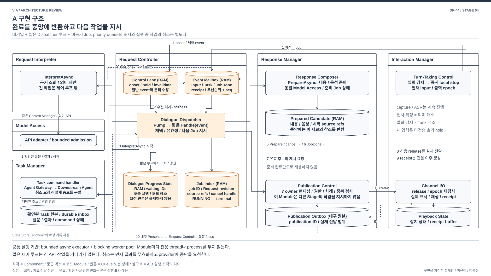
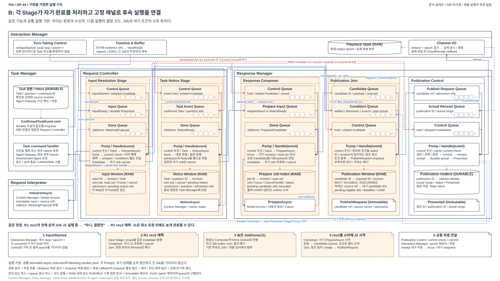

# DP-44 구현을 가정한 실행 구조

> 2026-10-13 / 문서 설계안 / A와 B 미선정 / 제품 구현과 품질 측정 아님
> [44 본문](./04-44-continuous-interaction.md) / [공통 실행 계약](./04-40-common-execution-contract.md)

**DP-44의 구조도는 사건이 들어가는 대기열, 짧은 상태 전이 코드, 오래 걸리는 작업, 완료 반환, 취소와 게시 경로까지 보여야 한다.** 기존 MAIN은 Component와 실행 조직의 차이를 설명하지만, 실제 코드를 어떻게 구성할지 판단하기에는 추상적이다. 아래 두 장은 기존 A/B를 구현 가능한 코드 조직으로 펼친 제안이다. 라이브러리와 언어, 수용량 숫자를 선정하지 않는다.

## 1. 그림의 범위와 읽는 법

DP-44는 자연스러운 대화를 위한 청취와 발화의 실행 구조를 비교한다. 핵심 협력은 Interaction Manager의 입력과 실제 출력, Request Controller의 의미 채택 및 대화 제어, Response Manager의 준비와 게시다. [공통 경로와 전체 일곱 그림은 44 본문](./04-44-continuous-interaction.md#0-먼저-확인할-dp의-범위와-전체-그림)에 직접 표시한다. 이 문서는 코드 조직의 보충 설명이다.

두 구현 그림에서 같은 위치의 Component는 같은 책임을 맡는다. 왼쪽 Request Interpreter는 의미를 제안하고, Task Manager는 확인된 업무 사실을 제공한다. 중앙 Request Controller는 의미 채택과 요청 제어, 오른쪽 Response Manager는 응답 준비와 게시, Interaction Manager는 입력과 실제 출력을 소유한다. 살구색은 A/B에서 실행 조직이 다른 코드와 임시 상태다.

Agent의 질문 및 결과는 Downstream Agent → Agent Gateway → Task Manager → Request Controller → Response Manager → Interaction Manager 경로를 따른다. Task Manager의 확인 및 원본 저장, Request Controller의 대화 연결과 질문 등록을 거친다. Request Controller와 Task Manager의 업무 제어 및 사건 교환은 A/B 공통이며, 완료와 대기를 연결하는 코드 조직이 다르다.

원통의 RAM 표시는 대기열이나 실행 상태다. 독립 DB, thread 또는 process를 뜻하지 않는다. Publication Outbox와 Task 원본은 내구 기록이다. 각 owner가 State Store에 저장하며 저장소가 의미나 업무를 판단하지 않는다. Context Manager와 Policy Manager는 기존 조회 및 현재 권한 port로 사용한다. Agent Gateway와 Downstream Agent는 Task command handler가 호출하는 기존 전달 경로다. 전체 10개 Component의 배치는 [기존 MAIN](./diagrams/choice44-structure.svg)을 따른다.

Module 안의 `Pump`는 대기열에서 사건을 꺼내 짧은 handler를 실행하는 코드다. `InterpretAsync`, `NoticeAsync`, `PrepareAsync`는 근거 조회나 API 처럼 오래 걸릴 수 있는 작업이다. handler는 이 작업의 완료를 기다리는 대신 job ID와 취소 handle을 등록하고 돌아온다. 완료 callback은 해당 Done port에 결과를 넣는다. 이 구조에서는 새 입력을 처리하는 루프가 긴 모델 호출에 붙잡히지 않는다.

## 2. A: 중앙 Dispatcher와 Job 반환



[편집 가능한 draw.io](./diagrams/dp44-implementation-a.drawio) / [PNG](./diagrams/dp44-implementation-a.png)

### 2.1 코드와 상태

| 구현 요소 | 소유와 역할 |
| --- | --- |
| Control Lane | Request Controller의 별도 수용 경로. onset, hold, 채택된 무효화 같은 제어가 일반 사건의 backlog에 막히지 않게 한다. 자연어 “취소해”의 의미는 Request Interpreter가 판단한다. |
| Event Mailbox | conversation별 Input, 확인된 Task 사건, JobDone, Presented를 받는다. 사건을 선택하는 우선순위와 동률의 sequence, 중요 질문 및 완료의 fairness를 적용한다. |
| Dialogue Dispatcher | 짧은 `Handle(event)`에서 현재 상태를 확인하고 의미를 채택하거나 다음 Job을 지시한다. 이해 완료 뒤 준비, 준비 완료 뒤 게시를 이 코드가 연결한다. |
| Dialogue Progress State | 기다리는 ID, continuation, 후보 참조, 보류한 전달을 연결한다. 확정 Request나 Task 사실의 복제 원본이 아니다. |
| Job Index | job ID별 시작 revision, read dependency, cancel handle, 실행 상태를 가진다. 종료가 확인되기 전까지 취소 요청한 Job도 추적한다. |
| 비동기 실행 기반 | Request Interpreter와 Response Composer의 긴 작업을 실행한다. 완료를 Dispatcher의 Event Mailbox로 반환하며, 후속 단계는 임의로 시작하지 않는다. |

priority queue 하나가 모든 일을 해결하지는 않는다. queue는 **다음에 처리할 사건**을 고른다. 이미 진행 중인 API 호출의 중단은 Job Index의 handle을 통한 별도 요청이고, 사용자에게 말할 차례는 Publication Control의 책임이다. 입력의 인과관계와 owner revision도 우선순위로 뒤집지 않는다.

### 2.2 번호로 따라가는 실행

| 번호 | 동작 |
| --- | --- |
| 1 | Interaction Manager가 입력을 계속 받는다. onset은 즉시 로컬 출력을 멈추고 제어 lane에 전달한다. 확정 Input과 Task Manager의 확인된 사건은 Event Mailbox에 들어간다. |
| 2 | Dispatcher가 제어를 우선 수용하고 짧은 상태 전이를 수행한다. onset 처리로 Request Controller의 미전송 admission을 hold한다. |
| 3 | Input의 의미가 필요하면 InterpretAsync를 시작하고 Job Index에 등록한다. Dispatcher는 다음 사건을 처리한다. |
| 4 | 이해 완료가 job ID, 시작 revision, source refs와 함께 Mailbox로 돌아온다. Dispatcher가 유효성을 확인한 뒤 Request Controller의 의미 채택을 수행한다. |
| 5 | 직접 응답이나 유효 업무 알림을 준비하도록 Response Composer에 요청한다. 같은 Job 제어 경로로 불필요한 준비의 취소도 요청한다. |
| 6 | 준비 완료가 후보 참조와 함께 Mailbox로 돌아온다. Dispatcher가 진행 상태 및 현재 owner 사실과 연결한다. |
| 7 | Dispatcher가 유효 후보의 게시를 요청한다. Publication Control이 현재성, 권한, 차례, 중복을 최종 확인하고 publication 기록을 확정한다. |
| 8 | release를 받은 Interaction Manager가 재생 직전 input 및 출력 epoch를 검사하고 실제 전달한다. |
| 9 | 실제 전달 뒤 receipt로 Publication Outbox와 Playback State를 갱신한다. 생성 완료를 전달 완료로 세지 않는다. |
| 10 | 내구 Presented 사실을 Request Controller에 돌려 실제 제시 질문 focus를 갱신한다. |

개념적인 루프는 다음과 같다. 아래는 실행한 코드가 아닌 동작 설명이다.

```text
Pump:
  event = mailbox.take_with_priority_and_fairness()
  transition = handle_short(event, progress, job_index)
  apply_owner_changes(transition)
  for job in transition.jobs_to_start:
    job_index.register(job)
    executor.start(job, done => mailbox.post(JobDone(done)))
  for job_id in transition.jobs_to_cancel:
    job_index.mark_unusable(job_id)
    job_index.request_cancel(job_id)
  return to Pump
```

`apply_owner_changes`는 해당 owner의 검증과 저장 경계를 사용한다. 일반 코드가 Task 사실이나 의미 생산자의 판단을 대신 확정하지 않는다. thread를 하나씩 만드는 `executor.start`로 해석하지 않는다.

## 3. B: 고정 연결과 Stage별 제어 루프



[편집 가능한 draw.io](./diagrams/dp44-implementation-b.drawio) / [PNG](./diagrams/dp44-implementation-b.png)

### 3.1 연결을 실제 코드로 만든다는 의미

프로그램 시작 시 port를 연결한다. 결과마다 전체 흐름을 결정하는 중앙 handler를 부르는 구조가 아니다. 각 Module은 자기 mailbox와 Job/Window만 관리하며 자기 입력이 준비되면 작업을 시작한다. 그림의 queue는 다음 연결의 실제 수용 지점이다.

| 생산자 출력 | 연결된 소비자 입력 | 소비자 동작 |
| --- | --- | --- |
| Interaction Manager의 Input와 onset/control | Input Resolution Stage의 Data/Control lane | 입력별 InterpretAsync 시작, 자기 Done 처리, Request Controller의 채택과 hold 관리 |
| Task Manager의 확인된 질문/결과 | Task Notice Stage의 Task lane | 대화 연결, 질문 등록, 공개 범위와 admission 확인, 유효 Notice 생산 |
| Request Interpreter의 완료 | 시작한 Input Resolution Stage의 Done port | 자기 Job의 revision과 read set 검사. 다른 Stage의 다음 Job을 지시하지 않음 |
| 채택 의미, 확인 질문/제어 안내, 유효 Notice | Response Composer의 준비 port | 직접 응답이나 업무 알림 준비. 새 revision의 폐기 제어로 관련 준비 Job 무효화 및 취소 요청 |
| InputSettled, admission, source revision/validity | Publication Join의 Condition Queue | 해당 candidate가 기다리는 조건 갱신. onset/무효화는 제어 lane에서 처리 |
| Response Composer의 준비 완료 | Candidate Queue | Composer의 자기 Done 처리 후 후보 전달. Join은 후보를 소비해 조건과 결합 |
| Join의 eligible 후보 | Publication Control의 게시 port | 공통 최종 검사와 내구 publication 확정. 앞 Stage의 작업 순서를 결정하지 않음 |
| 실제 전달 후 확정한 Presented | Request Controller와 과거 전달 snapshot port | 실제 질문 focus와 다음 후보가 쓸 확정 snapshot 갱신 |

**fan-out은 각 필요한 소비자에게 별도로 전달하는 코드다.** 예를 들어 채택 의미는 Composer의 준비 입력에, InputSettled와 admission은 Join의 조건 입력에 각각 게시한다. 하나의 queue를 여러 소비자가 읽게 하는 것만으로는 두 소비자가 같은 event를 모두 받는다고 보장하지 않는다. 둘 중 하나만 받은 채 다음 단계가 진행되지 않도록 각각의 전달 및 실패를 추적한다.

Composer에도 짧은 Pump, Control lane, 준비 Job Index와 Done port가 있다. 그림에서는 공통 Response Composer 내부로 묶었다. 긴 PrepareAsync가 끝나면 자기 Done port로 돌아오고, 유효한 결과만 Candidate Queue에 넣는다. 각 Stage의 Control 처리는 긴 작업이나 가득 찬 출력 queue를 기다리지 않는다. 출력은 credit이 생길 때 배출하며 별도 pending 항목도 상한 안에서 추적한다.

### 3.2 Publication Join은 무엇을 구현하는가

Join은 “가장 최근 값” 몇 개를 무조건 붙이는 기능이 아니다. `candidate ID`별 Publication Window를 두고 후보가 요구한 **source ID와 revision**에 맞는 자료만 결합한다.

| Window에 있는 값 | 쓰는 이유 |
| --- | --- |
| conversation ID, candidate ID, kind | 다른 대화나 후보의 조건을 섞지 않는다. content, clarification, control, failure의 admission을 구별한다. |
| 필요한 Input/Request/Task/question/source 참조와 revision | 해당 후보의 dependency가 유효한지 확인한다. 새 입력 하나로 무관한 모든 업무를 폐기하지 않는다. |
| admission 및 InputSettled 또는 별도 clarification admission | 새 입력의 관계가 미해결이면 관련 내용을 보류한다. 그 입력을 해결할 확인 질문은 자기 InputSettled를 기다리지 않는다. |
| 게시 전 확정된 과거 delivery/focus snapshot | 실제 제시된 질문을 연결한다. known-empty와 UNKNOWN을 구별하며 자기 후보의 미래 receipt를 기다리지 않는다. |
| deadline, 상태, 중복 키 | WAIT_DEPENDENCY, ELIGIBLE, DISCARDED를 구별한다. 조건 누락을 무한 대기로 숨기지 않는다. |

Condition Queue의 event가 늦게 도착할 수 있으므로 Join 통과만으로 재생 권한이 생기지는 않는다. Publication Control은 원본 owner에 현재성을 확인하고, Interaction Manager는 release와 현재 장치 epoch를 재검사한다.

### 3.3 번호로 따라가는 실행

| 번호 | 동작 |
| --- | --- |
| 1 | Input와 업무 사건을 각 port에 넣는다. onset/control은 Input 및 Notice 제어 경로에 fan-out하며 로컬 stop는 먼저 수행한다. |
| 2 | 각 Stage의 Pump가 자기 입력과 제어를 처리한다. 각 Window는 자기 Job과 대기만 가진다. |
| 3 | Input Resolution Stage가 InterpretAsync를 시작한다. 완료는 이 Stage의 Done port에 돌아와 현재 검사와 채택을 수행한다. |
| 4 | 채택 의미와 유효 Notice가 연결된 Composer를 활성화한다. settled/admission/source 및 폐기 제어는 필요한 소비자에게 별도로 전달한다. |
| 5 | Composer가 준비 완료를 Candidate Queue로 보낸다. Join이 Condition Queue의 참조별 값과 결합한다. |
| 6 | 조건을 충족한 후보만 Publication Control의 게시 port에 전달한다. 미충족은 Window에서 대기 또는 폐기한다. |
| 7~10 | A와 같은 최종 게시, 실제 전달, receipt 저장과 질문 focus 갱신을 수행한다. 번호 7은 공통 Publication Control의 동작이다. |

국소 루프는 다음과 같다. 읽기와 API 작업의 완료가 모두 자기 mailbox에 들어오므로 제어 처리를 계속할 수 있다.

```text
StagePump:
  event = own_mailbox.take_control_or_data_or_done()
  transition = handle_short(event, own_window, own_jobs)
  apply_owner_changes(transition)
  start_async_jobs(done => own_mailbox.post(JobDone(done)))
  request_cancel_for_invalidated_own_jobs()
  queue_outputs_for_fixed_ports(transition.outputs)
  flush_outputs_with_credit_without_blocking_control()
  return to StagePump
```

이름을 Stage로 바꾼 뒤 모든 완료를 한곳으로 보내고 다음 worker를 거기서 고르면 A와의 구조 차이가 사라진다. 반대로 A에서 종류별 handler를 나눠도 다음 실행을 Dispatcher가 명령하면 A다.

## 4. 같은 정정을 끝까지 추적

먼저 하나의 흐름으로 설명한다. R1의 개정 1은 “보고서 전체를 요약해줘”이며 준비 Job J1이 실행 중이다. 아직 답변을 전달하지 않았다. 사용자가 “아니, 결론만”이라고 말한다. 별도 업무나 확인 질문을 이 예시에 추가하지 않는다.

| 시점 | 공통 사실 | A에서 실행하는 코드 | B에서 실행하는 코드 |
| --- | --- | --- | --- |
| 새 발화 시작 | 출력 중이면 즉시 로컬 stop. Request Controller가 미전송 효과와 관련 게시를 hold. 아직 R1 취소로 확정하지 않음 | Control Lane을 Dispatcher가 우선 처리 | Input Resolution Stage의 Control handler가 hold. 필요한 소비자로 조건 제어 전달 |
| 새 발화 이해 중 | 기존 근거와 실제 전달 참조로 정정 대상을 판단. 입력 capture/ASR 계속 | Dispatcher가 새 이해 Job 시작 | Input Resolution Stage가 새 이해 Job 시작 |
| 정정 채택 | Request Controller가 R1 개정 2와 정정 범위를 확정. 바뀌지 않은 보고서 원본과 근거는 재사용 가능 | Dispatcher가 Job Index에서 R1 개정 1에 의존한 J1과 후보를 무효화하고 cancel 요청 | 새 revision/Invalidate가 고정 port에 전달. Composer가 자기 J1을 무효화하고 cancel 요청. Join은 관련 Window 폐기 |
| J1 늦은 완료 | provider가 취소를 지원하지 않아 완료할 수 있음. 구 revision의 결과는 신규 게시에 사용하지 않음 | JobDone을 회수해 무효 결과를 폐기하고 종료 상태와 비용 추적 | Composer가 자기 Done에서 무효 결과 폐기. 이미 전달된 구 후보도 Join/최종 검사에서 탈락 |
| 결론 요약 J2 | R1 개정 2와 source refs에 맞춰 새 내용 준비 | Dispatcher가 J2 시작, 완료 회수 후 게시 요청 | Composer가 채택 입력을 소비해 J2 시작. 후보가 Join을 통과하면 게시 port로 전달 |
| 실제 전달 | 두 안 모두 최종 현재 검사, 현재 출력 release, 실제 receipt 사용 | 공통 Publication Control과 Interaction Manager | 공통 Publication Control과 Interaction Manager |

다른 Task T2의 완료 알림이 함께 있었다면, R1을 바꿨다는 이유만으로 T2를 무효화하지 않는다. 새 입력의 관계가 미해결인 동안 공통 정책에 따라 보류할 수 있지만, 무관함과 source 유효성이 확인되면 보존한 알림을 현재 차례에 전달한다. 예전 출력 epoch의 release는 새로 검사하고 발급한다. candidate가 오래됐다는 것과 후보 내용의 dependency가 무효라는 것을 구별한다.

## 5. 중단과 폐기는 네 동작으로 분리

| 동작 | 실제 구현상 처리 |
| --- | --- |
| 로컬 출력 중단 | Interaction Manager가 출력 epoch를 바꾸고 현재 재생을 멈춘다. 의미 모델이나 Dispatcher의 Job 종료를 기다리지 않는다. |
| 결과 무효화 | owner가 채택한 정정 범위에 맞춰 관련 Job과 candidate에 unusable 표시. 늦은 완료가 도착해도 소비하거나 게시하지 않는다. 원본 이력과 이미 실제 전달한 범위는 보존한다. |
| 실행 취소 요청 | Job의 cancel handle로 worker/provider에 요청. token 변경만으로 물리 종료나 자원 반환이 확인된 것으로 세지 않는다. 원격 계산 지속 가능성과 실제 청구를 추적한다. |
| 외부 업무 취소 | Request Controller → Task Manager → Agent Gateway → Downstream Agent. 미전송 명령 철회와 이미 전송한 업무의 취소 요청을 구별한다. 접수, 종료 확인, 실패와 UNKNOWN을 실제 외부 사실대로 남긴다. |

입력과 중요한 질문, 완료, 실패, receipt를 임의 drop하지 않는다. 확인된 외부 사건은 내구 inbox를 먼저 보존하고 준비 admission을 제한한다. progress 최신값은 합칠 수 있다. RAM window, pending 출력과 job 수는 상한을 가지며 중요 backlog가 넘치면 원본을 유지한 채 추가 준비를 멈추고 처리 불가를 드러낸다. 우선순위 값, queue 크기와 deadline 숫자는 후속 구현 계약에서 정할 항목이다.

## 6. 이 그림으로 판단할 구조 차이

**A는 전체 후속 실행의 연결을 Dispatcher와 Progress State에 모은다. B는 고정 연결을 따라 소비자가 활성화되고 국소 Window 및 Publication Join에 대기와 폐기를 나눈다.** 같은 bounded executor와 API 수용량을 사용하므로 B만 비동기이거나 A만 priority를 쓰는 비교가 아니다.

A에서 검토할 비용은 중앙 전이 규칙과 continuation 관리가 늘어나는 것이다. B에서 검토할 비용은 각 port의 전달 실패, 국소 Job/Window, 조건의 version 결합, credit과 무효화 전파를 함께 관리하는 것이다. 이 조직 차이가 VIA의 대표 교차 사건에서 의미 있는 품질 차이를 만드는지는 아직 확인하지 않았다.

[생성기](../../../../scripts/architecture/generate_dp44_implementation_diagrams.py)는 공통 경로와 두 구현 구조의 SVG 및 draw.io를 같은 scene에서 생성한다. [렌더 도구](../../../../scripts/architecture/render_dp44_implementation_diagrams.cjs)는 PNG와 [렌더 기록](./diagrams/dp44-implementation-render.json)을 만든다. 도식 검수는 Component 포함, 배선, 글자 배치와 생성물 일치를 확인하며 제품 실행이나 A/B 품질을 검증하지 않는다.
