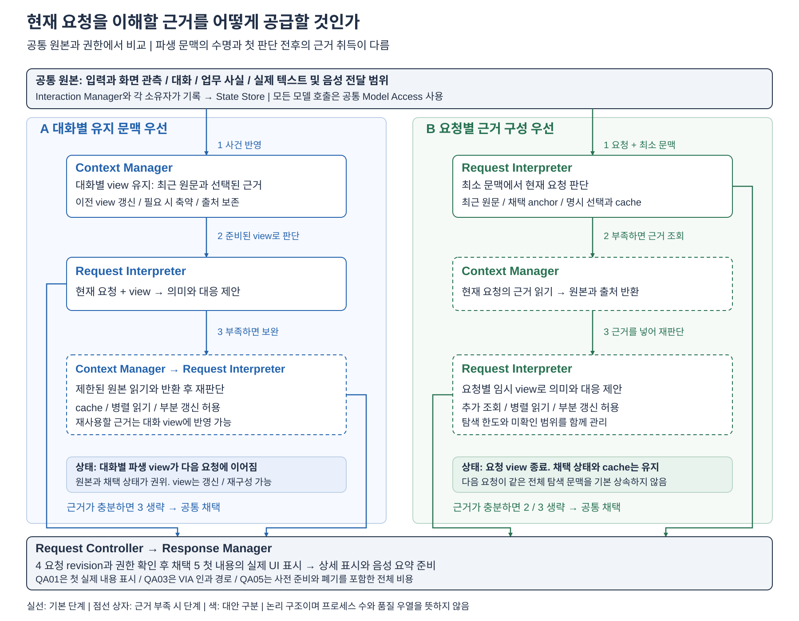

# 첫 비교: 현재 요청에 필요한 근거를 공급하는 구조

2026-10-16 / QA에서 도출한 첫 구조 비교 / A/B 미선정

## 1. 먼저 읽을 판단

**VIA는 첫 응답을 하기 전에 사용자가 지금 무엇을 가리키는지 알아야 한다. 필요한 근거는 현재 화면뿐 아니라 방금 한 말, 이전에 실제 들려준 설명, 수정된 업무 조건에 나뉘어 있다. 이 근거를 대화의 유지 문맥에 준비해 둘지, 현재 요청에 맞춰 가져올지가 첫 비교 문제다.**

주 비교는 **A 대화별 유지 문맥 우선**과 **B 요청별 근거 구성 우선**이다. A는 관련 근거가 이미 들어 있는 연속 대화에서 조회 왕복을 피하기 쉽다. B는 주제가 바뀌거나 좁은 일부만 필요한 요청에서 불필요한 모델 입력과 문맥 유지 비용을 줄이기 쉽다. 양쪽 모두 원본 재조회, cache, 부분 갱신과 병렬 읽기를 허용한다.

추가로 조사한 **C 별도 근거 처리자**는 실용적인 구조지만 A/B에 조합할 수 있다. 따라서 서로 배타적인 세 번째 방안으로 놓지 않는다. 별도 문맥으로 탐색을 넘겼을 때 주 해석기의 반복 입력을 줄이는 이익이, 추가 해석과 반환 비용을 넘는지 별도로 따진다.

**권고는 A/B를 첫 심화 비교로 유지하되 주요 DP 확정은 보류하는 것이다.** QA01/03/05의 손익은 실행 경로로 설명할 수 있다. QA02 차이는 가능한 실패 경로까지 확인했지만 강한 대안 간 우열은 아직 약하다. QA04는 동점 가능성이 크다. 단순한 cache 정책 조정으로 양안이 수렴하는지도 남은 핵심 질문이다. 그 경우 이 주제를 상세 설계로 내려야 한다.

[전체 기능 지도](./README.md) / [고정 소스 조사](../../../../references/qa-first-evidence-supply-20261016.md) / [QA 명세](../qa-candidate-package/README.md)

## 2. VIA에서 왜 어려운가

같은 ‘두 번째 것’이라도 직전 설명의 두 번째 항목, 화면에 남은 두 번째 카드, 다른 Task의 두 번째 자료를 뜻할 수 있다. ‘아까 들려준 부분’은 생성된 음성 전체가 아니라 실제 재생된 범위다. 발화 중 두 차트를 가리켰다면 마지막 화면이나 최종 포인터 위치만 읽어서도 안 된다. 이후 ‘표는 바꾸고 문단 수정은 유지해’라는 정정은 기존 판단의 일부를 재사용해야 한다.

이때 근거를 많이 주면 항상 정확하고 빠르다는 보장은 없다. 입력량과 관련 없는 내용이 늘고, 오래된 조건을 최신 조건과 혼동할 수 있다. 적게 주면 첫 모델 호출 이후 원본 조회와 재해석이 필요할 수 있다. 최초 해석이 무엇을 조회할지 잘못 판단하면 정답 원본이 있어도 찾지 못한다. 이것이 QA01의 첫 응답, QA02의 대상 집합, QA03의 전체 VIA 처리와 QA05의 비용을 동시에 건드리는 이유다.

### 고정할 기능 경계

- VIA 내부 작업은 사용자 요청을 이해하기 위한 제한된 읽기, 검색, 관측 조합과 판단이다. 실제 보고서 작성, 조사 계획과 업무 도구 실행은 Downstream Agent에 위임한다.
- 이번 비교는 **같은 원본 관측을 어떻게 모델에 공급하는지**를 다룬다. 음성과 화면을 어떤 장치 API로 획득하고 시간에 맞추는지는 공통 입력 조건이다. timestamp만으로 의도가 판명된다고 가정하지 않는다.
- Request Interpreter가 지칭과 Task 연관성을 제안한다. Task ID를 입력 전에 정답으로 지정하지 않는다. Request Controller가 현재 revision, 권한과 중복 조건을 검사해 채택한다.
- 첫 내용 응답은 채택한 구체적인 처리 의도를 알리는 문장일 수도 있다. 이를 위해 필요한 지칭과 조건만 확인되면 먼저 표시할 수 있다. 이후 상세 답변에 필요한 전체 자료 읽기나 Agent 접수를 첫 응답의 선행 조건으로 강제하지 않는다. 완료 사실은 실제 완료 범위에서만 말한다.
- Task Manager와 Agent Gateway의 업무 사실, Response Manager의 실제 표시 / 음성 전달 기록을 사용한다. 생성 예정 문장을 실제 전달 사실로 바꾸지 않는다.
- 이 비교는 현재 QA 후보와 [공통 실행 계약](../04-40-common-execution-contract.md)의 로컬 VIA, cloud 음성 / 의미 모델 조건을 사용한다. 같은 provider, 모델, 호출 제한과 worker 예산을 둔다. 서로 다른 모델이나 로컬 가중치 복제로 차이를 만들지 않는다.

## 3. 비교 구조

[편집용 draw.io](./diagrams/response-evidence-supply.drawio) / [PNG](./diagrams/response-evidence-supply.png) / [생성 코드](./diagrams/generate_response_evidence_supply.py)

그림은 논리 책임과 데이터 수명을 보여 준다. 상자는 프로세스 수를 뜻하지 않는다. A의 추가 조회와 B의 cache hit를 모두 허용한다. 두 안의 모든 모델 호출은 공통 Model Access를 사용하며, 채택 이후 상세 표시와 음성 준비도 동일한 Response Manager 경로를 따른다.

### A. 대화별 유지 문맥 우선

**최근 대화와 관련 근거를 반영한 모델 입력 view를 대화 수명 동안 유지한다.** 새 입력이 오면 이 view와 최신 관측을 사용해 의미 판단을 시작한다. 오래되거나 큰 자료는 출처가 있는 요약과 참조로 압축하고 원본을 별도로 보존한다.

1. Interaction Manager가 입력과 관측을 기록한다. 실제 출력과 업무 사건도 각 소유자가 기록한다.
2. Context Manager가 대화별 view를 갱신한다. 최신 발화와 정정은 원문을 유지하고, 오래된 부분은 필요한 경우 축약한다. token 한도와 만료 정책을 둔다. 사용자 입력 이전에 수행한 작업도 비용에 포함한다.
3. Request Interpreter가 현재 요청과 준비된 view를 함께 읽고 판단한다. 이미 근거가 충분하면 조회 호출 없이 채택 제안을 낸다.
4. 부족한 근거가 있으면 같은 해석 흐름에서 원본을 제한된 범위로 조회하고 재판단한다. 조회 결과는 출처와 의존 관계를 가진 채 view에 남길 수 있다.
5. Request Controller가 채택한 뒤 Response Manager가 첫 내용 단위를 실제 표시한다. 다음 대화는 갱신된 view에서 이어 간다.

**실제 근거:** OpenHands는 보존한 사건에서 rolling view를 구성하고 필요할 때 condensation 사건을 남겨 모델 입력을 축약한다. [RollingCondenser](https://github.com/OpenHands/software-agent-sdk/blob/fd387b58dc7b707b73c159845c0396a17000be24/openhands-sdk/openhands/sdk/context/condenser/base.py#L107), [Agent.step](https://github.com/OpenHands/software-agent-sdk/blob/fd387b58dc7b707b73c159845c0396a17000be24/openhands-sdk/openhands/sdk/agent/agent.py#L694). 이 구조를 VIA의 관측과 전달 기록까지 확장한 것이 A다.

**강한 A의 조건:** 전체 transcript나 모든 화면을 매번 넣지 않는다. 안정된 prefix cache, 원본 검색, 최근 근거 pinning, 부분 갱신을 사용할 수 있다. 요약이 필요할 때만 수행하며 요청 경로에서 일어나면 그 시간을 그대로 센다. 이미 완성된 정확한 의미 기억을 무료로 제공하지 않는다.

### B. 요청별 근거 구성 우선

**최근 원문과 채택된 지칭 anchor 등 공통 최소 문맥에서 시작하고, 필요한 근거를 요청별로 구성한다.** 자료와 이력은 원본 저장소 및 검색 가능한 참조로 남긴다. 현재 요청에서 사용한 모델 입력 전체를 다음 요청의 기본 문맥으로 계속 물려주지는 않는다.

1. 같은 입력, 관측과 사실을 기록한다. 최근 대화, 채택된 대상, 진행 중인 대응 등 필요한 연속성 정보는 최소 문맥에 유지한다. 매번 빈 대화로 시작하지 않는다.
2. Request Interpreter가 최소 문맥과 요청을 읽는다. 단순 질문과 바로 이어지는 지칭은 이 단계에서 판단할 수 있다. 코드로 식별 가능한 명시 선택과 이미 유효한 cache도 즉시 사용할 수 있다.
3. 근거가 부족하면 해석기가 검색과 원본 읽기를 요청한다. Context Manager는 권한과 범위를 적용해 원본 및 출처를 반환한다. 여러 독립 원본은 예산 안에서 병렬로 읽을 수 있다.
4. Request Interpreter가 반환 근거를 요청별 임시 view에 넣어 재판단한다. 필요한 경우 추가 조회하되 호출 / 시간 / 자료량 한도를 지킨다.
5. 채택과 표시 후 의미 있는 채택 결과, 출처, 원본 cache는 남긴다. 요청별 탐색 과정과 모델 입력 view는 완료 또는 폐기 조건에 따라 종료한다. 다음 요청은 최소 문맥과 사용 가능한 cache에서 시작한다.

**실제 근거:** Deep Agents는 큰 이력과 도구 결과를 backend에 보존하고, 모델이 `read_file` 등으로 필요한 범위를 다시 읽는 메커니즘을 제공한다. [범위 읽기](https://github.com/langchain-ai/deepagents/blob/7764f1f8d21a594f0cbd31d273a7cad36597d6ba/libs/deepagents/deepagents/middleware/filesystem.py#L2241), [이력 offload와 요약](https://github.com/langchain-ai/deepagents/blob/7764f1f8d21a594f0cbd31d273a7cad36597d6ba/libs/deepagents/deepagents/middleware/summarization.py#L1526). 요청별 view의 수명은 이 실제 메커니즘을 VIA 요구에 맞춰 구성한 제안이다. Deep Agents 전체가 B만 사용한다는 뜻은 아니다.

**강한 B의 조건:** 최근 원문, 현재 선택과 실제 전달 anchor를 없애서 조회를 강제하지 않는다. 반복 질의 cache와 채택 결과의 재사용을 허용한다. 원본 검색의 index 생산과 embedding 비용, 실패한 탐색도 모두 센다. 사용자가 정답 근거를 사전에 지정했다고 가정하지 않는다.

### 상태와 실행의 실제 차이

| 항목 | A | B |
| --- | --- | --- |
| 해석 전의 주된 준비물 | Context Manager가 유지한 대화별 모델 입력 view | 최근 원문 / 채택 anchor의 최소 문맥과 원본 참조 / cache |
| 추가 근거 취득의 기본 계기 | view의 유지와 요청 해석 중 부족함의 발견 | 현재 요청 해석 중 필요 근거의 발견 |
| 모델 입력의 수명 | 이후 대화에 이어 사용할 view가 남음 | 요청별 탐색 view는 종료. 명시 채택 상태와 원본 cache만 다음 입력에 재사용 |
| 정정 시 갱신 범위 | 수정된 사실을 참조하는 view 조각과 파생 요약의 무효화 또는 재구성 | 해당 요청 view의 재판단과 공통 cache / anchor의 무효화 |
| 준비 실패의 처리 | view를 낡은 채 사용하지 않고 유효 조각과 원본 재조회로 진행 | 원본 조회 실패를 누락 없이 반환하고 충분한 근거인지 재판단 |
| 주된 비용 | 유지 / 축약과 관련 없는 내용의 반복 입력. hit가 많으면 조회 반복을 절약 | 요청별 판단 → 조회 → 재판단의 왕복. 좁은 조회와 cache가 많으면 입력을 절약 |

State Store의 원본 사건, 실제 전달, 채택 상태는 양안 공통이다. A의 view와 B의 임시 view는 모두 파생 상태다. 어느 쪽도 요약 문장을 원본보다 높은 권위로 두지 않는다.

## 4. C를 독립 대안으로 세우지 않은 이유

**C는 근거를 찾는 실행을 주 해석기와 분리하는 선택이다.** Context Manager 내부의 별도 근거 처리자가 자기 모델 문맥과 탐색 상태를 갖고 원본을 읽는다. Request Interpreter에는 근거 묶음을 돌려준다. 논리 분리만 필요하며 별도 서비스나 OS 프로세스를 전제하지 않는다.

실제 구현으로 OpenClaw Active Memory는 일부 요청에서 주 응답의 prompt를 만들기 전에 별도 recall 결과를 기다린다. 일반 turn은 건너뛰고 현재 입력과 최근 대화로 query를 만든다. [조건부 recall과 주입](https://github.com/openclaw/openclaw/blob/e7a155a8ae860d71b1ab5eed45fa4af338011db9/extensions/active-memory/index.ts#L517). CrewAI의 [RecallFlow](https://github.com/crewAIInc/crewAI/blob/3da2d4e9932b5f2fa9aa73ea9245e0f8b5c154f8/lib/crewai/src/crewai/memory/recall_flow.py#L1)는 질의 분석, 범위별 검색, 근거의 부족함과 추가 탐색을 별도 상태로 관리한다.

VIA에 옮길 C의 반환물은 짧은 단정적 요약 한 개로 끝내지 않는다. 다음 내용을 갖춘다.

- 읽은 원본의 `source_id / revision / extent`와 요청 revision
- 요청과 관련 있다고 본 후보 및 원본 구절 / crop 참조
- 확인하지 못한 범위, 충돌하는 후보와 조회 실패
- 어떤 전달 기록과 조건에서 근거를 얻었는지

근거 처리자에게 올바른 Task와 지칭 대상부터 알려 주지 않는다. 원래 발화와 필요한 최근 맥락을 전달한다. 최종 지칭, Task 연관성과 대응 채택 권한은 주 해석 경로에 남는다. 반환 내용이 부족하면 추가 근거를 요청할 수 있다.

| C를 붙일 때 이익이 가능한 조건 | 치르는 비용과 반례 |
| --- | --- |
| 여러 번의 검색 중간 결과가 크고 최종 근거는 작음. 주 해석기의 반복 입력에서 중간 자료를 제거 가능 | query 해석, 검색 후 반환 가공과 주 해석기의 재판단이 추가. 한 번 읽으면 되는 질문은 대개 불리 |
| 제한된 범위의 근거 생산 계약을 안정적으로 반복 사용 | 별도 query에 암묵적 지칭이 빠지거나 반환에서 후보가 탈락. 누락을 주 해석기가 알아채지 못할 수 있음 |
| 별도 helper 예산으로 독립 자료 검색을 수행 | B도 같은 병렬 도구 호출을 할 수 있음. 별도 담당자가 있다는 이유만으로 병렬성 이익을 부여할 수 없음 |

A가 view에서 부족한 내용을 C에게 보완 요청할 수도 있고, B가 요청별 근거 구성을 C에게 맡길 수도 있다. 따라서 **A/B는 근거 공급과 view 수명, C는 탐색의 문맥 소유자**에 관한 선택이다. 이 두 축을 A/B/C 한 줄로 비교하면 변화 원인을 분리할 수 없다. 이번에는 직접 조회하는 A/B를 주 비교로 두고 C의 추가 여부는 후속 세부 선택으로 남긴다.

Magentic-One의 [WebSurfer](https://github.com/microsoft/autogen/blob/027ecf0a379bcc1d09956d46d12d44a3ad9cee14/python/packages/autogen-ext/src/autogen_ext/agents/web_surfer/_multimodal_web_surfer.py#L490)는 native 대상 목록과 screenshot을 같이 공급하는 참고 사례다. 이번 A/B가 공통으로 받을 관측 묶음에 참고했으며, 다섯 제품에 하나씩 자리를 만들기 위해 별도 대안을 추가하지 않았다.

## 5. 같은 VIA 장면을 양안에서 따라가기

[COMMON-28](../qa-candidate-package/common-scenarios.md)의 입력을 사용한 구조 검토다. 아래는 예상 경로이며 실행 결과가 아니다. 쉬운 입력과 cache hit를 함께 남겨 어려운 장면만으로 차이를 키우지 않는다.

| 같은 입력과 필요한 근거 | A에서의 처리 | B에서의 처리 | 기대 차이와 제한 |
| --- | --- | --- | --- |
| **S01**: TCP 다음에 UDP를 설명한 뒤 ‘방금 두 번째 방식은 언제 써?’ | 최근 원문과 순서가 view에 있어 바로 UDP를 대상으로 판단 | 최소 최근 문맥에 같은 두 설명이 있어 바로 판단 | **동점 예상.** B에 매번 검색을 강제할 근거가 없음 |
| **S03**: 현재 명시적으로 선택한 문단이나 도형을 말로 지정 | 현재 선택을 view에 결합해 읽음 | 현재 선택을 요청의 명시 근거로 즉시 읽음 | **동점 예상.** 근거가 이미 특정된 입력은 양안의 단순 경로. 채택한 구체적 처리 안내가 가능하면 상세 읽기 전에 표시 |
| **S05**: 6초 동안 ‘이 그래프와 저 그래프를 비교해줘.’ A를 1초, B를 3초에 가리키고 4초에는 빈 곳으로 이동 | 발화 구간의 관측을 view에 포함. A/B와 시간 관계를 공동 해석 | 같은 구간의 관측을 명시 입력으로 받거나 제한된 범위 읽기로 취득해 해석 | B가 모델 판단 뒤 조회해야 하면 왕복 증가. 발화 구간 관측을 기본 제공하면 **그 차이는 사라짐**. 마지막 포인터만 쓰는 안은 기능 미충족 |
| **S08**: 표 T1/T2는 보존하고 문단 P2 수정. 이어 ‘보존할 표는 첫째와 이 표로 바꿔. 문단 수정은 유지해.’에서 T3 지칭 | 최근 원문과 채택 조건을 갱신하고 T2에 의존한 view 조각만 무효화. P2는 유지 | 채택 조건과 새 관측으로 요청 view를 구성. T1/T3로 수정하고 P2를 유지 | 둘 다 부분 갱신 가능. A가 오래된 T2 요약을 재사용하거나 B가 P2 조건을 빠뜨리는 실패를 비교하되 한쪽에만 강제하지 않음 |
| **S10**: H01의 텍스트는 A/B/C, 음성은 A만 실제 전달. ‘아까 들려준 설명만’ 뒤 ‘화면에 적어둔 두 번째 항목’ | view에 전달 범위가 있으면 바로 후보 구성. 상세 구간이 요약에서 빠졌으면 원장 조회 | 실제 전달 anchor로 원장을 조회하거나 cache를 사용. 청취 요청에는 A, 화면 요청에는 B를 구별 | A의 원장 hit는 왕복 절약. 넓은 view를 읽는 비용과 B의 좁은 조회 비용 비교. 최종 정확도는 둘 다 같을 수 있음 |
| **S11**: H10 비용 비교를 다시 요청하고, 반복 요청 후 H11 일정 설명과의 관계 요청 | H10/H11이 view에 있으면 즉시 재사용. 없으면 조회 후 view에 반영 | 첫 요청에서 H10 조회 후 cache. 반복은 hit. 세 번째에 H11이 없으면 추가 취득 | 첫 요청과 세 번째에는 차이 가능. 두 번째에도 B의 cold lookup을 반복시키면 부당한 비교 |
| **S06-U02 / S09의 지정된 모호 입력**: 관측만으로 대상 하나를 정할 수 없음 | 불확실성을 유지하고 확인 질문 | 동일하게 확인 질문 | 자료를 많이 넣거나 검색을 분리해도 사라지지 않는 모호성. 기존 QA02 제외 규칙을 유지하고 질문 응답 시간은 해당 규칙대로 기록 |

S05와 S11의 다른 Task 진행 / 완료도 동일하게 주어진다. 사건을 받았다는 이유로 무관한 업무 결과 전체를 현재 지칭 입력에 강제로 넣지 않는다. 관련 여부와 source revision은 확인하되, 사건 실행 순서의 차이를 이번 공급 구조의 이익으로 섞지 않는다.

### S10의 채택 단위를 더 자세히 보면

1. 공통 원장은 H01 텍스트 A/B/C의 실제 표시와 음성 A의 실제 전달만 기록한다. 취소된 B/C 음성은 전달 근거가 아니다.
2. 첫 요청의 목표 집합은 음성 A의 범위다. A는 view에 남은 실제 전달 범위를 사용할 수 있고, B는 원장을 읽을 수 있다. 둘 다 원본 참조가 부족하면 보완한다.
3. 두 번째 요청에서는 H01 카드가 다시 활성화된 사실과 화면 텍스트 순서를 읽는다. 올바른 대상은 B다. 이전의 ‘들려준 A’ 집합을 고정해 두면 안 된다.
4. Request Controller가 입력 revision에 대한 대상 집합을 채택한다. 이후 답변 생성이 빨라도 이 집합이 틀렸으면 QA02 실패는 남는다. QA01에는 실제 표시 시간이 남는다.

이 장면은 ‘검색 결과가 관련 있어 보이는가’가 아니라 **동일한 지정 표현의 실제 채택 대상 집합**을 양안에서 비교하게 해 준다.

## 6. QA별 인과 관계와 현재 판단

| QA | A가 유리할 수 있는 경로 | B가 유리할 수 있는 경로 | 차이를 없애거나 뒤집는 조건 | 현재 판단 |
| --- | --- | --- | --- | --- |
| **01 첫 응답** | 필요한 과거 근거가 view에 있어 모델 판단 → 검색 → 재판단 왕복을 생략 | 최소 문맥과 좁은 근거만 읽어 큰 view 입력 및 요청 시 축약을 피함 | B cache / 직접 명시 근거 hit, A prefix cache / 좁은 view. 실제 cloud 처리에서 입력 감소가 작은 경우 | **주된 차이 가설.** 모든 장면에서 같은 방향은 아님 |
| **02 지칭 정확도** | 최근 대화와 교차 지칭의 관계가 보존되어 조회 범위 선택 전에 올바른 후보를 볼 수 있음 | 현재 요청에 맞는 원본과 실제 전달 범위를 읽어 낡은 요약의 생략을 회복 | A도 같은 원본을 읽고 B도 최근 맥락과 후보 확장을 유지하면 같아질 수 있음 | **양방향 실패 가설. 우위 미확인.** 일반 recall 정확도와 혼동하지 않음 |
| **03 VIA 처리시간** | 첫 표시 뒤 상세 답변에도 같은 근거를 재사용. 여러 조회와 재판단을 줄임 | 관련 없는 view 갱신과 반복 모델 입력을 줄임 | 배경 유지가 현재 결과의 인과 경로 밖이면 QA03에 단순 가산하지 않음. QA01에서 절약한 같은 단계의 중복 해석 주의 | **보완 차이 가설.** 01과 독립된 큰 이익이라고 주장하지 않음 |
| **04 변경 범위** | 한 view 소유자 안에서 파생 문맥 갱신을 처리할 수 있음 | 요청 종료 후 view가 남지 않아 일부 장기 무효화 변경이 줄 수 있음 | 양안이 공통 adapter와 출처 의존 관리에 모이면 실제 수정 모듈 수가 같을 수 있음 | **방향 미확보.** 점수와 커버리지에 우위 부여 안 함 |
| **05 모델 비용** | 여러 후속 질문이 같은 근거를 쓰면 탐색과 재해석 반복을 절약 | 좁은 자료만 읽고, 사용하지 않을 의미 view 유지와 긴 입력을 줄임 | A prefix cache, B 검색 준비 / embedding / 반복 탐색, 버려진 사전 작업 포함 시 역전 가능 | **주된 차이 가설.** 호출 수만으로 가격을 예측하지 않음 |

### 지연과 비용의 손익을 판단하는 방법

첫 응답 경로의 차이는 아래 요소로 분해할 수 있다. 수치를 임의로 넣어 우열을 만들지 않는다.

- A: `현재 입력 반영과 필요한 view 갱신 → view를 읽는 판단 → 필요 시 보완 조회와 재판단 → 채택과 실제 표시`
- B: `최소 문맥에서 판단 → 필요 시 근거 조회 → 필요한 근거로 재판단 → 채택과 실제 표시`

**A의 입력 처리 증가와 요청 경로의 view 갱신이, B에서 추가되는 조회와 재판단보다 작으면 A가 빠를 수 있다.** 반대 조건이면 B가 빠를 수 있다. 양안 모두 처음부터 근거가 충분한 장면에서는 추가 조회가 없다. 읽기 cache가 있다는 사실만으로 모델 입력과 모델 왕복이 사라지는 것은 아니며, provider prefix cache가 있다는 사실만으로 응답 지연이 0이 되는 것도 아니다.

이 판단은 **첫 내용 응답 전에 실제로 필요한 근거 단계**에만 적용한다. 대상과 의도가 이미 확인되어 구체적인 처리 안내를 채택할 수 있다면, 뒤의 상세 자료 읽기는 QA01의 차이에서 제외하고 QA03과 QA05에 남긴다. 여러 원본을 읽는다는 사실만으로 QA01의 차이를 크게 예상하지 않는다.

QA05는 같은 전체 활동에서 `view 생산 / 갱신 + 검색 준비 + 모든 모델 입력 / 출력 + 음성 + 재시도 / 폐기 + 종료 후 남은 작업`을 포함한다. 의미 없는 준비를 하지 않는 강한 A와, 반복 근거를 재사용하는 강한 B를 비교한다. 사전 작업은 첫 응답 경로에서 벗어날 수 있지만 총 비용 원장에서 빠지지 않는다.

### QA04의 구체적 변경 검토

| 같은 변경 요구 | 실제로 바뀔 경로와 예상 한계 |
| --- | --- |
| C01 모델 형식 | 양안의 공통 Model Access에서 흡수 가능. A/B 차이를 기대할 근거가 약함 |
| C02 Agent wire | 이 공급 구조를 직접 바꾸지 않으면 비교 모집단에서 제외할 후보. 단순히 Task 사실을 읽는다는 이유로 차이를 부여하지 않음 |
| C03 좌표 / 시각 / 버전 형식 | 공통 자료 adapter에서 흡수되는 쉬운 대조 과제. view가 wire 형식에 직접 결합했다면 그 설계를 먼저 의심해야 함 |
| C04 지정 문단 응답 교체 | 공통 Response Manager와 전달 상태 변경이 우선. 해당 결과를 view에 반영하는 경로까지 요구되는지 확인. 둘 다 기존 출처 무효화로 처리하면 동점 |
| C05 실제 전달 설명의 원본 위치 표시 | 공통 전달 원장과 출처 계약에서 처리할 수 있음. A도 원본 참조를 유지하므로 별도 대규모 변경을 강제할 이유가 없음 |
| C06 구간 허용 철회 | A의 유지 view와 파생 요약, B의 요청 view와 cache에서 철회된 의존 범위를 차단. A에 더 많은 데이터가 남는다고 수정 Rust 모듈 수도 자동 증가하지 않음 |

따라서 QA04 차이를 주요 승격 근거로 쓰지 않는다. 실제 구현 변경 과제를 수행할 때 적용 목록과 모듈 registry를 먼저 정해야 하며 이번에는 코드나 모듈 수를 만들어 내지 않았다.

## 7. 공통 수명, 실패와 정정 계약

| 사건 | 양안의 필수 처리 | 구조별 차이 |
| --- | --- | --- |
| 새 입력 revision | 원래 입력과 수정 관계를 보존. 진행 중 결과를 자동 채택하지 않고 현재 revision과 의존 범위를 확인 | A는 영향을 받은 유지 조각, B는 요청 view와 연결 cache를 재판단 |
| 자료 수정 | source revision을 기록. 새 버전으로 다시 읽었는지와 과거 버전을 근거로 설명하는지 구별 | A는 낡은 조각을 무효화하거나 과거 상태임을 명시. B도 cache를 검증해야 함 |
| 자료 일부의 사용 허용 철회 | 해당 원본과 의존 파생 내용의 신규 사용을 차단. 무관한 허용 구간은 유지 | A의 유지 view, B의 요청 view, C의 반환 대기 근거 모두 검사 대상 |
| 원본 조회 실패 / 한도 도달 | 미확인 범위를 숨기지 않음. 남은 근거가 충분하면 판단하고 부족하면 한계를 알리거나 필요한 질문 | A는 기존 view만으로 충분할 수 있으나 낡은 원본의 진실성을 주장할 수 없음. B는 요청별 취득 실패 영향이 클 수 있음 |
| 축약 / helper 실패 | 요청 전체 성공을 꾸미지 않음. 예산 내 원본 경로로 회복하거나 한계를 표시 | A의 view 재구성, C의 주 해석기 직접 조회는 fallback 비용까지 포함 |
| 재접속 / 프로세스 재시작 | 원본, 채택 상태와 실제 전달 기록으로 복원. 재실행 결과의 중복 채택을 차단 | A는 파생 view 검증 / 재구성. B는 종료되지 않은 요청 view를 복원하거나 해당 요청을 재구성 |
| 늦은 Agent 결과 | 도착 사실과 현재 요청의 유효 근거로 사용 가능함을 구별 | 입력 정보가 같다면 결과 채택 권한은 양안 공통. writer lock만으로 의미적 유효성을 판정하지 않음 |

음성 중단은 업무 취소와 구별한다. 입력 수신과 음성 중단이 view 갱신이나 검색 완료를 기다리게 하지 않는다. 이 공통 기능을 한쪽에만 주어 비교하지 않는다.

## 8. 강한 혼합안과 반증 조건

### 가장 값싼 보완을 적용해도 다른가

A의 넓은 view가 부담이면 최근 원문과 재사용 빈도가 높은 근거만 남기고 나머지를 원본 참조로 바꿀 수 있다. B의 조회가 느리면 최근 채택 근거를 cache에 남기고 명시 선택과 발화 구간 관측을 처음부터 제공할 수 있다. 둘 다 합리적이며 공식 harness들도 요약, 외부 보존과 필요 시 읽기를 함께 사용한다.

이 보완 뒤에도 **대화별 의미 view를 계속 생산하고 다음 요청의 기본 입력으로 유지하는가**와 **현재 요청에서 선택한 근거만 임시 view로 만들고 종료하는가**는 남을 수 있다. 유지 단위, 무효화와 갱신 계기, 다음 호출의 기본 입력이 달라지기 때문이다. 그러나 같은 구현에서 정책과 cache 범위만 바꾸면 양쪽 최적점을 모두 얻을 수도 있다.

**후자의 경우 주요 Architecture DP로 승격하지 않는다.** 현재 조사만으로 이 선택을 큰 비용으로만 바꿀 수 있는 구조 결정이라고 단정할 수 없다. A의 view를 줄이지 못하게 하거나 B의 cache를 금지해서 차이를 남기지 않는다.

### 주장별 반증 조건

| 현재 주장 | 어떤 결과나 설계 사실이면 철회할 것인가 |
| --- | --- |
| A는 연속 대화의 첫 응답에서 이익이 있음 | B의 공통 최소 문맥과 cache만으로 관련 장면의 추가 왕복이 대부분 없어지고, A의 view 입력 비용을 상쇄할 이익이 남지 않음 |
| B는 관련 없는 입력과 유지 비용을 줄임 | 강한 A의 bounded view와 prefix cache를 적용하면 총 모델 비용 차이가 사라지거나, B의 반복 조회 / 재판단 비용이 더 큼 |
| 구조가 QA02 차이를 만듦 | 동일 원본과 충분한 보완 경로에서 채택 집합이 같거나, 오류가 근거 공급이 아닌 공통 관측 / 해석 모델 문제로 설명됨 |
| C가 별도 근거 서비스로 유용함 | 직접 조회도 중간 결과를 쉽게 offload하고 같은 병렬 읽기를 수행하여, C의 추가 해석과 반환 비용을 보상할 이익이 없음 |
| 독립적인 주요 DP가 됨 | 저비용 정책 조정으로 A/B 장점을 함께 얻거나, 기존 다른 후보와 동일한 상태 / 실행 변화를 비교하여 독립성이 없음 |

## 9. 평가 연결과 기존 DP와의 관계

이번에는 수치 예측, 모델 실행이나 측정 모집단의 freeze를 하지 않았다. 검토에 사용한 S01/S03/S05/S08/S10/S11과 모호성 대조 장면은 관련성 탐색 자료다. 이후 비교를 진행한다면 전체 COMMON-28을 다시 대조해 관련 관측을 양안에 동일하게 등록해야 한다. 위 장면만 골라 평균을 계산하지 않는다. QA05는 기존처럼 전체 28개 묶음을 유지한다.

같은 원본, 접근 허용, 최근 대화의 시작 상태, 200 turn 이력과 업무 상태, 모델과 자원 예산을 제공한다. 사전 준비가 끝날 때까지 첫 입력을 늦추지 않는다. 반복 요청의 cache는 같은 장면 안에서 유지하고, 장면 간 초기화 조건은 공통 명세를 따른다. 지칭 정답이나 Task 연결 정답을 해석 전에 주지 않는다.

| 기존 탐색과 접점 | 이번 비교의 경계 |
| --- | --- |
| DP-45의 과거 근거 생산과 조회 | 가장 큰 중복 가능성. 과거 자료의 사전 생산 여부만 남는다면 새 DP를 추가하지 않고 기존 주제를 재검토할 근거로 사용 |
| DP-47의 화면 / 음성 근거 표현과 결합 | 이번에는 관측 생산과 원본을 동일하게 고정. 현재 화면의 해석 표현 자체를 바꾸기 시작하면 두 문제를 분리하거나 통합해야 함 |
| DP-43의 의미 생산 기능 분리 | C는 최종 의미 생산자를 나누지 않고 근거 취득만 맡김. 분리 그 자체의 품질 이익을 가져오지 않음 |
| DP-44의 연속 상호작용 처리 | 입력과 사건의 실행 정책을 동일하게 고정. 다음 심화에서 동시 처리 경로를 별도로 비교 |
| DP-42의 상태 소유와 실행 수명 | 이번 view 수명은 파생 문맥의 수명. 서비스 분리나 업무 실행 수명 차이를 자동 도출하지 않음 |

**이번에 얻은 것은 VIA 기능에서 시작해 실제 코드 메커니즘으로 구성한 비교와 그 한계다.** 주요 DP 네 개를 확보했다거나 QA 커버리지가 충족됐다는 결론은 내리지 않는다. 다음 문제를 같은 깊이로 검토한 뒤, 독립적이고 큰 손익이 남는 비교를 우선 후보로 고르는 것이 맞다.
