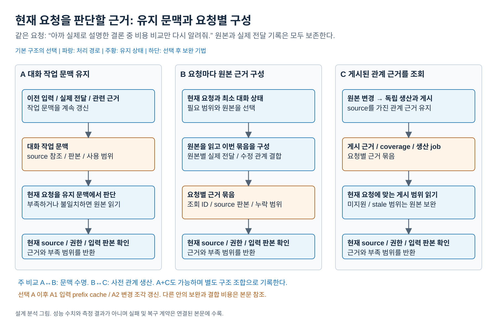
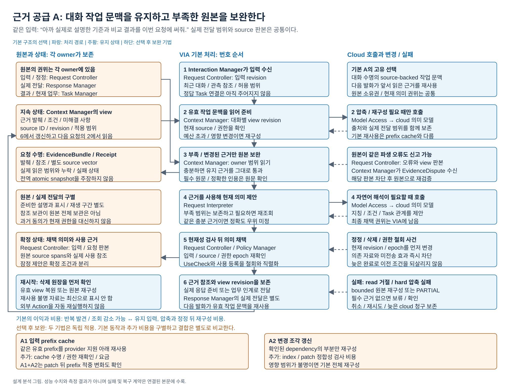
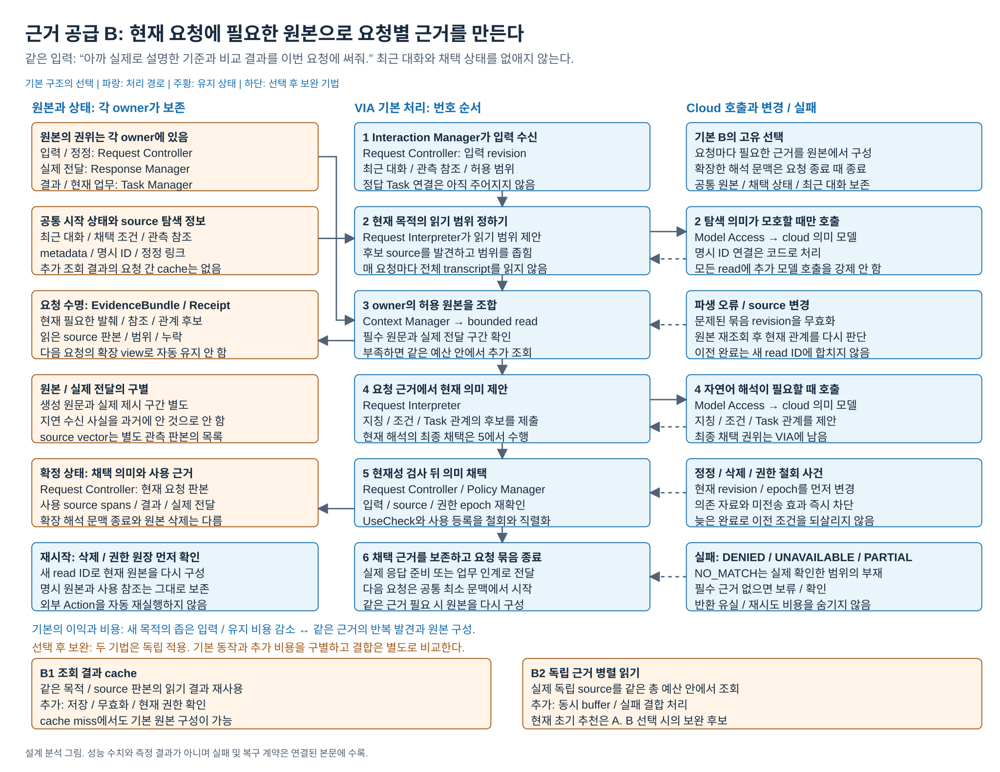
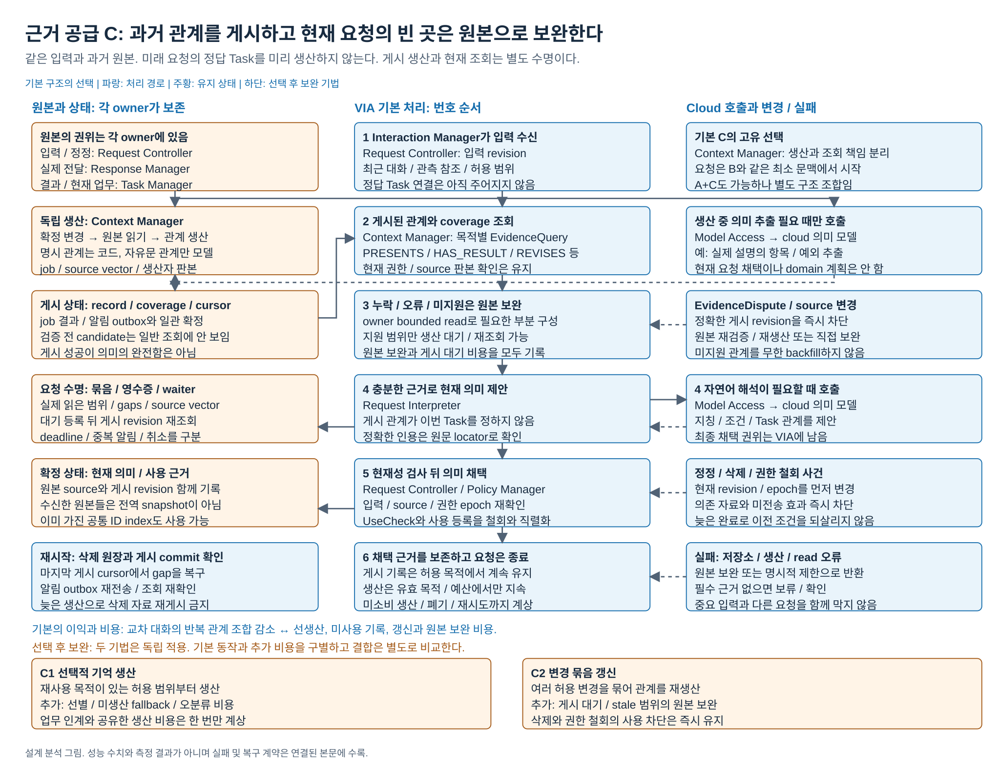

# 현재 요청을 위한 근거 공급: 작업 문맥과 과거 근거 생산

2026-10-18 / 문제 1과 DP-45 통합 설계 분석

아래 권고와 미측정 표시는 설계 분석 시점의 기록이다. [15 보완 PoC 결과](15-corrected-poc-results.md#dp01-결과--현재-요청의-근거-공급)는 A/B/C 전체 36회와 A2 세 번의 실제 비교를 제공한다. 현재 권고는 기본 A이며, A2는 재조회 감소만 확인하고 주요 성능 보완으로 채택하지 않았다. [12 초기 PoC](12-poc-results.md#3-근거-공급)의 값은 본문 재조회·완료 계약 보완 이전 이력으로 보존한다. 이 문서의 구조 그림과 원래 반증 조건은 유지한다.

## 0. 비교 그림

[편집 원본](diagrams/problem01-evidence-supply.drawio) / [PNG](diagrams/problem01-evidence-supply.png) / [전체 그림 안내](diagrams/README.md)

[기본 A 상세도](#detail-a) / [기본 B 상세도](#detail-b) / [기본 C 상세도](#detail-c)

상세도는 입력, 번호 순서의 처리, 상태 owner와 수명, 조건부 모델, 정정/실패 경로를 표시한다. 하단 tactic은 기본에 자동 포함되지 않는다.

## 1. 사용 장면과 결론

사용자가 방금 읽던 표를 가리켜 “그 비용은 일정과 무슨 관계야?”라고 묻는다. 이어 다른 문서를 열고 “지난번 네가 설명한 평가 기준에 맞춰, 앞서 조사한 제품 비교 결과와 받아둔 견적을 이번 제안서에 반영해줘”라고 한다. VIA는 현재 화면뿐 아니라 이전에 **실제로 전달한 설명**, 서로 다른 업무의 결과와 수정된 조건을 찾아야 한다. 그 자료를 항상 모델 입력에 유지하면 불필요한 입력과 갱신이 늘고, 매 요청마다 구성하면 같은 자료를 다시 찾는 대기가 생긴다.

**판정: 주요 DP에 포함한다. 주 비교는 A 대 B의 작업 문맥 수명이며, 과거 근거의 선생산 여부는 B 대 C로 구분하는 하위 구조 선택이다. 초기 기본안은 A를 권고한다.** A는 과거 원본을 보존하면서 최근 사용한 유효 근거를 다음 발화의 작업 문맥에 유지한다. 짧은 후속 지칭이 잦다는 VIA 사용 가정에 따른 권고이며, 기존 다섯 문제의 추천이나 OpenHands의 사용 여부를 근거로 자동 채택한 결론이 아니다.

| 기본안 | 다음 요청이 시작할 때 가진 것 | 추가로 필요한 자료 | 정상 사용의 이익 | 반대편 비용 |
| --- | --- | --- | --- | --- |
| **A. 대화 작업 문맥 유지** | 최근 대화와 채택 상태에 더해 이전 요청에서 읽은 근거를 유지한, 출처가 있는 작업 문맥 | 부족하거나 변경된 원본을 요청 경로에서 구성 | 같은 자료에 대한 후속 질문에서 재발견과 재조합을 줄임 | 주제가 바뀌어도 남는 입력, 문맥 압축, 정정 뒤 갱신 비용 |
| **B. 요청별 원본 구성** | 공통 최근 대화, 채택 상태, 현재 입력의 관측 참조 | 현재 요청에 필요한 원본을 읽어 요청 수명의 근거 묶음 구성 | 새 목적에 필요한 범위만 읽고 이전 의미 문맥의 유지 비용을 피함 | 같은 근거가 다시 필요할 때 발견과 조합 반복 |
| **C. 요청별 게시 근거 조회** | B의 최소 시작 문맥과, 요청과 별개로 생산된 공통 과거 근거 저장소 | 게시 근거를 조회하고 미생산, 오류, 표현 미지원 구간은 원본으로 보완 | 대화가 바뀌어도 반복되는 과거 설명과 결과 관계를 재사용 | 생산, 미사용 생산, 갱신, 게시 관리와 원본 보완 비용 |

여기서 작업 문맥은 현재 의미 판단에 넘기는 대화 수명의 자료다. 게시 근거는 여러 요청이 재사용할 수 있도록 원본에서 생산한 파생 기록과 관계다. 둘 다 현재 Task의 권위나 사용자의 장기 선호 원본은 아니다. 기본안과 tactic의 구분, 공통 QA 경계는 [분석 기준](00-analysis-contract.md)을 따른다.

## 2. 선택을 두 축으로 나눈 이유

| 비교축 | 질문 | 한 축만 다른 비교 | 주요 사용 조건 |
| --- | --- | --- | --- |
| 작업 문맥 수명 | 이전 해석에서 읽은 근거를 다음 발화의 입력으로 유지하는가 | **A 대 B**. 양쪽 모두 과거 원본에서 부족한 근거를 구성 | 동일 업무의 짧은 후속 질문, 여러 주제 전환, 긴 대화 |
| 과거 근거 생산 책임 | 과거 관계를 요청 소비자가 구성하는가, 별도 생산자가 미리 게시하는가 | **B 대 C**. 양쪽 모두 최소 문맥에서 새 요청 시작 | 여러 대화의 설명과 결과를 반복 결합하는 요청 |

A 대 C는 두 축이 함께 바뀐 완결 구성 비교다. 그 결과만으로 유지 문맥 또는 게시 기억 중 어느 것이 원인인지 말할 수 없다. **A에 C의 게시 근거를 결합하는 구성도 가능하다.** 그 구성은 대화 작업 문맥의 부족분을 게시 저장소에서 보충하고 다시 원본으로 보완한다. 별도 생산자와 게시 계약이 추가되므로 작은 cache tactic으로 분류하지 않는다.

두 축을 별도 주요 DP로 늘리지는 않는다. 현재 VIA에서는 같은 근거 공급 경로의 대기, 입력량과 선생산 비용을 나누는 선택이며, 두 결정을 독립 승리로 합산하면 같은 조회 절약을 중복 주장하기 쉽다. 다만 논리적으로 조합 가능한 선택이라는 사실은 남긴다. 여러 대화의 반복 소비가 주된 부하가 되면 B 대 C 또는 A 대 A+C를 주 비교로 다시 선정할 수 있다.

| 이전 자료의 이름 | 이번 의미와 대응 |
| --- | --- |
| 다섯 문제 A / B / C | 각각 이번 A / B / C의 출발점. 이번에는 두 축의 차이와 교차 구성을 명시 |
| DP-45 A 원본 서비스 조합 | 이번 A의 부족분 구성, B의 정상 경로, C의 원본 보완에서 사용하는 근거 획득 계약 |
| DP-45 B 순수 게시 경로 | 이번 C의 게시 생산과 읽기 계약의 출발점. 미지원 관계를 제한만 하던 구성을 그대로 경쟁안으로 사용하지 않음 |
| DP-45 B+ 원본 직접 보완 | 이번 C의 필수 보완 경로에 포함. 원본 보완의 호출, 대기와 오류를 C 비용으로 셈 |

기존 순수 게시형의 `NOT_COVERED → 생산 → 게시 → 재조회`는 C가 지원하는 선택 가능한 경로다. 현재 요청에 필요한 관계를 표현할 수 없는데도 게시를 기다리게 하는 것은 공통 기능을 충족하지 않는다. 이번 C는 원본 조합으로 보완하거나 원본 자체를 얻을 수 없으면 세 안과 같은 명시적 제한을 반환한다. 이 변경을 숨겨서 “게시 근거만으로 모두 처리한다”고 주장하지 않는다.

## 3. 모든 안이 보존할 데이터와 책임

### 3.1 원본과 현재 의미를 구분한다

| 보존할 원본 | 기록 내용 | 잘못된 확대 해석 |
| --- | --- | --- |
| 사용자 입력 | 발화나 텍스트, 채널, Conversation/Turn, input revision, 확인 질문 참조, 관측 불확실성 | 전사 문장만으로 지칭이나 Task가 확정됐다고 간주 |
| 채택 요청과 정정 | 실제 채택한 목표, 대상, 조건, Task 관계, 근거 참조와 정정 범위 | 미채택 제안을 확정 상태로 사용 |
| 외부 업무에서 확인한 사실 | 보낸 명령, 수신 확인, 공개 진행/질문/결과/실패, 결과 판본 | 보낸 명령을 완료 사실로 사용하거나 Agent 내부 추론을 수집했다고 간주 |
| 응답 준비와 실제 전달 | 생성 원문/판본, 실제 텍스트 표시 구간, 실제 음성 재생 구간과 중단 위치 | 준비만 한 뒷부분을 “사용자에게 설명한 내용”으로 기록 |
| 사용 자료와 결과 참조 | source ID/revision, locator, 읽은 범위와 목적, 요청/업무 관계, 접근 실패 | 참조를 보관했다는 이유로 원본 전체가 보존됐다고 간주 |

사건 발생 시각과 VIA 수신 시각을 함께 둔다. 늦게 받은 결과를 그 이전 요청이 이미 알고 있었다고 재작성하지 않는다. 현재 화면 근거의 획득과 발화 정렬 방식은 [화면 지칭 문제](04-screen-speech-grounding.md)의 책임이고, 이 문서는 그 관측 참조를 소비한다.

Interaction Manager는 입력과 실제 출력 관측을, Request Controller는 입력 revision과 현재 의미의 채택을, Request Interpreter는 근거 읽기와 의미 제안을 맡는다. Response Manager는 응답 원문과 실제 전달 기록, Task Manager는 업무 상태와 확인된 외부 사실, Context Manager는 허용 근거의 구성과 파생 자료 사용을 맡는다. State Store의 저장이 원본 소유권을 바꾸지는 않는다. 현재 권한은 Policy Manager의 판단을 따르며 과거 동의로 대체하지 않는다.

명시적으로 허용한 장기 선호 등 User Memory는 별도 원본이다. 일시적 업무 조건이나 추출 요약을 자동 승격하지 않는다. 삭제한 선호를 이전 transcript에서 재추출해 부활시키지 않는다. 이를 위해 내용 자체와 구분한 삭제 식별자와 판본 원장을 남길 수 있다.

### 3.2 DP-45의 근거 계약을 공통으로 유지한다

| 계약 | 필수 필드와 의미 |
| --- | --- |
| `EvidenceQuery` | query/request/attempt ID, input revision, 목적, 요청 관계 종류와 source 범위, 원문 필수 여부, 예산, 권한 epoch. 후보 Task ID는 정답 입력이 아님 |
| `EvidenceBundle` | query/bundle ID, 상태, 발췌/참조, 관계, source revision vector, 누락/충돌, 읽기 영수증, 권한 epoch, 획득 경로 |
| `EvidenceQueryReceipt` | 실제 읽은 범위, 확인한 판본, source별 cursor, 제외/미확인 구간, deadline 결과. 여러 원본의 전역 동시 snapshot을 보장하지 않음 |
| `SourceSpan` | owner/source ID/revision, start/end/unit. 텍스트 구간은 Unicode code point 등 단위를 명시하며 음성 시간과 혼용하지 않음 |
| `UseCheck` | 모델 전송, 의미 채택, 응답 출력, Agent 전송 시 현재 권한/삭제 epoch와 의존 판본을 확인하고 사용 등록 |
| `EvidenceDispute` | 문제가 된 파생 record와 정확한 revision, 근거 구간, 누락/충돌 이유. 원본 판본이 그대로여도 신고 가능 |

반환 상태는 `OK`, `PARTIAL`, `NO_MATCH`, `NOT_COVERED`, `UNSUPPORTED_RELATION`, `DENIED`, `UNAVAILABLE`, `STALE`, `EXPIRED`를 구별한다. `NO_MATCH`는 실제 확인한 범위 안의 부재다. 파생값의 `VALID`, `DIRTY`, `UNRESOLVED`, `REVOKED`, `PURGE_PENDING`도 조회 결과와 구분한다. 원문과 문자열이 일치하고 실제 전달 구간 안에 있다는 검사는 의미의 정확성까지 보장하지 않는다.

UseCheck와 실제 사용 등록/queue admission은 철회와 직렬화한다. 확인만 끝낸 뒤 철회된 자료를 새 작업에 enqueue하는 틈을 허용하지 않는다. 긴 파일 읽기나 모델 호출 전체를 그 잠금으로 묶지는 않는다. 현재 판본 확인이 불가능하면 “최신”이라고 반환하지 않는다. 당시의 허용 snapshot을 사용하는 경우 당시 자료임을 명시한다.

## 4. 기본안의 실제 처리와 상태

### 4.1 A: 대화 작업 문맥 유지

1. 공통 최근 대화와 현재 채택 상태를 읽고, 해당 대화의 작업 문맥 revision을 가져온다. 작업 문맥에는 이전에 읽은 source-backed 발췌, 관계 후보, 미해결 사항과 출처가 있다. 서로 다른 Task의 조건은 출처와 적용 범위를 보존한다.
2. 새 입력을 그 문맥에서 판단한다. 지금 필요한 원본이 빠졌거나 판본/권한이 달라졌으면 bounded read로 보완하고 조회 영수증을 붙인다. 현재 Task 확인이 필요하면 Task Manager의 현재 상태를 읽는다.
3. 현재 요청의 의미를 제안하고 Request Controller가 현재 revision에서 채택한다. 예산을 넘는 문맥은 출처를 보존해 압축하고, 다음 요청이 사용할 유효 작업 문맥을 갱신한다.
4. 다음 발화는 이 작업 문맥에서 시작한다. 이전 근거의 재사용은 A의 핵심이다. 모델 제공자의 입력 prefix cache가 있는지는 별도 tactic이다.

지속 상태는 원본과 작업 문맥 revision/의존 source 목록이다. 현재 호출 입력과 읽기 job은 요청 수명이다. 기본 A는 변경 영향이 있는 작업 문맥을 재구성하며, 변경 조각만 계산하는 최적화를 미리 가정하지 않는다. 압축 실패 시 아직 예산 안의 원문 view는 사용할 수 있지만, hard limit을 넘으면 같은 읽기/입력 예산 안에서 원본으로 재구성하거나 실패 범위를 알린다. 무제한 원문 입력을 fallback이라고 부르지 않는다.

### 4.2 B: 요청별 원본 구성

1. 공통 최근 대화와 채택 상태, 현재 입력의 관측 참조에서 필요한 근거의 범위를 정한다. 이전 응답과 실제 전달 기록을 없애거나 최근 대화조차 빈 상태에서 시작하지 않는다.
2. Context Manager가 source별 허용 read port로 필요한 범위를 읽는다. 명시 ID 관계는 코드로 연결하고 자유로운 과거 표현의 관계는 현재 의미 판단에서 해석한다.
3. 발췌, 관계 후보, 판본과 누락을 요청별 EvidenceBundle로 반환한다. Request Interpreter가 필요하면 범위를 좁혀 다시 읽고 현재 의미를 제안한다.
4. 채택 근거의 참조와 실제 결과는 공통 원본에 남긴다. 추가 조회 내용으로 만든 해석용 작업 문맥은 요청이 끝나면 종료한다. 다음 요청은 최소 문맥에서 다시 시작한다.

기본 B는 metadata/ID/정정 링크 탐색을 사용하며 매번 전체 transcript를 읽지 않는다. 추가적인 요청 간 조회 결과 cache나 독립 조회 병렬화는 기본의 이익에 선반영하지 않는다. 동시 실행 중인 요청은 각각 bounded 입력을 가지므로 “요청별”이라는 이유만으로 로컬 메모리 peak가 낮다고 확정할 수도 없다.

### 4.3 C: 요청별 게시 근거 조회와 원본 보완

1. 생산자가 확정된 입력/정정, 실제 전달, 공개 결과 변경에서 원본 locator와 판본을 받는다. 신뢰할 변경 알림이 없으면 허용된 증분 열거가 필요하며 그 비용을 기록한다.
2. 공통 과거 관계를 생산한다. 실제 전달과 응답 구간의 `PRESENTS`, 확정 업무와 결과의 `HAS_RESULT`, 채택 정정의 `REVISES`는 명시 기록을 사용한다. 설명 항목/예외의 `EXPLAINS_ITEM`처럼 자유문 해석이 필요할 때만 의미 모델을 호출한다.
3. source 의존 판본과 권한 epoch를 검사한 뒤 파생 관계와 coverage를 같은 게시 revision으로 확정한다. **미래 요청의 정답 Task, 현재 지칭이나 업무 계획을 미리 게시하지 않는다.**
4. 새 요청은 B와 같은 최소 문맥에서 시작해 게시 근거의 locator/관계/발췌/coverage를 읽는다. 현재 권한과 source 판본 확인, 정확한 인용의 원문 읽기는 남는다.
5. 미생산 또는 잘못된 범위는 예산 안에서 원본을 직접 구성한다. 지원 관계의 생산을 기다리는 것이 유리한 경우에는 bounded 생산/게시/재조회를 선택할 수 있다. 미지원 관계는 반복 생산하지 않고 원본 경로로 처리한다. 파생 저장소 장애도 같은 원본 보완 또는 명시적 제한으로 처리한다.

생산은 요청과 별개 수명이며 기본 C는 정의된 관계 범위의 허용 변경을 생산 대상으로 삼는다. 소비 가능성이 높은 일부만 선택하거나 여러 변경을 묶는 것은 뒤의 tactic이다. 게시 파생물은 원본의 권위를 갖지 않고, covered 조회에서 source별 관계 조합을 대체하는 읽기 계약을 갖는다. 기존 A/B의 명시 ID index 하나가 같은 일을 해결하면 그 부분은 C의 독점 이익이 아니다.

| C의 상태 | 내용과 확정 규칙 |
| --- | --- |
| `ProductionJob` | job/trigger ID, producer/schema version, 입력 source vector, 권한 epoch, 기대 게시 revision. queued/running/published/retry/rejected를 지속 기록 |
| `CandidateBatch` | 생산 중인 후보. 검증과 게시 전에는 일반 조회에 보이지 않음 |
| `MemoryRecord` | 관계/값, source spans, 명시/파생 구분, 불확실성, producer version, 의존성, 유효 상태와 게시 revision |
| `Coverage` | 관계 종류, source 범위/cursor, gaps와 생산 실패, 같은 게시 revision. 열거 완료가 의미 추출 완전성을 보장하지 않음 |
| 게시 commit | 관계, coverage, committed cursor, job 결과와 알림 outbox를 일관되게 확정. 분리 저장이면 복구 protocol 필요. 원본 owner 전체와의 atomic commit은 아님 |
| 조회 대기 | read ID, 범위, 최소 게시 revision, deadline. waiter 등록 후 revision 재조회로 알림 유실 경쟁을 닫고 중복 알림은 read/revision으로 무시 |

## 5. 오류, 정정, 삭제와 복구

| 사건 | 모든 안의 필수 처리 | A / B / C에서 달라지는 실제 일 |
| --- | --- | --- |
| 읽는 동안 원본 변경 | source vector를 확인하고 stale 범위를 현재 결과로 채택하지 않음 | A는 의존 작업 문맥 무효화/재구성, B는 현재 묶음 재읽기, C는 기존 게시물 즉시 사용 차단 후 재생산/원본 보완 |
| 원본은 같지만 요약/관계가 잘못됨 | Request Interpreter의 EvidenceDispute를 Request Controller가 Context Manager로 전달. 정확한 파생 revision만 차단하고 원본 재확인 | A 작업 문맥, B 요청 묶음/선택 cache, C 게시 record의 재검증. 오래된 신고로 새 revision을 무효화하지 않음 |
| 새 입력 또는 취소가 도착 | read ID/attempt/input revision을 확인하고 늦은 완료를 새 요청에 섞지 않음 | A의 이전 view 갱신 fence, B의 요청별 폐기, C의 consumer 종료와 공용 생산 수명 분리. C 생산 지속은 현재 허용 목적/예산/다른 소비자가 있을 때만 |
| 자료 삭제 또는 접근 철회 | tombstone/epoch/정리 의도를 먼저 확정하고 신규 사용 차단. 이미 보낸 외부 정보의 회수 한계 표시 | 작업 문맥, 묶음, cache, 게시물, model context와 queued job을 무효화. 늦은 생산과 출력은 fence. 로컬 정리는 PURGE_PENDING에서 재개 |
| 입력 예산 또는 원본 접근 실패 | 부족 범위를 표시하고 필수 근거면 제한/확인. summary로 사라진 원문을 복원했다고 하지 않음 | A는 유효 view가 충분한 범위만 사용, B는 얻은 원본 범위만 반환, C는 유효 게시 범위와 원문 필수 구간을 구분 |
| 프로세스 재시작 | 삭제 원장을 먼저 읽고 현재 권한/판본을 다시 검사. 동일 외부 Action을 자동 재실행하지 않음 | A는 유효 문맥 복원 또는 원본 재구성, B는 새 read ID로 재구성, C는 이미 확정한 게시물을 확인한 뒤 미완료 job 재시도 |
| C 게시/알림 일부 실패 | 미확정 후보를 노출하지 않고 cursor만 앞서가지 않음 | 마지막 **게시된** cursor에서 gap 확인/재생산. 알림 실패는 outbox 재전송과 조회 재확인. 재실행 모델 비용도 보존 |

긴 읽기나 backfill을 기다려도 음성 입력 수집과 다른 요청을 멈추지 않는다. 파생 저장소가 별도 수명을 가진다는 이유만으로 process 장애 격리가 생기지 않는다. cloud 취소 뒤 청구, 이미 전송한 자료와 외부 backup의 잔존을 로컬 삭제 완료와 구별한다.

## 6. 같은 입력에서 보는 정상 이익과 비용

아래 E1~E7은 설계 사고실험이다. COMMON-28의 모집단이나 점수를 바꾸지 않는다. A/B/C에는 같은 과거 사건과 원본을 주고 각 구조가 필요한 파생 상태를 그 사건에서 생산하게 한다.

| 장면 | A 유지 문맥 | B 요청별 원본 | C 게시 근거와 원본 보완 |
| --- | --- | --- | --- |
| **E1 같은 표 연속 질문**: 비용 확인 → “그럼 일정은?” → “둘을 함께 설명해줘” | 앞서 읽은 표와 관계를 계속 사용. 문맥 입력은 남음 | 최근 대화/채택 ID만으로 충분하면 A와 동점. 원문 세부가 필요할 때 재읽기 | 게시된 결과 관계는 재사용. 현재 표의 새 세부는 원본 읽기. 생산 비용을 회수하지 못할 수 있음 |
| **E2 주제 전환**: 제품 → 메일 → 일정 → 새 문서 | 더는 쓰지 않는 근거가 입력/압축 비용을 만들 수 있음 | 새 목적에 맞는 범위만 구성. 불필요한 의미 문맥 유지가 적음 | 앞서 생산한 자료가 소비되지 않으면 B보다 비용 증가 |
| **E3 여러 대화의 설명/결과 결합**: 아래 DP-45 사례 | view에 없는 과거는 B와 같이 원본 조합 | 실제 전달과 두 결과의 locator를 찾아 현재 목적에서 조합 | coverage가 유효하면 과거 관계 발견/조합 일부 대체. 현재 목적의 의미 판단과 정확한 원문 확인은 남음 |
| **E4 같은 과거를 다시 요청**: E3 뒤 새 대화에서 같은 자료로 다른 설명 | 현재 대화 view가 없으면 다시 원본 구성 | cache 없는 기본에서는 다시 필요한 관계를 구성 | 생산/갱신 비용보다 반복 소비 절약이 커질 조건. 새 목적에 필요한 관계가 다르면 원본 보완 |
| **E5 조건 정정과 늦은 결과**: 가격 기준 유지, 설치 조건만 철회, 이전 결과 도착 | 영향 view 재구성 후 현재 조건 사용 | 현재 조건을 읽고 과거 결과와 구분 | 관련 게시물 차단/갱신과 fallback. 미사용 생산이나 중복 재생산 비용 발생 |
| **E6 원본 동일, 파생 오류 발견**: 예외 조건이 요약에서 빠짐 | 오류 view revision 차단 후 원문 보완 | 현재 묶음을 재해석. 후속 요청은 오류 문맥을 기본 유지하지 않음 | 오류 record 차단/재생산 후 모든 소비자가 새 판본 사용. 넓은 오염 범위와 교정 이익이 함께 존재 |
| **E7 삭제와 재시작**: 견적 철회 후 늦은 생산 완료 | view와 모델 입력 후보 차단, 재시작 시 철회 재적용 | 진행 읽기와 묶음 차단, 새 요청에 부활 금지 | 게시물과 job/coverage 정리, 오래된 생산의 재게시 거절 |

### DP-45 대표 장면의 충분 범위

VIA가 E20에서 “가격, 유지보수 기간, 가격이 같을 때 유지보수 기간 우선, 설치 편의”를 설명하도록 준비했지만 P20에서 앞부분 `[0,52)`만 실제 텍스트/음성으로 전달했다고 하자. 제품 비교는 T21의 D21@v2, 견적은 T22의 D22@v1이다. 현재 사용자는 이 이름이나 ID를 말하지 않고 “지난번 네가 설명한 기준과 앞서 조사한 결과, 받아둔 견적”이라고 요청한다.

1. 세 안 모두 후보를 발견하고 실제 전달된 E20의 `[0,52)`와 두 유효 결과 참조를 확보한다. 준비만 했던 설치 편의를 실제 설명으로 넣지 않는다. 예외 문장 `[27,52)`만 확보했으면 전체 기준에 대해 `PARTIAL`이다.
2. A는 그 자료가 유효 view에 이미 있을 때만 재사용한다. B는 source read를 조합한다. C는 게시된 PRESENTS/HAS_RESULT/EXPLAINS_ITEM을 쓰되 부족한 기준을 원본으로 보완한다.
3. Request Interpreter가 현재 지칭과 조건, Task 연결을 제안한다. 과거 관계가 새 T23을 미리 선택하지 않는다. 기준을 적용해 제안서를 작성하는 일은 Downstream Agent의 domain 업무다.
4. 같은 충분 EvidenceBundle을 만들었다면 최종 해석 호출의 token이나 정확도 차이를 자동 주장하지 않는다. 차이는 그 묶음을 얻기 전의 유지, 발견, 생산과 읽기에 있다.

## 7. 실제 harness가 뒷받침하는 범위

공식 고정 코드와 VIA 추가 설계의 구분은 [근거 원장 EH01~EH14](../../../../references/seven-problem-review/evidence-handoff.md)에 기록했다. 제품 하나를 대안 하나와 동일시하지 않는다.

| 확인한 구현 | 이번에 가져온 메커니즘 | 그대로 가져오지 않는 주장 |
| --- | --- | --- |
| OpenHands rolling view와 condensation | 같은 대화의 view를 유지하고 필요할 때 압축하는 A의 실행 근거 | VIA 실제 전달 범위, 삭제 fence나 정정 정확성이 자동 구현된다는 주장 |
| Deep Agents 원본 offload/범위 읽기 | 큰 원본을 별도 저장하고 현재 필요 범위를 읽는 B의 근거 | Deep Agents 전체가 매 요청 무상태라는 주장. 자체 요약/기억도 있음 |
| OpenClaw memory consolidation과 provenance | 제한된 기록에서 파생 기억을 생산하고 lineage/이전 항목 손실을 검사하는 C의 부분 근거 | 모든 transcript 접근, 전역 atomic 기억, VIA의 완전한 Coverage 보장 |
| CrewAI unified memory | 기억 write를 별도 처리하고 recall에서 미완료 write를 기다리는 생산/소비 의존 | 선생산이 항상 요청 지연이나 모델 비용을 줄인다는 주장 |
| AutoGen Magentic-One | facts/plan/message thread를 유지하고 저장/복원하며 ledger를 재배포하는 유지 상태의 실제 예 | VIA가 domain 계획을 대신 만들거나 다른 제품의 내부 기억을 수입해야 한다는 주장 |

VIA의 actual-delivery, source revision, EvidenceDispute, 철회 gate와 게시 일관성 계약은 이 프로젝트의 추가 설계다. reference의 기능명만으로 이를 충족했다고 표시하지 않는다.

## 8. QA01~06의 인과와 반증

주 비교축은 **QA01, QA03, QA05**이며 QA02를 중요한 회귀와 조건부 차이 후보로 유지한다. QA01과 QA03은 겹치는 시간을 별도 정의로 관측하는 것이지 두 번 절약한 자원이 아니다.

| QA | 기본 구조가 만드는 차이 | 상쇄와 반증 조건 |
| --- | --- | --- |
| **QA01 첫 응답 지연** | 첫 구체적 내용을 채택하기 전에 필요한 근거가 A view 또는 C 게시물에 있으면 B의 발견/조합 대기가 줄 수 있음 | B의 공통 최근 대화/ID만으로 충분하거나 첫 내용이 추가 조회 전에 채택되면 동점. A 압축/재구성 또는 C 게시 대기가 절약보다 크면 우열 역전 |
| **QA02 지칭 집합 정확도** | A는 이미 확인한 원문/조건을 보유하지만 압축 누락과 주제 혼입 위험. B는 목적별 원문을 보지만 탐색 누락 위험. C는 관계 재사용과 파생 오류 확산이 함께 존재 | 채택 **전** 보완으로 같은 대상을 처음 채택하면 동점. 최초 오채택은 나중 원본 보완으로 지우지 않음. 세 안의 최초 대상 집합이 같으면 차이 coverage로 세지 않음 |
| **QA03 VIA 처리시간** | 완료 목표의 인과 경로 안에서 원본 발견/반복 읽기/재조합을 줄이거나, 압축/생산/보완 대기를 추가 | 상세 표시와 전체 음성 요약 준비 종료점 이후 유지/생산 시간을 더하지 않음. 그 일의 비용은 QA05와 별도 진단에 남김. 외부 업무 대기는 제외 |
| **QA04 실제 변경 범위** | source 계약/표현을 추가할 때 A/B는 요청 조합과 read adapter, C는 생산/schema/coverage/reader의 변경이 필요할 수 있음 | 새 source adapter 하나로 모두 끝날 수도 있고 C 공통 계약이 소비자 변경을 막을 수도 있음. 실제 C01~C06 Rust 변경 전에는 모듈 수나 승자를 정하지 않음 |
| **QA05 전체 모델 비용** | A는 반복 탐색 대신 지속 입력/압축 비용, B는 필요할 때 구성/해석 비용, C는 생산/갱신 후 재사용 비용 | 준비, 미사용 생산, 폐기와 취소 후 청구까지 같은 COMMON-28에 포함. ID 연결은 모델 호출이 아님. C가 같은 최종 입력을 제공하면 마지막 해석 비용은 그대로일 수 있음 |
| **QA06 전체 로컬 RAM** | A view와 갱신 후보, B 동시 요청 묶음, C 생산 batch와 read/저장 buffer의 동시 생존량이 다름 | 저장소 전체 크기나 cloud KV가 로컬 RAM은 아님. bounded 구현의 실제 동시 peak가 같으면 차이 없음. 작은 반환 범위도 backend의 전체 파일 읽기를 숨기지 않음 |

인계 계약 N-H는 이 문서에서 별도 정확도 지표로 확대하지 않는다. 근거 누락이 [업무 인계](05-agent-handoff.md)의 외부 실행 허가 시점까지 남은 위임 장면에만 같은 N-H를 적용한다. 해석 모델 입력의 정보 누락은 내부 원인 진단이며 직접 응답을 N-H 분모에 넣지 않는다.

### 비용을 상각하는 조건

모델 비용은 동일 사건 창에서 아래 항목을 **각 실제 호출 ID별로 한 번씩** 합한다. 금액이나 승률을 대입하지 않은 분석식이다.

- A: `공통 비용 + Σ현재 해석(유지 view) + Σ필요 원본 구성 + Σview 압축/재구성`.
- B: `공통 비용 + Σ현재 해석(요청 묶음) + Σ필요 원본 구성`.
- C: `공통 비용 + Σ현재 해석(게시/원본 묶음) + Σ기억 생산/갱신 + Σ원본 보완/재구성`.

여기에 코드 조회 자체의 모델 비용을 만들지 않는다. 읽기 I/O와 게시 대기는 시간 및 자원 진단으로 따로 기록한다. A의 이익은 반복 원본 구성 절약이 추가 입력/유지 비용을 넘는 구간이다. C의 이익은 여러 요청의 실제 소비가 생산/갱신/보완 비용을 회수하는 구간이다. 미소비 사건이 많거나 목적마다 원본을 다시 구성하면 C의 상각 가설이 깨진다.

## 9. 추천과 선택 후 tactic

### 9.1 기본안 선정 근거

**A를 초기 기본으로 권고한다.** VIA의 메인 인터페이스는 같은 자료를 가리키는 짧은 질문과 정정이 연속해서 들어오는 정상 사용을 책임진다. 이때 이미 읽고 채택에 사용한 근거를 대화 수명에 유지하는 것은 외부 Agent의 교체와 무관하게 필요성이 높다. 원본 보완을 유지하면 먼 과거와 새 관계를 미리 생산해야 한다는 전제도 필요하지 않다.

다음 조건에서는 반대안이 더 낫다.

| 더 유리한 안 | 구체 조건 | 추천을 바꿀 근거 |
| --- | --- | --- |
| **B** | 대부분의 요청이 새 주제이며 공통 최근 대화/채택 ID로 후속 연결이 충분. view에 유지한 큰 자료가 재사용되지 않음 | 같은 최초 지칭 정확도와 응답 기능에서 QA01/03 손해가 작거나 없고 전체 QA05가 낮음. A가 정정 때마다 광범위 재구성한다면 B 이익 증가 |
| **C** | 여러 대화의 실제 설명과 공개 결과를 반복해서 결합하고, 같은 관계가 오래 유효하며 생산한 기록의 상당 부분이 사용됨 | 생산/갱신/미사용분과 원본 보완까지 포함해 B보다 QA03/05가 유리. A의 현재 view만으로 해결되는 반복을 C 단독 이익으로 세지 않음 |
| **A+C 교차 구성** | 같은 대화의 짧은 후속 질문과 여러 대화의 관계 재사용이 모두 많음 | A 대비 별도 게시 계층의 추가 비용을 회수. 두 상태의 무효화와 중복 생산이 관리 가능해야 함. 자동 선택이나 tactic 취급하지 않음 |

### 9.2 A 선택 뒤 권고하는 두 tactic

| 구성 | 기본 A에서의 약점 | 바꾸는 처리와 기대 개선 | 추가 비용과 적용 한계 |
| --- | --- | --- | --- |
| **A1 입력 prefix cache** | 동일한 유지 문맥을 반복 전송/처리하는 QA05 | 제공자가 지원하고 유효 prefix가 같은 경우 할인/재처리 절약 가능 | cache 비용/수명/적중 조건, provider 종속. source 철회와 현재 조건은 매번 검사. cloud cache를 로컬 QA06 절약으로 세지 않음 |
| **A2 변경 조각 갱신** | 작은 정정에도 view 전체를 재구성하는 QA03/05 | source dependency가 확인되는 부분만 갱신하고 나머지 유효 문맥 재사용 | dependency index와 patch 검증 비용. 영향 범위 불명/누락이면 전체 재구성. 실제 차이가 없으면 이익 주장 철회 |

A1과 A2는 각각 기본 A에 하나씩 적용하며 자동 누적하지 않는다. A1+A2에서는 patch로 prefix 적중률이 바뀌는 상호작용까지 기록한다. 반복 E1/E4의 기본 비용과 tactic 적용 뒤 비용을 구별한다. B의 조회 cache/독립 읽기 병렬화, C의 선택적 생산/변경 묶음 갱신은 반대안의 가능한 보완이지만 기본 비교에 미리 무료로 넣지 않는다. 작은 ID index만으로 C의 이익이 사라지는 경우도 후속 민감도 분석에 남긴다.

상세 그림의 B/C 보완 번호는 다음과 같다. 해당 기본안을 선택한 경우의 후보이며 초기 A 권고를 변경한 것은 아니다.

| 구성 | 기본 대비 바꾸는 처리 | 추가 비용과 제한 |
| --- | --- | --- |
| **B1 조회 결과 cache** | 같은 목적과 source 판본의 읽기 결과를 요청 사이 재사용 | 저장/무효화와 현재 권한 확인. miss이면 기본 원본 구성 |
| **B2 독립 근거 병렬 읽기** | 실제 독립 source를 같은 총 예산 안에서 동시에 조회 | 동시 buffer와 실패 결합. 의존 조회를 억지로 병렬화하지 않음 |
| **C1 선택적 기억 생산** | 재사용 목적이 있는 허용 범위부터 생산 | 선별, 미생산 원본 보완과 오분류 비용. 필요한 근거의 기본 보완은 유지 |
| **C2 변경 묶음 갱신** | 여러 허용 변경을 묶어 관계를 재생산 | 게시 대기와 stale 범위의 원본 보완. 삭제/철회 사용 차단은 즉시 적용 |

B1/B2와 C1/C2도 각 기본안에 독립 적용한다. 같은 게시 근거를 업무 인계가 소비하더라도 생산 비용은 한 번만 계상한다.

## 10. 같은 입력 PoC와 최종 DP 자격

향후 승인을 받은 제한된 PoC에서는 E1/E2의 연속/전환, E3/E4의 교차 대화/반복, E5/E6의 정정/파생 오류, E7의 철회/재시작을 묶는다. 같은 source bytes/revisions, 실제 전달 구간, 현재 입력, 모델 capability/예산과 사건 순서를 사용한다. 정답 Task나 완성된 파생 기록을 어느 안에만 사전 제공하지 않는다.

1. **A 대 B**를 먼저 비교한다. 동일 과거 원본 접근과 현재 채택 규칙을 고정하고 작업 문맥 수명만 바꾼다. 다음으로 **B 대 C**에서 최소 시작 문맥을 고정한다. A 대 C의 결과를 단일 원인의 증거로 사용하지 않는다.
2. first-adoption 지칭 oracle, 실제 전달 범위, 현재/과거 판본, 삭제/권한과 누락 상태를 확인한다. 오답의 실제 시간과 최초 오류를 보존한다. 나중 수정은 별도 사건이다.
3. QA01/03의 endpoint까지 실제로 필요한 작업만 시간 경로에 포함한다. 모든 선생산과 폐기/재시도는 QA05 원장에 남긴다. 작은 PoC 부분합을 공식 COMMON-28 점수로 바꾸지 않는다.
4. 기본 비교 뒤 A1, A2를 각각 적용한다. 이어 가장 작은 B 보완으로 A의 차이가 사라지는지도 본다. 동일 결과를 더 작은 구조로 얻으면 큰 구조의 권고를 수정한다.
5. A의 유지 문맥이 B의 공통 최근 대화보다 실질적으로 더 유용한 근거를 거의 제공하지 않거나, 추가 입력/갱신 비용만 늘면 A 권고를 B로 바꾼다. C가 반복 소비에서도 대부분 원본 보완을 요구하면 게시 계층을 채택하지 않는다.

**최종 판정은 주요 DP 포함이다.** 근거의 수명과 생성 시점이 정상 요청의 실제 읽기 경로, 모델 입력과 유지 비용을 바꾸고 A/B 각각을 선택할 조건이 있다. 주된 차이 가설은 QA01/03/05이며 QA02 차이는 미확인이다. 세 시간/비용 축 중 응답 시간 두 축은 상관된 관측임을 공개한다. QA02까지 차이가 반드시 생기거나 모든 과정 coverage를 충족했다고 주장하지 않는다.

[업무 인계](05-agent-handoff.md)와는 현재 의미 판단에 들어가는 근거 계약과 외부 Agent에 내보내는 업무 계약이 다르므로 분리한다. 원본 보관, 실제 전달 기록과 공통 파생 관계를 함께 사용하면 **생산 한 번을 두 DP에서 두 번 절약했다고 합산하지 않는다.** 인계 전용 목적/형식 구성과 상대 Agent의 읽기 지원 비용은 05에, 해석 전용 view 유지 비용은 여기에 귀속한다. 공용 생산은 한 원장에 한 번 계상하고 두 소비자에 대한 영향만 표시한다.

이 문서는 설계와 공식 코드의 정적 대조 결과다. 이전 [DP-45 상세 문서](../04-45-memory-and-context.md), [기존 다섯 문제 분석](../qa-first-exploration/five-problem-study/01-evidence-supply.md)과 그 당시 리뷰는 보조 이력이며 이번 판본의 실행 검증이 아니다.

## 부록. 방안별 상세 설계 그림

각 방안은 같은 기능 조건을 갖는다. 처리 순서와 상태/호출의 차이를 위 기본 비교 및 QA 표와 함께 읽는다.

### 기본 A 상세도

[편집 원본](diagrams/problem01-A-detail.drawio) / [PNG](diagrams/problem01-A-detail.png)

### 기본 B 상세도

[편집 원본](diagrams/problem01-B-detail.drawio) / [PNG](diagrams/problem01-B-detail.png)

### 기본 C 상세도

[편집 원본](diagrams/problem01-C-detail.drawio) / [PNG](diagrams/problem01-C-detail.png)
