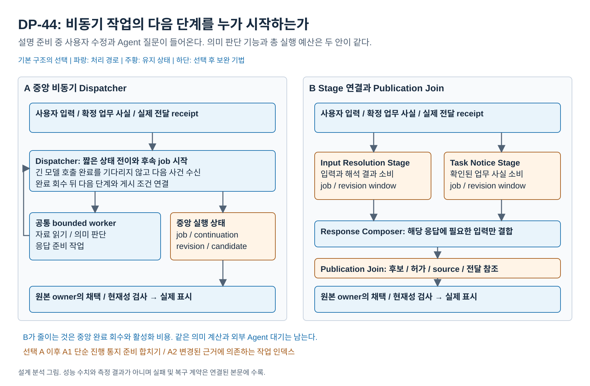

# 비동기 작업의 완료에서 다음 처리를 누가 활성화할 것인가

2026-10-18 / 기존 DP-44 독립 재검토 / **독립 상세 설계 유지, 기본 A 추천** / 사용자 미채택, 구현과 측정 없음

## 0. 비교 그림



[편집 원본](diagrams/problem03-execution-coordination.drawio) / [PNG](diagrams/problem03-execution-coordination.png) / [전체 그림 안내](diagrams/README.md)

## 1. 결정과 핵심 이유

**짧은 중앙 Dispatcher가 비동기 작업의 완료를 회수하고 다음 처리를 지시하는 A를 추천한다.** VIA의 의미 판단, Agent 사실 확인, 응답 준비와 실제 표시의 권한은 여러 owner에 있다. 이 결과를 중앙에서 연결하면 교차 조건을 추적할 위치가 모이고, 주요 실행 경로가 적은 PC용 VIA에서 단계마다 실행 window와 join 상태를 추가할 이유가 작다.

B의 반응형 단계 연결도 실제로 쓰이는 Architecture다. Pipecat의 인접 processor 전달과 CrewAI Flow의 결과 기반 listener 활성화를 확인했다. B는 다수 생산 경로가 독립적으로 움직일 때 중앙 후속 배정을 줄이고 단계별 수용량을 표현하는 이익이 있다. 다만 **양안이 같은 의미 호출과 현재성 검사를 수행하면 긴 모델 판단의 선행 의존은 바뀌지 않는다.** 다음 코드 작업의 활성화 비용이 줄어든다는 사실만으로 중요한 QA01 / QA03 차이를 주장할 수 없다.

현재 중요한 trade-off의 근거는 QA04의 교차 규칙 변경 경로와 QA06의 임시 상태, QA01 / QA03의 작은 제어 경로 차이다. QA02와 QA05의 기본 차이는 확보되지 않았다. 정상 사용에서 B의 핵심 시간 이익이 충분히 크다는 근거도 없다. **기능과 A/B 설계를 유지하되 최종 주요 DP 세트에는 포함하지 않고 독립 상세 설계로 둔다.** 문제 2에 합치거나 흡수하지 않는다.

## 2. VIA의 어려움과 비교 범위

사용자 입력, VIA의 의미 판단 결과, Agent가 보낸 질문 / 결과, 준비된 응답, 실제 표시 / 재생 receipt는 서로 다른 시점에 도착한다. 새 발화 때문에 미전송 효과를 보류한 동안에도 무관한 사실을 보존해야 하며, 어떤 조건이 충족되면 다음 처리를 시작할지 정해야 한다.

이 문제는 **이미 정한 의미 기능을 어떤 실행 연결로 움직이는가**다. [문제 2](02-interpretation-execution.md)는 입력을 어느 의미 문맥과 요청 실행에서 해석하는가를 비교한다. [상태 경계](07-lifecycle-boundaries.md)는 대화와 업무 원본을 어디서 확정하는가를 비교한다. 새 source를 읽는 판단, domain 계획, 발화 종료 전 추론 시작 정책은 여기서 바꾸지 않는다.

| 용어 | 뜻 |
| --- | --- |
| Dispatcher | 사건을 받아 실행 상태를 짧게 갱신하고 후속 job을 시작하는 코드. LLM이나 전체 요청을 동기적으로 수행하는 loop가 아님 |
| Job / 완료 | 읽기, 의미 판단, 응답 준비 등의 비동기 실행과 ID / 시작 revision이 붙은 반환 |
| Stage | 정해진 typed 입력과 준비 조건을 소비하고 출력을 게시하는 Module. 전용 OS thread나 의미 전문가를 뜻하지 않음 |
| 실행 window | 진행 중 job과 대체 revision, 아직 충족되지 않은 입력의 임시 연결 상태. Request / Task 원본을 대신하지 않음 |
| Publication Join | 응답 후보, 현재 의미 / 게시 허가, source 상태와 과거 실제 전달 참조를 결합해 게시 가능 여부를 만드는 단계 |

현재 [DP-44 상세 구조](../04-44-continuous-interaction.md)와 [구현 설명](../dp44-implementation-structure.md)의 비교 축을 유지했다. 이전 문서에서 허용한 모든 선택적 최적화를 기본안에 강제하지 않고 [공통 규칙](00-analysis-contract.md)에 따라 보완으로 분리한다.

## 3. 모든 안이 만족할 조건

1. Interaction Manager는 계속 입력을 받고 음성을 로컬에서 중단한다. 새 발화의 의미 판단을 기다렸다가 stop하지 않는다.
2. Request Interpreter의 의미 기능 / 모델 입력 정책과 총 호출 한도는 동일하다. Request Controller가 관계 / 조건을 채택한다. Dispatcher나 Stage는 자연어의 의미를 추측하지 않는다.
3. Task Manager가 외부 질문 / 결과의 업무 사실을 소유한다. Agent Gateway의 수신, Task Manager의 확인 / 저장, Request Controller의 대화 연결을 생략하지 않는다.
4. Response Manager가 게시 허가와 내구 전달 원장을, Interaction Manager가 실제 표시 / 재생과 receipt를 맡는다. 생성 완료와 실제 사용자 전달은 다르다.
5. 새 입력의 관계가 불명하면 관련 미전송 효과를 보류한다. 현재 입력을 해결하는 확인 질문과 확인된 실패 안내는 별도 허가로 표시할 수 있다. 확인 질문이 업무 실행 허가를 뜻하지 않는다.
6. 같은 revision / 권한 / source 검사를 최종 게시와 외부 전송 전에 수행한다. 늦은 invalidation 통지만 보고 최신이라고 믿지 않는다.
7. 공통 내구 inbox, 중요 사건 보존과 전체 수용량 상한을 둔다. 동일 글로벌 실행 / payload 예산 안에서 A는 중앙 admission을, B는 단계별 분할을 구성한다. B에 queue마다 같은 예산을 중복 부여하지 않는다.

중요 사용자 입력, 질문, 결과, 실패와 실제 receipt는 임의로 버리지 않는다. 최신 진행률처럼 의미상 합칠 수 있는 항목만 보완 정책에서 합친다. 외부 Agent가 VIA의 credit을 지원한다는 가정도 없다.

## 4. 기본안의 실행과 상태

### A. 중앙 비동기 Dispatcher

```text
입력 / 업무 사실 / receipt
    → Dispatcher의 짧은 전이
    → bounded worker의 읽기 / 해석 / 준비 job
    → 완료를 Dispatcher에 반환
    → 현재 조건 확인과 다음 job 또는 게시 요청
```

Dispatcher는 job을 시작한 뒤 다음 사건을 받는다. `await`로 전체 요청이나 긴 모델 호출을 붙잡고 다른 사건 처리를 막지 않는다. 여러 요청별 해석 실행을 사용하는 문제 2 B와도 조합할 수 있다. async 수신, worker 분리와 우선 제어는 기본 구성이다.

중앙 실행 상태는 `input/request revision, job ID, continuation, waiting ID, candidate ref`를 연결한다. 확정 의미와 Task / 질문 / 전달 원본은 공통 owner에 남는다. 완료를 회수한 Dispatcher가 후속 준비와 현재성 검사를 요청하고, 원본 owner가 채택 / 게시 / 전송을 확정한다.

관련 상태를 한 위치에서 추적할 수 있으므로 질문 제시와 답변, 부분 정정과 무관 결과 유지 같은 교차 규칙을 중앙 전이에 표현하기 쉽다. 반면 서로 다른 생산 경로가 늘면 같은 조정 경로가 많은 완료를 소비하고 전이 조합을 관리한다.

### B. typed Stage와 생산자 / 소비자 연결

```text
입력 → Input Resolution Stage → 채택 의미 ─┐
업무 사실 → Task Notice Stage → 허용 통지 ─┼→ Response Composer
                                         └→ 후보 + 관련 허가 / source / 전달 참조
                                                → Publication Join → 게시
```

Input Resolution Stage는 입력 근거와 해석 결과를, Task Notice Stage는 확인된 업무 통지를 소비한다. Response Composer가 후보를 준비하면 Publication Join이 후보 종류별 선행 조건을 모은다. 연결된 소비자가 준비된 입력으로 활성화되므로 모든 완료를 하나의 애플리케이션 Dispatcher에 회수해 다음 job을 정하지 않는다. 공통 executor / 라이브러리가 존재한다는 이유만으로 A가 되지는 않는다.

각 Stage에는 bounded 입력과 진행 job / revision window가 있고, Join에는 아직 부족한 참조와 후보가 있다. 후보마다 conversation / request / source identity와 revision을 유지한다. “가장 최근 값” 하나를 여러 업무의 값과 결합하지 않는다. 게시 이후의 자기 receipt를 게시의 선행 조건으로 삼지 않으며, 최초 대화의 확인된 빈 전달 이력과 재접속 후 불명 상태를 구별한다.

B는 같은 프로세스와 worker pool에서 동작할 수 있다. stage channel은 내구 저장소나 의미 authority가 아니다. 단계마다 전용 thread, 모델 또는 원본 전체 복사본을 추가하지 않는다. 기본 B의 손익은 후속 활성화와 readiness / window가 여러 소비자에 분산된 데서 발생한다.

### 실패와 복구

| 조건 | A | B | 공통 완료 조건 |
| --- | --- | --- | --- |
| 오래된 job 반환 | 중앙 job revision을 검사하고 폐기 / 필요한 재개 | 해당 window에서 superseded 처리하고 join에서도 검증 | 이전 조건을 신규 응답으로 게시하지 않음 |
| 준비 / 모델 실패 | 명시적 job error를 회수 | 명시적 error envelope를 전달 | 실패를 무한 미완료 join으로 숨기지 않음 |
| 포화 | 중앙 admission을 막고 중요 사건을 내구 inbox에 남김 | consumer 수용량으로 준비를 늦추고 inbox 보존 | 제어 / stop이 일반 준비 queue에 막히지 않음 |
| Core 재시작 | owner 원본에서 중앙 continuation 재구성 | owner 원본에서 각 window / 구독 / pending join 재구성 | 외부 수행 여부 확인 없이 중복 명령 금지 |
| 부분 출력 후 중단 | 실제 receipt를 중앙 진행 참조에 연결 | 같은 receipt를 join / 입력 근거로 연결 | 마지막 확인 밖 전달은 불명, 실제 제시 질문만 답변 근거 |

Stage 예외를 잡는 것과 process crash를 격리하는 것은 다르다. 양안이 같은 프로세스 / 모델 / 저장소를 사용하면 해당 공통 장애를 함께 겪는다.

## 5. 정상 / 겹침 / 포화 / 정정 시나리오

| 장면 | 같은 완료 조건 | A의 연결 | B의 연결 | 남는 차이 |
| --- | --- | --- | --- | --- |
| **S1 짧은 일반 질문** | 상세 답 표시와 음성 요약 준비 | 입력 전이 → 해석 완료 → 준비 / 게시 | Input Stage → Composer → Join / 게시 | 짧은 코드 전달과 readiness 처리. 의미 모델 시간은 공통 |
| **S2 설명 중 Agent 질문 도착** | 설명 목표 유지, Q1 실제 제시, 그 뒤 사용자 답 연결 | 통지 handler와 준비 완료를 중앙에서 연결 | Notice Stage의 준비를 연결하고 Join에서 차례 / 현재성 확인 | B의 독립 경로 활성화 대 여러 window. A도 async 준비 가능 |
| **S3 정정과 늦은 응답** | “전체 말고 결론만” 뒤 이전 결과 재게시 금지 | 관련 continuation / job 참조를 변경 | 해당 input / publication window를 무효화 | 무효화 전달과 상태 추적 위치. 의미 판단은 같음 |
| **S4 여러 Agent 진행 burst와 사용자 질문** | 진행은 보존 / 정리하고 질문은 내용으로 응답 | 공통 mailbox가 짧은 완료 / 제어 전이를 처리 | 준비 / 출력 단계의 수용량이 upstream에 전달 | 중앙 queue 대기 감소 가능성과 단계별 queue / join 대기. burst가 실제 제품 범위인지 별도 확인 |
| **S5 한도 포화 중 중요 결과 / 취소 확인** | 입력 / 결과 유실 없이 확인 사실 표시 | 내구 inbox와 중앙 admission | 내구 inbox와 stage admission | 같은 한도로서 본질적 수용량 우위는 없음 |
| **S6 특정 문단 수정 / 구간 철회 기능 추가** | 대상 문단만 바꾸고 다른 응답 / 업무 / 허용 구간 유지 | 중앙 전이와 기존 owner의 부분 범위를 변경 | Stage 출력 계약과 해당 Join / 철회 전달을 변경 | 실제 C04 / C06 구현의 변경 파급 후보. 아직 모듈 수 없음 |

S4에서 audio frame이나 screen capture의 모든 저수준 event를 중앙 의미 Dispatcher에 보내도록 A를 구성하지 않는다. 양안 공통 I/O에서 처리할 사건을 A에만 몰아주면 범위가 바뀐다. 정상 수용 부하와 별도 스트레스 부하를 구별하고 과도한 burst 하나로 일반 사용의 우위를 주장하지 않는다.

## 6. 다른 선택과 독립적으로 조합할 수 있는가

| 문제 2의 의미 실행 | 44 A 중앙 연결 | 44 B 단계 연결 |
| --- | --- | --- |
| 하나의 대화 실행 | 같은 문맥의 다음 의미 job을 중앙이 요청 | Stage가 같은 문맥의 수용 경계를 거쳐 job을 연결 |
| 요청별 실행 + 공통 대화 | 중앙이 여러 실행의 job / 완료를 ID로 관리 | Stage가 요청별 결과와 공통 대화의 채택 결과를 연결 |

| 상태 확정 | 44 A 중앙 연결 | 44 B 단계 연결 |
| --- | --- | --- |
| 42 A 통합 Core | 공동 확정 결과가 중앙 완료 사건이 됨 | 공동 확정 결과가 다음 Stage의 입력이 됨 |
| 42 B 독립 서비스 | hold ACK / 업무 접수 / 대화 반영을 각각 완료로 회수 | 같은 ACK / 접수 / 반영 결과를 typed 입력으로 연결 |

어떤 조합에서도 의미 입력을 늘리거나 전체 모델 호출 상한, 최종 현재성 검사와 실제 전달 계약을 바꾸지 않는다. 표는 설계상 2×2 독립성을 보이며 실행된 조합 검증은 아니다.

## 7. 공식 구현으로 확인한 차이와 한계

고정 함수 본문과 판본은 [소스 원장 E05~E07 / E10](../../../../references/seven-problem-review/execution-lifecycle.md)을 따른다.

| 근거 | 확인한 실제 메커니즘 | VIA에서 별도로 필요한 것 |
| --- | --- | --- |
| AutoGen SingleThreadedAgentRuntime | 공통 queue에서 꺼내 send / publish / response를 별도 async task로 시작 | 중앙 비동기 운반은 A의 현실성 근거. VIA continuation / 권한 / bounded 한도는 자체 설계 |
| CrewAI Flow | method 완료에 따라 router / listener를 활성화하고 listener 결과가 후속 listener를 유발 | B의 연결된 실행 참고. bounded 유량과 입력 revision / 실제 전달 Join은 자동 제공 안 됨 |
| Pipecat FrameProcessor | 앞뒤 processor를 연결하고 인접 queue로 직접 전달. system / 일반 frame 처리를 구별 | B의 음성 SW 실재 근거. VIA Task / 의미 채택과 내구 중요 사건 보존은 추가 설계 |
| LangGraph Pregel | channel 구독과 actor 실행. 같은 step의 결과가 다음 step에 보임 | graph라는 이름만으로 B의 즉시 downstream 활성화를 주장할 수 없다는 반례 |
| Reactive Streams / Tokio mpsc | 비차단 backpressure / bounded channel 구현 계약 | A도 bounded mailbox 가능. B에만 메모리 상한을 부여할 근거 아님 |

Magentic-One의 중앙 모델 판단은 이 문서의 코드 Dispatcher와 다르다. 해당 모델 호출을 A에만 더해 B가 저렴하다고 비교하지 않는다. 어떤 참고 harness도 VIA의 전체 B를 이미 구현하고 측정했다고 주장하지 않는다.

## 8. QA 인과와 실용 차이 판정

같은 의미 / 준비 job과 정책을 사용하는 실제 경로의 분해를 다음처럼 둔다. 변수 값은 미측정이다.

```text
T_A = 공통 작업 DAG의 길이 + A의 임계 경로상 활성화 / 내부 대기 비용
T_B = 공통 작업 DAG의 길이 + B의 임계 경로상 전달 / readiness / join / 내부 대기 비용

B의 순이익 = 제거한 중앙 완료 회수 / 다음 dispatch 비용
             - 추가한 channel / readiness / join 비용
             + 실제로 달라진 자원 순서의 효과
```

이 식은 각 비용이 다른 작업과 중첩되지 않는 잔여 경로만 더한 설명식이다. 모델 시간을 공통 값에 포함한 뒤 queue 대기로 다시 더하지 않는다. B가 제어 코드를 한 번 덜 거친다고 긴 의미 호출 하나가 사라지지 않는다. semantic / 조회 job의 실행 순서까지 달라지면 무엇이 실제 독립 작업인지 명시해야 하며, 문제 2의 실행 분리 이익을 44 효과로 기록하지 않는다.

| QA | 기대 경로와 반대편 이익 | 현재 판정 / 반증 |
| --- | --- | --- |
| **QA01** | B의 직접 활성화로 중앙 완료 backlog를 피할 수 있음. A는 적은 readiness / join 경유 | 작은 코드 비용의 방향 가설. A의 짧은 전이로 차이가 사라지거나 B가 더 늦으면 B 반응 이익 철회 |
| **QA03** | 같은 목표의 후속 준비 활성화 비용 차이 | 외부 업무 / 사용자 대기 제외. 실제 상세 표시 / 전체 음성 준비 이후 제어 비용은 제외. 큰 정상 차이 미확보 |
| **QA04** | A는 C04/C06의 교차 제어를 중앙에 모을 수 있음. B는 안정된 port 아래 독립 생산자를 연결할 때 국소 변경 가능 | 기존 C01~03은 공통 adapter에서 끝날 수 있음. 실제 C01~06 Rust patch 없이 수치 / 우위 확정 불가. 새 생산자 추가를 기존 평가 과제인 것처럼 넣지 않음 |
| **QA05** | 같은 의미 / 준비 호출과 입력이면 기본 비용 동점 | B의 재활성화 / 폐기 호출이 실제 생긴 경우만 비용. 모든 Stage에 LLM을 배치해 차이 생성 금지 |
| **QA06** | A의 중앙 진행 상태 대 B의 여러 window / join / channel metadata. B는 소비 완료 참조를 일찍 놓을 수도 있음 | 실제 전체 동시 peak와 총 payload 한도에서 확인. B의 queue 수에 비례한 임의 RAM 수치 금지. 512 MB 유지 |
| **QA02** | 같은 의미 기능과 원본으로 지칭 판단 | 기본 우위 없음. stale 게시와 질문 focus 오류를 지칭 집합 정확도 대신 세지 않음 |

QA01/03의 오답도 실제 시간을 보존하고 오류를 함께 표시한다. source occurrence와 VIA receive, candidate 준비와 실제 UI 표시를 구분한다. QA05는 전체 COMMON-28, QA06은 전체 로컬 VIA를 대상으로 하며 부분 제어 PoC만으로 전체 점수를 만들지 않는다.

**추가 가치의 위치:** 단계별 trace와 local backpressure는 분석 / 운영 가치가 있지만 현재 핵심 QA의 숫자로 환산하지 않는다. 현재성 오류 방지는 공통 필수 기능이며 B만의 정확도 이익으로 세지 않는다. fault recovery는 같은 process / 원본이므로 독립 서비스의 이익을 차용하지 않는다.

## 9. 기본 선택 뒤 보완

| 보완 | 목표 | 추가하는 처리 | 비용과 검증 조건 |
| --- | --- | --- | --- |
| **A1 진행 통지 준비 합치기** | 진행 burst의 QA01/03 간섭과 QA05 낭비 감소 | 같은 Task의 아직 미전달인 단순 progress 준비를 최신 값으로 합침. 원본 / 중요 질문 / 결과 / 실패 / receipt는 보존 | 합쳐도 되는 상태와 설명 필요 통지 분류, 대기 표시. 정상 / burst / 중요 질문 동시 입력에서 누락 확인 |
| **A2 의존 참조 인덱스** | 정정 / 철회 때 QA03/06 불필요한 전역 scan 감소 | request / source revision별 영향받은 job / candidate 참조를 인덱싱 | 추가 RAM과 인덱스 정합성 / 해제 비용. 작은 정상 상태에서는 오히려 손해 가능 |
| B1 불변 envelope 참조 공유 | Stage별 복사 / 직렬화 peak의 QA06 완화 | 동일 원본 payload는 참조하고 window에는 식별자 / version 보관 | 참조 수명과 철회 전파, 누수 확인. cloud 입력 절감과 다름 |
| B2 공통 유효성 조회 묶기 | 반복 owner 조회의 QA03 완화 | 동일 채택 revision의 검증을 한 번 수행해 허용 범위 안에서 소비 | 최종 전송 / 게시 현재 검사는 유지. stale reuse와 추가 cache 비용 확인 |

A1은 B에도 별도 번호로 적용 가능한 정책이다. 채널을 추가했어도 중앙이 다음 job을 계속 지시하면 A다. 특정 경로의 후속 활성화 권한을 소비 Stage에 넘기면 그 경로는 A/B 혼합이므로 A의 작은 성능 최적화로 숨기지 않는다. A2가 A1을 포함하지 않는다.

## 10. 최종 판정과 재검토 조건

### 왜 주요 DP에 넣지 않는가

정상 사용에서 필요한 기능이며 실제 Architecture 차이도 있다. 그러나 이번 재조사로 얻은 B의 이익은 **중앙 제어 경로를 피하는 조건부 활성화 / 조합 이익**이다. 중요한 모델 대기를 줄이는 문제 2와 달리 긴 계산 의존은 공통이다. QA04와 RAM의 예상 부담을 상쇄하는 정상 QA01 / QA03 이익의 실용 크기를 뒷받침할 근거가 없다. QA02 / QA05 차이를 억지로 붙이면 세 축을 채울 수 있지만 비교가 틀어진다.

따라서 **독립 상세 설계로 유지하고 A를 추천한다.** 모든 보완을 먼저 적용한 뒤 차이가 없어야 제외한다는 규칙을 사용한 결론이 아니다. 기본안 자체의 정상 이익과 중요한 QA 인과를 평가한 결론이다. B의 전체 설계나 필요한 기능을 폐기하지 않는다.

### B로 바꾸거나 주요 DP로 다시 포함할 조건

- 정상적인 VIA 범위에서 다수 생산 경로가 지속적으로 조합되어 중앙의 짧은 전이만으로도 첫 내용 / 목표 완료의 중요한 대기가 생긴다.
- B의 직접 연결이 그 대기를 줄이며 추가 window / join과 메모리 비용을 감수할 가치가 있다. capture 전체를 중앙에 몰아주는 약한 A와의 차이여서는 안 된다.
- 실제 동일 C01~06에서 B가 변경 국소화 이익을 보이거나, 새로 중요해진 생산자 조합 변경을 별도 공통 요구로 승인해 같은 metric으로 평가할 수 있다.

### 이후 승인할 제한된 검증

같은 의미 응답과 준비 시간의 고정 worker를 두고 S1~S5의 typed 사건만 실행한다. 입력, model capacity, 전체 payload 예산, priority control과 현재성 검사 위치를 동일하게 고정한다. 중앙 반환과 다음 dispatch, Stage enqueue / dequeue, join readiness, 실제 UI 표시, 정정 후 폐기와 peak buffer를 기록한다. 정상 부하와 스트레스는 분리한다.

이 제어 검증은 실제 cloud 모델 성능이나 전체 512 MB 적합성을 증명하지 않는다. C01~06은 같은 시작 코드의 독립 patch로 별도 수행하며 실제 Rust 모듈 수를 센다. B가 중앙 전달 비용을 줄여도 QA01/03의 사용자 경로에서 의미 있는 차이가 없고 다른 적용 QA의 반대편 이익도 없다면 상세 설계 판정을 유지한다. 근거가 생기면 판정을 바꾼다. 현재는 이 검증을 실행하지 않았다.
