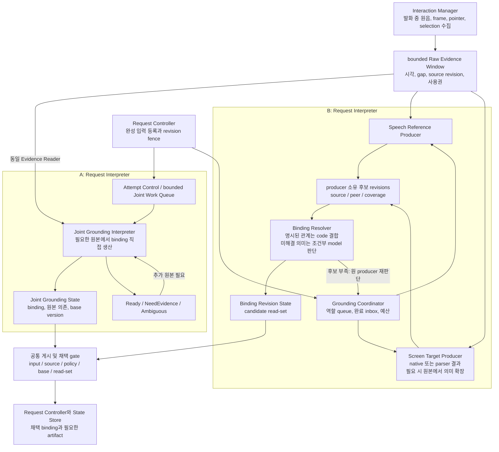
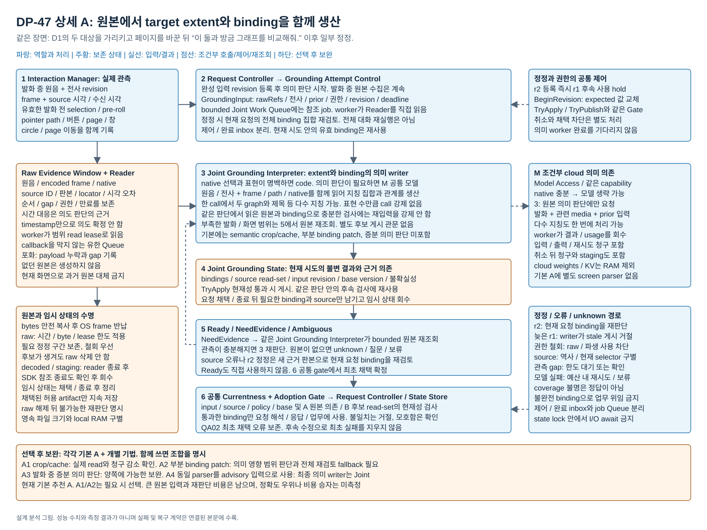
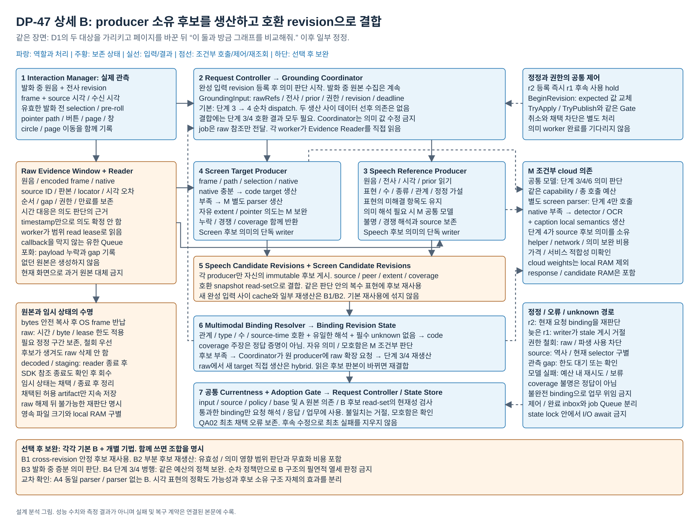

# 발화와 화면 조작의 지칭 해석

> **2026-10-19 DP3 구조 재검토:** 사용자는 종전 B의 장점을 억지로 만들지 않고, 같은 주제에서 실제 QA trade-off가 있는 다른 구조를 찾도록 요청했다. [별도 재검토](dp3-reconstruction-20261019/README.md)에 완성 입력 후 판단과 발화 중 잠정 관계 유지, 발화 질의 분해, evidence 보존 축의 선별·비용·반증을 기록했다. 새 구조는 제안이며 미구현·미측정·미선정이다. 현재 논의에서 독립 생산의 병렬 실행을 B의 기본으로 보고 기존 pixel B4 실측을 활용한다. 아래 본문과 순차 기본/B4 보완 명칭·추천은 당시 설계와 실행의 이력으로 보존한다.

2026-10-18 / 문제 3과 기존 DP-47의 통합 설계 분석

아래 A 권고와 미측정 표시는 설계 분석 시점의 기록이다. [15 보완 PoC 결과](15-corrected-poc-results.md#dp04-결과--화면과-발화의-지칭-결합)에서는 기본 A 17/24·B 24/24의 지칭 정확도와 B의 추가 생산 지연을 확인했다. **현재 권고는 B를 선택하고 B4로 생산 단계를 병행하는 구성**이다. A4도 24/24를 얻었으나 B4보다 시간·비용이 컸다. [12 초기 PoC](12-poc-results.md#5-화면과-발화의-지칭-결합)의 수치·실패와 아래 이전 설계 판단은 보존한다. 실행한 Qwen vision 생산자는 설계에서 참고한 OmniParser의 실제 실행과 구별한다.

**실행 전 설계 권고 이력: 이 문제를 최종 주요 DP 세트에 포함하고, 원본 공동 해석 A로 시작할 것을 제안했다.** B는 화면 영역과 의미를 먼저 명시적으로 생산하여 복잡한 시각 대상의 혼동을 줄일 가능성이 있고, 그 대가로 후보 생산과 추가 모델 의존, 확장 및 결합 비용을 감수한다. 당시 추가 조사에서 같은 최종 VLM에 화면 파싱 결과를 공급한 공식 비교 실험을 확인하여 이 정확도 경로의 근거를 보강했다. 당시 VIA의 정확도 우위를 측정했다는 뜻은 아니다. A의 직접 판단과 B의 구조화된 생산을 같은 기능에서 선택할 QA 상충이 충분하다는 작성자 판단이었다. 구체적인 B의 모델 의존과 교차 조합은 §5.3, 초기 선택 이유와 한계는 §10을 따른다. 현재 측정 후 권고는 위의 B+B4다.

[공통 분석 기준](00-analysis-contract.md) / [공식 자료와 재확인 범위](../../../../references/seven-problem-review/screen-grounding.md) / [기존 DP-47](../04-47-screen-voice-grounding.md) / [직전 문제 3 비교](../qa-first-exploration/five-problem-study/03-screen-speech-grounding.md)

## 0. 비교 그림


[편집 원본](diagrams/dp47-seven-comparison.drawio) / [PNG](diagrams/dp47-seven-comparison.png) / [전체 그림 안내](diagrams/README.md)

[기본 A 상세도](#detail-a) / [기본 B 상세도](#detail-b)

상세도는 입력, 번호 순서의 처리, 상태 owner와 수명, 조건부 모델, 정정/실패 경로를 표시한다. 하단 tactic은 기본에 자동 포함되지 않는다.

## 1. VIA가 풀어야 하는 문제

사용자는 spreadsheet에서 범위를 선택한 뒤 “이 매출과”라고 말하고, PDF의 표를 가리키며 “여기 작년 수치를 비교해줘”라고 이어갈 수 있다. scrollbar를 끌어 페이지를 바꾼 뒤 두 graph 주위로 pointer를 돌리며 “이 두 개도”라고 말한다. 곧이어 “아니, 아래 것만. 처음 범위는 그대로”라고 고칠 수도 있다. 전사가 완성될 때 현재 화면은 이미 메일일 수 있다.

VIA는 말과 당시 화면 행동을 함께 요청의 입력으로 취급한다. 잘못 연결한 자료를 Downstream Agent에 전달하면 외부 업무가 정확히 수행되어도 사용자의 요청은 실패한다. 이름과 경로를 다시 말하게 하는 확인만으로 모든 자연 지칭을 대신할 수도 없다.

사용자가 승인한 세 설계 포인트는 다음과 같다.

1. **근거의 보존과 표현:** 사라진 화면, selection과 pointer 경로를 어떤 자료로 남길 것인가.
2. **의미 생산의 협력:** 발화와 화면 행동의 관계를 원본에서 함께 생산할 것인가, 별도 생산자가 만든 부분 후보를 결합할 것인가.
3. **정정과 재판단:** 바뀐 부분과 유지할 부분을 어떤 근거로 구별하고, 어떤 상태를 다시 생산할 것인가.

시간 대응, 화면 대상의 탐색, 사용자 의도 판단은 다른 일이다. 같은 시각에 관측되었다는 이유만으로 pointer 아래 객체가 지칭 대상이 되지는 않는다. 이 문서는 세 일을 반드시 별도 Component로 나누자는 제안도 아니다.

### 다른 문제와의 경계

| 인접 문제 | 여기서 공통 입력 또는 후속 계약으로 취급하는 것 | 이 문서의 선택 |
| --- | --- | --- |
| 현재 요청의 근거 공급 | 최근 대화, 실제 전달 기록과 관련 원본을 읽을 수 있는 경로 | 현재 지칭에 사용한 발화와 화면 행동의 의미 표현과 결합 |
| 후속 입력의 판단 실행 | 새 입력을 어떤 실행에 배정하는가 | 배정된 입력 revision 안에서 지칭을 어떻게 생산하는가 |
| 비동기 실행 연결 | 작업을 깨우고 완료를 전달하는 공통 실행 방식 | 원본 직접 binding과 후보 게시 후 binding이라는 데이터 의존 |
| 업무 인계와 Agent 선택 | 채택된 대상과 자료를 누구에게 어떤 계약으로 전달하는가 | 그 전달 전에 사용자가 지칭한 대상 집합을 식별 |

Task 연결이나 Agent 선택을 QA02의 지칭 정확도에 넣지 않는다. 화면 업무의 실제 클릭, 자료 분석과 문서 작성도 Downstream Agent의 책임을 유지한다.

## 2. 같은 일을 수행하는 공통 계약

### 2.1 실제 관측할 수 있는 입력

원본 수집은 허용된 범위에서 발화 중 계속한다. **두 기본안의 의미 판단은 완성된 입력 revision 이후에 시작한다.** 발화 전에 선택하여 아직 유효한 selection과, 이미 허용되어 실제로 기록한 pre-roll은 공통 입력에 포함한다. 항상 켜진 녹화나 관측하지 않은 과거 화면을 가정하지 않는다.

| 입력 | 남길 정보 | 자동으로 알 수 없는 것 |
| --- | --- | --- |
| 원음과 전사 | stream, sample 구간, provider item/revision, 제공된 span time, 실제 수신 시각과 오차 | VAD가 단어별 시각을 제공하거나 전사 수신 시각이 발화 시각이라는 가정 |
| 화면 frame | 관측한 pixels, source/창, frame 시각, 크기, 좌표 기준과 source revision | 모든 frame이 도착했다는 보장, native 조회와의 원자적 동시성 |
| pointer와 button | 실제 관측한 경로, button 전환, wheel, 시각과 좌표 변환 | 단순 이동이 지칭인지, 원이 집합 지정인지, drag가 선택인지 navigation인지 |
| native selection과 앱 자료 | 실제 제공된 range/element/text, 조회 시각, 지원 상태 | 모든 PDF graph가 객체로 노출되거나 현재 handle이 과거 객체와 같다는 가정 |
| 이전 채택 결과 | binding, source extent, 요청 revision, 유지 조건과 원문 | 이전 결과가 현재 요청에도 자동 유효하다는 가정 |

WASAPI의 packet 시각과 오류 flag, Windows.Graphics.Capture의 frame 시각과 수명, UI Automation의 실제 selection 지원을 구별해야 한다. 선택이 없는 빈 range, selection 미지원과 조회 실패도 서로 다르다. API가 제공하는 자료를 VIA에서 실제로 취득했다는 검증은 아직 없다. [WASAPI](https://learn.microsoft.com/en-us/windows/win32/api/audioclient/nf-audioclient-iaudiocaptureclient-getbuffer), [화면 frame 수명](https://learn.microsoft.com/en-us/windows/apps/develop/media-authoring-processing/screen-capture), [TextPattern selection](https://learn.microsoft.com/en-us/windows/win32/api/uiautomationclient/nf-uiautomationclient-iuiautomationtextpattern-getselection)

### 2.2 입력과 결과 자료형

아래는 VIA 설계 계약이다. 외부 harness가 그대로 구현한 schema가 아니다.

| 계약 | 주요 내용 |
| --- | --- |
| `GroundingInput` | requestId, inputRev, 완성 입력 원문/원음 참조, 관측 window, prior binding, 권한, deadline, 전체 예산 |
| `EvidenceReadReceipt` | 실제 읽은 sourceRefs와 sourceVector, 시간/좌표 범위, coverage/gap, clock uncertainty, useLease |
| `GroundingProposal` | expression별 target 집합/extent, 근거, 유지/교체 관계, inputRev, base binding version, 해결/확인 상태. B는 candidate read-set도 포함 |
| outcome | `Ready`, `NeedEvidence(scope)`, `RejudgeRequest(producer, scope, peerVersion)`, `Ambiguous`, `Failed`, `Stale` |

모호함이나 원본 부족은 필요한 표현 단위로 남긴다. 해결 가능한 장면에서 불필요한 확인을 하는 것은 정확도 성공이 아니다. 반대로 실제로 관측되지 않은 대상을 그럴듯하게 채택하지 않는다. 후보에 없는 대상을 읽을 수 있는 원본으로 확장하는 경로는 B의 기본 기능이다.

### 2.3 비용과 기능을 같게 만드는 조건

- 같은 로컬 VIA, 최종 cloud 음성/의미 모델 capability, source 권한과 전체 실행 예산을 쓴다. §5.3의 B는 화면 parser를 추가 의존으로 명시하고 요금, 지연과 상태 비용을 포함한다. 추가 학습이나 helper가 공짜라고 가정하지 않는다.
- native 자료만으로 명백한 선택을 표현할 수 있으면 양쪽 모두 코드 경로를 허용한다. A를 항상 전체 이미지 호출로 만들지 않는다.
- 원본 보존과 모델에 원본 전체를 보내는 것은 다르다. 기본 A도 필요한 구간을 읽고, 충분한 binding이 이미 만들어진 같은 판단 안에서는 불필요하게 원본을 반복 전송하지 않는다.
- 후보나 첫 binding을 잘못 만들었더라도 채택 전에 추가 근거로 바로잡는 것은 정상 경로다. 최초 채택 뒤의 정정은 최초 오류를 지우지 않는다.
- 새 입력, 권한 철회와 늦은 결과의 현재성 검사, capture 지속과 로컬 음성 stop은 공통 기능이다. 어느 안의 고유 정확도 이익으로 세지 않는다.

## 3. 레퍼런스에서 확인한 선택과 가져오지 않은 주장

공식 구현을 그대로 VIA 완성품으로 취급하지 않는다. 다섯 agent harness 중 현재 화면의 native 목록과 pixels를 함께 쓰는 선례는 있지만, 발화 중 page crossing과 click 없는 circle, 부분 정정까지 구현했다는 직접 근거는 부족하다. 인접 multimodal 시스템까지 넓혀 다음 메커니즘을 확인했다.

| 확인한 실제 메커니즘 | 설계에 적용하는 부분 | 적용하지 않는 주장 |
| --- | --- | --- |
| Magentic-One WebSurfer의 interactive rectangle, Set-of-Mark image와 요청 공동 입력 | A가 native와 pixels를 함께 읽는 실용적 형태 | 당시 사용자 음성과 pointer의 temporal grounding이 이미 검증됨 |
| OpenHands의 text/image BrowserObservation, OpenClaw의 snapshot identity guard | 관측 자료와 현재 identity를 구별하는 공통 계약 | hash 파일이나 현재 browser index만으로 과거 대상을 복구 |
| Google Live Console의 같은 client에 대한 PCM와 JPEG 전송 | 원본을 공동 의미 처리에 공급할 수 있음 | 샘플 frame cadence가 VIA 요구를 충족하거나 자체 binding 기록을 제공 |
| QuickSet의 부분 typed feature structure와 unification | B는 부분 의미를 결합하며 **매 결합마다 LLM 호출이 필요한 구조가 아님** | pen 지도 명령의 grammar가 자유로운 PC 화면 지칭 전체를 지원 |
| Johnston/Bangalore의 speech/gesture stream을 결합하는 finite-state 구현 | 명시된 type와 event reference로 계산 가능한 결합, 중간값의 참조 전달 | 고정 cloud API의 ASR decoder를 동적으로 제어할 수 있음 |
| ReALM의 entity와 주변 text 및 상대 위치 encoding | screen 후보를 text로 전달하는 B의 구현 가능성 | upstream detector 비용과 누락이 없어지거나 섬세한 공간 정보가 모두 유지 |
| OmniParser의 screenshot → parsed content interface와 같은 GPT-4V의 local semantics 비교 | 별도 화면 생산자, 영역/의미를 명시한 입력이 target 식별을 도울 수 있다는 간접 근거 | 추가 detector/caption 모델이 무료이거나 VIA의 시간 지칭과 모든 graph 범위를 검증 |
| Psi의 originating-time fusion, InproTKS의 가설 추가/철회 | 공통 시간 대응과 선택적 증분 처리의 상태 관리 | 시간 정렬이 지칭 의도를 증명하거나 revoke가 모든 의존을 자동 복구 |

Magentic-One, Google과 OmniParser의 고정 코드를 다시 열어 확인했다. OpenHands, OpenClaw의 고정 경로는 이번 web 재조회가 실패하여 이전 직접 확인 원장을 보존했다. Deep Agents와 CrewAI의 기억/위임 구조는 이 문제의 직접적인 temporal grounding 대안으로 사용하지 않는다. 전체 제품에 해당 기능이 없다는 판정은 아니다. 정확한 URL, 위치, 성공/실패한 재확인은 [source note](../../../../references/seven-problem-review/screen-grounding.md)에 있다.

**새 C를 만들지 않은 이유:** 화면 text encoding이나 typed resolver는 B의 생산/결합 구현이고, streaming과 cache는 양쪽의 보완이다. gesture로 ASR search 자체를 바꾸는 finite-state 설계는 별도 메커니즘이지만 현재 cloud API 계약과 자유 지칭 범위에서 같은 기능의 완결 대안으로 가져올 수 없다. 명시 선택을 매번 강제하는 안은 사용자의 자연 지칭 요구를 바꾼다. 이들을 억지로 세 번째 구조로 세지 않는다.

## 4. 기본 A: 원본에서 지칭을 함께 생산한다

**핵심:** Joint Grounding Interpreter가 발화와 화면 행동의 원본을 읽고 target extent와 binding을 직접 생산한다. 별도 Screen Target Producer가 후보를 게시해야만 판단할 수 있는 관문이 없다.

1. Grounding Attempt Control이 현재 `GroundingInput`으로 Joint Work Queue에 job을 넣는다.
2. worker가 Evidence Reader에서 필요한 원음/전사, 당시 frame/path/native와 이전 binding을 읽는다.
3. 명백한 native 선택은 코드로 표현할 수 있다. 의미 판단이 필요하면 동일 cloud model에 관련 원본과 요청을 함께 전달한다. **한 번의 입력에서 여러 지칭과 관계를 모두 생산할 수 있다.**
4. 추가 원본이 필요하면 같은 의미 책임에서 다시 읽는다. 부족한 근거를 만들어내지는 않는다.
5. `TryApply`로 현재 input/source/base version을 검사한 결과만 Joint Grounding State에 게시하고 typed outcome을 반환한다.
6. Request Controller의 공통 채택을 통과한 proposal이 전체 요청 해석과 후속 응답/업무에 사용된다.

기본 A는 현재 요청의 전체 binding 집합을 재검토하여 새 완성 입력의 정정과 유지 조건을 반영한다. 모든 Conversation과 Task를 다시 실행하는 뜻은 아니다. 같은 판단 안에서 이미 얻은 binding으로 충분한 검사에는 원본 재전송을 강제하지 않는다. 별도 semantic crop/cache와 영향 부분만 재판단하는 최적화는 A1/A2로 분리한다.

**정상 이익:** 언어가 화면 범위의 분할을 결정하는 경우에도 중간 후보 schema를 먼저 확장할 필요가 없다. 별도 후보 출력, 게시와 재결합을 모든 요청에 요구하지 않는다. **정상 비용:** 큰 관측 구간과 다수 관계를 공동 입력으로 처리하고 재판단하면 media 입력, 모델 시간과 전송 준비가 커질 수 있다. 공동 판단이 복잡한 집합과 정정 관계를 실제로 더 잘 푼다는 정확도 주장은 아직 할 수 없다.

## 5. 기본 B: 생산자가 관리하는 부분 후보를 결합한다

**핵심:** Speech Reference Producer와 Screen Target Producer가 원본에 근거한 부분 후보를 생산한다. Multimodal Binding Resolver는 그 후보들로 binding을 만든다. 새로운 대상 범위가 필요하면 원 생산자에게 돌아간다.

| 역할 | 읽는 자료와 생산 내용 | 의미 writer와 상태 |
| --- | --- | --- |
| Speech Reference Producer | 발화 원문/원음, 실제 시간 정보, prior. 지칭 표현, 개수/종류/관계/정정 가설과 불명확 값 | Speech Candidate Revisions를 해당 producer만 게시 |
| Screen Target Producer | 실제 frame/path/selection/native. target extent, type/관계, navigation/designation 경쟁 가설과 covered/unknown 범위 | Screen Candidate Revisions를 해당 producer만 게시 |
| Multimodal Binding Resolver | 호환 revision의 후보, 허용된 설명과 prior. 표현과 대상의 관계를 결합 | Binding Revision State. 없는 target을 raw에서 직접 새로 만드는 권한은 없음 |
| Grounding Coordinator | job, source/peer read-set, 준비 상태, 예산과 deadline | 실행만 조정. producer의 의미 값을 대신 수정하지 않음 |

기본 비교의 초기 두 생산은 동일 예산 아래 단순 순차 실행 정책으로 둔다. **두 생산 사이에 본질적인 선후 데이터 의존이 있다는 뜻은 아니다.** 필요한 두 결과가 있어야 결합할 수 있다는 의존과 구별한다. B4의 병행 생산을 확인하지 않고 이 초기 정책 때문에 B 전체가 느리다고 결론내리지 않는다.

### 5.1 코드로 결합할 수 있는 경로와 의미 판단이 필요한 경로

QuickSet은 partial typed feature structure를 unification으로 합친다. 별도 후보 구조를 두었다고 결합마다 LLM을 호출해야 하는 것은 아니다. 이 사실을 이번 기본 B에 반영한다. [QuickSet 원 논문 §3](https://aclanthology.org/P97-1036.pdf)

예를 들어 speech 후보에 실제 언어 해석으로 확인된 `count=2, kind=graph, relation=within designated region`이 있고, screen 후보가 관측한 지정 동작과 해당 region의 두 graph extent 및 불확실성을 표현했다고 하자. Resolver는 type, 개수, source/time 호환과 관계 predicate를 검사할 수 있다. 필요한 관계가 모두 표현되고 **양립하는 해석이 하나이며 필수 항목에 미해결 값이 없는 경우**, 코드가 그 결합을 proposal로 만들 수 있다.

이 경로에는 다음 제한이 있다.

- 후보가 하나뿐이라는 사실만으로 충분하다고 하지 않는다. producer의 미커버 구간, 경쟁 해석과 누락 가능성을 입력으로 유지한다. coverage 표시는 producer의 주장이지 정답 증명은 아니다.
- 가까운 좌표, 높은 confidence 또는 circle 모양만으로 의도를 확정하지 않는다. 같은 경로가 navigation일 가능성이 남으면 semantic 판단 또는 producer 확장이 필요하다.
- 복합 의미나 후보 간 모호함은 동일 cloud model을 쓰는 Resolver의 판단으로 처리할 수 있다. target 자체가 부족하면 producer가 원본을 확장한다. 규칙의 미지원과 실제로 모호한 사용자 입력을 구별한다.
- 원본에서 새로운 범위를 Resolver가 직접 만들면 A를 포함한 hybrid다. 그 성공을 pure B의 성과로 적지 않는다.

동일한 명백한 native 선택과 검증을 A에도 허용한다. 이 보강의 이익은 B의 추가 결합 호출을 줄일 가능성이지, A가 할 수 있는 코드 처리를 빼서 만드는 우위가 아니다.

### 5.2 후보 게시, 재사용과 확장

producer는 `candidateId, revision, sourceRefs, peerVersions, extent, alternatives, coverage`를 immutable record로 게시한다. 두 repository의 호환 snapshot으로 결합한다. 예를 들어 speech가 “두 graph”를 생산했지만 screen이 figure 전체 하나만 생산했다면 Resolver는 `RejudgeRequest(Screen, sourceScope, peerRevision)`을 보낸다. Screen Target Producer가 보존 원본에서 내부 두 extent를 생산한 뒤 새 read-set으로 결합한다. speech 해석이 부족하면 반대 방향도 가능하다.

**한 판단 안의 재사용은 기본 B의 성질이다.** 같은 두 graph 후보가 “이 둘을 비교하고 오른쪽 graph의 제목도 쓰라”의 복수 표현과 관계 검사에 사용될 때 다시 화면을 생산할 필요가 없다. 확장되지 않은 유효 후보와 같은 판단의 후속 결합도 재사용한다. 반면 새 완성 입력 revision 사이의 안정 후보 재사용과 영향 부분만의 재생산은 B1/B2다. provenance를 보관했다고 이전 의미가 자동 유효한 것은 아니다.

정상 이익은 부분 의미의 type/관계를 명시하여 조합하고, 충분한 후보로 여러 결합을 수행하며, 오류가 생긴 생산 지점을 구별할 수 있다는 것이다. 정상 비용은 후보 생산과 출력, 추가 상태, coverage 관리와 원본 재확장이다. 진단이 편해진다는 사실만으로 QA02나 실제 Rust 변경 범위의 우위를 주지 않는다.

### 5.3 비교할 B의 화면 생산을 구체화한다

이번 B의 visual 경로는 단순히 같은 LLM을 여러 번 호출하는 prompt 분할보다 구체적으로 정한다. **native만으로 부족한 화면에서는 Screen Target Producer가 별도 screen parser의 영역, text와 local semantics를 받아 source-backed 후보를 만든다.** 이 구성은 OmniParser의 detector, OCR와 caption 생산 및 API 반환 형태에서 가져온다. 기본 B에 추가되는 실질적인 의존이며 B1/B2 cache 효과가 아니다. parser가 지원하지 않는 graph 내부 범위, pointer 의도나 관계는 같은 cloud 의미 모델로 해당 producer가 원본을 읽어 생산/확장한다. parser 출력은 완전한 정답 목록이 아니다. [OmniParser 실행 코드](https://github.com/microsoft/OmniParser/blob/354021201345a96178360b28733573e27269f2de/util/omniparser.py)

| 구체 구성 | A | B |
| --- | --- | --- |
| final 의미 capability와 source | 동일 cloud 모델, 같은 원본/native | 동일 cloud 모델, 같은 원본/native |
| 추가 visual production | 기본에는 별도 learned screen parser 없음 | 필요한 visual 경로에 detector/OCR/caption parser를 추가. Speech Reference Producer와 Screen Target Producer의 후보 계약은 유지 |
| 배치 | 로컬 VIA와 cloud 의미 API | parser도 Model Access 뒤의 별도 cloud service로 두는 설계 가정. 제품에서 사용 가능한 service/가격을 이미 확인했다는 뜻은 아님 |
| 추가 비용 | 공동 media 처리 | parser 호출/출력과 network, producer 의미 보완, bind/확장, 사용하지 못한 생산. cloud parser 청구가 미정이면 총 QA05도 미산출 |
| local RAM | capture와 upload, binding | 같은 raw와 upload 외 parser response/annotated image 및 candidate/read-set. cloud helper 가중치를 local RAM에 더하지 않음 |

이 명세는 parser 모델을 새로 학습하거나 현재 Windows VIA에 설치한다는 계획이 아니다. 기존 공개 parser의 소비 interface를 구현 근거로 쓰며, 실제 dependency 선택 시 capability/가격/사용권을 확인한다. 만약 로컬 helper 배치를 검토하면 전체 가중치와 작업 메모리를 512 MB에 포함하는 별도 구성이다. cloud 배치와 섞어 좋은 값만 취하지 않는다.

**두 축을 공개한다.** A/B의 핵심축은 원본에서 직접 binding을 생산하는가, producer가 소유한 후보를 정상 입력으로 결합하는가다. 실제 비교 구성에는 B의 별도 visual producer라는 의존 차이도 있다. 외부 실험은 주로 그 visual representation의 효과를 지지한다. producer ownership이나 revision 자체가 정확도를 높였다는 실험으로 읽지 않는다.

| 교차 구성 | 의미와 판정 |
| --- | --- |
| 기본 A | 원본/native에서 직접 binding. 기본 선택의 비교점 |
| 기본 B | 별도 화면 생산을 포함한 producer-owned 후보 결합. 추가 의존을 비용에 포함 |
| A4: 같은 parser를 보조 입력으로 쓰는 공동 판단 | Joint Grounding Interpreter가 최종 extent와 binding을 직접 생산하므로 A 계열. B의 시각적 이익이 이 보완만으로 회복되는지 확인 |
| B의 parser 없는 구성 | 기존 동일 cloud 의미 모델로 후보 생산. 구조는 B지만 추가 visual producer의 정확도 근거를 그대로 적용할 수 없음. 분리 효과의 진단 구성 |

A4가 가능하다고 기본 비교를 없애지 않는다. 다만 A4가 동일 정확도 경로를 더 적은 조정으로 확보하면 **producer 소유 후보 계약 자체를 선택할 근거**는 약해진다. 그 사실을 후속 추천에 반영한다. 이 효과 귀속을 숨기고 B의 모든 모듈 분리가 검증되었다고 주장하지 않는다.

## 6. 실행과 상태 수명을 한 구조에서 읽기



그림의 producer 두 화살표는 의존 구조다. 기본 B의 순차 dispatch와 B4 병행 정책을 같은 것으로 세지 않는다. 의미 모델의 호출과 반환은 각 의미 worker가 Model Access를 통해 수행한다. queue와 gate는 로컬 실행 가정이며 별도 process, message broker 또는 durable queue를 추가한 구조가 아니다.

### 6.1 제어와 정정의 실행 계약

1. 새 완성 입력 r2를 등록할 때 Request Controller가 후속 사용을 hold하고 `BeginRevision(r2)`를 호출한다. worker의 모델 결과를 기다린 뒤 무효화하지 않는다.
2. 요청별 RevisionGate의 짧은 임계 구역에서 expected revision/generation을 바꾼다. `TryApply`와 `TryPublish`도 같은 gate를 사용한다. 검사와 상태 교체 사이의 race를 남기지 않는다.
3. 취소는 자원 절약 요청이다. r1이 늦게 반환하면 실제 writer가 게시 전에 stale로 거절하고 완료 통지를 남긴다. 최종 채택 gate만으로 중간 repository 오염을 방치하지 않는다.
4. B의 결합은 읽은 producer revision 집합을 기록한다. 그 사이 후보가 바뀌면 옛 결합을 채택하지 않고 현재 snapshot으로 재결합한다. 같은 peer version 왕복은 예산과 반복 검출로 제한한다.
5. A/B 모두 deadline까지 가능한 자료를 사용하되 unresolved 범위를 보존한다. 필요한 source가 영원히 완료되기를 기다리지 않는다. 불완전한 binding으로 업무를 위임하지 않는다.

Observation Queue는 유한 FIFO이고 포화 시 capture callback을 막지 않고 gap과 버린 payload를 기록한다. Control Inbox와 Completion Inbox는 분리하고 제어 loop가 가득 찬 역할 queue를 await하면서 완료를 못 읽는 순환 대기를 피한다. job에는 raw 사본 대신 참조를 넣는다. 상태 lock 안에서는 원본 read, 모델, DB 또는 queue write를 await하지 않는다. queue가 있다는 이유로 crash 후 재전달을 보장하지 않는다.

### 6.2 원본, decoded media와 후보의 수명을 구별한다

| 상태 | 유지 이유와 owner | 해제 조건 |
| --- | --- | --- |
| OS capture frame/surface | Interaction Manager가 실제 관측을 취득 | 보존할 bytes와 metadata를 안전하게 복사한 뒤 반납. 반납된 surface 참조를 계속 쓰지 않음 |
| 보존한 원음과 encoded frame | Interaction Manager의 bounded window. 당시 원본 재조회와 정정, source 검토 | 공통 시간/byte 한도, 유효 read lease와 현재 요청 의존을 함께 적용. 한도/철회가 우선이면 gap 또는 사용 불가로 전환 |
| decoded pixels와 API 전송 staging | 지금 수행하는 read/encode/upload | 해당 reader와 SDK가 더 이상 참조하지 않을 때 회수. 취소 호출만으로 SDK 사본이 사라졌다고 가정하지 않음 |
| A binding 상태 | 같은 판단의 결과, source 의존과 정정 원문 | 채택/종료 뒤 필요한 결과만 State Store로 남기고 임시 시도 회수 |
| B 후보와 binding 상태 | producer 소유 의미, 같은 판단의 복수 결합과 확장 | 사용 job/read-set이 끝나고 재판단에 불필요한 revision부터 회수. candidate 참조가 raw 소유권을 무제한 연장하지 않음 |
| 채택 artifact | 후속 Request/Task가 실제 사용하는 허용 범위 | 공통 보존/삭제 정책. 전체 raw나 모든 후보를 Conversation 영구 기억으로 복제하지 않음 |

**B는 후보를 만들었다는 이유만으로 raw를 일찍 폐기할 수 없다.** 후보 밖의 범위로 확장하거나 “내부 둘만”이라고 정정할 때 같은 기능을 유지하려면 재조회 가능한 원본이 필요하다. 현재 revision의 필수 판단과 정정용 보존 계약이 끝났거나, 필요한 역사 자료가 허용 artifact로 실제 확보되어 이후 계약을 충족할 때만 원본을 회수한다. snapshot을 남겨도 전체 raw를 필요로 하는 미래 요구까지 지원한다고 약속하지 않는다. 원본 사용권이 철회되면 후보/summary를 통한 우회 사용도 차단한다.

B의 생산 단계가 끝나면 decoded media와 upload staging을 먼저 비울 수 있다. A도 한 번 올린 media의 로컬 사본을 해제하거나 순차 materialization할 수 있다. 따라서 원본 보존과 전송 사본의 수명 차이를 실제 확인하기 전에는 B의 QA06 이익이 아니다. 파일 offload도 양쪽에 허용할 공통 저장 정책이며 파일 크기 감소를 RAM 절감으로 그대로 세지 않는다.

## 7. 같은 여섯 장면으로 기본안을 비교한다

아래는 COMMON-28을 바꾸는 평가 모집단이 아니라 설계 사고실험이다. 기호와 정답 target은 설명용이며 후보 입력에 주지 않는다. A1/A2/B1/B2의 cache나 부분 재계산, A3/B3의 발화 중 의미 판단을 아래 기본 경로에 넣지 않는다.

| 장면과 같은 완료 조건 | 기본 A의 실제 경로 | 기본 B의 실제 경로 | 차이가 없어지거나 실패하는 조건 |
| --- | --- | --- | --- |
| **S1 사전 selection:** spreadsheet 범위를 선택하고 PDF를 foreground로 둔 채 옆 창을 가리켜 “이 매출 범위” | 최초 유효 selection, 창/경로와 말을 직접 연결. 명백한 native 조건이면 image 모델 불필요 | selection을 source-backed target으로 표현하고 speech 표현과 결합. native 생산과 명백한 결합은 code 가능 | 같은 native 근거면 B의 시각 생산 절약은 고유 이익이 아님. selection이 없는 경우 양쪽 visual 경로. foreground만으로 결정하면 양쪽 실패 |
| **S2 page crossing:** 두 페이지의 서로 다른 표를 순서대로 가리킨 뒤 메일로 이동하고 final 전사 도착 | 보존한 각 frame/path와 원문을 한 판단에 전달해 두 대상을 연결 | 각 당시 source의 target 후보와 지칭 순서/시간 후보를 결합. 같은 좌표의 다른 페이지를 다른 source로 유지 | 시간 오차가 페이지 전환을 걸치면 양쪽 미해결. B가 원본 없이 현재 화면 후보로 대체하면 필수 기능 실패 |
| **S3 circle와 navigation:** scrollbar drag 후 두 graph 주위로 버튼 없이 원을 그리며 “이 둘과 오른쪽 제목” | button/path, 전후 화면과 말을 공동 판단하여 집합과 제목 관계를 생산 | navigation/designation 경쟁 후보와 두 graph/제목 extent를 생산. 같은 후보로 여러 관계를 결합. 조건이 완전하면 typed code 결합 | 기본 B의 within-judgment reuse가 드러남. A도 이 원본을 한 번만 입력해 모두 생산 가능. screen 생산이 figure 하나면 확장 후 결합 필요 |
| **S4 밀집 화면과 언어가 정하는 범위:** dashboard에서 “이 표시의 뜻”을 묻거나 같은 그림의 “안쪽 두 graph만, 축 표기는 빼고”를 지칭 | 작은 표시/범위와 말을 공동 판단. native가 없으면 pixels를 사용 | UI text/icon은 parser의 영역/설명으로 혼동을 줄일 수 있음. graph 제외 범위가 없으면 원 producer가 원본에서 확장 | 앱을 실제 조작하는 시험이 아닌 지칭 대상 식별이다. parser의 UI icon 지원을 graph 내부 분할 지원으로 확대하지 않음. 실제 후보 부족과 A 오류 모두 보존 |
| **S5 부분 정정과 늦은 결과:** “아래 graph만, 처음 표는 그대로” r2 동안 r1 결과가 반환 | r2의 현재 요청 binding 집합과 이전 원본을 재검토하여 유지/교체를 제안. r1 게시 거절 | r2 후보를 생산하고 새 read-set 결합. r1 게시 거절. 기본에는 cross-revision 후보 cache 없음 | 나머지 조건의 유지가 공통 성공 기준. A2/B2를 기본 이익으로 세지 않음. stale 차단은 의미 정확도 차이가 아닌 공통 qualification |
| **S6 근거 공백과 현재성:** frame gap, 늦은 UIA, 원본 사용권 철회 또는 같은 모양의 새 문서 | 실제 gap/시각 오차를 바탕으로 제한된 대기 또는 해당 지칭 확인. 옛 원본의 역사 참조와 현재 조작 selector 구별 | 같은 처리와 파생 candidate의 사용권/peer 갱신. missing 후보를 current screenshot으로 보충했다고 주장하지 않음 | 양쪽에 실제 원본이 없으면 구조 승자 없음. 불필요한 질문과 정당한 미해결을 다른 oracle로 판정 |

S3의 후보 재사용과 S4의 밀집 UI 요소는 B가 유리할 조건을 드러낸다. S4의 자유로운 내부 extent는 A가 유리할 수 있는 조건이다. 어느 한쪽에 유리한 종류만으로 모집단을 구성하지 않는다. S1의 동점과 S6의 공통 한계도 유지한다.

## 8. B의 이익이 성립하는 조건을 비용 전체로 확인한다

### 8.1 복수 표현은 A의 원본 반복 입력 횟수가 아니다

R은 같은 관측 원본, U는 발화, m은 지칭 표현 수, C는 screen 후보, S는 speech 후보다. `Cost`는 실제 청구되는 모든 입력/출력과 필요 재시도다. 다음 식은 구조 분석이며 측정치가 아니다.

```text
A 비용 = Cost(Joint(R, U, m)) + Cost(A 추가 조회와 재판단)
B 비용 = Cost(Parser(R)) + Cost(Screen(R, parsed)) + Cost(Speech(U))
       + Cost(Bind(C, S, m)) + Cost(후보 확장과 재결합)
```

`Joint(R,U,m)`을 `m × Cost(Joint(R,U,1))`로 바꾸지 않는다. B도 C를 표현마다 다시 생산하지 않는다. 코드 생산/결합의 모델 요금은 0일 수 있지만 실행 시간과 RAM 및 유지 비용은 남는다. 반대로 parser와 producer의 media 입력, candidate 출력과 cloud service 청구까지 모두 B 비용이다. native가 충분하여 parser를 호출하지 않은 episode에서는 그 항이 0이다.

한 판단에서 최초 결합 뒤 추가 관계 검토가 k번 필요한 경우 B는 같은 C로 결합할 수 있다. 이때에만 다음 조건을 따져볼 수 있다.

```text
B의 실제 이익 조건:
A에서 필요한 추가 raw 재처리 비용
  > B의 최초 후보 생산/출력 및 기본 결합 추가 부담
    + B의 실제 확장/재결합 비용
    - B가 대신 줄인 최초 처리 비용
```

k가 m과 같다는 가정은 없다. A의 최초 결과와 raw dependency만으로 후속 검사가 충분하면 왼쪽은 작거나 0이다. B의 후보가 충분하고 이후 결합이 작으며, A의 실제 공동 판단이 반복 원본 해석을 필요로 하는 조건에서만 B의 재사용이 총비용 이익이 된다. 그 빈도와 비용은 아직 확인하지 않았다.

### 8.2 typed 결합과 text encoding이 바꾸는 것

B의 결합이 코드로 끝나면 큰 후보 재입력과 추가 모델 응답 생성이 사라질 수 있다. 그러나 앞선 speech/screen 의미를 이미 정확히 생산한 비용은 남는다. type/count 검사는 없는 정답 후보를 생성하지 않는다. grammar의 범위를 넘는 발화에는 semantic 경로가 필요하다.

ReALM은 upstream detector가 얻은 entities와 주변 text/위치를 text로 구성해 지칭 집합을 찾는다. 본문은 섬세한 공간 관계에서 정보가 손실될 수 있음을 명시한다. VIA의 허용 native 정보가 이 표현을 이미 제공한다면 A도 같은 자료를 쓸 수 있다. image-only graph를 이 형태로 생산하는 비용과 누락은 별도로 남는다. 따라서 “text를 넣으므로 B는 싸고 정확하다”로 결론내리지 않는다. [ReALM §5.3.2, §7](https://arxiv.org/html/2403.20329v1)

finite-state 원 논문은 gesture가 speech recognition search에 제약을 주는 구성까지 설명한다. 이는 일반적인 추가 LLM 결합보다 넓은 설계 가능성을 보여준다. 다만 해당 decoder 제어와 domain grammar를 현재 cloud 음성 API의 제공 기능이라고 가정할 수 없어 그 논문의 품질 이익을 VIA의 B에 옮기지 않는다. [Johnston/Bangalore §3–4](https://aclanthology.org/C00-1054.pdf)

### 8.3 시간과 RAM도 별도로 계산한다

```text
A 의미 경로 = Joint + 실제 추가 판단 경로
B 기본 정책 = Screen + Speech + Bind + 실제 확장 경로
B4 병행 정책 = max(Screen, Speech) + Bind + 실제 확장 경로
```

위 식의 Screen에는 필요한 parser와 그 결과를 쓰는 screen producer 처리를 포함한다. 필요한 데이터가 같은 시점에 준비되고 자원 경쟁이 없다는 단순 의존 설명이므로 실제 queue, provider slot, upload와 code 검사를 더해야 한다. B4는 slot과 전송이 겹쳐 오히려 부담을 늘릴 수도 있다. B의 구조적 시간 부담을 설명할 때는 이 B4 민감도까지 남긴다. 초기 순차 정책을 구조의 필연적인 열세로 쓰지 않는다.

```text
local peak RAM = max_t(공통 capture/buffer + 살아 있는 decoded/staging
                      + 실행/queue 상태 + binding/후보/cache 상태)
```

B는 stage별 media staging을 줄일 가능성과 추가 후보/read-set 비용이 함께 있다. A가 여러 media를 한 요청에 전달한다고 모든 decoded frame을 끝까지 동시에 유지해야 하는 것은 아니다. 별도 시점의 peak들을 합하거나 cloud KV를 local RAM에 넣지 않는다. 원본 해제 기준을 느슨하게 바꾸어 B에만 512 MB를 만족시키는 비교도 금지한다.

### 8.4 정확도 이익의 새 근거와 귀속 범위

OmniParser 원 논문의 §4.1 Table 1은 같은 GPT-4V와 SoM 화면에 local semantics를 추가하는 비교를, §4.2 Table 2는 화면 파싱 구성의 ablation을 보고한다. Table 1은 지칭 대상이 검출된 box 안에 있는 조건이므로 후보 누락까지 해결했다는 증거가 아니다. 영역과 설명을 명시하면 밀집 화면의 target 연결을 도울 수 있다는 **외부 간접 근거**다. §5는 반복 요소, 부정확한 bbox granularity와 crop의 전체 맥락 손실도 실패로 남긴다. [OmniParser 원 논문](https://arxiv.org/html/2408.00203v1)

이를 VIA로 옮긴 가설은 `별도 화면 영역/의미 생산 → 시각 대상과 표현의 대응 부담 감소 → 일부 image-only 지칭의 QA02 개선 가능성`이다. 그 대가는 §5.3의 추가 생산과 모델 의존, §8.1의 총비용이다. 단일 정지 화면의 행동 대상 시험을 한국어 발화의 temporal referent-set 정확도로 환산하지 않는다. speech producer 분리와 revision ownership의 우위도 해당 논문이 검증하지 않았다. A4가 같은 representation 이익을 얻을 가능성을 남기면서, **기본 A와 구체 B의 정확도 가능성 대 지연/모델 비용**은 설계상 비교할 근거가 있는 상충으로 채택한다.

## 9. QA01~06의 인과와 반증

현재 QA 패키지의 의미와 점수표를 유지한다. 다음은 적용 경로와 설계 가설이며 차이를 확보한 점수표가 아니다. 주요 비교 관점은 QA02, QA03, QA05, QA06이다. QA01도 실제 응답 경로에 적용되지만 QA03과 같은 지연을 독립 이익으로 합하지 않는다.

| QA | A의 이익 / 부담 | B의 반대편 이익이 성립할 조건 / 부담 | 반증과 현재 판단 |
| --- | --- | --- | --- |
| **QA01 첫 응답 지연시간** | 바로 binding을 만들면 필요한 내용 표시까지 단계가 적음. 큰 공동 입력과 추가 read가 지연 가능 | 충분한 native 후보와 code 결합 또는 B4의 짧은 경로. 초기 생산/확장이 필요하면 표시 대기 | 실제 첫 구체 내용 UI까지 측정. 단순 접수 인사나 model finish는 endpoint 아님. B4 전에 구조 전체의 열세 판정 금지. 우열 미확인 |
| **QA02 지칭 대상 식별 정확도** | 후보 schema에 없던 범위도 공동 원본에서 생산. 다수 관계와 작은 시각 요소의 혼동 가능 | 별도 parser의 영역/설명이 image-only target 연결을 도울 수 있다는 간접 비교 근거. type/count/관계 검사도 가능. 누락/잘못된 의미/분할은 반대 위험 | 같은 표현/revision의 최초 채택 집합 완전 일치. B 확장 후 최초 채택 성공 인정. A native 검증 허용. VIA 우위는 미확인이고 A4로 효과 귀속을 구별 |
| **QA03 VIA 처리시간** | 직접 생산과 동일 책임의 재조회. 반복 media 해석 부담 | 같은 판단의 후보 재사용과 조건부 code 결합. producer→resolver 및 확장 의존 부담 | 실제 발화 종료 후 입력 확정 대기를 포함한 기존 endpoint까지의 VIA 인과 경로. 외부 Agent 업무와 사용자 대기 제외. A가 이미 한 번에 끝나면 B 재사용 이익 축소 |
| **QA04 변경 범위** | 공통 input/output와 한 binding writer. 새 source/관계가 통합 처리에 영향 | C03의 source 표현 변화가 screen producer에 머무는 경우 국소화 가능. schema가 바뀌면 speech/resolver/read-set까지 전파 | 같은 C01–C06 변경 과제의 실제 운영 Rust 모듈 수로만 판정. C05 전달 근거, C06 철회도 확인. 상자 수/trace 용이성으로 우위 없음 |
| **QA05 모델 사용 비용** | parser/후보 출력과 결합 호출을 필수로 추가하지 않음. 큰 media 재처리 비용 | 정확도를 위해 parser 생산비를 감수. native/code 결합과 실제 반복 처리 절감은 상쇄 가능성. 후보/확장/폐기 출력도 추가 비용 | 전체 COMMON-28의 준비, 미사용, 재시도, 취소 후 청구, voice와 helper API 포함. S1~6 비용은 진단일 뿐 공식 QA05 아님. B의 작은 binder 입력만으로 우위 없음 |
| **QA06 최대 RAM** | candidate repository가 불필요. joint media staging이 커질 가능성 | 단계별 staging 회수 가능. raw 외에 후보/read-set/queue 상태와 B4 동시 실행 비용 | 전체 로컬 VIA의 Windows 실제 상주 RAM 최고량과 512 MB 요구 유지. 공유 중복을 제거하며 commit은 보조. 동일 보존과 source gap 조건. 양쪽 모두 사본을 잘 회수하면 차이 작을 수 있음 |

원본 누락, 권한 위반과 stale 결과 채택은 공통 실패로 보존한다. 이를 B의 provenance 존재나 A의 단순 구조만으로 자동 해결했다고 하지 않는다. N-H가 틀린 지칭의 후속 전달을 함께 포착해도 같은 오류를 독립 trade-off로 추가 집계하지 않는다. 이 문제만을 위해 새 핵심 QA를 만들 필요는 없다.

## 10. 작성자 선택과 최종 DP 포함 판단

### 10.1 A를 추천하는 이유와 감수할 단점

VIA의 필수 범위에는 native 정보가 충분하지 않은 PDF/graph, click 없는 집합 지칭, 언어가 정하는 extent와 정정이 있다. **A는 그 범위를 최종 의미 판단에서 직접 생산하며, parser와 후보 계약의 생산/확장 비용을 필수로 추가하지 않는다.** 이번 작성자 선택은 자유로운 지칭 범위와 cloud 총처리 부담을 먼저 단순하게 관리하고, 필요한 정확도 보완을 관측한 실패 종류에 맞춰 추가하는 것이다. 정지 UI 요소의 명시적 생산을 중시하는 조건에서는 B를 고를 이유가 있으며 그 반대편 이익을 인정한다.

선택의 대가는 큰 공동 입력과 현재 요청 집합 재판단의 지연/요금, 복잡한 관계를 한 책임에서 검토하는 부담이다. A가 더 정확하다는 실증을 이유로 선택한 것이 아니다. 이 단점은 §11의 A1/A2로 줄이는 설계를 권고한다.

### 10.2 B를 실제로 선택할 조건

다음 조건은 B를 의미 없는 대안으로 만들지 않기 위한 실제 선택 기준이다.

1. 표/graph/selection의 후보와 관계가 실제 원본에서 충분히 생산되고 같은 판단 안의 여러 표현/재검사에 쓰인다. 후보 개수가 많다는 사실 대신 실제 원본 재처리 절감을 확인한다.
2. 밀집 UI 요소와 image-only 대상이 정상 사용의 중요한 부분이고, 별도 화면 생산이 최초 채택 오류를 줄일 가능성을 중시해 추가 production/확장 비용을 감수한다. B가 반드시 저렴해야만 선택할 수 있는 것은 아니다.
3. producer가 정한 partial meaning의 조합 중 상당수가 안전하게 code 결합되거나 같은 판단의 반복 처리를 줄여, 추가 비용을 상쇄한다. native-only 이익은 A와 비교한다.
4. 동일 입력에서 후보 관계의 분리가 최초 채택 집합 오류를 줄이거나, source 변경이 소비 계약을 건드리지 않아 실제 QA04 변경 범위가 줄어든다. 추가 지연/비용/RAM을 감수할 만큼 이 이익이 중요하다.
5. B4의 같은 자원 병행 정책과 실제 local state 수명을 포함해도 이익이 유지된다. B의 원본 폐기 또는 미지원 입력 제외로 기능을 약화시키지 않는다.

이 조건 중 중요한 적용 QA의 이익이 부담을 정당화하면 **기본 B로 추천을 바꿀 수 있다.** 기본 B가 A1/A2까지 이겨야 한다는 조건은 없다. 기본 선택 뒤의 보완 비교는 별도로 한다.

### 10.3 이번 주요 DP 세트에 포함할 것을 권고한다

| 판정 질문 | 결과 |
| --- | --- |
| VIA에서 중요한 어려운 기능인가 | 예. 발화 당시 근거와 자연 지칭을 보존해야 하는 핵심 기능 |
| 같은 기능을 수행하는 실제 구조 대안인가 | 예. 직접 binding writer와 producer 소유 후보/재생산/결합 계약은 다름 |
| 외부 구현 근거가 있는가 | 예. 공동 입력, partial 의미 결합, 화면 요소 생산과 typed fusion의 선례 있음 |
| 반대편의 중요한 QA 이익이 설계 가설로 뒷받침되는가 | **예, 적용 범위를 한정한다.** B의 별도 화면 생산에 따른 QA02 개선 가능성은 동일 최종 VLM의 외부 비교 근거가 있음. VIA의 시간 지칭 전체 우위는 미확인 |
| 중요한 상충 축은 무엇인가 | QA02의 시각 대상 연결 개선 가능성 대 QA03의 production/확장 경로와 QA05 추가 모델 비용. QA06은 추가 상태와 stage 수명의 회귀/조건부 차이, QA04 우위는 미확보 |
| 이번 최종 주요 DP 세트에 포함할 것인가 | **포함 권고.** 완결된 A/B의 선택과 A의 보완을 비교. 현재 기본 A 추천과 B를 선택할 사용 조건을 함께 남김 |

직전 비교와 이번 초반 검토는 같은 cloud 모델을 나눈 B에서 재사용의 총비용 이익을 주로 찾았다. 그 조건만으로는 반대편 이익이 약했다. 추가 공식 논문의 ablation을 읽은 뒤 **별도 screen production을 명시한 B의 정확도 가능성 대 추가 비용**으로 판단 근거를 보강하여 포함 권고로 바꾼다. 이는 수치를 만들거나 기존 결과를 VIA 결과로 옮긴 것이 아니다.

포함 권고의 범위는 위 구체 구성이다. 화면 parser만 A4에 붙여도 모든 이익을 얻고 producer 후보 계약의 추가 이익이 사라진다면, 후속 결론은 ‘전용 화면 생산을 추가할 것인가’라는 더 좁은 선택으로 재정리할 수 있다. **현재 외부 근거가 ownership/revision 분리 자체를 입증하지 않는다는 한계는 최종 발표에도 남겨야 한다.** 보완이 가능하다는 사실만으로 기본 trade-off를 지우지 않되, 실제 효과가 생긴 축을 숨기지 않는다.

## 11. 선택 후 보완

번호는 누적이 아니다. A2는 A1을 포함하지 않으며 결합은 A1+A2로 쓴다. 필요한 원본 재조회와 B의 후보 확장은 기본 기능으로 남긴다.

| 보완 | 목표 QA와 추가 처리 | 비용과 적용 조건 |
| --- | --- | --- |
| **A1 crop/cache: 우선 권고** | 실제 관측한 source/extent/revision/권한을 key로 주변 문맥을 포함한 입력 crop과 준비 결과 재사용. QA03/05 부담 감소 목적 | QA06 cache, 무효화와 관계 단서 누락 위험. crop 밖 필요 시 원본 확대. 단순 encode cache를 cloud 입력 요금 절감으로 세지 않음 |
| **A2 부분 binding patch: 우선 권고** | 이전 binding과 원본 dependency, 정정 원문으로 영향 범위를 제안하고 해당 binding만 재판단 | 영향 범위 판단 자체의 비용, 유지 오류 가능성. 불명확하거나 관계 전체가 바뀌면 전체 재판단. 코드가 의미 범위를 추측해 확정하지 않음 |
| B1 안정 target 후보 재사용 | 새 완성 입력 사이에서 source/coverage/peer 유효성을 검증한 후보 재사용 | cache RAM과 invalidation. 기본 B의 같은 판단 내 재사용과 구별 |
| B2 부분 후보 재생산 | 현재 요청에서 정정 영향을 받은 producer 후보와 binding만 다시 생산 | dependency 관리와 영향 누락 위험. source-key cache B1과 다름 |
| A3 / B3 발화 중 증분 판단 | 잠정 입력 revision으로 앞선 판단을 시작하고 add/revoke/coalesce로 갱신 | 긴 안정 발화에 유리할 가능성. cloud 미사용/폐기 비용과 재판단 증가. 기본 비교에 넣지 않음 |
| B4 초기 생산 병행 | 독립 speech/screen 생산을 같은 slot/전송 예산에서 병행 | 초기 순차 정책의 대기 감소 가능성. 경합과 동시 staging 증가. producer→binding/확장 의존은 남음 |
| A4 parser 보조 입력 | B와 동일한 화면 parser 결과를 공동 판단의 보조 근거로 전달하여 QA02 시각 혼동 완화 | 추가 helper 요금/지연/응답 상태. extent와 binding의 최종 writer는 Joint Grounding Interpreter. B의 생산자 관문으로 바꾸면 보완이 아닌 B/hybrid로 재분류 |

InproTKS의 add/revoke/commit은 A3/B3의 가설 수명 참고다. 처리자의 commit 표시는 VIA의 영속 채택이나 이후 사용자 정정 금지가 아니다. [InproTKS §2](https://aclanthology.org/W14-4312.pdf)

A에 screen 후보 helper만 추가해도 최종 extent를 Joint Grounding Interpreter가 직접 생산하면 A4 보완이다. A1/A2를 우선 보완으로 권고하고, A4는 QA02의 image-only 실패와 B 이익의 귀속을 확인하는 필수 교차 비교로 둔다. Resolver가 후보 부족 시 raw에서 직접 최종 target을 만드는 방식은 A+B hybrid로 표시한다. 두 경로를 유지하고 선택하는 정책, source/read-set와 오류 처리 비용을 별도로 계산한다. hybrid라는 이름만으로 비용 없이 두 장점을 모두 얻지는 않는다.

## 12. 추천을 확인하거나 뒤집는 bounded PoC

지금 실행한 결과가 아니라 후속 승인을 위한 완결된 계획이다. 제품 전체나 Downstream Agent의 업무를 구현하지 않고 **같은 관측 replay → grounding → 현재성 채택 → 최소 Request UI**에 한정한다.

### 입력과 비교 구성

- S1~S6 각각 두 변형을 사전에 고정한다. native 충분/부족, 완전/누락 관측, 단순/복합 관계, 두/여러 표현, 좁은/넓은 정정을 균형 있게 포함한다. 총 12 episode는 작은 mechanism 검토 상한 제안이지 QA 모집단 freeze가 아니다.
- episode별 최대 두 완성 발화, 여섯 보존 frame과 네 지칭 표현으로 제한한다. 원음, 실제 time uncertainty와 selection, path, source change를 같은 순서로 제공한다. oracle은 평가기에만 둔다.
- 먼저 기본 A/B를 비교한다. B의 code/semantic resolver 분기는 동일한 사전 규칙으로 기록한다. **B4를 필수 민감도 확인**으로 실행한 뒤에만 초기 직렬 정책을 넘어 구조의 시간 부담을 평가한다. B4 결과를 기본 B 열에 덮어쓰지 않는다.
- 그 뒤 A 대 A1, A 대 A2, A 대 A1+A2를 분리한다. A4와 parser 없는 B도 각각 교차/진단 구성으로 두어 representation의 이익과 후보 소유 구조의 효과를 구별한다. 동일 parser에는 같은 입력과 trigger를 적용한다. 총 여덟 구성, episode당 두 번이면 최대 192 episode 실행의 상한 제안이다. 반복과 확장 호출은 각 episode 예산에 포함한다. B1/B2는 별도 후속 보완 비교로 남기며 모든 최적화 B의 최종 열세를 선언하지 않는다.
- 같은 provider/model capability, 원본 권한, 전체 budget과 deadline을 고정한다. 필요한 기본 단계가 다른데 호출 횟수만 같게 잘라 B를 실패시키지 않는다. B4에 추가 worker budget을 주지도 않는다.

### 관찰과 실패 보존

| 관찰 | 판정 방식 |
| --- | --- |
| 최초 채택 target 집합 | 표현/revision별 QA02 oracle. 실제 모호한 입력과 해결 가능한 대조 입력 분리. 후속 수정으로 최초 실패를 지우지 않음 |
| 실제 첫 내용과 완료 준비 | UI 표시를 관측해야 QA01. model finish만 있으면 진단. QA03은 기존 상세 표시/전체 음성 요약 준비 endpoint를 유지 |
| 전체 처리비 | 생산/결합/확장, 실제 추가 raw 입력, 코드 처리, 준비/폐기/재시도/후속 청구를 분리. episode 비용은 QA05 전체값이 아닌 진단 |
| 상태와 RAM | raw window, decoded/staging, SDK 사본, 후보/read-set, queue/cache의 겹친 수명을 실제 추적. 별도 peak 합산 금지 |
| 현재성과 coverage | 늦은 결과 게시 거절, 철회 전파, frame gap과 정당한 확인. 자연스럽게 발생한 후보 누락과 expansion을 기록 |

후보가 잘못된 상태를 미리 B에 주입하여 자연 입력의 정확도 차이를 만들지 않는다. 강제 오류 주입은 별도의 deterministic 회복 진단으로만 둔다. QA04는 실제 운영 Rust 모듈과 같은 변경 과제를 구현한 별도 평가가 필요하며 작은 mock의 파일 수로 대체하지 않는다.

**추천 반증:** 기본 B 또는 B4가 동일 입력에서 최초 채택 오류를 줄이고 추가 생산/상태 부담을 정당화하거나, 충분한 후보와 code 결합으로 총비용/시간 이익을 보이면 B 구성으로 추천을 갱신한다. B4만의 이익은 그 구성의 이익으로 기록한다. B의 정확도 이익이 없고 비용만 남으면 이 비교의 DP 포함도 재검토한다. A4가 같은 이익을 얻으면 후보 계약 자체의 필요성을 좁혀 설명한다. A1/A2가 QA02 손실, 불필요한 질문 또는 RAM 한도 위반을 만들면 해당 보완을 제거하거나 범위를 좁힌다. 양쪽의 실패 원인이 미관측 원본이면 capture capability의 공통 문제로 남긴다.

## 13. 기존 자료와의 통합 범위 및 완료 상태

| 기존 자료 | 이 문서로 가져온 내용 | 현재 비교에서 분리한 부분 |
| --- | --- | --- |
| [DP-47 본문](../04-47-screen-voice-grounding.md)와 [관측 자료](../dp47-windows-observation-sources.md) | 세 설계 포인트, selection/pointing/circle/page 이동, 입력/결과 계약, source 한계 | 이전 QA 이름과 예상 수치, 모든 보완을 양쪽에 선반영한 비교 |
| [구현 구조 비교 그림](../diagrams/dp47-implementation-comparison-v1.svg), [A 상세](../diagrams/dp47-implementation-a.svg), [B 상세](../diagrams/dp47-implementation-b.svg) | bounded queue, writer/temporary state, currentness gate, 읽기/모델 호출과 결과 반환 | 그림의 cache/partial patch/병행 표시는 현재 기본안과 같지 않음. 현 기본과 보완은 §4–6/11을 따름 |
| [A 정정 사건도](../diagrams/dp47-revision-a.svg), [B 정정 사건도](../diagrams/dp47-revision-b.svg) | 늦은 결과의 게시 전 거절, B 원 producer 확장과 새 read-set | 부분 재계산과 cross-revision reuse는 A2/B1/B2로 분리 |
| [16개 사고실험](../dp47-design-experiments.md)와 [리뷰](../dp47-design-review.md) | 약한 A/B 배제, gap/철회/모호함, hybrid와 원본 비용 반론 | 작은 보완이 가능하면 자동 DP 탈락이라는 과거 규칙은 적용하지 않음 |
| [문제 3의 17일 권고](../qa-first-exploration/five-problem-study/03-screen-speech-grounding.md) | 기본과 tactic, 같은 판단 내 reuse, 공정 비용과 B4 민감도 | typed code 결합과 별도 화면 생산의 정확도 근거를 보강. 기존 조건부 판정을 이번 구체 A/B의 주요 DP 포함 권고로 변경 |

**완료한 것:** 동일 기능의 A/B 명세, 실행/수명 계약, 여섯 장면, 여섯 QA 인과/반증, 추가 공식 근거, 작성자 A 추천과 주요 DP 포함 권고, 선택 후 보완과 bounded PoC 조건이다. 새 C를 만들 근거는 확보하지 못했다. 기존 문서와 그림은 수정하지 않았다.

**검증의 한계:** 공개 코드와 원 논문 및 문서의 대조다. 실제 Windows 앱/source coverage, cloud capability, 한국어 지칭 품질, 전체 모델 요금, 실제 Rust 변경 범위와 512 MB 달성은 시험하거나 측정하지 않았다. 이 문서의 완성은 그 성능 검증이나 사용자 최종 채택을 뜻하지 않는다.

## 부록. 방안별 상세 설계 그림

각 방안은 같은 기능 조건을 갖는다. 처리 순서와 상태/호출의 차이를 위 기본 비교 및 QA 표와 함께 읽는다.

<a id="detail-a"></a>

### 기본 A 상세도



[편집 원본](diagrams/dp47-seven-A-detail.drawio) / [PNG](diagrams/dp47-seven-A-detail.png)

<a id="detail-b"></a>

### 기본 B 상세도



[편집 원본](diagrams/dp47-seven-B-detail.drawio) / [PNG](diagrams/dp47-seven-B-detail.png)
