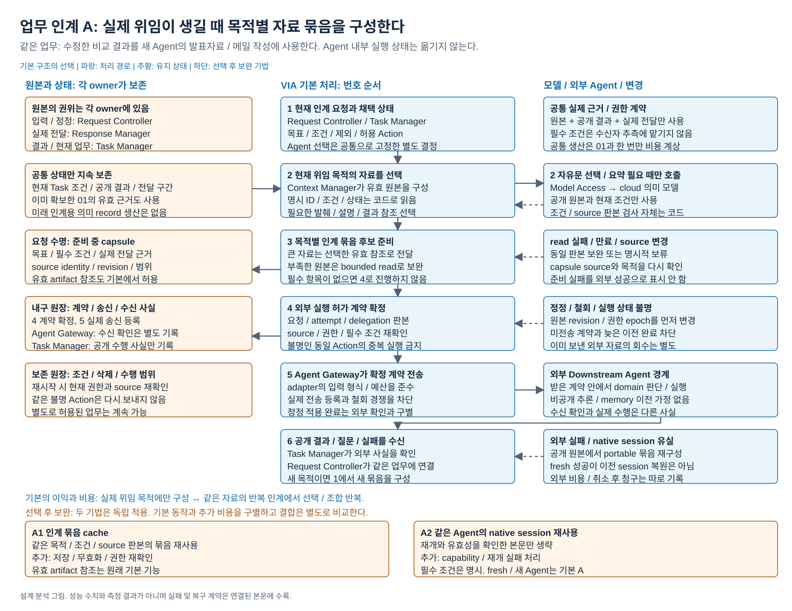
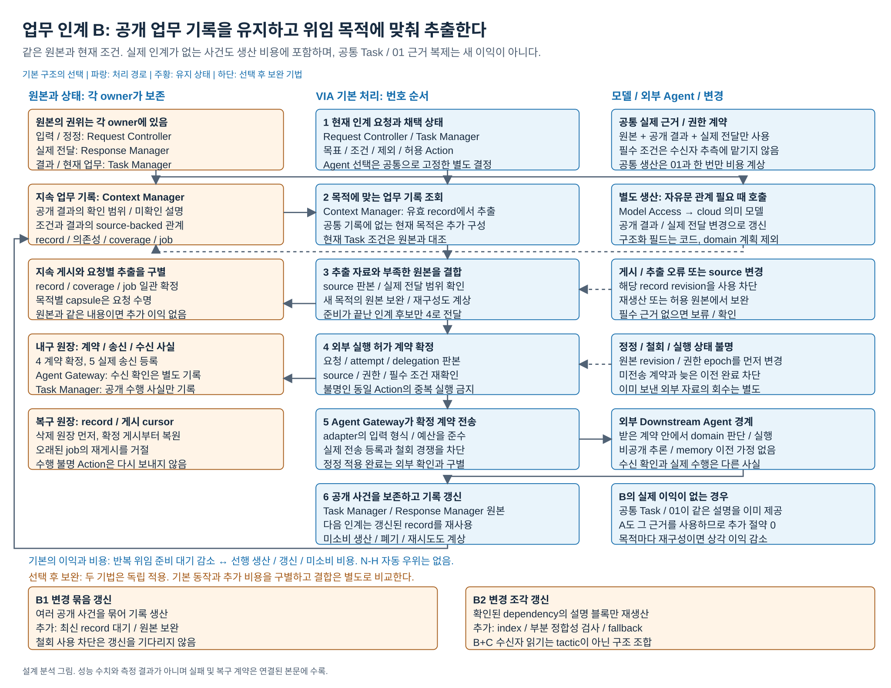
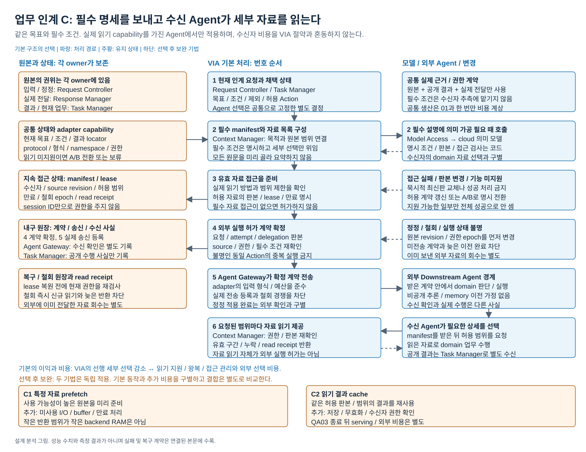

# Agent가 바뀌어도 이어지는 업무 조건과 결과의 인계

2026-10-18 / 기존 문제 4 재검토와 설계 분석

**2026-10-19 현재 결과는 [15 보완 PoC](15-corrected-poc-results.md#dp05-결과--agent-간-업무-인계)와 [10 발표 원고](10-presentation-outline.md#8-업무-인계-선택과-보완)에 있다.** 실제 원문 재사용과 범위 검사를 고친 ABC 전체36회를 비교했다. 반복 인계에서 조건 원문을 이어 주는 목적을 우선하면 B, 읽기 가능한 수신자에서 시간·비용을 우선하면 C를 조건부 권고한다. A도 실제 근거 재사용으로5건의 추가 가공을 생략했다. 전체 본문 충족 A8/18·B15/18·C12/18과 B의 높은 준비비용을 함께 읽는다. 아래 A 권고·미측정 표시는 실행 전 설계 분석 기록이다. [12 초기 PoC](12-poc-results.md#6-agent-간-업무-인계)의 후채택 수치와 기존 C 선택을 그대로 승계한 결론이 아니다. 계약과 교정 이력은 [14](14-corrected-poc-contract.md)에 보존한다.

## 0. 비교 그림

[편집 원본](diagrams/problem05-agent-handoff.drawio) / [PNG](diagrams/problem05-agent-handoff.png) / [전체 그림 안내](diagrams/README.md)

[기본 A 상세도](#detail-a) / [기본 B 상세도](#detail-b) / [기본 C 상세도](#detail-c)

상세도는 입력, 번호 순서의 처리, 상태 owner와 수명, 조건부 모델, 정정/실패 경로를 표시한다. 하단 tactic은 기본에 자동 포함되지 않는다.

## 1. 사용 장면과 최종 판정

사용자는 Agent X가 만든 제품 비교를 VIA에서 검토하며 “비용 기준은 유지하고 설치 조건은 빼줘”라고 정정한다. 다음에는 Agent Y에게 그 결과로 발표자료를 만들게 하고, 이후 Agent Z에게 관련 메일 초안을 맡긴다. VIA는 X가 공개한 결과, 사용자가 채택한 조건과 실제로 전달한 설명을 이어 주어야 한다. X의 비공개 추론이나 실행 중 도구 상태를 가져올 수 있다고 가정하지 않는다.

**추천 기본안은 A, 위임 시 목적별 인계 묶음이다. 설계 판정은 주요 DP 포함 권고이며, 과정의 3~4개 QA 차별화 판정은 현재 미충족이다.** A/B/C는 출력 계약, 준비 수명과 자료 선택 책임이 다르다. 반복 인계에서 B는 QA03의 위임 준비 대기를 줄이는 대신 QA05의 생산/갱신과 미소비 비용을 낸다. A는 반대 조건에서 유리하다. 이 정상 사용의 손익은 의미 있지만 세 번째 중요한 차이는 아직 부족하다. N-H 업무 인계 정확도는 신규 지표 제안이며 B 또는 C의 자동 우위를 뜻하지 않는다. 두 판정을 분리하여 최종 세트의 통합 선택에 제공한다.

| 기본안 | 누가 세부 자료를 고르는가 | 지속하는 추가 상태 | 정상 이익 | 비용 |
| --- | --- | --- | --- | --- |
| **A. 위임 시 인계 묶음** | VIA가 현재 위임 목적에 맞춰 선택 | 공통 원본과 실제 보낸 계약/receipt. 별도 미래 인계용 의미 기록은 없음 | 실제 필요가 생긴 목적에만 자료를 구성. 텍스트/첨부/참조를 받는 다양한 Agent에 적용 | 같은 업무를 여러 번 넘기면 원본 선택과 묶음 구성 반복 |
| **B. 지속 업무 기록** | VIA가 유지한 업무 기록에서 목적별 추출 | source-backed 업무 기록과 갱신 상태 | 같은 조건/결과 관계를 여러 Agent가 반복 사용할 때 준비 작업 재사용 | 아직 인계하지 않을 업무도 기록 생산/갱신. 새 목적에서 추가 원본 구성 가능 |
| **C. 필수 명세와 수신자 읽기** | VIA는 필수 조건과 자료 목록, 수신자는 세부 범위 선택 | 접근 manifest, 허용 범위, 유효기간과 읽기 receipt | domain 수행 중에야 필요한 세부가 정해지는 큰 자료에서 VIA의 선행 자료 선택 감소 | 수신자의 실제 읽기 기능 필요. 왕복/권한 관리와 외부 선택 비용 증가 |

manifest는 필수 조건과 허용 자료의 판본/범위/접근 방법을 적은 인계 명세다. capsule은 A의 목적별 인계 묶음을 뜻한다. portable은 특정 Agent의 native session 없이 다른 Agent에도 전달 가능한 자료 계약이라는 뜻이며 모든 입력 형식이 호환된다는 뜻은 아니다.

## 2. 해결할 기능과 문제 경계

### 2.1 VIA가 기억할 수 있는 것

- 사용자의 원래 요청, 현재 채택한 목표/대상/조건/제외사항과 정정 이력.
- VIA가 실제로 보낸 위임 내용, 외부 수신 확인과 공개 진행/질문/결과/실패.
- VIA가 실제로 보여 주거나 재생한 설명의 판본과 구간. 준비만 했던 설명은 구별한다.
- 허용된 자료/결과의 source ID, 판본, locator, 읽은 범위와 당시 접근 상태.
- 완료가 확인된 일, 수행 여부가 불명인 일, 다시 실행하면 안 되는 동일 Action.

Agent 내부 chain of thought, 비공개 memory, 관측하지 않은 도구 상태와 domain 계획의 완전한 이전은 제외한다. 실제 공개 transcript export가 있어도 접근 권한, 누락 범위와 안정된 cutoff가 확인된 부분만 원본으로 등록한다. 사용자가 특정 선호를 지웠으면 과거 transcript에서 다시 만들어내지 않는다.

### 2.2 독립 경계와 겹치는 생산 비용

| 관련 문제 | 고유 계약 | 이 문서와의 관계 |
| --- | --- | --- |
| [01 현재 요청 근거 공급](01-evidence-supply.md) | 현재 의미 판단에 사용할 근거 묶음/작업 문맥 | 여기서는 의미 채택 뒤 외부 Agent가 실제로 받을 계약을 구성. 같은 근거를 쓰더라도 소비자/수명/누락 판정 지점이 다름 |
| [06 Agent 선택](06-agent-selection.md) | 어떤 Agent에 어떤 실행을 맡길지 결정 | 같은 Agent를 선택해도 잘못 인계할 수 있고, 같은 인계 계약으로 여러 적합 Agent를 비교할 수 있음 |
| [03 실행 연결](03-execution-coordination.md) | 채택된 사건 뒤 비동기 작업을 이어 가는 실행 상태 | 인계 자료를 어떻게 준비할지는 실행 연결 방식과 독립. queue를 썼다는 이유로 B가 되지 않음 |
| [07 상태/서비스 경계](07-lifecycle-boundaries.md) | 대화와 업무 변경의 확정/복구 권위 | capsule, 업무 기록, manifest 중 무엇을 확정할지와 별개 |

01의 C가 공통 과거 관계를 이미 생산하면 B는 이를 재사용한다. **공통 생산 한 번을 두 문서에서 각각 추가 비용 또는 절약으로 더하지 않는다.** 실제 생산 job/call ID에 한 비용만 기록하고 소비한 경로를 두 개 연결한다. A도 01에서 이미 얻은 유효 근거를 쓸 수 있다. 인계를 비교하려고 해석 단계에서 얻은 자료를 A에서 숨기지 않는다.

B의 추가 상태는 공통 Task 필드의 복제본만으로 성립하지 않는다. B가 유지하는 것은 여러 공개 결과와 실제 전달, 채택 조건 사이의 source-backed 업무 설명, 적용/대체 관계, 미해결 자료 범위를 다음 위임이 읽는 공통 계약이다. 공통 Task 상태와 01의 파생 근거만으로 이 계약이 그대로 제공된다면 **B 전용 생산 계층을 추가할 이유가 없으며 A/B 비교의 그 차이는 소멸한다.** 같은 변경 신호를 받는다는 사실만으로 두 계약이 같아지는 것은 아니지만, 실제 생산 내용을 대조해야 한다.

### 2.3 세 기본안에 들어 있는 두 비교축

| 비교축 | 한 축을 고정한 비교 | 차이 |
| --- | --- | --- |
| 준비 수명 | **A 대 B**: 상세 자료를 VIA가 선택하는 책임은 같음 | 실제 위임 때 구성할지, 지속 업무 기록을 먼저 생산/갱신한 뒤 추출할지 |
| 상세 자료 선택 책임 | **A 대 C**: 별도 지속 업무 기록을 필수로 두지 않음 | VIA가 목적별 세부를 고를지, 필수 manifest를 받은 수신자가 수행 중 세부를 고를지 |

B 대 C는 준비 수명과 선택 책임이 함께 바뀐 구성 비교다. 그 결과만으로 어느 축의 효과인지 단정하지 않는다. **B+C도 가능하다.** VIA가 source-backed 업무 기록을 유지하면서 필수 manifest를 보내고, 수신자가 허용된 업무 기록/원본 중 필요한 세부를 읽는다. 별도 기록 생산과 수신자 읽기 계약을 모두 갖추므로 작은 cache tactic이 아닌 구조 조합이다. 최초 주 비교는 A 대 B이며 A 대 C는 실제 읽기 지원이 있는 Agent 집합에서 별도로 판단한다.

## 3. 공통 인계 계약과 N-H

### 3.1 외부 실행 전에 확정할 계약

| 항목 | 반드시 전달/검사할 내용 |
| --- | --- |
| 식별 | Task, request revision, execution attempt, delegation revision, 의도한 수신 Agent/adapter와 입력 형식 |
| 목표 | 이번 요청의 목적, 완료 조건, 채택 대상, 필수 조건과 제외사항. 이전 요청의 목표를 자동 승계하지 않음 |
| 근거 | source identity/revision/범위, 실제 전달 구간, 자료의 의미와 불확실성, 원본이 필요한 부분. 큰 자료는 유효한 제한 참조로 전달 가능 |
| 수행 범위 | 허용 Action, 아직 허가하지 않은 Action, 이미 완료/실행 불명인 Action. 같은 불명 Action의 중복 실행을 허용하지 않음 |
| 접근 | 현재 권한, 허용 namespace/범위, 만료, 읽기 방법과 거절/철회 결과. session ID만으로 접근 권한을 부여하지 않음 |
| 갱신 | source vector와 조건 revision, supersedes 관계, 실제 보낸 계약 및 수신 확인. “전송 시도”와 “수신/적용 확인”을 구분 |

현재 의미 채택과 source 검사, 실제 외부 전송 허가는 구별한다. 조건/권한 확인과 전송 queue 등록 사이 철회 경쟁을 막는다. 이미 보낸 외부 자료는 로컬 삭제만으로 회수했다고 하지 않는다. 외부가 정정을 적용했는지 확인할 방법이 없으면 “적용 완료”를 표시하지 않는다.

현재 근거가 모자라면 보완하고, 필수 부분을 끝내 확보하지 못하면 보류/질문 또는 범위 제한을 명시한다. source 판본을 정할 수 없거나 필수 조건을 생략한 상태로 실행하게 만든 뒤 성공률을 비교하지 않는다.

### 3.2 신규 QA 제안: N-H 업무 인계 정확도

관측 단위는 **`(Task, request revision, execution attempt, delegation revision)`의 외부 실행 허가 시점에 확정한 인계 계약**이다. oracle은 같은 원본과 채택 상태에서 요구되는 목표, 조건/제외사항, source identity/revision/범위/접근, 허용 실행 범위, 확정/미확정 사실이다. 각 단위에서 필수 항목의 의미가 모두 일치해야 정확한 인계로 센다.

유효한 자료 참조는 본문과 동등한 적법 표현일 수 있다. 만료됐거나 필수 판본에 접근할 수 없는 참조는 실패다. 올바른 보류는 사전에 정한 보류 계약에서만 성공이다. 외부 수신자가 유효 참조를 안 읽거나 잘못 추론한 것은 외부 업무 진단이며 N-H를 그 결과까지 넓히지 않는다. 외부 실행 전 사용할 수 없는 명세를 보낸 실패와 구별한다.

최초 실패를 나중의 수정 계약으로 지우지 않는다. 아직 실행을 허가하지 않은 미완료 준비는 계약 실패율과 별개로 미완료/대기 기록에 남긴다. 이 정의를 요청 해석 모델의 입력 충실도로 바꾸거나 직접 응답에 강제로 적용하지 않는다. 목표치/점수와 핵심 QA 채택은 별도 사용자 검토 사항이다.

## 4. 기본안별 실행과 상태

### 4.1 A: 위임 시 인계 묶음

1. 현재 채택한 목표/조건, 이미 확보한 유효 근거와 공통 원본에서 이번 위임에 필요한 부분을 선택한다. 의미가 필요한 연결에만 모델을 쓰며 명시 ID/판본/실행 상태는 코드로 가져온다.
2. 필수 조건과 필요한 설명/발췌/결과 참조를 capsule로 구성한다. 큰 결과는 VIA가 선택한 유효 artifact 참조로 전달할 수 있다. A를 모든 원문을 prompt에 붙이는 안으로 약화하지 않는다.
3. 필수 항목, 현재 source와 접근, 실행 범위를 검증한 뒤 해당 delegation revision을 확정하고 보낸 계약과 수신 상태를 기록한다.
4. 새 목적이나 새 Agent로의 인계가 생기면 같은 원본에서 다시 목적별 구성한다. 기본 A에 별도 capsule cache나 native session 재사용은 선반영하지 않는다.

추가 상태는 준비 중인 capsule, 확정된 송신 계약, receipt다. 공통 원본 보존은 모든 안의 기능이다. 즉석 구성이라는 말은 매번 전체 history를 읽거나 기존에 확보한 근거를 버린다는 뜻이 아니다.

### 4.2 B: 지속 업무 기록

1. 업무의 공개 결과, 실제 전달, 채택 정정이 확정될 때 관련 원본을 읽는다. 같은 명시 필드는 코드로 연결하고 공개 자유문에서 인계 가능한 설명/관계가 필요할 때만 의미 모델을 호출한다.
2. 현재 목표와 조건, 유효/대체 결과, 중요한 공개 근거, 아직 모르는 사항을 source-backed 업무 기록으로 게시한다. 자료 사이의 의미 관계는 파생임을 표시한다. domain 계획을 대신 만들지 않는다.
3. 위임 요청은 그 기록에서 목적에 맞는 부분을 추출하고, 현재 조건과 source를 확인하며 부족한 원본을 보완한다. 새 목적에 맞지 않으면 추가 조합 비용을 낸다.
4. 인계 후에도 공개 사건에 따라 기록을 갱신한다. 같은 기록을 반복 사용한 이익과 끝내 인계되지 않은 생산 비용을 함께 센다.

추가 상태는 work record revision, source dependencies, coverage/미해결 범위, 생산 job과 게시 상태다. records/coverage/job 결과/알림은 일관되게 확정한다. 이 원리는 01의 게시 근거와 공유할 수 있지만 기록의 소비 계약이 같다는 뜻은 아니다. 기본 B의 지속 재사용은 핵심이고, 변경 batching이나 일부 조각만 재계산하는 것은 별도 tactic이다.

**이미 있는 정보와 추가 생산의 작은 예:** 공통 Task에는 `T21 → D21@v2`, `T22 → D22@v1`, 채택된 “설치 항목 제외”가 있고, 01 C에는 그 결과 관계와 실제 전달한 평가 기준의 source spans가 있다고 하자. 이 ID와 조건을 다시 복사하는 일은 B의 새로운 의미 생산이 아니며 모델 비용 절약은 0이다. 공개 결과의 긴 자유문에서 “이 결과가 실제로 확인한 범위와 미확인 사항”을 출처 구간에 붙여 정리한 공통 설명 블록이 아직 없다면 A는 각 위임에 필요한 범위를 읽고 구성한다. B는 공개 결과에서 확인 가능한 그 블록을 미리 작성해 발표자료/메일/회의 메모 인계에 재사용할 수 있다. 가격을 새로 평가하거나 다음 업무 계획을 만드는 것은 포함하지 않는다. 자유문 해석이 필요할 때만 모델 비용이 생기며 구조화된 결과면 코드로 가져온다. 01 C가 같은 블록까지 이미 공급한다면 A도 재사용하고 B의 해당 추가 생산/절약은 다시 0이다.

### 4.3 C: 필수 manifest와 수신자 읽기

1. VIA는 현재 목표, 필수 조건/제외사항, 수행 범위와 자료 목록을 구성한다. 이 필수 내용까지 수신자가 발견하도록 떠넘기지 않는다.
2. 자료별 source 판본, 허용 범위와 접근 lease를 발급하고 adapter의 실제 읽기 기능을 확인한다. 수신자에게 manifest와 읽기 도구/접근 경로를 전달한다.
3. 수신자가 수행 중 필요한 상세 범위를 고른다. VIA 자료 제공 경로는 읽기마다 요청 범위, session/수신자, 권한, source revision과 철회를 확인하고 읽기 receipt를 남긴다.
4. 자료가 바뀌거나 철회되면 기존 lease를 차단하고 변경된 계약을 전달한다. 미지원 adapter에서는 C 성공으로 표시하지 않고 A/B로 명시 전환하거나 현재 범위에서 보류한다.

추가 상태는 manifest revision, lease와 접근 범위, 읽기 진행/receipt다. 기본 A/B에도 자료 참조가 있지만 **어떤 세부를 필요하다고 판단할 책임이 VIA에 있는지 수신자에게 있는지**가 다르다. A/B에 일반적인 수신자 선택 읽기를 붙이면 그 조합을 명시한다. 단순히 기존 artifact 참조에 새 tactic 이름을 붙여 절약을 다시 주장하지 않는다.

C는 전체 자료를 안 읽을 가능성이 있는 구조다. 실제 읽기 backend가 큰 파일 전체를 메모리에 읽고 결과만 잘라 반환할 수 있으므로, 반환 token 감소에서 I/O나 QA06 개선을 추론하지 않는다.

## 5. 실제 API 지원과 외부 비용

[고정 코드 원장 EH06~EH14](../../../../references/seven-problem-review/evidence-handoff.md)의 확인 범위는 다음과 같다.

| 공식 구현 | 확인한 경로 | VIA 적용 조건/한계 |
| --- | --- | --- |
| Deep Agents isolated/fork child | isolated는 description 중심 입력, fork는 허용 상태/메시지 상속. child에 같은 backend의 FilesystemMiddleware 연결 | 제한 입력과 공유 읽기 모두 실재. namespace/권한이 맞아야 함. 다른 제품의 비공개 상태 이전 증거는 아님 |
| CrewAI task context | 앞선 결과 전체 또는 명시한 Task 출력들을 다음 작업 context로 조합 | A의 실제 구현 근거. 모든 과거 사용자 조건을 자동 포함한다는 보장은 없음 |
| AutoGen Magentic-One | facts/plan/thread를 저장/복원하고 outer-loop 재진입 시 참가자를 reset한 뒤 ledger 재배포 | 공통 기록으로 수행 문맥을 다시 제공하는 B의 일부 근거. domain planner 전체를 VIA에 이식하지 않음 |
| OpenHands delegate | 등록된 child LocalConversation에 task를 보내고 같은 객체를 다시 사용 | 같은 harness의 후속 메시지 근거. 임의 이종 제품의 세션 이동이나 재시작 후 복원 보장은 아님 |
| OpenClaw + acpx 0.19.4 | capability를 보고 resume 우선, 없으면 load, 둘 다 없으면 오류. 특정 복원 실패에서는 OpenClaw가 fresh 초기화 | 같은 Agent의 지원 확인 후 재개 가능. session ID 보유를 동일 문맥 재개 성공으로 취급하지 않음 |
| ACP v1 + acpx 파일 읽기 | 협상한 읽기 capability와 session/경로/범위, 호출 권한 검사 | C의 한 구현 경로. acpx는 파일을 읽고 줄 범위를 잘라 반환. ACP bridge와 외부 harness adapter 지원은 서로 다름 |

ACP라는 이름만으로 모든 연결에 같은 기능이 있다고 가정하지 않는다. 고정 source에서 OpenClaw의 `openclaw acp` bridge는 client filesystem/session MCP를 지원하지 않는다고 설명하며, 외부 harness용 acpx 경로와 구분된다. ACP v2 migration의 MCP 전환은 해당 문서에서 draft다. 특정 GPT/Gemini/Claude 음성 앱 전체가 이 API를 제공한다고 확인한 것이 아니다.

VIA는 adapter별 protocol version, 지원 입력 형식/자료 범위, 읽기/재개 capability와 실패 응답을 확인해야 한다. Agent가 내부적으로 추가 호출을 사용한 비용, 수신자가 자료를 선택하고 읽느라 쓰는 token과 시간은 외부 비용 진단이다. VIA의 QA05가 줄었다는 이유만으로 총 업무 비용 절약을 주장하지 않는다.

## 6. 정정과 오류의 강한 경로

| 사건 | 공통 계약 | A / B / C의 차이 |
| --- | --- | --- |
| 정정 후 이전 결과 도착 | 현재 request/delegation/source revision과 대조. 과거 결과는 기록하되 현재 결과로 무조건 채택하지 않음 | A 새 capsule, B 의존 record 차단/재생산+원본 보완, C 새 manifest/lease와 기존 접근 차단 |
| 원본 같은데 파생 설명이 틀림 | 오류를 발견한 정확한 record/contract revision과 근거를 보존. 원본으로 재검증 | A 현재 구성 재작성, B 파생 record 차단/갱신, C 필수 manifest 오류는 VIA가 수정. 수신자의 domain 오판은 별도 |
| 보내는 동안 취소/철회 | 전송 admission의 현재 조건 검사와 철회를 직렬화. 실제 외부 수신/취소 확인은 별도 사실 | A queued capsule, B record와 queued 추출, C lease/read를 각각 차단. 이미 전송한 자료의 회수는 보장하지 않음 |
| 외부 수행 여부 불명 | 같은 불명 Action을 다시 실행시키지 않음. 결과 조회/상태 확인과 별도로 허용된 업무는 계속 가능 | 세 안 모두 실행 상태 원본 확인. B 기억이나 C manifest가 외부 수행 확인을 대신하지 않음 |
| 큰 자료 URL 만료/판본 변경 | 실행 허가 시 필요한 자료 접근이 유효해야 함. 조용히 최신판으로 바꾸지 않음 | A 참조 갱신/구성, B record locator 확인+보완, C lease 재발급/현재 읽기 거절 |
| B 게시 실패/재시작 | 확정 record와 coverage/job 상태를 확인한 뒤 재시도. cursor만 전진 금지 | A는 원본에서 재구성, B는 유효 record 재사용 또는 원본 보완, C는 접근 원장을 복원하고 이전 lease 유효성 재검사 |
| native session 유실 | 실제 같은 session과 자료 유효성이 확인되지 않으면 기본 portable 인계로 복귀 | A2 등을 적용한 경우만 해당. fresh session 성공을 기존 문맥 복원으로 표시하지 않음 |

삭제/철회는 record 정리 완료를 기다리지 않고 사용을 먼저 차단한다. 늦은 생산/요약/송신 결과를 새 revision에 합치지 않는다. 취소 뒤 청구와 재구성 비용은 남긴다. 외부 domain execution을 재시작하지 않고도 공개 결과와 조건만으로 인계 자료를 다시 만들 수 있어야 한다.

## 7. 같은 여러 시나리오

H1~H7은 추가 설계 사고실험이다. 01의 E 장면과 원본을 공유할 수 있지만 직접 설명과 외부 위임을 같은 평가 단위로 섞지 않는다. 해석 결과, 선택된 Agent와 허용 실행 범위를 공통으로 고정한 뒤 인계만 바꾼다.

| 장면 | A 위임 시 묶음 | B 지속 기록 | C 명세와 수신자 읽기 |
| --- | --- | --- | --- |
| **H1 공개 결과로 새 Agent 위임**: 비교 v2와 정정 조건 → 발표자료 | 이번 목적에 필요한 자료만 구성 | 기록에 해당 조건/결과 관계가 있으면 추출, 부족하면 재구성 | 필수 조건과 v2 목록을 주고 필요한 세부를 수신자가 선택 |
| **H2 반복 후속 인계**: 같은 자료/조건으로 발표자료, 메일, 회의 메모 | cache 없는 기본은 각 목적별 조합 | 공통 관계를 반복 재사용. 목적이 달라 공통 부분이 적으면 이익 감소 | 각 Agent의 자료 읽기 지원과 수행 중 선택에 따라 왕복 발생 |
| **H3 인계 없이 종료**: 사용자가 비교 결과만 확인 | 별도 인계 생산 없음 | 갱신한 업무 기록이 미사용 비용으로 남음 | 실제 인계 전이면 읽기 lease/서버 준비를 불필요하게 실행하지 않음 |
| **H4 실제 전달과 부분 정정**: 읽어준 기준 일부, 설치 조건 철회 | 실제 전달 구간과 현재 조건을 선택 | 기록의 누락/오래된 조건을 검사하고 부족분 보완 | 필수 조건은 manifest에 명시. 원문 전체에서 수신자가 철회를 추측하게 하지 않음 |
| **H5 실행 불명/접근 철회**: 파일 생성 확인, 외부 전송 불명, 견적 철회 | 허용된 새 작업만 인계 | 기록의 상태와 현재 원본 대조 | 동일 불명 전송은 허용하지 않고 철회 lease 차단 |
| **H6 큰 결과, 필요한 세부가 domain에서 결정** | VIA가 필요한 후보 범위/유효 artifact 참조 선택 | 기록 추출 후에도 상세 원본 선택이 필요할 수 있음 | 읽기 지원 Agent라면 상세 선택을 맡기는 이익. 텍스트 입력만 가능한 Agent에는 전환 필요 |
| **H7 같은 Agent에 제목 수정, 이후 session 유실** | 기본은 portable 묶음 구성. A2는 확인된 재개 때만 생략 범위 축소 | 기록은 portable fallback에 사용 가능 | native session과 자료 lease는 별개. 재개 성공이 유효 자료 접근을 뜻하지 않음 |

H2에서 B가 유리하려면 단순 현재 Task 필드 읽기를 넘는 자료 관계 구성이 반복돼야 한다. A도 이미 채택된 조건과 source ID를 코드로 가져올 수 있다. 그것을 매번 모델이 처음부터 추론하게 만들어 B 이익을 키우지 않는다. H6에서 A/B도 원래 유효 참조를 전달할 수 있으므로 C의 이익은 전송 byte 자체보다 **세부 선택 책임과 필요한 때의 읽기**에 있다.

## 8. QA01~06: 차이, 동점과 반증

| QA | 인계 기본 구조의 실제 영향 | 반증 또는 비교 한계 |
| --- | --- | --- |
| **QA01 첫 응답 지연** | 구체적인 수행 안내가 인계 준비 전에 채택/표시된다면 A/B/C 동점 | 인계 완료를 기존 endpoint 뒤에 더해 지연 차이를 만들지 않음. 계약 준비가 실제 첫 내용의 선행조건인 고정 trial에서만 조건부 영향 |
| **QA02 지칭 집합 정확도** | 공통 지칭 채택 뒤 인계만 바꾸는 현재 비교에서는 동점 | 잘못 고른 인계 자료나 manifest source는 N-H. 인계 자료가 최초 지칭 채택에 실제 되먹임되는 결합 설계에서만 조건부 QA02 영향, 그 결합을 별도 표시 |
| **QA03 VIA 처리시간** | 목표의 인과 경로에서 A 목적별 구성, B 추출/보완, C manifest/접근 준비와 필요한 VIA read가 대기를 만듦 | 외부 Agent 대기는 제외. 종료점 뒤의 serving을 더하지 않음. B 준비가 원본 확인/보완에 상쇄되거나 C가 같은 준비를 요구하면 차이 사라짐 |
| **QA04 실제 변경 범위** | 새로운 인계 필드/형식/자료 접근 지원에서 capsule composer, record schema, manifest/adapter의 변경 범위가 달라질 수 있음 | 새 Agent adapter 하나로 끝날 수도 있음. 현재 C01~C06의 실제 Rust 변경 없이는 차이/순위를 확정하지 않음 |
| **QA05 전체 모델 비용** | A는 실제 위임 시 선택/조합, B는 기록 생산/갱신+추출/보완, C는 manifest 구성과 VIA 내 필요한 가공 | 공통 현재 조건은 코드로 읽음. 미사용 B 생산, 모든 재시도와 취소 청구 포함. C의 수신자 선택 비용은 외부 비용이며 절약으로 합산하지 않음 |
| **QA06 전체 로컬 RAM** | 준비 capsule, B 생산 batch/read buffer, C 동시 파일 serving이 다른 시점/양으로 생존 | 영속 DB 크기나 cloud KV를 더하지 않음. adapter가 전체 파일을 읽으면 C가 더 클 수도 있음. 전체 VIA peak에서 차이가 없으면 동점 |

N-H는 세 안 모두 중요한 정확성 관측이며 순위는 미확인이다. B는 source-backed 기록 덕분에 반복 누락을 줄일 수 있지만 잘못 만든 기록을 여러 인계에 퍼뜨릴 수도 있다. C는 세부 누락 위험을 줄일 수 있지만 잘못된 manifest나 접근 범위로 실패할 수 있다. **지속 기록을 가진다는 사실은 N-H 개선의 증거가 아니다.**

### QA03에 실제 연결되는 기존 목표

[COMMON-28 S15-G03](../qa-candidate-package/common-scenarios.md#s15)은 “아까 문단 설명으로 발표자료 파일을 만들어줘”부터 새 Task 결과 파일 참조 표시까지다. 같은 Voice OFF 조건에서 `사용자 제출 → 이미 채택한 설명의 인계 준비 → Agent ingress → 외부 결과 → VIA 결과 참조 표시`로 연결된다. 외부 실행 대역 시간은 제외하고 실제 VIA 처리만 남긴다. 이처럼 인계가 완료 목표의 선행조건인 trial에서는 준비 비용이 QA03 경로에 있다. S16-G01~04도 실제 Agent 결과 확인 목표를 가진다.

반면 최초 수행 안내가 이미 표시되었다면 이후 인계 준비를 QA01에 넣지 않는다. 완료 endpoint 이후 수신자의 추가 자료 읽기는 QA03에 더하지 않는다. endpoint 전의 read라도 VIA가 실제 처리한 부분만 인과 경로에 남기고 외부 모델의 판단 대기는 별도다.

## 9. 기본 비용과 추천

같은 사건 창에서 아래 모델 호출 항목을 실제 call ID별로 한 번 센다. 코드 상태 읽기에는 가상의 LLM 비용을 붙이지 않는다. 준비 시간, 모델 비용과 RAM은 서로 다른 관측이다.

- A: `공통 비용 + Σ목적별 선택/조합 + Σ필수 원본 보완/재구성`.
- B: `공통 비용 + Σ업무 기록 생산/갱신 + Σ목적별 추출 + Σ필수 원본 보완/재구성`.
- C: `공통 비용 + Σ필수 명세/자료 목록 구성 + Σ접근 준비 중 모델 가공 + ΣVIA serving 중 모델 가공`.

C의 접근 준비/serving이 코드와 I/O만 사용하면 모델 비용은 없지만 시간과 RAM은 남는다. 수신 Agent의 선택/읽기 비용은 별도 표시한다. B의 사전 생산이 QA03 밖이어도 QA05에서 없어지지 않는다. 공용 근거 생산은 01과 중복 합산하지 않는다.

### A를 추천하는 이유와 반대 조건

**A를 초기 공통 구조로 추천한다.** 현재 목표와 공개 원본을 지속 보존하고 실제 위임에 필요한 자료를 구성하면 Agent 교체가 가능하다. 아직 수행하지 않을 미래 위임의 자료를 항상 의미 기록으로 생산할 필요는 없다. 이 선택은 사용자의 기억을 외부 native session에만 맡기지 않으면서, 서로 다른 Agent의 실제 입력 형식에 대응한다.

| 반대안이 더 나은 조건 | 그 안이 선택할 만한 이유 | 추천 변경에 필요한 확인 |
| --- | --- | --- |
| **B**: 같은 업무 관계를 여러 역할의 Agent에 자주 인계하며 조건/자료가 오래 유효 | 매 인계 때 필요한 의미 조합을 선행 생산으로 재사용. 결과와 정정이 왔을 때 준비된 record를 다음 위임에서 바로 추출 | 공통 Task/01 근거를 제외한 추가 생산이 실제로 반복 구성을 대체하고, 생산/갱신/보완을 넣어도 QA03/05 이익이 남음 |
| **C**: 원본이 크고 어떤 세부가 필요한지 VIA보다 수신자의 domain 수행에서 잘 정해짐. 지원 Agent가 주 사용 집합 | VIA가 상세 자료를 미리 고르는 호출을 줄이고 수신자가 필요한 순간 범위를 읽음 | 같은 mandatory 계약과 전체 지원 범위에서 이익. 미지원 전환과 VIA serving/외부 비용까지 보고도 실용적이어야 함 |

Agent 교체 횟수만으로 B를 고르지 않는다. 목적이 매번 달라 기록을 거의 못 쓰면 B는 생산과 재구성을 모두 낸다. 반대로 공개 결과 관계를 계속 재해석한다면 A의 단순함만으로 B를 배제하지 않는다. C의 비용을 외부로 이동한 것과 사용자가 경험하는 전체 이익을 구별한다.

### 선택 후 두 tactic

| 구성 | 보완할 기본 A 비용 | 기대 변화 | 추가 비용/실패 처리 |
| --- | --- | --- | --- |
| **A1 인계 묶음 cache** | H2 같은 목적/조건/source 판본의 반복 구성 | 유효 capsule을 재사용해 원래 경로의 QA03/05 절약 가능 | 목적과 조건/판본/접근/실행 범위 검증, 저장과 무효화. 목적 변경은 기본 구성. 유효 artifact 참조는 원래 기본 기능 |
| **A2 같은 Agent의 native session 재사용** | H7의 짧은 후속 수정에서 이미 전달한 유효 자료를 다시 구성/전송 | 실제 재개와 자료 유효성이 확인되면 생략 가능한 본문만 줄임 | capability/동일 session/반영 지점 검사. 필수 목표/조건/금지 범위는 새 계약에 명시. fresh/미지원/불명은 기본 A 복귀 |

A2가 외부 입력 token만 줄이면 외부 비용 진단이다. VIA의 구성 호출이나 기존 QA03 인과 경로를 줄여야 해당 QA 이익이다. native session의 내용을 확인할 방법이 없으면 그 자료를 생략하지 않는다. A1/A2는 각각 독립 적용하며 A1+A2는 결합 비용을 따로 본다. B의 batching/부분 갱신과 C의 특정 자료 prefetch/read cache는 가능한 보완이나 현재 기본안 비교의 무료 기능은 아니다.

상세 그림의 B/C 보완 번호는 다음과 같이 맞춘다. 현재 추천 두 개는 A1/A2이며 아래는 해당 반대안을 선택할 때의 후보다.

| 구성 | 기본 대비 바꾸는 처리 | 추가 비용과 제한 |
| --- | --- | --- |
| **B1 변경 묶음 갱신** | 여러 공개 사건을 묶어 업무 기록 생산 | 최신 record 대기와 원본 보완. 철회 사용 차단은 생산을 기다리지 않음 |
| **B2 변경 조각 갱신** | 확인된 dependency의 설명 블록만 재생산 | index, 부분 정합성 검사와 전체 재구성 fallback |
| **C1 특정 자료 prefetch** | 사용 가능성이 높은 원본을 읽기 요청 전에 준비 | 미사용 I/O, buffer와 만료 처리. 원래의 필수 접근 준비를 새 절약으로 세지 않음 |
| **C2 읽기 결과 cache** | 같은 허용 판본/범위의 읽기 결과를 재사용 | 저장/무효화와 수신자 권한 확인. QA03 종료 이후 serving은 별도 진단 |

B1/B2와 C1/C2는 각 기본안에 독립 적용한다. B+C는 생산과 수신자 읽기 계약을 결합하는 별도 구조이며 위 작은 보완과 구분한다.

## 10. PoC 판정과 두 가지 선정 결과

향후 제한 PoC는 H1/H2/H3의 목적 변경/반복/미소비, H4의 실제 전달/부분 정정, H5의 실행 불명/철회, H6의 큰 원본과 adapter 지원 차이, H7의 재개 성공/유실을 같은 입력으로 다룬다. 현재 제품/모델 실행이나 성능 측정은 하지 않았다.

1. 원본, 현재 채택 의미, 선택된 Agent, capability, 사건 순서/시간, 예산과 N-H oracle을 고정한다. A도 이미 얻은 유효 근거와 유효 artifact 참조를 사용할 수 있다. B record를 무료 완성 입력으로 주지 않는다.
2. 먼저 외부 실행 허가 계약의 N-H와 보류/실패를 확인한다. 잘못된 계약을 나중 correction으로 지우지 않는다. 계약이 맞아도 실제 Agent의 domain 품질을 입증하지는 않는다.
3. 기본 A/B/C의 구성/생산/추출/원본 보완/접근 준비/serving을 실제 경계에 따라 분리한다. 전체 비용과 외부 비용을 함께 보며 QA03 종료점은 유지한다. H6 일부만 성공한 결과를 전체 지원 결과로 일반화하지 않는다.
4. 기본 비교 뒤 A1/A2를 각각 적용한다. C는 정해진 읽기 요청으로 자료 제공 계약을 확인할 수 있지만, 그 대역만으로 실제 수신자의 좋은 자료 선택을 주장하지 않는다.
5. B가 계속 원본을 다시 조합하거나 공통 Task/01 기록 이상의 준비를 대체하지 못하면 별도 기록 생산 권고를 기각한다. C가 A의 원래 유효 참조와 같은 경로이거나 외부로 비용만 옮겼다면 독립 비용 이익을 기각/미확인으로 남긴다.

### 10.1 설계 DP 판정: 주요 DP 포함 권고

현재 요청의 의미를 이해하는 입력과 외부 Agent에 맡기는 계약은 소비자와 확정 지점이 다르다. 공개 결과가 쌓이는 동안 미리 업무 기록을 생산할지, 실제 위임 때만 구성할지, 수신자에게 상세 읽기 선택을 맡길지는 실행과 상태를 바꾼다. H2에서 반복될 의미 조합을 B가 미리 준비하면 위임 시 대기를 줄일 수 있고, H3나 목적 변경이 많은 H1에서는 A가 생산 비용을 피한다. QA03과 QA05의 같은 숫자를 두 번 세는 것이 아니라 **요청 경로의 준비 대기와 전체 활동의 선생산/미소비 비용 사이 손익**이다. 이 독립적인 정상 사용 선택 때문에 주요 DP 포함을 권고한다.

**권고 구성은 A + 조건이 맞는 A1/A2다.** 초기에는 미래 인계의 재사용률을 높게 가정하지 않고 공개 원본과 현재 채택 상태로 실제 위임을 구성한다. B와 C의 반대편 이익은 §9의 조건에서 유효하다. 미측정 자체를 대안이나 DP 제외 이유로 삼지 않는다.

진짜 독립성 반례는 별도다. B가 공통 Task 필드나 01의 공통 근거를 복제하기만 하고 A의 목적별 조합을 대체하지 못하면 해당 B의 생산 계층을 제외한다. C가 A의 원래 artifact 참조와 똑같이 VIA가 세부를 선택하는 구조라면 해당 C의 독립성도 없다. 그 경우 실제로 남은 비교쌍을 다시 평가하고 주요 DP 지위를 낮출 수 있다. 기능의 중요성만으로 무의미해진 비교쌍을 보존하지 않는다.

### 10.2 과정 coverage 판정: 세 번째 중요한 차이 부족

QA01/02는 공통 채택 후 비교에서 동점이며 N-H 우열은 미확인이다. QA04/06의 잠재 차이를 정상 사용상 세 번째 핵심 손익으로 확정할 근거도 아직 없다. 따라서 과정의 DP별 3~4 QA 차별화 기준은 **현재 충족했다고 발표하지 않는다.** 이 부족을 설계 trade-off 자체의 부재와 혼동하지 않는다.

그 격차를 줄일 합법적인 근거는 다음과 같다. 목표나 모집단을 바꾸거나 지표의 뜻을 늘려 채우지 않는다.

- B의 독립 생산 계약이 반복 인계에서 누락 또는 잘못된 조건 재도입을 실제로 줄이거나 늘리는 경로를 같은 N-H oracle로 확인한다. source-backed 기록이라는 이름만으로 순위를 부여하지 않는다.
- 실제 C01~C06 변경 또는 전체 로컬 peak에서 구조에 따른 중요한 차이가 드러나는지 확인한다. 상자 수나 영속 저장량으로 대체하지 않는다.
- C를 지원하는 Agent가 주요 사용 집합인 경우, 수신자 선택이 전체 비용 전가 이상의 이익을 만드는지 확인한다. 외부 읽기 시간을 QA03 endpoint 뒤에 붙이지 않는다.

공개 원본, 실제 전달, mandatory 조건, current revision, 실행 불명/철회 계약은 coverage 충족 여부와 무관하게 유지한다. 과거 [다섯 문제의 04 권고](../qa-first-exploration/five-problem-study/04-agent-independent-handoff.md)를 그대로 승인한 것이 아니라 공통 상태 중복과 외부 비용, API 제약을 대조한 뒤 **의미 있는 독립 설계는 유지하고 과정 coverage의 미확인을 명시한 재판정**이다. 현재 권고는 사용자 채택이나 측정된 우위가 아니다.

## 부록. 방안별 상세 설계 그림

각 방안은 같은 기능 조건을 갖는다. 처리 순서와 상태/호출의 차이를 위 기본 비교 및 QA 표와 함께 읽는다.

### 기본 A 상세도

[편집 원본](diagrams/problem05-A-detail.drawio) / [PNG](diagrams/problem05-A-detail.png)

### 기본 B 상세도

[편집 원본](diagrams/problem05-B-detail.drawio) / [PNG](diagrams/problem05-B-detail.png)

### 기본 C 상세도

[편집 원본](diagrams/problem05-C-detail.drawio) / [PNG](diagrams/problem05-C-detail.png)
