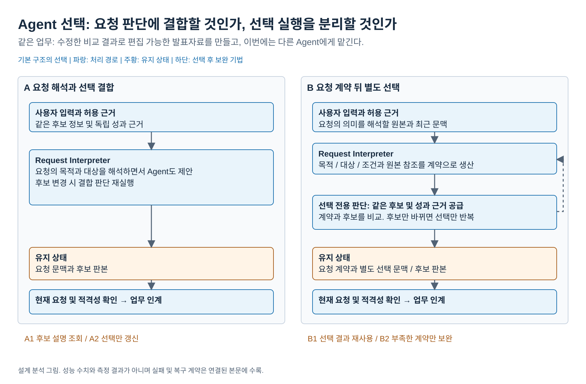
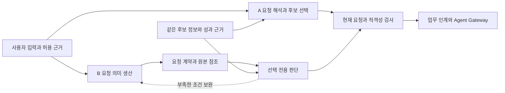

# 업무에 적합한 Agent 선택과 수행 중 교체

2026-10-18 / 문제 5 통합 분석 / 결론: 독립 상세 설계로 유지 / 기본 A 선택 권고

## 0. 비교 그림



[편집 원본](diagrams/problem06-agent-selection.drawio) / [PNG](diagrams/problem06-agent-selection.png) / [전체 그림 안내](diagrams/README.md)

## 1. 결론과 설계할 문제

**Agent 선택은 VIA의 독립 기능이지만, 현재의 결합 판단 대 별도 selector 비교는 최종 주요 DP 세트에 포함하지 않는다.** 두 방식 모두 실제 구현 근거가 있다. 별도 선택 실행이 VIA의 정상 사용에서 추가 호출과 계약 전달 비용을 상쇄하는 조건은 있으나, 후보만 바뀌는 재선택의 비중과 독립 품질 근거가 확보되지 않았다. 이 빈칸을 ‘별도 selector가 더 정확하다’는 가정으로 메우지 않는다.

상세 설계의 기본은 **A 요청 해석과 Agent 선택을 함께 수행**하는 방식으로 정한다. 명시적 사용자 지정과 단일 적격 후보는 공통 코드 경로로 처리하고, 복수 후보의 선택이 필요한 요청은 해석 문맥에서 판단한다. 기존 accepted ADR의 연동 계약과 외부 책임 경계는 유지한다. 이 선택은 설계 분석의 권고이며 실측 승리나 제품 구현 완료가 아니다.

대표 상황은 사용자가 “앞서 비교한 내용으로 편집 가능한 발표자료를 만들어줘. 이번에는 다른 Agent를 써줘”라고 말하는 경우다. VIA는 ‘앞서 비교한 내용’과 ‘다른 Agent’의 뜻을 파악하고, 필요한 자료를 읽을 수 있으며 해당 출력 형식을 만들 수 있는 후보를 골라야 한다. 요청한 자료와 조건을 다음 Agent에 전달하는 일은 [업무 인계](05-agent-handoff.md)의 책임이다.

## 2. 혼동하면 안 되는 세 가지 판단

| 판단 | 필요한 근거 | 결과 |
| --- | --- | --- |
| 요청의 의미 | 원문, 대화, 채택 대상과 조건 | 목표, 자료, 출력 요구, 사용자 지정, 불확실성 |
| 후보 적격성 | 실제 연동, 인증, 허용 자료 접근, 지원 형식과 제어 기능 | 실행 가능한 후보 또는 지원 불가 |
| 적격 후보 사이의 적합성 | 사용자 목적과 업무별 검증 자료 | 허용 후보 집합 안의 선택 또는 추가 확인 |

“지난번 쓴 그 Agent”는 해석 전 고정 ID가 아니다. 코드 사전 필터는 연결 상태나 이미 확정된 사용자 지정처럼 알려진 조건만 사용할 수 있다. 새로 해석한 조건은 최종 적격성 검사에 다시 반영한다. 후보의 자기소개와 capability 선언은 성능 검증 자료와 별도로 보존한다.

## 3. 기본 구조와 실제 근거

| 기본안 | 선택의 정상 경로 | 유지하는 상태 | 실제 메커니즘 근거 |
| --- | --- | --- | --- |
| **A 요청 해석과 선택 결합** | 현재 입력과 근거 및 후보 설명 → 같은 의미 실행에서 요청과 Agent 제안 → 공통 실행 허가 | 요청 해석 문맥, 후보 목록 판본, 제안과 선택 이유 | Deep Agents subagent description/task 호출, OpenHands TaskTool, CrewAI A2A prompt 및 위임 |
| **B 요청 계약을 만든 뒤 별도 선택** | 요청 의미 생산 → 요청 계약 → selector가 후보와 비교 → 현재 요청과 연결 → 공통 실행 허가 | 요청 계약, 선택 전용 문맥, 요청/registry revision과 결과 | AutoGen SelectorGroupChat, Magentic-One의 별도 진행/참가자 선택 |

후보를 걸러 주는 코드, 사용자 지정, 단일 후보 경로와 최종 실행 허가는 공통이다. A를 모든 정보를 한 번에 추측하는 안으로 만들지 않고 B에도 상세 원본 보완을 허용한다. 모델과 코드 중 하나를 선택하는 비교가 아니며 별도 process도 요구하지 않는다.



공식 코드와 문서의 확인 위치, 참고 범위와 적용 한계는 [선택 근거 원장](../../../../references/seven-problem-review/agent-selection.md)에 있다. 실제 자료를 조사한 뒤 만드는 VIA의 registry, 요청 계약과 현재성 검사는 아래 추가 설계다. 모든 harness가 이를 그대로 제공한다는 뜻은 아니다.

### 3.1 A의 실행과 상태

1. Request Controller가 입력과 현재 요청 revision을 등록한다. 이미 알려진 권한과 연결 상태로 불가능한 후보를 제외한다.
2. Request Interpreter가 허용된 원문과 후보 설명을 읽어 요청 의미 및 Agent 선택을 제안한다. 후보 하나가 명확하게 지정되고 적격하면 불필요한 선택 호출은 없다.
3. Request Controller가 요청과 후보 정보 판본을 확인하고 Task Manager의 위임 명령 및 Agent Gateway 경로로 연결한다.
4. 후보 정보가 바뀌면 보존한 원본/채택 조건과 새 후보로 결합 판단을 다시 한다. 자료를 처음부터 재취득하도록 강제하지 않는다.

결합 문맥에 사용자 목적이 남지만 후보 목록이 크면 요청 해석 입력도 커진다. 선택만 부분 갱신하는 추가 실행은 A2로 구분한다.

### 3.2 B의 실행과 상태

1. Request Interpreter가 목표, 자료, 출력 조건, 명시한 목적, 사용자 지정과 미해결 사항을 요청 계약으로 만든다.
2. 별도 선택 실행은 계약과 같은 후보 근거를 읽어 Agent 또는 확인 필요를 제안한다.
3. 계약이 빠뜨린 조건은 원 해석에 보완을 요청한다. 이 기본 구성에서는 보완한 원문으로 계약 전체를 다시 생산하고 선택한다. 필드별 갱신은 B2로 구분한다. 전체 재생산이 모든 B 구조에 필연인 것은 아니며 이 비용은 현재 기본 비교에 포함한다.
4. 요청은 그대로이고 후보만 바뀌면 유효한 계약에서 선택 실행만 반복한다. 이 재사용은 B의 기본 구조다.
5. 실행 허가 직전에는 A와 같은 현재성 검사를 한다. 이미 선택한 후보라도 권한이나 가용성이 바뀌면 다시 선택하거나 보류한다.

요청 계약은 단순 요약문이 아니다. 핵심 조건과 원본 참조 및 미해결 범위가 있어야 한다. 계약에 없는 선호를 selector가 임의로 보충하지 않는다.

## 4. 모든 안의 등록 계약과 교체 절차

### 4.1 등록할 최소 자료

| 자료 | 보존 내용 | 용도 |
| --- | --- | --- |
| 연결 | endpoint 또는 SDK adapter, 인증 방법, 실제 연결 확인 시각 | 후보 실행 가능성 |
| 입출력과 자료 접근 | 지원 형식, 파일 전달/참조 읽기, 인증 범위 | 해당 요청의 적격성 |
| 실행 제어 | 접수 식별자, 상태 조회, 추가 입력, cancel 지원 및 확인 방법 | 기존 실행과 안전한 재연결 |
| 능력 근거 | 선언된 업무 종류와 별개로, 검증한 업무 표본/조건/실패/확인일 | 사용자 목적에 대한 선택 근거 |
| 버전 | Agent, protocol, capability와 성과 자료 판본 | 오래된 선택의 채택 차단 |

위 표는 연동 가능한 후보를 실제 등록할 계약이다. GPT, Gemini, Claude 같은 제품 이름만으로 세 후보가 모두 호출/취소/자료 읽기를 지원한다고 채우지 않는다. 성과 자료가 없으면 그 항목은 미확인으로 남기며 임의 점수를 생성하지 않는다.

### 4.2 수행 중 교체

`교체 요청 수신 → 해당 Task와 변경 의도 해석 → 기존 수행 범위 확인 → 같은 외부 Action의 중복 위험 확인 → 새 후보 선택 → 최신 조건 인계 → 새 execution 접수 확인`을 따른다.

기존 업무의 상태는 `실행 중 / 취소 요청 / 종료 확인 / 수행 여부 불명`을 구별한다. 취소 요청을 보냈다는 사실로 이미 수행한 외부 변경을 되돌렸다고 말하지 않는다. 확인되지 않은 동일 Action의 재실행은 보류한다. 무관한 다른 요청까지 모두 멈추지는 않는다. 기존 Agent가 완료한 결과를 이용한 새 수정 업무는 같은 명령 재시도와 구별한다.

재시작 시 Task ID, 실행 ID와 접수 기록을 대조한다. 선택 결과가 저장돼 있다는 이유만으로 위임 명령을 다시 보내지 않는다. 외부가 idempotency나 조회를 지원하지 않으면 확인 가능한 범위를 사용자에게 설명한다.

## 5. 같은 상황에서의 대안 비교

| 장면 | 공통 완료 조건 | A | B | 판단을 바꿀 조건 |
| --- | --- | --- | --- | --- |
| 처음 요청한 발표자료 작성 | 편집 가능한 형식과 허용 자료 접근을 지원하는 Agent 선택 | 목적과 후보를 함께 판단 | 계약 생성 뒤 selector 실행 | 작은 후보군에서 별도 왕복의 이익이 있는가 |
| 사용자가 특정 Agent를 명확히 지정 | 지정과 권한이 유효하면 그 후보 사용 | 공통 적격성 경로 | 같은 경로, 추가 selector 강제 없음 | 동점 대조 장면 |
| ‘앞서 조사한 그 Agent 말고’ | 대화에서 기존 Agent를 찾아 제외한 뒤 적합 후보 선택 | 대화와 후보를 같이 읽음 | 제외 대상과 목적을 계약에 보존 | B의 계약 누락이나 A의 후보 간섭 가능성 |
| 후보만 연결 해제 또는 기능 변경 | 같은 요청을 수행할 유효 후보 재선택 | 결합 판단 반복 | 계약 유지 후 selector만 반복 | 재선택 횟수와 요청 문맥 크기가 충분한가 |
| 빠른 초안과 편집 가능한 완성본의 목적 차이 | 명시한 목적에 맞는 허용 후보 선택 | 대화 목적을 직접 활용 | 목적을 계약에 명시 | 같은 독립 성과 근거가 있어야 정확도 비교 가능 |
| 이전 실행 상태 불명 중 교체 | 같은 Action 중복 금지, 다른 목표 보존 | 선택과 실행 허가 분리 | 동일 | 별도 selector가 안전한 실행을 자동 보장하지 않음 |
| 적합한 후보 없음 | 제한과 가능한 확인 경로 안내 | 임의 fallback 실행 금지 | 동일 | 무응답이나 무조건 첫 후보를 빠른 성공으로 세지 않음 |

COMMON-28의 S15-G03 및 S16 결과 목표에는 실제 Agent ingress 전의 선택/인계 경로가 들어간다. 해당 목표의 외부 실행 대기를 제외하고 VIA 구간만 본다. 첫 구체적인 수행 안내가 선택 전에 표시됐다면 그 뒤 선택 시간은 QA01에 들어가지 않는다. 추가 장면은 설계 분석이며 기존 모집단을 바꾸지 않는다.

## 6. 비용 조건과 QA trade-off

### 6.1 별도 선택이 비용을 회수하는 조건

동일 요청에 대한 선택 한 번의 결합 처리 모델 비용을 `J`, 요청 계약 생산을 `I`, 별도 선택을 `S`, 계약 보완 총비용을 `R`로 둔다. 기존 요청에 대해 후보만 바뀌어 재선택하는 횟수를 `k`라 하면 기본 구조의 비교 항은 다음과 같다.

```text
A의 비교 항 = (k + 1) × J
B의 비교 항 = I + (k + 1) × S + R
B가 이 항에서 저렴한 조건 = (k + 1) × (J - S) > I + R
```

이는 실제 비용이 일정하다는 단순화 아래의 손익분기 조건이다. 호출마다 토큰, cache 청구와 보완량이 다르면 실제 항을 각각 합산해야 한다. A2 선택 부분 갱신을 적용한 값은 기본 A에 소급하지 않는다. 비용 식을 그대로 지연 식으로 사용하지 않으며 음성 등 공통 비용도 전체 QA05에는 남긴다.

### 6.2 QA별 판단

| QA | 실제 구조에서 생기는 차이 | 현재 결론과 반증 |
| --- | --- | --- |
| QA01 | 선택이 첫 내용의 전제인 경우 A의 결합 판단 대 B의 계약/선택 의존 | 대부분 위임 안내 뒤면 차이 없음. 선택보다 먼저 표시 가능한 응답을 두 안에 동일하게 허용 |
| QA02 | A의 후보 정보와 지칭 근거 간섭, B의 계약에 담긴 대상 오류 | 오류 경로는 있으나 구조만으로 정확도 방향 없음. Agent 선택 오류는 이 지표에 넣지 않음 |
| QA03 | 최초 선택의 추가 왕복 대 후보만 바뀐 반복 선택의 계약 재사용 | 조건부 차이. 실제 결과 목표 안에서만 측정. 외부 실행시간 절약을 VIA 절약으로 계산하지 않음 |
| QA04 | 선택 schema와 계약 보완의 변경 파급 | 현재 C01/C02는 공통 adapter에서 끝날 수도 있음. 후보 추가 자체는 기존 wire 변경 C02와 다름. 실제 Rust diff 없이 우열 없음 |
| QA05 | 결합 문맥 반복 대 계약 생산과 선택 전용 호출 및 보완 비용 | 위 조건에서 부호가 바뀜. 정상 사용의 `k`와 전체 문맥 크기가 미확인 |
| QA06 | A의 결합 buffer 대 B의 계약과 selector 상태 | 저장 자료 크기와 메모리 주재가 같지 않음. 중요 차이 근거 부족, 필수 512 MB 확인 유지 |
| N-S 선택 정확도 제안 | 사용자 목적과 실제 capability/성과 근거를 올바른 후보에 연결 | 중요한 별도 품질. 별도 selector가 자동 우위라는 근거 없음 |

QA01/03/05에 조건부 영향이 있다는 것만으로 세 개의 차이가 입증됐다고 세지 않는다. 첫 응답 이후 선택은 QA01과 분리되고, 같은 토큰 감소를 처리시간과 비용의 독립 원인 두 개라고 설명하지 않는다.

## 7. N-S를 판정할 때의 독립 기준

각 선택 기회마다 실제 연동 시험과 동일 업무의 독립 성과 자료, 사용자 목적을 바탕으로 허용 Agent 또는 정당한 보류의 집합을 먼저 정한다. 선택이 그 집합에 속하는 비율을 N-S로 제안한다. 후보의 자기소개를 보고 후보가 만든 답을 정답으로 채점하지 않는다.

두 후보가 모두 충분하면 둘 다 허용한다. 자료 부족 시 언제 사용자 지정이나 보류가 정당한지 정하고, 해결 가능한 입력을 매번 보류해 성공률을 높이지 않는다. 일단 선택한 Agent가 우연히 업무에 실패한 사건과, 당시 근거상 부적격 후보를 선택한 오류를 구별한다. 목적별 품질과 비용을 임의 가중 합으로 합치지 않는다.

N-S의 중요성은 인정하지만 현재는 실제 후보 목록, 독립 성과 및 반복 선택 자료가 없어 점수와 목표를 확정하지 않는다. 허용 집합이 없는데 예시 제품 이름을 정답으로 적는 것보다 이 비교를 주요 DP에서 제외하는 판단이 타당하다.

## 8. 다른 구조도 조사한 결과

| 검토한 방향 | 최종 기본안으로 추가하지 않은 이유 | 남길 위치 |
| --- | --- | --- |
| OpenClaw 방식의 계정/채널 binding | 업무별 적합성보다 수신 메시지의 담당 identity를 결정. 일반 VIA 요청의 선택 기능을 단독으로 완성하지 못함 | 공통 사용자 지정과 기본 후보 정책 |
| AutoGen Swarm처럼 현재 worker가 다음 후보 제안 | VIA가 최종 적격성을 확인하면 A/B 모두의 입력으로 붙일 수 있음. 외부 worker에 사용자 대화/최종 실행 권한까지 넘기면 범위가 달라짐 | 명시된 근거를 받는 후속 보완 후보 |
| CrewAI 계층 관리자 | 별도 관리자가 선택한다는 점은 B에 포함. 내부 업무 계획까지 복제하면 VIA의 책임을 넘음 | B의 reference |
| 여러 Agent의 실제 수행을 경주시키기 | 선택 전에 이미 실행 비용과 외부 효과가 발생. 동일 기능의 값싼 선택안이 아니며 무부작용 평가 지원도 공통 가정 불가 | 이번 기본 비교에서 제외 |
| 작은 모델과 큰 모델 중 선택 | Agent의 자료 접근/업무 형식/취소 지원을 포함하는 이 문제와 다른 모델 portfolio 선택 | 이번 주제에서 제외 |

## 9. 선택 후의 보완

**기본 A로 시작하고 모든 보완을 미리 넣지는 않는다.** 후보군이 커지거나 재선택 비용이 실제로 지배할 때 다음 보완을 적용한다.

| 보완 | 줄일 약점 | 추가 구조 | 새 비용과 반증 |
| --- | --- | --- | --- |
| A1 후보 설명을 필요한 범위로 조회 | 큰 후보 입력에 따른 QA03/05 비용 | 알려진 적격성 필터 뒤 description 색인과 후보 확대 경로 | 색인 갱신과 누락 위험. 올바른 후보 recall이 낮아지면 축소 폭을 줄이거나 사용 중단 |
| A2 현재 요청 의미를 유지하고 선택만 다시 판단 | 후보 변경 때 결합 문맥 반복 | 요청/선택 의존 판본과 영향 범위 기록 | 의존 검사와 잘못된 부분 갱신 위험. 별도 지속 selector 계약이 생기면 B로 재분류 |
| B1 유효 선택 결과 재사용 | 반복 selector 호출 | 요청 및 registry 판본 key의 cache | 무효화와 접근 철회 비용. A에 적용할 경우 별도 A 번호를 부여 |
| B2 부족한 계약 필드만 보완 | 전체 계약 재생산 | 누락 필드/원본 요청 및 부분 계약 갱신 | 필드 의존 추적 비용. 단순히 요약을 짧게 하는 것으로 해결됐다고 하지 않음 |

비교는 A 대 A1, A 대 A2, B 대 B1, B 대 B2로 나눈다. 결합은 A1+A2처럼 명시하며 기본 A/B의 손익을 소급해 바꾸지 않는다.

## 10. 주요 DP 제외 이유와 재검토 조건

**제외하는 것은 선택 기능이 아니라 현재 A/B의 주요 발표 DP 자격이다.** 요청과 후보가 결합되는 위치는 실제 설계 차이다. 그러나 현 VIA 조건에서 그 차이를 핵심으로 선택해야 한다는 근거는 다른 주요 문제보다 약하다.

다음 세 자료가 갖춰지면 같은 A/B를 다시 판단할 수 있다.

1. 실제 등록 후보가 여러 개이고, 같은 요청에서 후보만 바뀌는 정상 사용의 빈도와 문맥 크기.
2. 사용자 목적별 허용 후보를 판정할 독립 capability 및 업무 성과 근거.
3. 같은 기능에서 selector 분리가 요청 반복 또는 후보 간섭을 줄이는 양과 추가 계약/왕복 비용.

이 조건은 향후 연구 계획만 남기는 것이 아니다. 현재 결론은 **A를 상세 설계로 유지하고 이 비교는 이번 주요 DP 세트에서 제외**하는 것이다. 이후 이 자료가 생기면 결론을 바꿀 근거가 명확하다. 과거 [문제 5](../qa-first-exploration/five-problem-study/05-agent-selection-and-transition.md)는 이전 조사 이력으로 보존한다.
