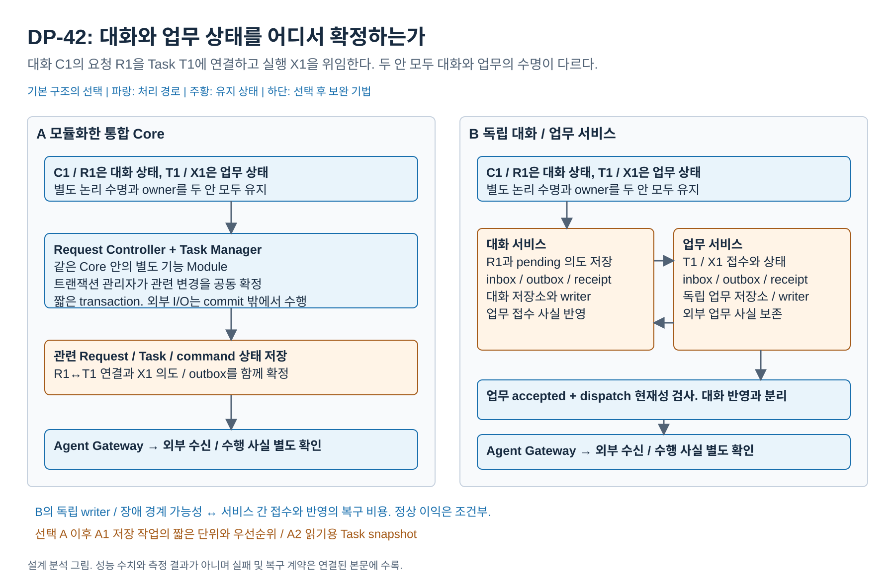

# 대화와 업무 상태를 어디서 확정하고 어느 서비스가 계속 소유할 것인가

2026-10-18 / 기존 DP-42 독립 재검토 / **독립 상세 설계 유지, 기본 A 추천** / 사용자 미채택, 구현과 측정 없음

## 0. 비교 그림



[편집 원본](diagrams/problem07-lifecycle-boundaries.drawio) / [PNG](diagrams/problem07-lifecycle-boundaries.png) / [전체 그림 안내](diagrams/README.md)

## 1. 결정과 핵심 이유

**Request / Task의 상태 의미는 각각의 owner가 유지하되 관련 변경을 통합 Core에서 공동 확정하는 A를 추천한다.** VIA는 하나의 PC에서 대화의 정정, 질문에 대한 답변, 업무 명령과 실제 전달 기록을 긴밀하게 연결한다. 이 경로에서 별도 서비스 접수와 재동기화보다 짧은 공동 확정과 적은 로컬 상태를 우선한다.

B는 대화 서비스와 업무 서비스의 상태 확정 / 실행 수명을 분리한다. 대화 상태 owner가 중단돼도 이미 접수한 업무의 통지를 확인하고 업무 원본을 갱신할 수 있으며, 특정 저장 방식에서는 두 종류의 쓰기 경합을 분리할 수 있다. 그 대가로 서비스 간 의도 / 접수 / 반영 상태, hold ACK, 중복 제거, snapshot 재조회와 부분 실패가 추가된다.

**현재 주요 DP 세트에는 포함하지 않고 독립 상세 설계로 유지한다.** B의 서비스 분리는 실제 선택이지만, 일반 Agent protocol 변화의 QA04 우위는 없고 모델 비용과 지칭 정확도도 기본적으로 같다. 정상 사용의 QA01 / QA03 이익은 구체 부하와 저장 방식에 의존한다. 명확한 장애 경계 이익만으로 사용자에게 중요한 정상 trade-off의 부족을 숨기지 않는다. 이 판정은 DP-42 기능 삭제나 기존 자료 폐기가 아니다.

## 2. VIA가 풀어야 하는 문제

사용자는 “아까 설명으로 발표자료를 만들어줘”라고 요청한 뒤 조건을 바꾸고, Agent의 추가 질문에 답하고, 창이나 음성 연결을 닫았다가 다시 돌아온다. VIA는 다음 사실을 구분해야 한다.

| 사실 | 원본과 의미 |
| --- | --- |
| 대화 / Request | 사용자가 무엇을 요청했고 어떤 목표 / 질문 / Task와 연결됐는가 |
| Task / Execution | 사용자가 보는 업무와 외부 Agent의 실제 실행이 무엇이며 어떤 사실이 확인됐는가 |
| 로컬 접수 | VIA 업무 owner가 조건을 검사해 명령을 받아 저장했는가 |
| 외부 접수 / 완료 | Agent가 실제 요청을 소비했는가, 실제 결과 또는 취소를 확인했는가 |
| 실제 전달 | 상세 텍스트가 표시됐는가, 음성이 어디까지 실제 재생됐는가 |
| 연결 수명 | UI / Voice / client의 접속 여부. 업무 원본이나 외부 실행의 종료와 같지 않음 |

이 논리적 수명들이 다르다는 사실만으로 별도 process가 필요한 것은 아니다. 하나의 background Core도 UI 연결과 독립해 내구 상태를 보유할 수 있다. **비교하는 선택은 관련 상태를 함께 확정할지, 독립 authority가 명령을 인계받아 따로 확정할지**다. 모델 / 네트워크 호출을 transaction 안에 넣지 않는다.

범위는 [공통 분석 기준](00-analysis-contract.md), [UC-07~15/18](../../../05-representative-use-cases.md), [기존 DP-42](../04-42-lifecycle-ownership.md)를 따른다. 문서 번호 07은 새 DP 번호가 아니다.

## 3. 공통 기능과 기존 결정의 관계

### 모든 안의 완료 조건

1. 사용자 원문, 채택 의미, Task identity, 외부 execution / command ID와 실제 전달 기록을 VIA가 소유한다. 모델 문맥이나 Agent session이 원본을 대신하지 않는다.
2. 같은 의미 기능과 입력, cloud 모델 호출 한도, 권한과 전체 로컬 512 MB 조건을 사용한다. 서비스마다 별도 모델을 더 호출하지 않는다.
3. 최신 Request / Task / 질문 / 권한 조건을 확인한다. 음성은 로컬에서 즉시 중단하고 미해결 입력의 관련 미전송 효과를 hold한다.
4. 로컬 접수, 전송 시작, 외부 접수, 외부 완료 / 취소 확인을 구분한다. timeout은 미실행의 증거가 아니다. 같은 command identity를 조회 / 재사용해 불명인 외부 Action을 중복 시작하지 않는다.
5. UI / Voice 연결이 끊겨도 상태를 보존한다. 양안 모두 background 실행과 내구 저장, 비동기 worker, owner별 Module 및 provider adapter를 가진다. A가 UI 종료와 함께 Task를 잃는 비교는 허용하지 않는다.
6. 실제 표시 / 재생 자체는 DB transaction과 원자적이지 않다. receipt를 받아 저장하고 확인 밖의 전달은 불명으로 남긴다.

### accepted ADR을 재해석하지 않는다

- [ADR-001](../../../../adr/ADR-001-agent-integration-contract-boundary.md)의 canonical Agent 경계는 양안 공통으로 유지할 수 있다. adapter는 Task 원본을 직접 쓰지 않는다.
- [ADR-002](../../../../adr/ADR-002-task-state-authority.md)의 Task별 writer / mailbox는 A Core 안이나 B 업무 서비스 안에서 사용할 수 있다. Task별 supervisor와 별도 대화 / 업무 서비스는 다른 축이다.
- [ADR-003](../../../../adr/ADR-003-runtime-fault-isolation-boundary.md)은 integration workload를 supervised worker로 격리하되 canonical Task와 policy를 Core에 남긴다. 이 격리는 A에서도 유지한다. B가 Task authority를 독립 업무 서비스로 옮기는 선택은 해당 원본 배치의 별도 재검토 사항이며 이미 accepted된 결정으로 취급하지 않는다.

이전 ADR의 historical 수치를 현재 QA01~06에 적용하지 않는다. 이번 A 추천은 새로운 ADR 채택이나 기존 결정의 재검증 완료가 아니다.

## 4. 기본안 A: 모듈화한 통합 Core의 공동 확정

```text
Request Controller: 입력 / 의미 / Request 변경 집합
Task Manager: Task / 질문 / 명령 변경 집합
    → State Store의 Unit of Work로 관련 변경 공동 확정
    → 전송 직전 현재 gate / command 검사 → Agent Gateway 전송
    → 실제 외부 사실 확인 → 사용자 표시 / 실제 전달 기록
```

각 owner가 자기 의미를 결정한다. State Store의 transaction 관리자는 검증된 변경 집합을 원자적으로 반영할 뿐 새 자연어 의미를 만들지 않는다. “Q1에 상반기로 답변”에서는 Request의 Q1 연결과 Task의 답변 접수 / 명령 K1을 함께 확정할 수 있다. 전송 시작 직전의 hold / permission / command 조건도 관련 owner의 짧은 공동 transaction에서 검사한다.

의미 모델이나 Agent API를 기다리는 동안 DB transaction을 유지하지 않는다. 서로 무관한 요청의 전체 실행을 전역 lock으로 묶지도 않는다. 통합 Core는 UI와 독립해서 계속 실행하며, Task별 writer와 integration worker 격리를 가질 수 있다.

**유지 상태:** 하나의 논리 State Store 안에 대화 / 업무 / 전달의 owner별 영역과 공통 command identity가 있다. 외부 전송의 outbox / 불명 상태는 A에도 필요하다. 중앙 저장을 전체 이력의 반복 모델 입력과 혼동하지 않는다.

**실패:** Core의 owner 전체가 중단되면 canonical 업무 상태 갱신도 멈춘다. integration worker가 남긴 원시 수신 기록이나 외부 상태를 복구 후 대조할 수 있지만, 그 동안 Core의 Task 원본이 계속 갱신된 것은 아니다. A의 worker까지 모두 즉시 사라진다고 가정하지 않는다.

## 5. 기본안 B: 독립 대화 / 업무 서비스의 접수와 반영

```text
대화 서비스: Request 의도 + 미확정 명령 저장
    → 안정된 command ID로 업무 서비스에 전달
업무 서비스: 현재 Task / 질문 / gate 검사
    → Task 변경 + 접수 결과 + 전송 outbox를 local transaction으로 확정
    ├→ 업무 서비스의 전송 검사 → 외부 Agent
    └→ 접수 결과를 대화 서비스가 별도로 반영
외부 Agent의 확인 사실 / 결과 보관
    → 대화 재연결과 표시
```

대화 서비스에 Request Controller, Request Interpreter와 Response Manager를, 업무 서비스에 Task Manager와 업무 연동 권한을 둔다. 두 서비스는 별도 process와 독립 저장 / 쓰기 권한을 가진다. supervised integration worker를 추가로 쓰는 조건은 양안 공통이다. 각 서비스의 State Store가 상대 저장소에 직접 쓰거나 두 저장소를 하나의 transaction으로 묶지 않는다.

업무 서비스는 같은 command ID / payload의 재수신에 기존 접수 결과를 돌려준다. 같은 ID에 다른 payload는 거절한다. 대화 표시용 Task snapshot은 원본이 아니며 version과 확인 상태를 가진다. 접수 응답이 유실돼도 새 Task를 만들지 않고 같은 ID로 조회한다.

**유지 상태:** 대화에는 입력 / 의미 / pending 의도 / 접수 반영 / 실제 전달이, 업무에는 Task / execution / 질문 / command / outbox / event cursor가 남는다. 서비스 간 전달에 필요한 접수 대기와 projection, 송수신 buffer가 추가된다. 원문이나 결과 전체를 무조건 양쪽에 복제하지 않으며 자료는 허용된 참조로 연결할 수 있다.

**독립 수명의 정확한 범위:** 대화 owner 중단 중에도 업무 owner가 이미 접수한 Task의 외부 통지 확인 / 보관과 상태 조회를 수행할 수 있다. 새 자연어 해석, 사용자 질문 제시와 대화가 소유한 미해제 요청 의존의 후속 시작은 기다린다. 외부 Agent 업무 자체의 지속은 A도 가능하므로 B의 이익으로 세지 않는다.

## 6. 정정, 전송과 재연결의 계약

기존 상세 계약을 이 문서에서 이해할 최소 범위로 정리했다. 실제 구현이나 고정 timeout 값은 아니다.

| 사건 | A의 확정 | B의 확정 | 공통으로 말할 수 있는 사실 |
| --- | --- | --- | --- |
| 새 발화 수신 | 입력 hold와 관련 명령의 gate를 공동 검사 / 반영 | 대화가 hold 의도를 저장하고 업무 gate에 전달. 적용 ACK는 별도 | 발화 시작은 Task 취소 완료가 아님 |
| 현재 의미 채택 | 관련 Request / Task / 명령 변경을 공동 확정 가능 | 의도 저장과 업무 접수, 대화 반영이 각각 확정 | 로컬 접수와 Agent 접수 구별 |
| 전송 시작 | 최신 조건으로 `PENDING → DISPATCHING` 원자 검사 | 업무 local transaction에서 동일 검사. 늦은 대화 허가만으로 전송 불가 | DISPATCHING은 외부 접수 확인이 아님 |
| 이전 명령 전송 전에 정정 | 관련 조건 / 명령을 미전송 상태에서 철회 / 교체 | 업무 hold 적용이 전송 CAS보다 먼저면 미전송 명령 교체 | 최신 조건으로 준비했는지 안내 |
| 이미 전송을 시작한 뒤 정정 | 실제 외부 상태와 정정 가능성 확인 | 동일. hold 요청이 먼저였어도 업무 적용 전에 CAS면 이미 전송 시작 | 기존 실행에 정정 / 취소 요청, 불명 효력은 불명으로 표시 |
| 접수 응답 유실 | 같은 원본에서 command 상태 조회 | 같은 command ID로 업무 접수 원본 조회 | timeout을 거절로 바꾸거나 새 start ID 생성 금지 |
| 대화 owner 중단 | Core의 canonical 갱신은 정지, 기록 / source로 복구 | 업무 관측은 유지. 연결 상실을 감지하면 신규 대화 연계 전송을 hold | 단절 즉시 전역 차단했다고 주장하지 않음 |
| 업무 owner 재시작 | 관련 Core 원본 복구와 외부 불명 상태 대조 | 보호 gate로 시작, 새 control session과 snapshot / pending 명령 대조 | 확인 없이 자동 release / 중복 실행 금지 |

B의 hold / release에는 control session과 증가하는 sequence, gate revision을 둔다. 늦은 release가 새 hold를 해제하지 않는다. snapshot watermark 뒤 event를 연결하고 gap / 역순 / 중복이면 업무 원본을 조회한다. 마지막 접수 receipt가 `PENDING`이었다는 이유로 현재 외부 접수를 되돌리지 않는다.

물리 발화 시작과 hold 적용 사이의 경합은 양안에 존재한다. B는 전달 / 적용 ACK 경계가 더 있으므로 그 시간도 남긴다. 이 계약을 만든다고 원격 Agent의 idempotency나 취소 기능이 생기는 것은 아니다. 지원하지 않는 동작은 보류 / 불가로 알린다.

## 7. 같은 사용 장면에서의 이익과 비용

| 장면 | 같은 완료 조건 | A | B | 판정 |
| --- | --- | --- | --- | --- |
| **S1 설명에서 새 업무로**: 전달한 D1 설명으로 발표자료 작성 | 올바른 근거 / 제약 전달, 실제 결과 참조 표시 | Request 연결 / Task / 명령을 공동 확정 | 의도 저장 → 업무 접수 → 별도 반영 | 정상 밀접 경로에서 A의 적은 확정 / 전달 비용 |
| **S2 Agent 질문에 답변 후 정정**: Q1에 “상반기”, 이어 “하반기” | 실제 제시 Q1에 답 연결, 최신 변경과 외부 전달 상태 확인 | 관련 질문 / 명령 / hold 검사 결합 | 별도 gate 적용과 접수 / 반영 경합 관리 | B의 추가 protocol 비용. 의미 정확도 우열은 아님 |
| **S3 여러 업무 통지가 오는 동안 일반 질문** | 통지 사실 보존과 일반 질문의 내용 응답 | worker는 비동기지만 공동 store 쓰기 경합이 생길 수 있음 | 업무 쓰기와 대화 쓰기를 별도 store에서 진행 가능 | 특정 저장 / 부하에서 B 정상 이익 후보. 추가 IPC / projection 비용 |
| **S4 UI / Voice 연결 종료 후 복귀** | 같은 Conversation / Task / 실제 전달에서 재개 | background Core와 내구 원본으로 복귀 | 대화 / 업무 상태를 재동기화해 복귀 | 수명 요구 자체는 양안 충족. 이 사례만으로 B 우세 아님 |
| **S5 대화 owner 장애 중 외부 결과 도착** | 중복 없이 결과 / 질문과 최신 상태 복구 | 살아 있는 worker의 원시 기록 / 외부 조회를 Core 복구 후 채택 | 업무 원본에 먼저 채택하고 대화 복귀 후 연결 | B의 명확한 상태 authority 가용성 이익. 정상 사용 평균에 고빈도로 섞지 않음 |
| **S6 Agent wire 변경 / 부분 정정 기능 추가** | 같은 Task ID, 접수 사실, 부분 수정 / 보존 조건 | 내부 API / adapter로 국소 변경 가능 | 서비스 API / 내부 adapter로 국소 변경 가능 | C02는 동점 가능. C04/C06은 양안 교차 계약 변경 가능 |

### S3에서 B가 정상적으로 이로울 수 있는 구체 조건

같은 SQLite WAL 구현을 예시로 두면 A의 한 DB 파일은 writer를 한 번에 하나만 허용한다. 짧은 업무 event transaction이 계속 들어오는 동안 대화의 새 입력 / 채택 기록이 같은 writer를 기다릴 수 있다. B가 별도 DB 파일을 사용하면 이 특정 lock은 분리된다. 일반 질문이 최신 Task fact를 필요로 하지 않는 S3에서는 대화 쓰기가 업무 쓰기의 완료를 기다리지 않을 가능성이 있다. [SQLite 공식 설명](https://www.sqlite.org/wal.html)

이것은 통합 Core의 필연적 성능 결함이 아니다. A는 짧은 transaction과 read / write 분리, 업무 progress 처리 조절을 사용할 수 있다. 다른 동시 쓰기 backend나 저장 분할을 택하면 이익이 바뀐다. B도 같은 디스크 / OS를 공유하고 사용자에게 표시할 업무 사실은 대화 반영이 필요하다. 동일한 durability를 낮춰 fsync 비용을 줄이는 비교도 허용하지 않는다.

따라서 S3는 **B의 정상 이익이 전혀 없다는 주장에 대한 구체 반례**이지만, 일반 PC 사용에서 서비스 분리 비용을 상쇄한다는 증거는 아니다. 전체 이력을 대화마다 재입력하게 만드는 약한 A는 사용하지 않는다.

## 8. 다른 두 축과의 2×2 독립성

| 의미 판단 실행 | 42 A 통합 Core | 42 B 독립 서비스 |
| --- | --- | --- |
| 문제 2 A 한 대화 실행 | Core 안의 한 의미 실행과 공동 확정 | 대화 서비스 안의 한 의미 실행과 별도 업무 접수 |
| 문제 2 B 요청별 실행 | Core 안의 여러 의미 실행과 공동 확정 | 대화 서비스 안의 여러 의미 실행과 별도 업무 접수 |

| 다음 단계 연결 | 42 A 통합 Core | 42 B 독립 서비스 |
| --- | --- | --- |
| 44 A Dispatcher | 공동 commit 결과가 중앙 continuation을 진행 | hold ACK / 업무 접수 / 반영을 중앙의 별도 완료로 연결 |
| 44 B Stage | 공동 commit 결과가 다음 Stage 입력 | 각 접수 / ACK가 typed 입력. join은 최신 authority를 재확인 |

논리적으로 가능한 조합이며 전체 조합을 구현 / 측정했다는 뜻은 아니다. 요청별 실행이 여러 개라는 이유로 독립 업무 서비스를 고르거나, 별도 process라는 이유로 반응형 Stage를 골라야 하는 것은 아니다. 같은 의미 기능, 총 모델 호출 한도와 최종 현재성 검사를 모든 조합에 유지한다.

## 9. 실제 구현에서 가져온 부분

고정 commit과 확인 함수는 [소스 원장 E08~E11](../../../../references/seven-problem-review/execution-lifecycle.md)을 따른다.

| 근거 | 확인된 메커니즘 | VIA의 추가 설계 / 한계 |
| --- | --- | --- |
| OpenHands Local / RemoteConversation | in-process와 server 실행을 같은 API 뒤로 구분. remote event 재동기화와 close / delete 분리 | VIA의 대화 / 업무 두 authority 자체를 구현한 근거는 아님. local도 persistence 가능 |
| Cline Local / Hub runtime | local 저장과 공유 authority에 대한 viewer attach / detach | UI 재연결 요구는 A background Core로도 해결된다는 근거. 전체 VIA B의 증거 아님 |
| Deep Agents 별도 thread / run | 동일 서버 안에서도 논리 실행 상태 분리 가능 | 문제 2의 실행 독립이 42 B를 요구하지 않는 대조 근거 |
| SQLite WAL | 같은 파일의 단일 writer와 checkpoint 비용 | B의 특정 저장 경합 분리 가능성. 서비스 분리의 보편적 이익으로 일반화 금지 |
| Transactional Outbox | 상태와 통지를 local transaction으로 기록, 소비 측 중복 / 순서 관리 | B의 별도 접수 / 반영 계약의 참고. A 외부 전송에도 필요할 수 있고 exactly-once 외부 업무를 증명하지 않음 |

참고 제품의 서버 운영 성능을 로컬 VIA로 가져오지 않았다. 추가 source 조사로 확인한 것은 실행 / 확정 경계의 실재성과 비용의 원인이다.

## 10. QA 경로와 반증

다음은 이미 채택한 요청 의도 이후의 조건부 설명식이다. 구체 duration, transaction 수의 고정값이나 실측 예측은 아니다.

```text
A의 관련 확정 경로 = 관련 owner 검증 + 공동 commit + 필요한 전송 검사
B의 관련 확정 경로 = 의도 commit + 명령 전달 + 업무 검증 / 접수 commit
                      + 목표가 요구하는 접수 반영 / 재조회 + 필요한 전송 검사

B의 정상 순이익 = 실제로 제거한 공동 자원 대기
                 - 추가 IPC / 직렬화 / 독립 commit / 재동기화의 임계 경로 비용
```

B의 대화 반영을 기다리지 않아도 업무 서비스가 전송할 수 있다면 그 반영은 ingress의 선행 단계로 강제하지 않는다. 반대로 해당 사용자 안내가 접수 확인을 요구하면 반영 / 조회를 생략하지 않는다. 병행 단계를 모두 더하지 않고 실제 의존 경로를 사용한다. 외부 Agent 작업 시간과 사용자 답변 대기는 QA03에서 제외한다.

| QA | 실제 영향 경로 | 현재 판단과 반증 |
| --- | --- | --- |
| **QA01** | 첫 구체 안내가 공동 확정 또는 업무 확인을 실제 기다리는 경우에만 차이 | 채택한 수행 안내를 위임 전에 양안 모두 표시할 수 있으므로 이후 handoff 비용은 미포함. 모든 위임에 B 지연을 붙이면 잘못된 비교 |
| **QA03** | S15-G03 / S16-G01~04처럼 실제 Agent 결과가 목표인 경로의 pre-ingress 확정과 결과 반영 | 낮은 부하 A 이익 가설. S3의 제거한 자원 대기가 더 크면 B 가능. 기존 endpoint 뒤 재동기화를 임의로 더하지 않음 |
| **QA04** | 같은 C01~06에서 owner API / 저장 / 전달 계약의 실제 변경 | 일반 C02 adapter 변경은 동점 가능. B의 독립 배포를 변경 Rust 모듈 수 감소로 바꾸지 않음 |
| **QA05** | 기본 의미 / 응답 모델 호출이 같으면 동점 | IPC / 저장은 모델 요금이 아님. 충돌 때문에 실제 추가된 재판단 / 음성 / 폐기 호출만 전체 COMMON-28 원장에 포함 |
| **QA06** | B의 별도 process heap, 명령 / 접수 상태, projection과 직렬화 buffer 대 A의 통합 상태 | A 비용 이익 가설. 동일 시점 전체 로컬 peak로 확인하며 process 수로 MB를 추정하지 않음. cloud KV와 disk 파일 제외 |
| **QA02** | 같은 원문 / 근거 / 의미 기능의 지칭 집합 | 기본 차이 없음. Task 접수 일관성이나 오래된 상태 표시를 QA02 정확도로 섞지 않음 |

COMMON-28 S15-G03은 S15-U03 “아까 문단 설명으로 발표자료 파일을 만들어줘”부터 S15-A01의 R15 결과 참조 표시까지이며 Voice OFF다. 첫 수행 안내 QA01이 끝나도 이 QA03 목표는 계속된다. Agent ingress 뒤 외부 8초는 제외한다. S16-G01~04도 실제 결과 확인과 최종 상세 표시 / 음성 준비가 완료 조건이다. [공통 사건 원문](../qa-candidate-package/common-scenarios.md#s15)

QA01/03은 실제 시간과 오류를 분리해 보존한다. 오답이 나왔다고 정답까지 시간을 늘리지 않는다. 부분 실패 / 미응답을 평균에서 조용히 제거하지 않는다. 두 시간은 겹치는 경로를 가지므로 합산한 종합 이익을 제시하지 않는다.

### 핵심 여섯 QA 밖의 가치

**업무 authority의 가용성과 올바른 복구**는 B의 실제 이익이다. 대화 owner 장애에 영향을 받지 않고 업무 사실을 확정하며 재연결하는지, 반대로 서비스 통신 장애로 상태를 잘못 안내하지 않는지를 본다. 이는 기존 QA-31/32와 QA-39의 장애 / 복구 관심사와 연결되는 별도 진단이다. 현재 후보 QA01~06에 새 이름으로 섞거나, B를 포함시키기 위해 임의의 높은 장애 빈도와 점수를 추가하지 않는다.

N-H / N-R / N-S 역시 상태 경계만으로 차별화되지 않는다. 같은 인계 내용과 관계 / 선택 판단을 사용한다면 동점이며 관련 기능이라는 이유로 coverage를 늘리지 않는다.

## 11. 선택 후 보완과 구조 변경의 선

| 보완 | 목표 / 처리 | 추가 비용과 비교 조건 |
| --- | --- | --- |
| **A1 저장 작업의 짧은 단위와 우선순위** | 업무 progress 쓰기 / 정리를 제한된 단위로 나누고 새 입력의 확정이 긴 정리 작업을 기다리지 않게 함. QA01/03 | scheduler / queue 상태, background 저장 지연. 중요 결과 / receipt 보존과 durability는 유지. 실제 writer 경합이 없는 쉬운 장면도 포함 |
| **A2 읽기용 Task snapshot** | 반복 조회가 확정 경로를 방해하는 경우 version이 붙은 읽기 view 사용. QA03 | projection RAM / 갱신과 stale 검사. 명령 접수 / 전송은 원본 검사를 유지하며 QA06 비용 확인 |
| B1 불변 결과 참조 공유 | 결과 전체의 IPC 복사 / projection 중복을 줄임. QA06 | 참조 수명, 권한 / 삭제, 실제 읽기 실패 처리. 로컬 자료 접근권한을 확대하지 않음 |
| B2 접수 / event 전송 묶기 | 독립 결과 통지의 반복 IPC를 합침. QA03 | batch 대기와 buffer 증가. hold / 취소 같은 제어를 같은 지연 queue에 넣지 않음 |

기본 A에도 짧은 transaction은 필수다. A1은 transaction에 모델 / 외부 호출을 넣는 결함을 고치는 것이 아니라, 정상적인 다수 저장 / 정리 작업의 admission을 추가로 조절한다. 성능 이익이 없으면 채택하지 않는다. A2가 A1을 포함하지 않는다.

integration SDK worker 격리는 이미 보존하는 결정이며 새 A 보완의 독점 이익으로 세지 않는다. A에서 Task 원본의 최종 쓰기 권한과 접수 수명을 독립 서비스로 옮기면 B로의 구조 변경이다. 두 process가 같은 DB에 공동 transaction을 쓰는 구성은 fault boundary와 확정 경계가 섞인 제3의 조합이며 순수 B라고 부르지 않는다.

## 12. 최종 판정과 변경 조건

### 주요 DP가 아닌 독립 상세 설계로 유지

이 재검토는 B의 이익을 업데이트 / 재시작 하나로만 설명하지 않았다. 정상 업무 통지와 대화 상태 쓰기의 경합 분리까지 구체화했다. 그러나 그 이익은 특정 backend와 실제 부하에 의존하며, A의 모듈성과 비동기 처리에서도 외부 실행 수명과 일반 기술 변화를 수용할 수 있다. 중요한 정상 QA에서 세 개 이상의 독립적인 차별 축은 아직 확보되지 않는다.

따라서 **A를 기본 상세 구조로 추천하고 DP-42는 독립 자료로 유지한다.** 장애 격리 관심사를 삭제하지 않으며 B가 필요한 요구가 생기면 선택을 바꿀 수 있다. 기능이 중요하다는 사실과 이 비교쌍이 최종 주요 DP여야 한다는 판단은 별개다. 모든 최적화를 미리 넣은 강한 A와만 비교해야 한다는 이전 규칙으로 내린 결론도 아니다.

### B를 선택하거나 주요 DP로 다시 포함할 조건

1. 대화 상태 owner의 중단과 독립적으로 업무 원본을 계속 확정 / 조회해야 한다는 요구가 중요해진다. 단순 UI 닫기나 외부 Agent 실행 지속만으로는 부족하다.
2. 정상 사용의 실제 업무 통지 / 저장 부하에서 공동 자원 대기가 사용자 내용 응답이나 목표 완료를 지배하고, B의 독립 저장이 추가 IPC / 동기화와 RAM 비용을 상쇄한다.
3. 안정된 서비스 계약 아래 업무 authority / 저장 runtime을 독립 변경하는 실제 과제가 자주 발생한다. 현재 C02 wire 변경만으로 이를 입증했다고 하지 않는다.

### 이후 승인할 최소 검증 설계

- 같은 원본과 의미 결과를 쓰는 두 구조에 S1~S6을 적용한다. 모델 / Agent 업무는 고정 stub으로 두어 상태 확정 경로만 먼저 비교한다. 이 결과는 의미 정확도 또는 실제 cloud 성능이 아니다.
- 정상 통지 부하, 순간 burst, 별도 장애를 분리한다. 같은 저장 engine / durability / 전체 자원 예산을 사용하고 A의 짧은 transaction, worker 격리와 background Core를 유지한다. 단일 WAL 경합 주장은 다른 저장 배치에서도 재검토한다.
- `의도 저장, hold 요청, gate 적용, 접수, DISPATCHING, 외부 ingress, 외부 사실, 대화 반영, 실제 표시`를 구분한다. 정정과 transmission의 양쪽 경합 순서, ACK 유실, duplicate / out-of-order 통지와 부분 snapshot을 포함한다.
- 대화 owner 장애에서는 worker의 원시 수신과 canonical 상태 채택을 따로 관찰한다. 서비스 하나가 살아 있다는 사실만으로 사용자 목표 전체가 복구됐다고 하지 않는다.
- B가 정상 지연을 줄이지 못하고 A도 필요한 업무 관측 / 복구 조건을 충족하면 A와 상세 설계 판정을 유지한다. 반대로 B만 실제 요구한 관측 지속을 충족하거나 정상 지연의 반대편 이익이 비용보다 중요하면 B 선택을 검토한다. 실제 적용 QA의 상쇄 이익을 모두 확인한 뒤 판정한다.

현재 검증 설계와 기본 추천을 완성했으며 제품 구현, 모델 실행, 측정, 새로운 ADR 채택은 하지 않았다.
