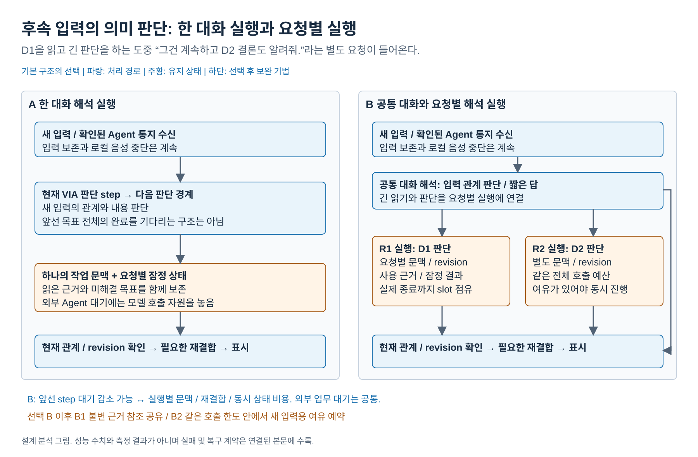
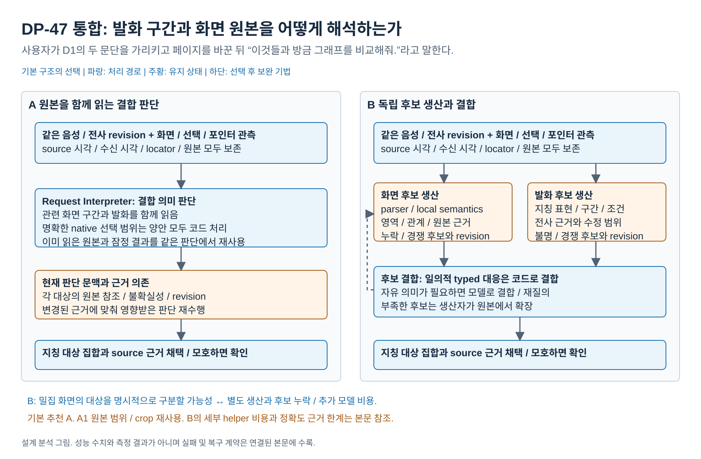
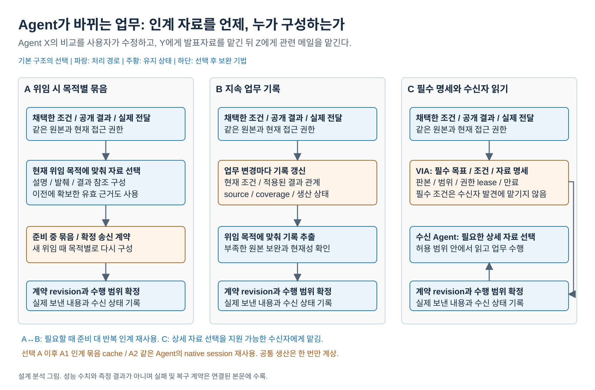

# 주요 DP의 비교와 선택 설명 원고

> **이 원고의 후속 자료:** 현재 발표용 재검토는 [17 결과](17-presentation-results.md), 편집 가능한 자료의 내용 원본은 [새 storyboard](../../../../presentations_files/four-dp-final-20261019/storyboard.md)를 따른다. 아래의 그림·수치·권고는 15 캠페인 당시 원고로 보존하며, 고정 QA 우선순위와 후속 실험의 결론으로 소급하지 않는다.

2026-10-19 / 네 주요 DP × 기본 비교와 선택 후 보완

> **이전 발표 근거:** [15 보완 PoC 결과](15-corrected-poc-results.md)를 따른다. 네 DP의 기본 비교와 A2/A4/B4의 보완, 업무 인계의 공통 행 번호 진단과 증거 대조를 완료했다. [12 초기 결과](12-poc-results.md)의 A/A/A/C 선택과 후채택 시간은 이후 감사로 한계가 확인됐다. 아래 그림은 기본 구조를 설명하며 수치·선택·보완의 상태는 15 캠페인 당시와 같다.

이 문서는 사용자가 제공한 예시의 **기본안 비교 → 선택 → 약한 QA를 tactic으로 보완** 순서를 따른다. 측정표는 15의 실제 값·고정 분모·실패·완료 범위를 함께 사용하며 기존 COMMON-28 점수로 임의 환산하지 않는다. 그림의 A/B/C는 기본이고 A1/A2/B1/B2는 선택 후 각각 추가하는 보완이다. 실제 callback 지연 proxy와 내용 정확성, 계약상 완료와 본문 충족을 구별한다.

상세 그림 전체는 [설계 그림 안내](diagrams/README.md)에서 열린다. 이 원고에는 비교 그림을 넣었고, 각 DP의 설계 본문에는 비교 그림과 방안별 상세 그림을 함께 넣었다.

## 1. 근거 공급: 비교 장면

**제목:** 현재 요청을 판단하는 근거의 유지와 구성 방안

**문제 한 문장:** 사용자가 과거에 실제 전달한 내용을 짧게 지칭할 때, 필요한 근거를 이미 유지할지 요청마다 다시 구성할지 정해야 한다.

[편집 원본](diagrams/problem01-evidence-supply.drawio) / [PNG](diagrams/problem01-evidence-supply.png)

| 기본안 | 장점 | 단점 | QA 해석 |
| --- | --- | --- | --- |
| A 대화 작업 문맥 유지 | 후속 지칭에 유효 근거가 이미 있으면 읽기/조합 대기 감소 | 쓰지 않는 문맥의 반복 입력과 압축/정정 갱신 | QA01/03 이익 가능 ↔ QA05 유지 비용 |
| B 요청별 원본 구성 | 지금 필요한 자료에만 구성 비용 사용 | 같은 자료를 다시 가리킬 때 발견/조합 반복 | QA05 절약 가능 ↔ QA01/03 조회 비용 |
| C 게시 근거 조회 | 여러 요청이 같은 관계를 재사용 | 생산/갱신/미소비 비용과 원본 보완 | B/C 하위 선택. A+C도 가능한 별도 구조 조합 |

**발표 문장:** “세 안 모두 원본을 보존합니다. A는 읽은 근거를 다음 질문에도 유지하고, B는 질문마다 필요한 근거를 구성하며, C는 자료 관계를 미리 만들어 둡니다. 같은 자료를 반복 질문한 사례에서 A는 B보다 답변 호출을 6회 줄였습니다. C는 요청 뒤 답변 단계를 많이 생략했지만, 사전 생산과 긴 기록의 입력 때문에 전체 비용이 A의 2.42배였습니다.”

## 2. 근거 공급: 선택과 보완

**기본 A를 권고한다.** 같은 자료의 짧은 후속 질문과 정정을 VIA의 주요 정상 사용으로 본다. 첫 지칭은 A/B 36/36, C 34/36이었다. A의 QA03은 36/36 관측의 13.617초, C는 12.364초이고 B는 1건 미완료이므로 14.242초를 전체 완료 성능으로 비교하지 않는다. 상세 답변 의미 검토의 A/B 30/36, C 34/36은 별도 사후 진단으로 제시한다.

| 보완 | 기본 A의 약점 | 추가 동작 | 대가 |
| --- | --- | --- | --- |
| A1 입력 prefix cache | 반복 입력 비용 | provider가 지원하는 유효 prefix 재사용 | 가격/cache hit/수명 의존. 로컬 RAM 절약은 아님 |
| A2 변경 조각 갱신 | 작은 정정의 넓은 재구성 | 의존성이 확인된 부분만 갱신 | dependency index/patch 검사. 범위 불명 시 전체 재구성 |

**A2의 실제 결과:** 같은 정정 사례 세 번에서 원문 읽기는 12→9회였으나 모델 호출은 12회로 같았다. 완료시간은 21.822→21.433초, 비용은 $0.0148424→$0.0145860으로 작은 차이였고 본문 충족은 3/6으로 같았다. 따라서 이번에는 기본 A를 선택하고, A2는 원본 재조회가 실제 병목일 때 적용할 후보로 남긴다. 원문 읽기 감소를 큰 모델 지연·비용 개선으로 발표하지 않는다.

**선택을 바꿀 조건:** 유지한 근거의 실제 재사용이 낮고 B의 구성 지연이 작다면 B로 바꾼다. C는 생산된 관계의 반복 소비가 추가 비용을 회수할 때 선택한다.

## 3. 의미 판단 실행: 비교 장면

**제목:** 앞선 판단 중 들어온 사용자 입력과 Agent 통지의 의미 실행 방안

**문제 한 문장:** 긴 VIA 판단 중에도 별도 질문/정정/확인 답변을 잃지 않고 적절한 목표와 연결해야 한다.

[편집 원본](diagrams/problem02-interpretation-execution.drawio) / [PNG](diagrams/problem02-interpretation-execution.png)

| 기본안 | 장점 | 단점 | QA 해석 |
| --- | --- | --- | --- |
| A 한 대화 해석 실행 | 읽은 자료와 대화 문맥 재사용 | 현재 VIA step의 경계까지 새 의미 판단 대기 | QA05 이익 가능 ↔ QA01/03 대기 |
| B 공통 대화와 요청별 실행 | 호출 여유가 있으면 독립 입력을 별도로 판단 | 분리 문맥/반환, 동시 상태와 재결합 | QA01/03 이익 가능 ↔ QA05 및 조건부 QA06 비용 |

**발표 문장:** “A도 입력을 받고 비동기로 동작합니다. 비교하는 대기는 앞선 목표 전체나 외부 Agent 업무가 아니라 현재 VIA 판단 step입니다. B는 그 실행을 요청별로 나누고 결과를 다시 현재 대화에 연결합니다.”

## 4. 의미 판단 실행: 선택과 보완

**호출 여유가 있는 VIA에는 B를 권고한다.** 이번 보완 비교에서는 B의 24개 목표가 모두 완료됐고 A는 23/24였다. 겹치는 독립 질문의 첫 응답은 호출 한도 2에서 A 13.388초, B 6.270초였다. 실제 B의 API 호출이 6.261초 겹쳤다. 한도 1에서는 독립 질문 완료가 A 13.429초, B 13.087초로 비슷했다. 따라서 B의 이익은 실행 분리 자체의 무조건적인 가속이 아니라, 호출 여유를 써서 앞선 판단의 대기를 피하는 데 있다.

관계 진단은 A 27/27, B 26/27이다. B의 한 건은 정정할 요청은 맞췄지만 불필요한 메일 Task 메타데이터까지 붙였고 실제 잘못된 메일 발송은 없었다. 이 오류를 숨기지 않는다. 총비용은 A $0.1224560, B $0.1125156으로 유사하며, 같은 일을 병행한다고 호출 비용까지 줄어드는 것은 아니다. 아래 B1/B2는 이번 보완 캠페인에서 실행하지 않은 후보다. 이전 A1 결과를 B의 정확도 보완 결과로 옮기지 않는다.

| 보완 | 기본 B의 약점 | 추가 동작 | 대가 |
| --- | --- | --- | --- |
| B1 불변 문맥 참조 공유 | 여러 활성 문맥의 로컬 중복 | 같은 source 조각을 참조로 공유 | 수명/철회/직렬화 관리. cloud token 절약을 보장하지 않음 |
| B2 foreground 호출 여유 예약 | 긴 요청이 전체 호출 한도 점유 | 총 한도 안에서 새 입력용 여유 유지 | 원래 요청의 완료가 늦어질 수 있음 |

**선택을 바꿀 조건:** 실제 입력 겹침이 드물거나 자원 포화로 B도 같은 호출을 기다리면 A의 단순성과 문맥 재사용이 유리하다.

## 5. 화면과 발화 지칭: 비교 장면

**제목:** 변화하는 화면과 사용자 발화의 지칭 결합 방안

**문제 한 문장:** 마지막 화면에 없는 과거 대상까지 당시 발화/포인터/선택과 결합해야 한다.

[편집 원본](diagrams/dp47-seven-comparison.drawio) / [PNG](diagrams/dp47-seven-comparison.png)

| 기본안 | 장점 | 단점 | QA 해석 |
| --- | --- | --- | --- |
| A 원본 결합 판단 | 언어가 정의하는 자유 범위도 직접 생산 | 복잡한 media/관계 입력과 재판단 비용 | QA01/03/05의 적은 생산 단계 가능. QA02 우위는 미확정 |
| B 후보 생산과 결합 | 밀집 화면의 명시적 영역/설명으로 대상 혼동을 줄일 가능성 | parser/producer 비용, 후보 밖 범위의 확장과 결합 손실 | QA02 가능 이익 ↔ QA01/03/05 추가 생산 비용 |

**발표 문장:** “B의 결합에 항상 모델을 호출하지는 않습니다. 표현된 관계가 충분하고 일의적이면 코드로 결합합니다. 다만 원본 밖의 범위를 만들어낼 수는 없어서, 새 범위가 필요하면 원 생산자가 원본을 다시 읽습니다.”

## 6. 화면과 발화 지칭: 선택과 보완

**기본 비교에서는 지칭 정확도를 우선해 B를 권고한다.** 같은 24개 지칭에서 A는 17개, B는 24개를 올바르게 채택했다. A는 대상 이름을 맞춰도 영역을 화면 밖으로 반환하거나 닫힌 경로 밖에 두어 계약 검사를 통과하지 못했다. B는 화면 후보와 발화 제약을 나누어 생산하고 코드 또는 모델로 결합했다.

**대가는 생산 단계의 대기다.** 두 안 모두 완료한 dense 사례의 첫 응답은 A 17.789초, B 27.580초였다. B의 전체 비용은 A의 1.037배였으며 화면·발화 생산 비용을 모두 포함한다. A의 11회 재판단과 B의 7회 코드 결합이 비용 차이를 줄였다. A의 미응답을 제외한 평균만으로 전체적으로 더 빠르다고 발표하지 않는다.

**선택한 B에 B4를 적용한다.** 화면·발화 생산을 같은 한도 안에서 병행한 결과 정확도 24/24와 완료 12/12를 유지하면서, 완료시간이 **22.930→18.085초**로 약 21% 줄었다. 비용은 $0.0431172→$0.0435792로 거의 같고, 최고 동시 RSS는 45.351→46.973MB였다. page 사례의 결합 호출 한 번 감소도 있으므로 시간 차이를 모두 순수 병행 효과로 설명하지 않는다.

A4도 같은 화면 생산자의 보조로 정확도 24/24를 얻었다. 다만 완료시간 24.747초, 비용 $0.0561648로 B4보다 컸다. 따라서 “B의 모든 소유 구조 때문에 정확해졌다”보다 **“별도 화면 표현으로 정확도를 확보하고, 후보 결합과 병행으로 추가 부담을 줄였다”**고 설명한다.

| 보완 | 목표 | 추가 동작 | 대가 |
| --- | --- | --- | --- |
| A1 제한 crop/cache | QA03/05 media 재처리 감소 | 원본 참조를 보존한 범위별 재사용 | crop 밖 맥락 손실과 접근/판본 검사 |
| A2 영향 부분 재판단 | 부분 정정의 재처리 감소 | 의존이 명확한 binding 부분만 갱신 | 유지/변경 범위 판정과 전체 결합 재검증 |
| A4 동일 화면 생산자 보조 입력 | 밀집 화면 QA02 보완 가능성 | 공동 판단에 화면 생산자의 설명도 제공. 이번 PoC는 같은 Qwen 사용 | 추가 dependency와 요금. 후보 결합과 보조 입력의 효과 구분 |
| **B4 초기 생산 병행: 이번 선택** | B의 QA01/03 대기 감소 | 같은 호출 한도에서 화면·발화 생산을 함께 시작 | 동시 buffer·호출 슬롯 점유. 이번 정확도 유지, 비용 유사, RSS 증가 |

**선택을 바꿀 조건:** 실제 지원 화면에서 A가 별도 생산 없이 같은 지칭 정확도·완료 범위를 확보하면 A의 적은 단계가 유리할 수 있다. A4를 택하려면 같은 정확도뿐 아니라 추가 이미지 입력·완료시간·비용까지 B4와 비교해야 한다. 이번 A4는 같은 정확도에서 시간·비용이 더 컸으므로 정확도 회복만으로 선택을 바꾸지 않는다.

## 7. 업무 인계: 비교 장면

**제목:** Downstream Agent 교체에도 이어지는 업무 조건과 결과의 인계 방안

**문제 한 문장:** Agent가 바뀌어도 사용자가 채택한 조건, 실제 결과와 수행 범위를 반복 설명하지 않아야 한다.

[편집 원본](diagrams/problem05-agent-handoff.drawio) / [PNG](diagrams/problem05-agent-handoff.png)

| 기본안 | 장점 | 단점 | QA 해석 |
| --- | --- | --- | --- |
| A 위임 시 목적별 인계 | 실제 위임 목적에 필요한 자료만 구성 | 반복 인계에 같은 의미 조합을 다시 수행할 수 있음 | QA05 미사용 생산 없음 ↔ QA03 위임 시 준비 |
| B 지속 업무 기록 | 같은 관계를 후속 Agent들이 재사용 | 미사용/갱신 생산, 새 목적의 원본 보완 | QA03 준비 감소 ↔ QA05 선생산 비용 |
| C 필수 명세와 수신자 읽기 | 실행 중 필요한 상세 범위를 수신자가 선택 | 실제 읽기 지원과 접근 관리, 외부 선택 비용 | A/C는 자료 선택 책임 축. B+C도 가능 |

**발표 문장:** “VIA가 보관하는 것은 공개 결과와 실제 전달/채택 사실입니다. Agent의 비공개 기억 전체를 복제하는 방식이 아닙니다. 필수 조건은 세 안 모두 VIA가 명시하며 C에서도 수신자가 알아서 발견하게 두지 않습니다.”

## 8. 업무 인계: 선택과 보완

**반복 인계에서 조건 보존을 우선하면 B, 읽기 가능한 수신자에서 적은 VIA 준비와 비용을 우선하면 C를 권고한다.** 원문 재사용과 범위 검사를 고친 ABC 전체 36회를 비교했다. A도 실제 확보한 원문으로 5개 후속 인계에서 추가 가공을 생략했다. B는 기록에서 18개 모두 직접 인계했지만 추출 모델 호출은 남았다.

**발표 문장:** “B는 사용자가 정한 조건의 원문을 업무 기록에 남겨 다음 Agent가 다시 활용하도록 했습니다. 같은 이력을 세 목적으로 넘긴 사례에서 본문 충족은 A 4/9, B 9/9, C 6/9였습니다. 대신 B는 인계 전에 기록을 만드는 비용을 계속 지불합니다. 한 번만 넘긴 사례에서는 C가 3/3으로 더 좋았고 전체 비용도 가장 작았습니다.”

전체 본문 충족은 A **8/18**, B **15/18**, C **12/18**이었다. 이것은 외부 수신자 본문의 조건·내용 진단이며 기존 QA02가 아니다. 별도 N-H 인계 계약은 A17/18, B/C18/18이다. B가 조건 원문을 공급한 실제 경로는 확인했으나, 원문이 있어도 잘못 쓴 경우가 있어 기록 자체의 정확성 보장으로 설명하지 않는다.

같은 열두 episode의 전체 비용은 A **$0.1018408**, B **$0.2886828**, C **$0.0757928**이었다. B는 C의 약 3.81배이며, B의 준비만 51호출·$0.1493156이다. 위임이 없었던 기록 생산도 포함했다. QA04는 A/C 1.50개·B 1.75개, 최고 동시 RSS는 A49.119·B57.229·C48.153MB다. B의 조건 보존 이익을 선택하려면 이 비용을 감수해야 한다.

첫 응답은 A4.307초(20/21), B4.421초(21/21), C4.321초(21/21)다. 세 안 모두 실제 입력의 의미를 채택하므로 기존 0.2ms를 사용하지 않는다. 모든 안이 완료한 같은16목표에서는 VIA 시간 A10.565·B12.299·C4.213초, 전체 경과 A31.372·B31.406·C23.532초였다. **B의 지속 기록이 A보다 빠른 완료를 만든다는 예상은 이번에 성립하지 않았다.** 각 안의 전체 완료는20/21·19/21·19/21이며 실패와 복구도 공개한다. 같은16목표만의 대조가 전체 성공률을 뜻하지 않는다.

| 보완 | 목표 | 추가 동작 | 대가 |
| --- | --- | --- | --- |
| B1 변경 묶음 갱신 | QA05 잦은 선행 생산 비용 | 여러 공개 사건을 묶어 업무 기록 생산 | 최신 기록 대기와 원본 보완. 철회 사용 차단은 생산을 기다리지 않음 |
| B2 변경 조각 갱신 | QA03/05 기록 전체 재생산 부담 | 확인된 dependency의 설명 블록만 재생산 | dependency index, 부분 정합성 검사와 전체 재구성 경로 |
| C2 읽기 결과 cache | 같은 허용 원문의 반복 읽기 | 같은 판본·범위의 결과 재사용 | 수신자 권한·판본·철회 검사와 유지 상태 |

위 B1/B2/C2는 이번에 성능을 측정하지 않은 보완 후보다. 원문 행 번호 표현 진단은 모든 ABC에 같은 입력 표현을 적용하므로 B의 전용 tactic으로 세지 않는다. 별도 E4×ABC×3회에서 목표 완료는 A/B/C 모두 6/6이었다. 본문은 작성자 17/18 충족·1건 미확정, 독립 검토 18/18 충족으로 한 건의 의미 해석 차이를 보존했다. 기본안의 E4 실패 네 건이나 평균을 이 성공으로 대체하지 않는다. A1 묶음 cache와 A2 확인된 native session 재사용은 A를 선택할 때의 후보로 원설계에 남긴다.

**발표에서 공개할 한계:** B는 기존 QA01~06 전반의 승자가 아니며, 반복 인계의 조건 보존을 선택 이유로 명시해야 한다. QA04의 실제 작은 차이는 확인됐지만 과정의 모든 강한 차별화 요건을 충족했다고 확대하지 않는다. 세 안 모두 본문 오류·미완료가 남았고 수신자가 원문 읽기를 지원하는 조건의 결과다.
