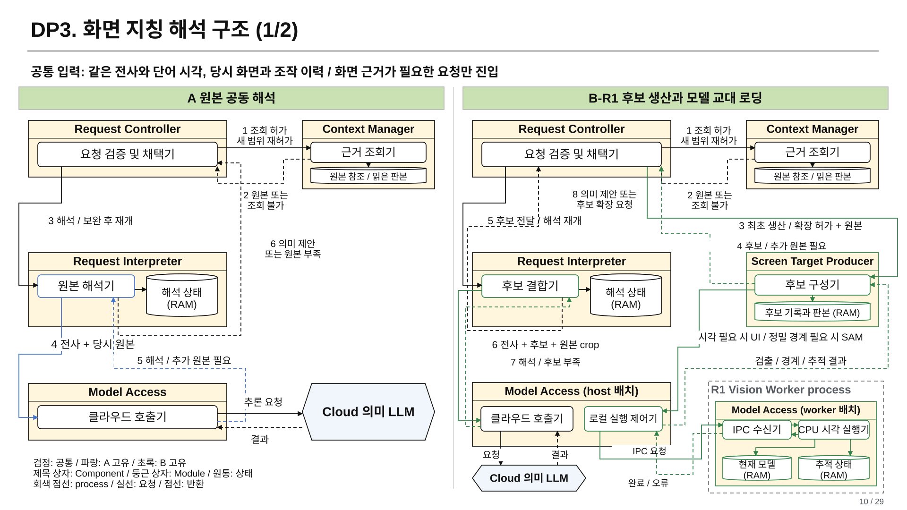
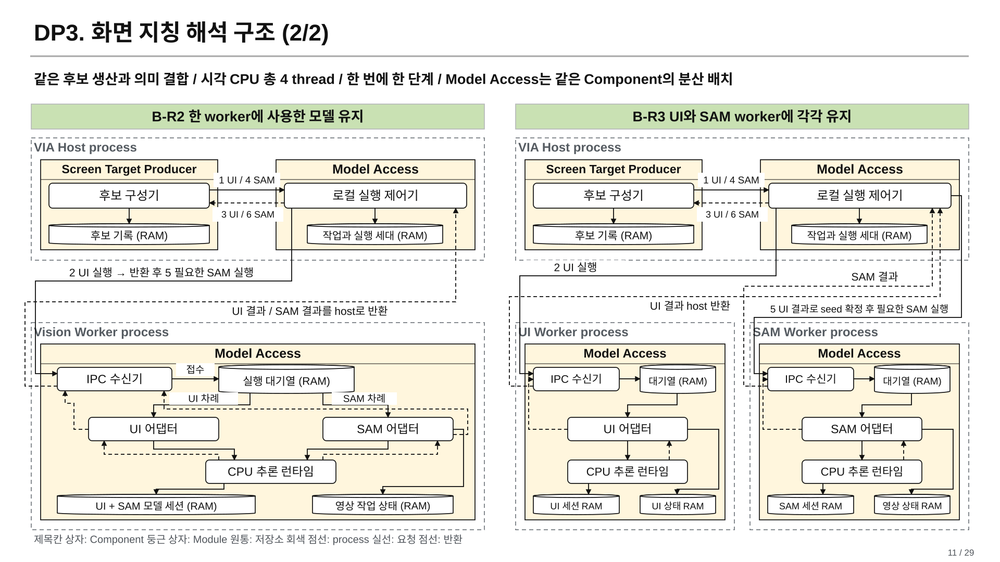
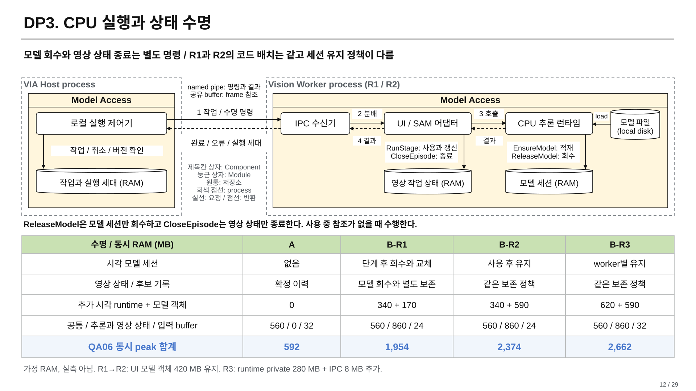
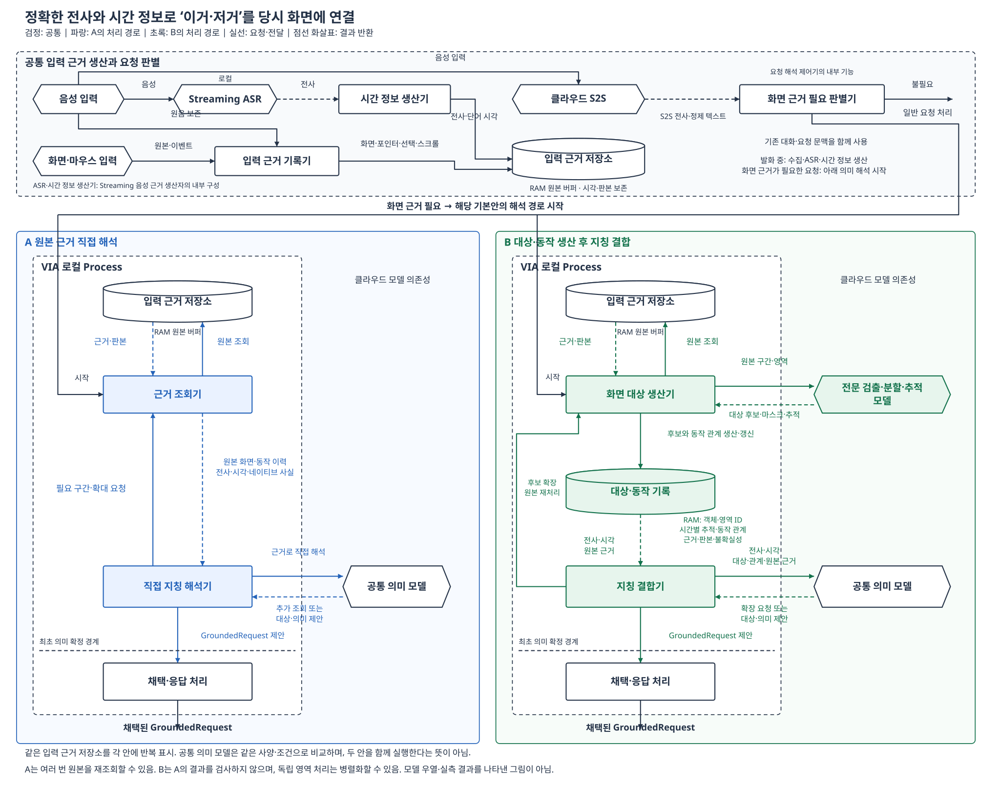
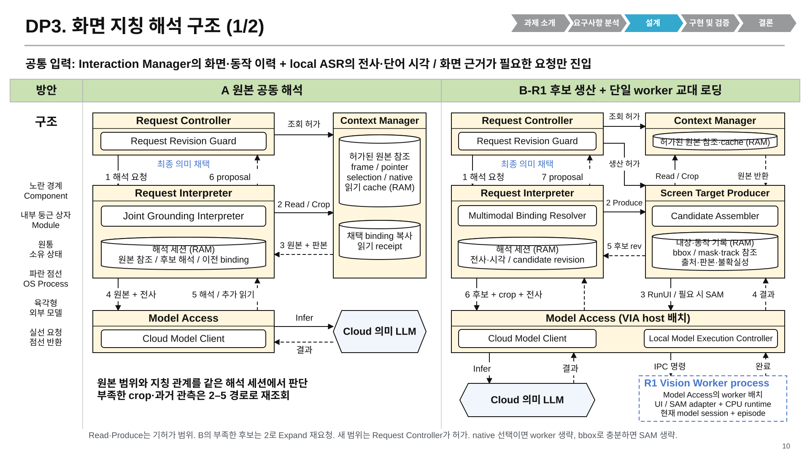
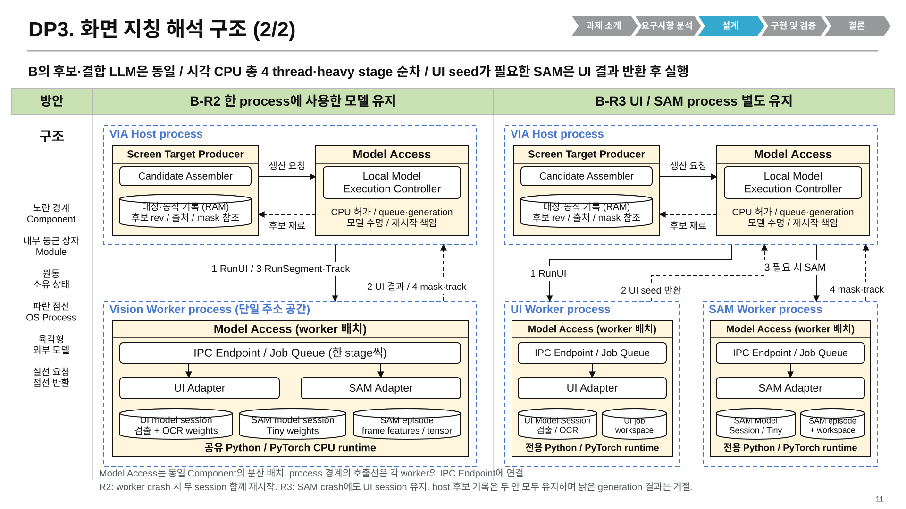
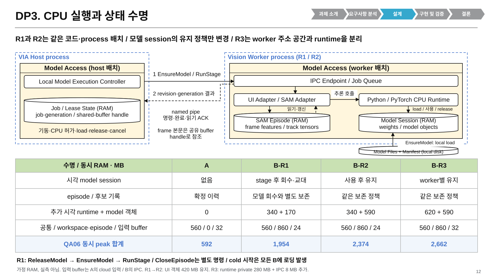

# DP3: 원본 직접 해석과 대상·동작 기록을 통한 지칭 해석

> **네 안의 수치 비교:** [동일 시나리오와 합성 QA 평가](synthetic-comparison/README.md)에 120평가 입력·60준비 활동의 가정 원장과 QA01~07, 대표 장면의 처리시간 분해 및 선택 결론을 추가했다. CPU 가정과 현재 QA 우선순위에서는 A를 선택하며, 실제 측정·제품 채택은 아니다.

> **현재 비교는 [A / B-R1 / B-R2 / B-R3의 네 대안](cpu-runtime-architecture.md#11-a와-b-r1b-r2b-r3의-네-대안-비교)이다.** 사용자가 GPU 없는 실행을 유지하면서 이번 검토의 512 MB 상한을 유보했다. [CPU runtime 설계](cpu-runtime-architecture.md)는 공개 FP32 모델과 실제 CPU API 경로, 공유/전용 worker와 모델·episode 수명을 구분한다. [local 생산기](local-producer.md)는 기본 grounding 계약, [이전 소형 CPU 가상 예산](cpu-small-synthetic-budget.md)은 역사적 합성 가정이며 현재 성능값이 아니다. 아래 cloud 생산기 본문과 `comparison` 그림도 앞선 설계 근거로 보존한다.

2026-10-21 / 사용자 요청에 따른 A 고정 및 B 상세 설계 / 설계 가설, 미구현·미측정·미선정

**A는 의미 LLM이 당시 화면과 조작 이력에서 지칭 대상을 직접 생산한다. B는 전문 시각 처리로 당시 대상의 경계와 이동, 포인터와의 공간 관계를 먼저 복원하고, 의미 LLM이 그 대상들을 발화에 연결한다.** B의 선택 이유는 전사를 더 잘 만드는 것이 아니라, 정확한 전사와 timestamp만으로는 해결되지 않는 대상의 경계·동일성·집합 범위 오류를 줄이는 것이다. 그 대가가 대상 생산을 기다리는 시간과 추가 모델 비용이다.

이번 B는 기존 [원본 공동 해석과 후보 생산·결합](../04-screen-speech-grounding.md) 계열을 **전용 검출·분할·추적 처리와 시간별 대상 기록으로 구체화한 판본**이다. 전혀 새로운 구조를 발견했다고 주장하지 않는다. 기존의 별도 발화 의미 생산자와 일반 VLM 화면 설명을 필수 단계로 계승하지 않는다. 과거 Qwen vision 실행, 점수와 추천을 이번 구성의 결과로 옮기지 않는다. [19일 재탐색](../dp3-reconstruction-20261019/README.md)의 speculative execution은 이번 비교에서 제외한다.

## 현재 발표의 SW 구조 그림

2026-10-22 v8. [Component, 상태와 실행 계약](presentation-architecture-contract.md)에 따라 발표 10~12쪽의 호출, 반환과 재허가 경로를 다시 그렸다. [그림 가이드](../../diagram-design-guide.md)의 이름은 상자, 동작은 화살표 규칙을 적용한다. 이전 v7의 process 경계에서 끝나는 호출선, 설명문에만 있던 확장 경로와 R1 worker 내부의 설명 카드를 수정한다. A/B의 기능, QA 수치와 합성 평가 조건은 유지한다.

| 발표 쪽 | 현재 그림 | 그림에서 따라갈 경로 |
| --- | --- | --- |
| 10 | [A와 B-R1](#a와-b-r1-원본-보완과-후보-확장) | 원본 보완 요청, Controller의 허가와 실제 읽기, 후보 확장과 재결합, 최종 채택 |
| 11 | [B-R2와 B-R3](#b-r2와-b-r3-process와-호출-경계) | host의 로컬 실행 제어기에서 worker의 IPC 수신기로 가는 호출과 결과 반환, UI 결과 이후 조건부 SAM 실행 |
| 12 | [CPU 실행과 상태 수명](#cpu-실행과-상태-수명) | 프로그램 기동, IPC, runtime의 모델 적재와 실행, 모델 해제와 episode 종료 |

### A와 B-R1: 원본 보완과 후보 확장



[편집 가능한 draw.io](diagrams/dp3-v8-ab-responsibilities.drawio) / [PPTX 렌더 PNG](diagrams/dp3-v8-ab-responsibilities.png)

A의 해석기는 부족한 원본을 Request Controller에 요청한다. Request Controller가 현재 입력과 접근 범위를 확인하고 Context Manager의 조회를 허가한다. 조회 결과도 Request Controller를 거쳐 해석기로 돌아간다. Context Manager가 가진 원본 참조는 Interaction Manager의 원본 소유권을 옮기지 않는다.

B의 결합기는 후보 확장을 Request Controller에 요청한다. Request Controller는 필요한 원본을 같은 조회 경로로 확보한 뒤 Screen Target Producer에 허가된 생산 범위를 전달한다. 생산기에 원본이 더 필요하면 같은 Controller로 돌아온다. 새 후보 판본은 Controller를 거쳐 결합기로 돌아가며, 양안의 최종 의미 채택은 Request Controller 내부의 요청 검증 및 채택기가 수행한다. 각주가 아니라 실제 왕복 연결선으로 경로를 표시한다.

### B-R2와 B-R3: process와 호출 경계



[편집 가능한 draw.io](diagrams/dp3-v8-resident-processes.drawio) / [PPTX 렌더 PNG](diagrams/dp3-v8-resident-processes.png)

Model Access는 하나의 논리 Component이며 host와 worker에 나뉘어 배치된다. IPC 호출선은 host의 로컬 실행 제어기에서 출발하여 worker의 IPC 수신기에 도착하고, 완료와 오류는 별도 반환선으로 돌아온다. process 테두리를 호출의 종착점으로 쓰지 않는다.

UI 결과가 host로 돌아온 다음 정밀 경계나 시간 대응에 필요한 SAM 작업을 발행한다. R3도 같은 총 CPU 예산으로 무거운 시각 단계 하나씩 실행한다. 작은 후보 기록은 Screen Target Producer가 host에서 소유하고, 모델 session과 영상 tensor는 해당 worker에 남는다.

### CPU 실행과 상태 수명



[편집 가능한 draw.io](diagrams/dp3-v8-runtime-lifetimes.drawio) / [PPTX 렌더 PNG](diagrams/dp3-v8-runtime-lifetimes.png)

worker는 실행 프로그램이며 모델 파일 자체가 실행 프로그램인 것은 아니다. worker의 runtime이 디스크 모델 파일을 RAM의 session으로 적재하고 adapter가 이를 사용한다. 추론 결과는 runtime → adapter로 돌아오고, adapter의 후처리가 끝난 완료 또는 오류가 IPC를 통해 host로 반환된다. `ReleaseModel`은 모델 session, `CloseEpisode`는 영상 처리 상태를 대상으로 하는 서로 다른 명령이다. `CloseEpisode`는 추론 없이 adapter에서 상태를 종료한 뒤 같은 IPC 경로로 완료를 반환할 수 있다. R1/R2/R3의 episode 보존 조건은 같으며 모델 상주만으로 새로운 정확도나 episode 재사용 이익을 부여하지 않는다. 표의 RAM 값은 기존 합성 원장이다.

세 그림은 [공통 scene 모델](diagrams/dp3-v8-scene-model.json)과 [생성기](../../../../../../scripts/presentations/build_dp3_cpu_v8.mjs)에서 native PowerPoint 도형, SVG와 draw.io로 생성한다. [현재 PowerPoint v8](../../../../../presentations_files/dp1-dp4-reference-style-20261019/VIA-DP1-DP5-reference-style-29slides-v8-dp3-guide-fixed-windows.pptx), [v8 검토 기록](../../../../../presentations_files/dp1-dp4-reference-style-20261019/dp3-v8-review.md)을 함께 확인한다. 아래 cloud 생산기 본문과 `comparison` 그림은 앞선 설계 근거이며 현재 local CPU 배치는 위 세 그림을 따른다.

## 1. 결론과 적용 범위

**이 A/B는 설계 비교로 성립한다.** 전용 시각 처리가 필요한 밀집 화면, 원으로 묶은 대상, 스크롤 전후 지칭에서는 B의 QA02 개선과 A의 QA01·03 이익을 함께 예상할 이유가 있다. 단순한 native 선택에서는 차이가 작고, 시각 생산자가 대상 경계를 틀리는 장면에서는 A가 더 정확할 수 있다. B가 전 모집단에서 더 정확하거나 조금만 느리다는 수치는 아직 없다.

QA07 요청 의미 해석 정확도는 대상·범위 오류가 없어져 전체 요청이 정답이 되는 경로로 개선될 수 있다. 이 효과는 QA02와 겹친다. “설치비 제외” 같은 순수 언어 조건의 이해까지 B가 독립적으로 더 잘한다고 주장하지 않는다.

따라서 이번 설계 권고는 **A를 강한 기준안으로 고정하고, 아래 B를 정확도를 위해 추가 생산 비용을 감수하는 경쟁안으로 채택해 비교하는 것**이다. 제품의 A/B 승자나 측정 결과를 채택하는 결정은 아니다. QA01을 우선하는 기존 선택 순서와 새 QA07의 미정 우선순위도 바꾸지 않는다.

## 2. 먼저 고정하는 공통 조건

풀 문제는 “늦게 도착한 전사의 ‘이거·저거’를, 그 말 전후의 실제 화면·포인터·선택과 연결하는 것”이다. 화면이 현재 어떻게 보이는지만 조회해서 과거 지칭을 대체하지 않는다.

| 항목 | A/B에 동일하게 적용할 조건 |
| --- | --- |
| 음성 경로 | cloud S2S의 전사·정제 텍스트와 local Streaming ASR의 단어·시각·revision을 받는다. 두 안 모두 같은 local ASR을 사용한다. |
| 시각 정확성 | 이번 중심 비교에서는 단어 전사와 timestamp가 정확하다. 일반 운영에서는 clock 오차·capture gap도 기록한다. |
| 준비 시점 | ASR와 시각 부여는 모든 요청의 발화 중에 진행한다. 발화 종료 전에 끝난 계산을 QA01·03에 다시 더하지 않는다. 종료 후 잔여 확정·경합이 있으면 그 구간만 포함한다. |
| 실행 조건 | 공통 요청 해석이 화면 근거 필요를 판단한 후 grounding을 실행한다. 화면 지칭을 미리 확정하거나 발화 중 의미 추론을 시작하지 않는다. raw 기록은 추측 실행이 아니다. |
| 원본 | 같은 역사 frame, pointer path, selection, scroll, foreground window, 실제 확보한 native snapshot과 source revision을 쓴다. |
| 좌표계 | frame 크기·원본 시각, monitor/DPI, desktop/window↔frame 변환, crop offset/scale과 변환 오차를 함께 보존한다. 좌표 변환을 확정할 수 없으면 경쟁 관계 또는 unknown으로 남긴다. 이 자료도 양쪽 공통이다. |
| 조회 능력 | 두 안 모두 과거 범위 확대, 고해상도 crop, 원본 재조회, 앞선 채택 결과와 문맥 사용이 가능하다. 고정된 최근 frame 몇 장이나 nearest-timestamp로 제한하지 않는다. |
| 실제 객체 정보 | 실제 취득된 native ID·선택 범위·viewport 변환은 양쪽이 쓴다. B에만 정답 객체 ID나 문서 좌표를 지급하지 않는다. |
| 모델 | 최종 의미 모델은 같은 cloud 모델·버전과 서비스 조건을 쓴다. B의 전용 시각 모델은 추가 의존으로 명시하고 전 비용을 센다. |
| 권한과 채택 | 같은 원본 접근권한, 입력 revision, 현재성, 중복 실행 방지와 결과 계약을 지킨다. 역사 대상을 식별한 것과 현재 앱에서 실행 가능한 selector 확보는 구별한다. |

원음은 공통 S2S/ASR 처리에 쓰인다. 이 비교의 의미 LLM에 원음을 다시 보내는 것을 B의 특징으로 삼지 않는다. 정제 텍스트가 지칭의 어순·반복을 바꿀 수 있으므로 양쪽 모두 정확한 원발화 단어열과 대응 구간을 보존한다.

## 3. A를 구체적인 SW 구조로 고정한다

### 3.1 책임과 상태

아래 명칭은 이번 비교의 논리적 모듈이다. 각각을 별도 프로세스로 만들거나 실제 Rust 파일 수라고 간주하지 않는다.

| 모듈 | A에서의 책임과 소유 상태 |
| --- | --- |
| 입력 근거 기록기 | 원음, frame, pointer/selection/scroll/window 사건과 source 시각·수신 시각을 기록한다. 공통 유한 원본 버퍼를 소유한다. |
| Streaming 음성 근거 생산자 | 단어·timestamp·revision을 생산한다. 원문과 S2S 정제 문장을 구별한다. |
| 요청 해석 제어기 | 화면 필요 여부, request/input revision, 실행 attempt와 원본 사용 참조를 관리한다. |
| 근거 조회기 | 역사 frame, crop, native snapshot, 이전 binding을 조회한다. 이 모듈이 별도 의미 모델로 정답 대상을 미리 생산하지 않는다. |
| 직접 지칭 해석기 | 하나의 논리적 의미 해석 세션에서 대상 경계·동일성·집합·역할과 요청 의미를 함께 생산한다. cloud 의미 모델과 조회 도구를 사용한다. |
| 채택·응답 처리 | proposal의 입력 판본·원본 권한·schema와 의존을 확인하고 요청을 채택한다. 실제 UI 내용 표시 및 후속 전달로 연결한다. |

**A의 한 세션은 한 번의 호출을 뜻하지 않는다.** 쉬운 요청은 한 번에 끝나고, 어려운 요청은 필요한 화면과 확대 영역을 조회하며 여러 번 추론한다. 독립적인 원본 조회는 병렬화한다. 한 번 입력한 복수 지칭을 각각 다시 호출해야 한다고 가정하지 않는다.

### 3.2 A의 처리 순서

1. 발화 중 공통 raw 버퍼와 Streaming ASR 기록을 만든다.
2. 완성 입력에 대해 화면 필요를 판단한다. 불필요하면 일반 의미 처리로 끝난다.
3. 필요하면 발화 전의 선택·포인팅까지 포함한 관련 이력을 직접 지칭 해석기에 전달한다. 처음의 시간 범위가 부족하면 넓힐 수 있다.
4. 해석기는 전사, 당시 화면, pointer path와 문맥을 함께 읽어 “어떤 대상들을 어떤 범위와 역할로 지칭했는지” 제안한다. 자신의 중간 후보와 관계를 추론에 사용할 수 있다.
5. 근거가 부족하면 원본을 더 읽고 재판단한다. 명백히 식별 가능한 입력을 무조건 사용자에게 되묻는 것으로 정확도를 높이지 않는다.
6. 현재 입력 판본의 제안만 공통 채택·응답 처리로 전달한다.

조회 인터페이스는 `read_history(time_range)`, `read_frames(frame_ids)`, `read_crop(frame_id, region)`, `read_selection_at(time)`, `read_native_snapshot(source_revision)`, `read_previous_binding(request_id, revision)`이다. 이는 설계 계약이며 구현 완료를 뜻하지 않는다.

### 3.3 동일한 최종 출력

```text
GroundedRequest
  request_id, input_revision
  referents[]
    expression_span
    source_object_or_region, source_frame_or_document_revision
    scope, role, evidence_refs
  goal, conditions_and_exclusions, relation_to_previous_request
  unresolved_items
```

A는 의미 모델이 제안한 역사 영역이나 native 객체를 최종 referent로 만들 수 있다. 모델이 올바른 후보 경계와 관계를 직접 추론하면 B와 같은 정답에 도달한다. 이번 비교는 그 능력을 금지하지 않는다.

## 4. B: 대상과 동작을 복원한 뒤 발화와 결합한다

### 4.1 A에서 무엇을 교체하는가

B는 A의 최종 해석 뒤에 검사를 붙이지 않는다. **원본에서 최종 지칭을 직접 생산하는 실행 경로를, 시각 대상 생산 → 대상·동작 기록 → 지칭 결합 경로로 교체한다.**



[편집 가능한 draw.io 원본](diagrams/comparison.drawio) · [그림 생성 소스](diagrams/generate.py)

| 항목 | A: 원본 직접 해석 | B: 대상·동작 기록 기반 해석 |
| --- | --- | --- |
| 시각 대상의 1차 생산자 | 최종 의미 해석 세션 | 전문 검출·분할·추적을 호출하는 화면 대상 생산기 |
| 핵심 중간 자료 | 원본 read-set, 세션의 잠정 추론과 제안 | 원본에 연결된 대상 경계·궤적·관계의 revision |
| 의미 LLM의 입력 | 전사와 원본 화면·행동 이력 | 같은 전사, 대상·동작 기록, 원본 crop·주변 문맥·미확인 영역 |
| 최종 대상 생성 | 원본을 보고 직접 경계·동일성을 제안할 수 있음 | 생산된 후보의 ID·판본과 그 집합/범위를 선택·결합 |
| 후보가 잘못되거나 빠짐 | 같은 해석 세션에서 원본 재조회·재판단 | 생산기에 확장/분할/추적 재검토를 요청하고 새 revision으로 결합 |
| 오류 의존 | 원본과 입력 revision | 원본·입력에 더해 후보/추적 revision을 읽은 binding 의존 |

이 구분을 지키지 않고 parser 설명을 A의 prompt에 추가하면 A의 보완안이다. B의 binder가 후보 기록을 무시하고 raw에서 임의의 최종 영역을 직접 확정하는 경로는 혼합안으로 구분한다. 반대로 객체 ID를 하나 거치게 했다는 사실만으로 정확도가 좋아지는 것은 아니다. 정확도 가설의 핵심은 다음의 실제 시각 처리다.

### 4.2 화면 대상 생산기가 실제로 수행하는 일

1. **관련 역사 화면과 동작 구간을 읽는다.** 공통 gate에서 이미 얻은 요청 단서와 시간 구간을 활용한다. 별도 LLM으로 문장을 다시 파싱하는 단계를 의무화하지 않는다. pointer가 없더라도 selection 또는 화면 전체가 후보 범위가 될 수 있다.
2. **대상 경계를 생산한다.** native 정보가 충분하면 그대로 쓴다. image-only 화면은 cloud의 UI 검출기 또는 문서/도형 영역 검출·분할 처리로 후보를 만든다. 작은 셀, 행, 표 전체처럼 중첩된 영역은 경쟁 후보로 남긴다. pointer는 분할 prompt의 단서가 될 수 있지만 가리킨 정답이라는 label로 주지 않는다.
3. **필요한 구간만 시간별 동일성을 계산한다.** 같은 화면이 이동했다면 검출된 영역을 인접 frame으로 추적한다. 실제 viewport 변환이 있으면 공통 변환을 사용한다. 없으면 시각 추적이 필요하다. 창·문서 교체를 단순 이동으로 연결하지 않는다. 가림·끊김에는 확정 ID 대신 경쟁 연결이나 unknown을 남긴다.
4. **포인터와 대상의 공간 관계를 계산한다.** 시간별 거리, 내부 체류, 교차, 닫힌 경로의 포함 범위, selection과의 교집합을 산출한다. 원을 그린 영역에 포함된 대상과 단순히 경계를 스친 대상을 구별할 자료가 된다. 이것은 “사용자가 그것을 의도했다”는 결론이 아니다.
5. **지칭 결합기에 같은 판본의 기록을 전달한다.** 말의 어순·지시어·복수/제외 표현과 문맥에 맞춰 최종 대상을 고르는 것은 의미 LLM의 책임이다.

독립 frame 검출은 묶거나 병렬화한다. 추적은 필요한 seed/관측에, 공간 관계는 해당 후보 경계에 의존한다. 이 의존은 실제 계산 때문에 생기며 B를 느리게 보이게 하기 위한 순차 dispatch가 아니다. 충분한 native 선택에는 불필요한 검출·분할·추적을 호출하지 않는다.

전용 UI 파서 하나가 PDF 도표 내부, 임의의 표 범위, 의미상 묶음을 모두 분할한다고 가정하지 않는다. 문서/도형 분할은 별도 capability이고, 실패하면 미확인 범위와 원본으로 확장한다. 모델 학습은 이 설계 범위 밖이다. 어떤 공급 모델을 연결하든 요구되는 출력·실패·비용 계약은 아래와 같다.

### 4.3 B의 데이터 계약과 실행 배치

```text
SceneEpisodeRevision
  episode_id, revision, source_read_set, coverage_gaps
  coordinate_frames[{source_time, dimensions, monitor_and_dpi,
                     desktop_window_to_frame, crop_offset_and_scale,
                     transform_uncertainty}]
  regions[]
    region_id, source_revision, frame_id, bounds_or_mask
    parent_region_candidates, visual_type_candidates, uncertainty
  tracks[]
    track_id, observations[{time, frame_id, region_id}]
    competing_identity_links, discontinuities
  interactions[]
    event_id, time_interval, raw_path_or_selection_ref
    candidate_regions, spatial_relations, uncertainty
  unresolved_regions, backing_crop_refs

BindingProposal
  input_revision, episode_revision_read_set
  expressions[{word_span, candidate_ids, scope, role}]
  goal, conditions_and_exclusions, relation_to_previous_request
  unresolved_items
```

이 기록은 원본에서 **추론한 결과**다. 원본과 독립된 새 증거나 정답이 아니다. `uncertainty`도 교정된 확률로 가정하지 않는다. 기록의 후보 ID와 사람이 설명용으로 붙인 정답 이름을 섞지 않는다.

| 배치 | 상태와 처리 |
| --- | --- |
| PC | 공통 capture/Streaming ASR, 요청 제어, 원본 조회, 필요한 후보 metadata와 binding/read-set, 채택·UI |
| cloud | 공통 S2S·의미 모델, B의 전용 검출/분할/추적 모델과 활성 추론 상태 |
| 자료 전송 | 허용된 역사 frame/crop·경로를 생산기로 전송한다. 큰 mask는 압축 또는 참조로 전달하되 materialization·전송 비용을 없다고 세지 않는다. |

B에는 local ASR가 없어도 된다는 이전 비교를 계승하지 않는다. 이 A/B에서는 정확한 동일 단어 시각이 공통이다. B가 로컬에 전용 시각 모델 가중치를 올리는 배치도 기본으로 가정하지 않는다.

### 4.4 누락·정정·실패와 상태 수명

- binder가 “표 전체 후보는 있지만 내부 두 행이 없다”고 판단하면 `Expand(episode_revision, source_region, requested_extent)`를 보낸다. 생산자는 원본 확대·재분할을 수행하고 새 후보를 반환한다. 이미 확보한 native 범위를 등록하는 데 추가 의미 호출을 강제하지 않는다.
- 새로운 발화 revision은 이전 입력의 채택을 차단한다. A도 자신의 원본·앞선 binding과 세션을 재사용할 수 있다. B는 시각 source가 그대로인 영역·궤적을 재사용하고 새 의미로 결합한다. 의미상 정정 범위를 코드가 문구만 보고 단정하지 않는다.
- 후보 경계나 track이 바뀌면 그 후보를 읽은 binding은 재검토한다. 변경 범위를 확정할 수 없으면 관련 전체 episode를 재생산한다. 단순히 같은 ID라는 이유로 옛 결과를 유지하지 않는다.
- B의 생산 실패를 A의 raw-to-final 경로로 자동 대체하면 별도 hybrid다. 기본 B는 생산 재시도/범위 확대와 필요한 확인을 수행한다. 명백한 원본을 후보화하지 못해 확인하게 된 경우는 B의 실패로 남긴다.
- 두 안 모두 원본 gap·권한 철회를 숨기지 않는다. B도 파생 기록으로 철회를 우회하지 않는다. 근거가 본래 불충분하면 같은 확인 정책을 따른다.
- 원본은 공통 보존 계약을 유지한다. B의 후보 생성만으로 raw를 일찍 버리지 않는다. 요청·정정에 필요한 원본 pin과 후보 판본만 유지하고, 종료 시 임시 decoded frame·전송 상태·추적 상태를 회수한다. 영구 graph DB나 별도 broker는 요구하지 않는다.

## 5. 전사가 완벽한 같은 장면에서 비교한다

아래 시각·객체 이름은 동작을 설명하는 가상 입력이다. 측정값이 아니고 새 QA 모집단/비중도 아니다. 정답 이름은 설명용이며 후보에 주지 않는다. 모든 장면에서 A도 정답을 낼 수 있다. 비교할 것은 틀릴 수밖에 없는 능력 제한이 아니라, 오류를 줄이는 실제 계산과 그 비용이다.

### S1. 원으로 묶은 둘 중 하나만 제외

image-only 대시보드에 작은 도표 네 개가 있다. 0.2–1.1초에 사용자가 왼쪽 위·왼쪽 아래 도표를 둘러 원을 그리며 “이 둘을”이라고 말한다. 1.5–2.1초에 다른 도표를 가리키며 “저거와 비교해줘”, 2.5–3.0초에 원 안의 아래 도표를 가리키며 “아니, 이건 빼고”라고 말한다. 최종 의미는 처음 원 안의 위 도표와 원 밖에서 나중에 가리킨 도표의 비교다. 단어 시각은 모두 정확하다.

| 단계 | A | B |
| --- | --- | --- |
| 대상 범위 | 원본 화면과 path를 보고 네 도표의 경계와 원 안의 집합을 직접 추론. 필요 시 확대 | 검출·분할로 네 도표와 상위 panel 경계를 경쟁 후보로 생산 |
| 동작 연결 | 각 지시어와 원·포인팅을 같은 세션에서 연결 | 각 경계와 원 내부·포인터 체류 관계를 계산해 후보에 연결 |
| 의미 | “이 둘”, “저거”, 마지막 제외를 함께 해석 | 같은 원문·문맥으로 후보 집합과 제외 관계를 함께 해석 |
| 예상 이익 | 화면을 잘 읽으면 바로 정답. 별도 후보 생산 대기 없음 | 작은 도표 누락, 옆 도표 포함, panel 전체를 선택하는 시각 오류를 줄일 가능성 |
| 반대 위험 | 밀집 영역을 잘못 구분할 수 있음 | 분할기가 두 도표를 하나로 합치거나, 원을 스친 경계를 잘못 포함하면 오히려 실패 |

**QA02:** 세 지칭의 대상·집합·범위를 정확히 채택하는지 본다. **QA07:** 최종 비교 대상과 제외가 모두 맞는지 본다. B의 이득은 시각 대상과 제외 대상이 제대로 연결되는 부분이며, “빼고”의 언어적 의미 자체를 더 잘 아는 데 있지 않다. 전문 생산이 오류를 줄이는 경우에만 B 정확도 우세가 성립한다.

### S2. 스크롤 후 같은 대상과 같은 좌표를 구별

0.2–0.8초에 PDF의 한 그림을 가리키며 “이거랑”이라고 말한다. 1.0–1.7초에 스크롤되어 그 그림은 위로 이동하고 다른 그림이 원래 좌표로 들어온다. 1.9–2.5초에 이동한 첫 그림을 잠깐 따라간 뒤 새 그림을 가리키며 “저거를 비교해줘”라고 말한다. 원본 frame·pointer·실제 존재하는 scroll metadata를 모두 보존한다.

A는 여러 frame과 path로 첫 그림과 새 그림을 직접 구별한다. B는 첫 그림의 시간별 경계와 새 그림의 별도 후보를 만들어 포인터가 어느 대상을 따라가고 어느 대상에 머물렀는지 결합기에 전달한다. **시각 추적이 필요한 장면에서 동일 대상의 이동과 동일 좌표의 대상 교체를 구별하는 계산**이 B의 정확도 근거다.

실제 문서 좌표·native ID가 이미 이 관계를 정확히 알려주면 양쪽 모두 사용할 수 있어 B만의 이득은 줄어든다. 단순한 정적 페이지 스크롤까지 B만 풀 수 있다고 주장하지 않는다. 가림, 재배치, 겹침으로 추적이 어렵다면 ID drift가 B의 새 오류다. 다른 문서의 비슷한 그림을 같은 track으로 잇는 것은 금지한다.

### S3. 셀·행·표 중 어느 범위인가

스캔된 표에서 한 행의 여러 셀을 따라 훑으며 “이 부분만 저 표에 붙여줘”라고 한다. 전사는 정확하지만 native selection은 없다. A는 원본과 경로에서 의미상 범위를 직접 생산한다. B는 셀·행·표의 중첩 경계를 생산하고 경로의 교차 범위를 제공한다. 최종 의미 LLM은 “부분”과 경로·문맥을 함께 보고 범위를 정한다.

표 구조 인식이 잘되면 B는 한 셀 누락이나 옆 행 혼입을 줄일 수 있다. 반면 사용자가 행 경계와 무관한 자유 영역을 가리켰다면 A가 직접 영역을 생산하는 것이 더 빠르고 정확할 수 있다. B는 초기 행 후보에 강제로 맞추지 않고 원본에서 자유 영역을 추가 생산해야 한다. QA07의 붙여 넣을 목표·대상·범위가 모두 맞는지는 첫 의미 채택에서 평가하며, 실제 붙여 넣기 성공은 이 두 정확도 QA 밖이다.

### S4. 정확한 전사만으로 해결되지 않는 진짜 모호함

포인터가 두 그림 사이에 정지한 채 “이거 설명해줘”라고 한다. 선택도 앞선 문맥도 없어 같은 관측이 두 의도와 양립한다. B가 더 많은 후보를 만들었다고 의도가 생기지 않는다. 두 안 모두 구체적인 확인이 필요하며, 이 장면을 B 정확도 우세의 근거로 쓰지 않는다.

### S5. 쉬운 선택과 반복 요청

실제 spreadsheet 선택 범위가 있고 “이 범위의 합계”라고 하면 양쪽 모두 그 범위를 쓴다. B가 전문 시각 처리를 호출해야 할 이유가 없고, 정확도 우세도 기대하지 않는다. 같은 화면을 두고 “그중 아래 두 개만”이라고 수정하면 B는 유효한 대상 기록을 재사용할 수 있다. A도 이전 입력·binding과 원본을 재사용할 수 있으므로 A의 전체 재처리를 의무화하지 않는다. 반복에서는 B의 추가 지연이 작아지거나 역전될 수 있다.

## 6. QA01·03에서 실제로 느려지는 이유

### 6.1 첫 응답은 무엇인가

QA01은 실제 발화 종료부터 **첫 실질적인 완결 내용 단위의 Request/Task UI 표시**까지다. “지칭 관계를 파악하겠습니다”는 일반적인 처리 안내여서 제외한다. 실제 음성 재생 시작도 이 지표의 끝이 아니다.

S1에서는 “왼쪽 위 도표와 오른쪽 도표를 비교하겠습니다”처럼 채택된 처리 의도가 첫 내용이 될 수 있다. 이 내용을 정확하게 표시하려면 지칭 확정이 선행되어야 한다. A는 직접 해석 결과 뒤, B는 필요한 후보 생산과 결합 뒤 표시할 수 있다. S4의 “왼쪽 그림과 오른쪽 그림 중 어느 것인가요?”는 구체적인 확인 내용이다.

다만 요청에 지칭과 독립된 유효한 첫 내용이 있다면 두 안 모두 먼저 표시할 수 있다. 그때는 QA01 차이가 사라지고 QA03에만 grounding 의존이 남을 수 있다. B의 모든 처리 완료까지 공통 안내를 지연시켜 차이를 만들지 않는다. 실제 표시한 오답의 시간도 기록하며 정확도는 별도로 실패 처리한다.

### 6.2 실행 경로의 비교식

새로운 image-only episode에서 필요한 각 처리의 critical path를 다음처럼 둔다. 기호는 관측 항목이며 숫자를 가정하지 않는다.

```text
C   = 공통 입력 확정·화면 필요 판단까지의 발화 종료 후 경로
G_A = A 직접 추론과 필요한 원본 조회/재추론 경로
P_B = 최초 결합에 필요한 첫 후보 revision 생산까지의
      검출·분할·추적·관계 계산 경로
G_B = 첫 후보 revision 이후의 결합 경로.
      추가 확장의 원본 조회·재생산·재결합도 이 항목에만 포함한다.
O_A, O_B = 해당 응답 채택·UI 표시까지의 나머지 경로

지칭 확정이 첫 응답의 선행 조건이고 이 경로가 실제 임계 경로이면:
T01_A = C + G_A + O_A
T01_B = C + P_B + G_B + O_B
차이   = P_B + G_B − G_A + (O_B − O_A)
```

병렬 frame 생산을 합산하지 않는다. `P_B`와 `G_B` 사이 부분 중첩이 가능하면 실제 의존 그래프로 계산하고 위 직렬식을 그대로 적용하지 않는다. B가 느릴 조건은 **추가 시각 생산 시간이 더 작은 의미 입력과 재조회 절약으로 상쇄되지 않는 경우**다. A가 한 번에 충분히 해석하는 신규 화면에서는 이 조건이 성립하기 쉽다는 설계 예상이다.

QA03은 이 지칭 경로에서 끝나지 않는다. 관련 VIA 상태 처리·Agent 연동·최종 상세 텍스트 표시·필요한 전체 음성 요약 준비까지의 기존 완료 계약을 따른다. 기존 인과 그래프 계약에 따라 외부 Agent 업무, 사용자 답변 대기와 후속 발화 길이, 순수 청취·재생 차례를 0으로 처리하고 VIA의 실제 작업·선행 의존·자원 순서를 보존한다. 확인 질문 생성, 화면 재조회, cloud 생산 모델·네트워크·queue·재시도와 사용자 답변 이후 재해석은 VIA 귀속 시간이다. grounding이 실제 완료 경로를 막으면 B의 추가 의존이 QA03에 반영된다. 다른 처리가 지배하거나 B의 재사용이 크면 차이가 줄어든다.

같은 local ASR와 timestamp 생산 비용은 양쪽 모두에 존재한다. 발화 중 완료된 부분은 QA01·03에 중복 가산하지 않고, 자원·메모리 부담과 종료 후 잔여 처리는 남긴다. B가 무조건 LLM 두 번, A가 무조건 한 번이라는 호출 횟수 비교는 사용하지 않는다.

## 7. QA01–07 판정

‘예상’은 신규 image-only 복합 지칭에서의 설계 가설이다. 전체 QA 값과 승자는 같은 정의·모집단의 실제 결과로 판단한다.

| QA | 구조 차이가 영향을 주는 경로 | 우열 판단과 반대 조건 |
| --- | --- | --- |
| **QA01 첫 응답 지연시간** | B의 실제 시각 생산이 지칭을 포함한 첫 내용보다 앞섬 | **A 우세 예상**: 첫 내용에 지칭 확정이 필요한 신규 복합 화면. 독립 첫 내용, native 선택, episode 재사용에서는 동점/역전 가능. |
| **QA02 지칭 대상 식별 정확도** | B가 전용 처리로 경계·동일성·집합 관계를 생산 | **B 우세 가설**: 밀집 영역, circle, 시각 추적, 중첩 범위. 정확한 단어 시각만으로 제거되지 않는 오류다. 생산 누락/잘못된 추적과 자유 범위에서는 A 우세 가능. |
| **QA03 VIA 처리시간** | 생산→관계→결합의 실제 완료 의존, 확장 비용 | **A 우세 예상**: 새 episode를 A가 직접 충분히 처리할 때. B 재사용/작은 입력의 이익과 A 재조회가 커지면 역전 가능. |
| **QA04 실제 Rust 변경 모듈 수** | B의 생산자·기록 schema·binder 계약 변경 전파 | **우열 미확정**. 시각 모델 교체가 adapter 안에 머무르면 B의 국소화 여지가 있으나 A도 adapter를 둘 수 있다. 새로운 관계·schema는 B에 더 넓게 전파될 수 있다. 실제 같은 변경 과제의 수정 모듈 수로 판단. |
| **QA05 전체 모델 사용 비용** | B 전용 시각 생산·전송·추론·확장 대 A의 원본 재추론 | **신규 복합 화면은 A 우세 예상**. B binder의 작은 입력만으로 전체 비용을 낮다고 하지 않는다. 반복·재사용에서는 상쇄 가능. 공통 S2S는 한 번 포함하고 local ASR CPU를 cloud 요금으로 바꾸지 않는다. |
| **QA06 로컬 메모리** | 같은 ASR/raw 버퍼에 A 세션 staging 또는 B 후보·mask metadata·전송 상태 | **우열 미확정**. B 추가 상태 때문에 A가 유리할 수 있으나 실제 동시 peak와 사본 수명에 달림. cloud 가중치를 local RAM에 더하지 않음. |
| **QA07 요청 의미 해석 정확도** | 올바른 대상·범위·역할이 전체 필수 의미에 반영 | **B 우세 가설, QA02와 중첩**. 대상 오류 때문에 실패하던 요청을 성공으로 바꾸는 경로. 조건·목표·이전 요청 관계의 언어 해석 전반에 독립 우위는 없음. |

QA02는 지칭 표현/revision별 처음 채택한 대상 집합·범위의 완전 일치다. QA07은 입력/revision별 처음 채택한 필수 요청 의미 전체의 일치다. 정정 후 최초 오답을 성공으로 고치거나 B가 만든 후보의 모호함을 이유로 분모에서 빼지 않는다. QA01/03/05/06의 상충을 QA02/07의 겹치는 효과와 독립 효과처럼 여러 번 합산하지 않는다.

공식 QA05는 기존 전체 활동 묶음 비용 단위를 유지한다. 위 episode별 비용 경로는 원인 진단이다. 외부 연구의 정확도나 FPS를 VIA 수치로 옮기지 않으며 기존 목표·점수·COMMON-28도 바꾸지 않는다.

## 8. A+α 반론과 반증까지 포함한 선택 이유

### 8.1 A가 할 수 있는데 왜 B인가

“A도 그 관계를 추론할 수 있다”는 사실은 맞다. B의 이유는 A의 불가능성이 아니라, **공간 경계와 시간별 대응을 전문 처리로 생산하는 것이 같은 의미 모델의 직접 시각 추론보다 특정 오류를 줄일 수 있다는 것**이다. A에게 충분한 조회와 문맥을 줘도 전문 처리의 계산 방식은 저절로 생기지 않는다. 반대로 전문 처리를 썼다는 이유만으로 더 정확해지는 것도 아니다.

A에 같은 parser/track 정보를 참고자료로 붙이는 A 보완안은 만들 수 있다. 이때는 최종 영역을 여전히 A가 raw에서 직접 생산한다. B는 후보가 실제 대상 출력의 기반이고 생산·확장·무효화가 그 계약을 따른다. 두 구현은 다른 구조지만, 정확도 이익이 어느 부분에서 왔는지는 별도의 문제다.

**A에 동일한 시각 처리 결과만 추가한 보완안이 B의 정확도·지연·비용을 모두 달성하면, 전체 B 계약의 추가 가치는 약해진다.** 그 결과를 숨기고 “소유권이 다르니 더 정확하다”고 주장하지 않는다. 이 교차 비교는 기본 A를 사전에 다른 구조로 바꾸라는 요구가 아니라 B의 실제 이익을 반증할 수 있게 하는 장치다.

### 8.2 각각을 고를 현실적인 이유

| A를 고를 이유 | B를 고를 이유 |
| --- | --- |
| 정적 화면·native 선택·일반 지칭이 주된 사용이며 직접 의미 모델이 충분히 정확함 | image-only 화면의 작은 대상·집합·이동이 주된 오류 원인이고 그 오류 감소가 중요함 |
| 빠른 첫 내용과 적은 cloud 생산 비용을 우선함 | 첫 지칭을 더 정확하게 확정하기 위해 추가 생산 시간과 비용을 감수함 |
| 임의의 자유 범위를 직접 표현하는 유연성이 중요함 | 여러 지칭이 같은 대상 경계·시간별 동일성 기록을 일관되게 사용해야 함 |
| 별도 생산 모델과 revision 계약의 운영 부담을 줄이고 싶음 | 시각 생산 결과를 재검토·확장할 명시적인 계약이 필요한 사용 범위임 |

독립된 정확도 지표 두 개를 따로 이긴다는 이유로 B를 고르지 않는다. 기존 QA01 우선순위를 유지하면 QA01의 유의미한 열세를 허용하는 제품 판단 없이 B를 전체 승자로 지정할 수 없다. 여기서는 사용자가 요구한 ‘속도를 일부 감수하고 정확도를 높이는 경쟁 구조’를 구체화한 것이다.

### 8.3 이 비교를 뒤집는 조건

1. 강한 A가 같은 원본·조회 능력으로 B와 같은 QA02/07을 내고 B의 생산 비용만 남으면 A를 택한다.
2. B의 분할 누락·track drift·후보 강제가 직접 해석의 오류 감소보다 크면 B의 정확도 주장은 실패다.
3. B의 이익이 native ID를 독점하거나 A의 입력/재조회를 제한해야만 생기면 공정한 구조 이익이 아니다.
4. B 이익이 UI 이름의 OCR/전사 교정에서만 나타나고 완벽한 전사·timestamp 조건에서는 사라지면 이번 목적의 B로 부적합하다.
5. B의 생산 시간을 작은 binder 입력/재사용이 상쇄하면 ‘B가 느리다’는 예상은 철회하고 실제 우열을 기록한다. 이는 B 설계가 실패했다는 뜻은 아니다.
6. 동일 전문 처리 결과를 붙인 A 보완안이 모든 이익을 얻으면 전용 시각 처리의 필요성과 생산자 중심 구조의 필요성을 분리해서 결론낸다.

## 9. 공식 구현에서 확인한 것과 VIA 설계 추론

| 근거 | 확인한 메커니즘 | 이번 설계에 쓰는 범위와 한계 |
| --- | --- | --- |
| [Microsoft OmniParser](https://www.microsoft.com/en-us/research/articles/omniparser-for-pure-vision-based-gui-agent/) | 검출·설명으로 화면 요소를 구조화하여 VLM에 공급. 같은 GPT-4V의 화면 grounding 개선을 보고 | 전문 시각 생산이 의미 모델의 시각 혼동을 줄일 수 있다는 근거. 시간별 ‘이거·저거’, 원형 집합과 임의 PDF 분할의 VIA 우위를 입증하지 않음. parser를 추가하는 것만으로 B 전체 구조가 입증되지 않음. |
| [Meta SAM 2 공식 구현](https://github.com/facebookresearch/sam2) | point/box prompt에 따른 mask 생산, video의 여러 객체 상태와 mask 전파·수정 API | 시간별 영역 기록을 생산·갱신하는 구현 수단이 존재함. track ID를 문서의 영구 객체 ID나 사용자 의도로 보지 않음. 데스크톱 UI의 성능은 별도 확인 대상. |
| [ReALM](https://aclanthology.org/2024.sigdial-1.5/) | 화면·대화의 entity 정보를 언어 모델의 reference resolution 입력으로 구성 | 대상 기록과 발화를 결합하는 방식의 선례. B가 실제 원본에서 그 entity를 생산하는 비용과 오류를 생략할 근거는 아님. |

이 자료에서 참고한 것은 실행 메커니즘이다. B의 temporal episode 구성, candidate 확장 계약과 QA 예상은 VIA에 맞춘 설계 추론이다. 수치·시나리오 비중·점수는 생성하지 않았다.

## 10. 다음 검증에서 고정할 항목

이번 문서는 구현·모델 실행·measurement freeze를 수행하거나 승인하지 않는다. 비교의 결론을 검증할 때는 다음을 결과 전에 정한다.

- 동일 raw history와 완벽한 전사/timestamp, 동일 최종 의미 모델, 공통 source 권한·native 정보·재조회 capability.
- 단순 선택, 신규 밀집 집합, 이동/가림, 중첩/자유 범위, 반복/정정, 실제 모호함과 gap을 포함한 같은 모집단. B에 유리한 장면만 사후 선택하지 않음.
- A 직접 경로, B 전문 생산 경로, 동일 parser/track을 A에 부가하는 별도 보완 경로. 기본 비교와 효과 귀속 검사를 구별.
- 최초 채택 대상과 전체 요청 의미, 실제 첫 UI 내용과 기존 완료 경계, 모든 producer/추론/조회/retry 시간·비용, 실제 로컬 peak와 같은 변경 과제.
- B의 검출 누락·경계 오류·identity drift·결합 오류를 구별하고 원본/후보 revision을 보존. 성공 표본만 남기지 않음.

QA의 상세 정의는 [QA01](../../qa-candidate-package/qa01-first-response-latency.md), [QA02](../../qa-candidate-package/qa02-referent-accuracy.md), [QA03](../../qa-candidate-package/qa03-via-processing-time.md), [QA04](../../qa-candidate-package/qa04-change-scope.md), [QA05](../../qa-candidate-package/qa05-model-cost.md), [QA06](../../qa-candidate-package/qa06-local-memory.md), 새 QA07은 [INTENT의 사용자 정의](../../../../../../INTENT.md#41-qa02와-새-qa07의-관계)를 따른다. 기존 결과·참조 Architecture·ADR을 변경하지 않는다.

독립 검토의 범위, 발견과 수정은 [검토 기록](review.md)에 남겼다.


## 이전 발표 그림 v7 보존

2026-10-21의 v7은 현재 그림이 아니다. 이후 검토에서 호출선과 실제 IPC 수신 Module의 연결, 원본 재허가와 후보 확장 루프의 가시성, R1 worker의 실제 내부 구성 표현이 부족하다고 판정했다. 해당 검토의 정정과 v8 반영 범위는 [검토 기록](review.md)에 있다. 가정 수치를 실측으로 재분류하지 않으며, v7의 도식 누락을 별도 실행 구조로 해석하지 않는다.



[v7 draw.io](diagrams/dp3-v7-ab-responsibilities.drawio) / [v7 PNG](diagrams/dp3-v7-ab-responsibilities.png)



[v7 draw.io](diagrams/dp3-v7-resident-processes.drawio) / [v7 PNG](diagrams/dp3-v7-resident-processes.png)



[v7 draw.io](diagrams/dp3-v7-runtime-lifetimes.drawio) / [v7 PNG](diagrams/dp3-v7-runtime-lifetimes.png) / [v7 검토 기록](../../../../../presentations_files/dp1-dp4-reference-style-20261019/dp3-v7-review.md)
