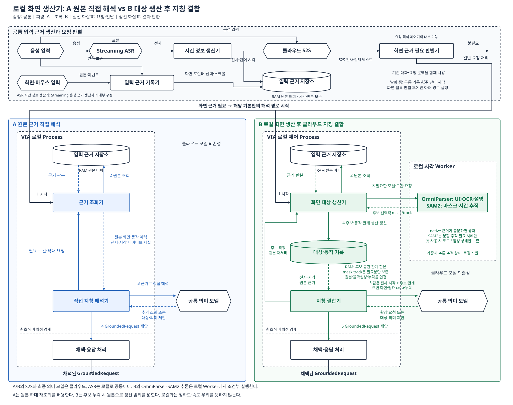

# DP3: 로컬 화면 생산기를 사용하는 B와 원본 직접 해석 A

> 현재 사용자 지정인 **GPU 없는 실행, 이번 검토에서 512 MB 상한 유보**는 [CPU runtime·상주·회수 구조](cpu-runtime-architecture.md)에 반영했다. [앞선 CPU 가상 예산](cpu-small-synthetic-budget.md)의 수치는 실측이나 현재 실행값이 아니다. 아래 모델 구성과 그림은 caption을 포함한 앞선 local 판본이다. 이번 실행 설계에서 local caption은 제외한다.

2026-10-21 / 사용자 지정: B 화면 생산기 local / 설계 비교, 미구현·미측정·미선정

**A는 당시 화면과 동작 원본을 cloud 의미 LLM이 직접 해석한다. B는 local 시각 모델로 대상 경계와 필요한 시간별 대응을 먼저 생산하고, 같은 cloud 의미 LLM이 그 기록과 원본을 발화에 연결한다.** 공통 local Streaming ASR와 단어 timestamp는 유지한다. B의 장점 후보는 시각 지칭 정확도와 cloud 입력 효율이고, 대가는 local 생산 지연·RAM·배포 복잡성이다. 이전 cloud 생산기 판본의 QA05 A 우세와 QA06 미확정 판단은 이 배치에 그대로 적용하지 않는다.

원본 공동 해석과 후보 생산·결합이라는 기존 비교를 구체화한 판본이다. [이전 cloud 생산기 설계](README.md)의 강한 A, 원본 권한·좌표·revision·정정 계약은 유지한다. speculative execution, 원음의 최종 의미 LLM 재전송, 새로운 QA 점수나 측정값은 도입하지 않는다.

## 1. 공통 조건과 실제 배치

| 구분 | A | B |
| --- | --- | --- |
| PC 공통 | 역사 화면·포인터·선택·scroll·window 기록, 실제 취득한 native 정보, local Streaming ASR와 단어 시각, 요청 제어·채택·UI | 같음 |
| cloud 공통 | S2S와 최종 의미 LLM | 같은 모델·서비스 조건 |
| 대상 생산 | 직접 지칭 해석 세션이 원본에서 경계·집합·동일성을 추론 | local 화면 대상 생산기가 모델과 기하 계산으로 후보 기록 생산 |
| 추가 local 실행 | 원본 조회·crop·전송 준비 | OmniParser worker, 필요 시 SAM2, 후보·track·공간 관계 관리 |
| 최종 의미 해석 | 원본을 직접 읽고 referent 영역/집합과 요청 의미를 제안 | 후보 ID·판본·범위를 발화와 연결하고 요청 의미를 제안 |

두 안 모두 원본 확대, 이전 화면 조회, 고해상도 crop, 대화와 이전 binding 재사용, 여러 번의 의미 모델 호출이 가능하다. A를 한 번의 호출이나 고정된 소수 frame으로 제한하지 않는다. native 객체·정확한 선택 범위·실제 viewport 변환도 공통 입력이다.



[편집 가능한 draw.io](diagrams/local-comparison.drawio) · [생성 소스](diagrams/generate_local.py)

## 2. B의 실행 단위와 수명

화면 대상 생산기는 VIA가 관리하는 local worker로 배치한다. 음성 capture/UI와 별도 실행 단위를 사용하되 프로세스 분리만으로 자원 경합이 없어졌다고 간주하지 않는다. 한 worker의 제한된 작업 큐가 요청 판본·사용 기한·취소를 관리하고, 공통 ASR/capture가 필요한 자원을 우선 확보하도록 연동한다. 이미 실행 중인 GPU kernel을 즉시 선점할 수 있다는 가정은 하지 않는다.

1. **발화 중:** 공통 기록과 ASR·단어 timestamp 생산만 수행한다. 화면의 의미상 대상을 미리 확정하지 않는다.
2. **화면 필요 판별:** 기존 요청 해석이 화면 근거가 필요하다고 판단한 경우에만 생산기를 호출한다. 포인터 움직임만으로 실행 여부를 정하지 않는다.
3. **근거 선택:** 발화 전 포인팅도 포함한 역사 구간과 source 판본을 읽는다. 처음 구간이 부족하면 늘린다. 모든 frame 대신 화면 변경, 포인터 동작, 선택 변경을 대표하는 frame을 우선 읽되 누락 구간은 기록하고 확대 가능하게 둔다. 같은 선택 능력은 A에도 있다.
4. **조건부 생산:** 아래 표에 따라 native 등록, OmniParser, SAM2 중 필요한 처리를 수행한다. 독립 frame 작업은 병렬화 가능하며 실제 의존·자원 제약만 직렬화한다.
5. **기록과 결합:** producer가 후보·track·공간 관계 revision을 만든다. binder가 공통 발화·문맥과 함께 cloud 의미 LLM에 전달한다.
6. **부족한 경우:** binder는 원본 확대를 요청하거나 생산기에 후보 추가·분할·추적 재검토를 요구한다. 새 후보 revision으로 재결합한다. 한 번에 끝난다고 가정하지 않는다.
7. **채택:** 현재 입력과 후보 판본을 함께 확인한다. 최종 출력은 A와 같은 대상 집합/범위·역할·목표·조건·이전 요청 관계다.

**모델은 처음 필요한 작업에서 load하고 동일 활성 처리 구간의 재호출에 재사용한다.** 해당 요청의 결합·확장 처리가 끝나 더 이상 실행 중인 참조가 없으면 가중치·추적 tensor·decoded frame을 해제한다. 다음 별도 요청을 위해 무기한 상주시켜 두지 않는다. 작은 후보 기록과 원본 참조는 공통 대화/정정 보존 기간 동안 남기며, 후속 정정이 새 영상 연산을 요구하면 모델을 다시 load한다. 추적 재생산에 필요한 seed/frame/prompt도 보존한다. 자원 해제는 참조 해제만이 아니라 worker/runtime의 실제 GPU·RAM 회수까지 관측한다.

이는 명시적 on-demand 기본 정책이다. 여러 요청 간 warm residency와 양자화는 별도 B 보완안으로 평가한다. 기본안의 cold-start를 빼거나 warm 속도와 unloaded 메모리를 동시에 취하지 않는다. OmniParser와 SAM2의 동시 상주를 강제하지 않으며, 동시에 활성 상태를 유지하는 구현은 그 실제 peak를 포함한다.

## 3. OmniParser와 SAM2를 언제 쓰는가

OmniParser는 UI 검출·OCR·아이콘 설명을 묶은 SW pipeline이다. SAM2는 point/box 등을 prompt로 받아 이미지 영역과 영상의 mask 변화를 생산하는 ML 모델이다. 두 모델이 서로를 반드시 차례로 실행해야 하는 관계는 아니다. [OmniParser 공식 구현](https://github.com/microsoft/OmniParser), [SAM2 공식 구현](https://github.com/facebookresearch/sam2)

| 관측과 필요한 결과 | OmniParser | SAM2 | 생산기가 남기는 결과 |
| --- | --- | --- | --- |
| 과거 native 선택에 정확한 객체·범위가 있음 | 생략 | 생략 | 실제 source ID·범위·선택 시각을 후보로 등록 |
| 정적 UI에서 버튼·아이콘·텍스트 영역 등 대상 목록이 필요 | 관련 keyframe에 실행 | bbox로 충분하면 생략 | 대상 후보, bbox, OCR, 아이콘 설명과 출처 |
| 사용자가 여러 직사각형 대상을 원으로 둘러쌈 | native 후보가 없으면 실행 | 원이라는 이유만으로 호출하지 않음 | 후보 경계와 닫힌 pointer path의 포함·교차 관계 |
| 비정형 그림의 실제 경계가 필요하거나 bbox가 이웃 대상을 크게 포함 | UI seed가 필요할 때만 실행 | image predictor 실행 | point/box에 따른 mask, 경쟁 경계·불확실성 |
| 같은 source가 이동하고 native 변환으로 대응이 해결되지 않음 | 필요한 seed 또는 새 UI frame에 실행 | 관련 연속 구간에 video predictor | 시간별 mask/영역 관측, 잠정 track 연결과 끊김 |
| 정확한 native scroll/viewport 변환으로 동일성을 유지 가능 | 새로 노출된 미확인 UI에만 필요 | 생략 가능 | 실제 변환과 source 판본으로 대응 |
| 문서·페이지가 교체되거나 긴 관측 gap이 있음 | 새 장면의 UI 후보가 필요하면 실행 | 단순히 이전 track을 계속 전파하지 않음 | 새 source 구간, 연결 미확인, 필요한 재검토 |

SAM2의 prompt는 실제 검출 bbox나 관측된 pointer 위치다. 이를 정답 대상으로 간주하지 않는다. 여러 후보가 가능하면 경쟁 mask/범위를 남긴다. SAM2의 track은 시각적 대응 추정이며 문서의 영구 객체 ID가 아니다. OmniParser가 일반 PDF 표의 행·셀이나 의미상 도표 집합을 완벽히 생산한다고 가정하지 않는다. 자유 범위·중첩 범위가 필요하면 원본과 경쟁 후보를 유지하며, 표현하지 못한 범위를 성공으로 처리하지 않는다.

호출 결정에 필요한 정보는 실제 native coverage, source 변화, bbox의 중첩/해상도, 확보한 변환과 기존 요청 해석의 단서에서 얻는다. 이것만으로 필요성을 확정할 수 없으면 최초 후보와 원본을 binder에 보내고 필요한 추가 생산을 요청받는다. 별도 LLM 하나를 무조건 추가해 routing하는 구조는 아니다.

### 이번 local 구성의 구체적인 후보

- **OmniParser:** `icon_detect_v3`의 YOLOv9-E 검출기 + `icon_caption`의 Florence-2 기반 설명기 + EasyOCR 기반 OCR 경로. UI 후보 검출/OCR과 아이콘 설명은 서로 다른 기능이며, 설명이 필요한 비텍스트 후보에 caption을 사용한다. 모델 선택은 배포 설계 제안이며 설치·성능 검증을 뜻하지 않는다.
- **SAM2:** local 자원을 고려해 `sam2.1_hiera_tiny`를 초기 비교 후보로 지정한다. 공식 크기는 38.9M parameter다. cloud 판본에서 특정 크기의 정확도를 측정한 적은 없으며 large의 성능을 tiny의 성능으로 계승하지 않는다. [모델 크기](https://github.com/facebookresearch/sam2#model-description)
- **runtime:** local PyTorch worker와 VIA adapter를 기준으로 설계한다. CUDA 가속 경로와 CPU 경로의 실행 시간을 같게 놓지 않는다. 공식 SAM2 설치 안내가 Windows에서 WSL을 권장한다는 점은 native Windows 배포가 이미 해결되었다는 근거가 아니다. 제품용 패키징·가속기 지원 비용은 별도 구현 과제다. [설치 안내](https://github.com/facebookresearch/sam2#installation)

같은 checkpoint·정밀도·입력이면 cloud에서 local로 옮긴 것 자체가 정확도 개선 원인은 아니다. 작은 checkpoint, 양자화나 frame 축소로 local 부담을 줄이면 그 정확도 변화를 별도로 공개한다. 공식 GPU의 FPS나 frame latency를 VIA 노트북의 QA01/03 수치로 옮기지 않는다.

## 4. 최종 의미 LLM에 보내는 실제 데이터

| 자료 | A의 입력 | B의 입력 |
| --- | --- | --- |
| 발화·문맥 | 같은 원발화 단어열/시각/revision, S2S 정제 문장, 대화/이전 요청 | 같음. 의미 LLM에 원음을 다시 보내지 않음 |
| 화면 | 당시 frame과 필요한 고해상도 crop, source 시각·판본 | 관련 overview와 후보 표시, 필요한 원본 crop, source 시각·판본 |
| 포인터·선택 | 시간별 좌표/path/buttons, 실제 selection, scroll/window 정보 | 동일 원본 조회 능력 + 후보별 포함/체류/교차 등의 계산 결과 |
| 대상 | 실제 native 정보와 해석 세션이 추론할 원본 | native 또는 모델이 생산한 후보 ID·bbox/필요 polygon·OCR/설명·출처 |
| 시간 관계 | 여러 원본 frame과 실제 변환, 의미 LLM의 직접 추론 | 시간별 후보 관측·잠정 track·경쟁 연결·gap |
| 누락·불확실성 | 원본 gap/좌표 오차 | 같은 gap/오차 + 생산 coverage/누락/추적 불확실성 |

B의 로컬 상태는 전체 mask와 track tensor를 가질 수 있다. **cloud에는 이 tensor 전체를 텍스트로 펼쳐 보내지 않는다.** 결합에 필요한 bbox/polygon, 시각별 관측과 공간 관계를 직렬화하고, 실제 확인에 필요한 overview/crop을 보낸다. 원본 reference는 추가조회 권한을 가진 식별자이며 그 문자열만으로 모델이 원본을 본 것으로 간주하지 않는다. 확대 요청 시 실제 픽셀을 다음 입력에 전달한다.

예를 들어 “이 둘을 보고서에 넣어줘. 아니, 이건 빼고.”라고 말하며 image-only UI 카드 두 개를 원으로 묶고, 스크롤 후 그중 하나를 다시 가리킨 경우다. 아래 ID와 시각은 **설명용 가상 입력**이며 정답 label이나 측정값이 아니다.

```text
speech: 원발화와 단어 구간, input_revision
  "이 둘" @ [0.3, 0.8], "이건" @ [2.7, 3.0]
source: window W, document D, frame F1/F2, 실제 source_time과 좌표 변환
scene_revision: R4
regions:
  e7: F1 bbox, OCR 또는 아이콘 설명, detector/native 출처
  e8: F1 bbox, OCR 또는 아이콘 설명, detector/native 출처
observations:
  e7/e8의 F1 시각별 경계
  F2의 후보 e12가 e8과 이어질 가능성, 경쟁 연결/끊김
interactions:
  gesture g1: 원본 path ref, [e7,e8]과 닫힌 경로의 포함 관계
  gesture g2: 원본 path ref, F2 e12 내부 체류와 주변 후보 거리
visuals: F1/F2의 관련 overview와 확인에 필요한 원본 crop
coverage: 생산하지 못한 주변 영역, 좌표/추적 불확실성
```

**OmniParser는 카드/텍스트 등의 후보 위치를 생산한다.** native 변환이 없다면 **SAM2는 e8과 F2 영역의 시각적 대응을 돕는다.** VIA 코드는 pointer와 후보의 기하 관계를 계산한다. **최종 LLM이 “둘을 넣고 마지막에 가리킨 하나를 제외한다”는 의도를 해석한다.** e12가 e8이라는 대응이 충분한 근거로 채택될 때 최종 포함 대상은 e7이다. 추적이 불분명하면 e8로 단정하지 않는다.

A에도 같은 frame·path·timestamp와 확대 능력을 준다. A는 이 관계를 직접 추론한다. B의 이익 가설은 전사 개선이 아니라 작은 대상의 누락, 서로 비슷한 영역의 혼동, 이동 후 다른 대상을 같은 대상으로 취급하는 오류를 전문 시각 처리로 줄이는 데 있다.

## 5. 원본 보완, 정정과 실패 계약

- producer는 파생 후보의 소유자이고 binder는 발화 의미의 소유자다. candidate가 없는 영역은 `Expand(source_revision, region, requested_extent)`로 생산기에 추가·분할을 요청한다. 최종 LLM이 raw에서 새 최종 영역을 확정하고 후보 기록을 우회하는 경로는 별도 혼합안이다.
- B의 최종 입력은 text-only로 강제하지 않는다. 미탐지/잘못된 분할을 발견할 수 있도록 주변 overview와 원본 확대를 유지한다. 생산 실패 때문에 확장·재질문이 생기면 그 시간과 비용·최초 채택 오류를 남긴다.
- 입력 revision이 바뀌면 옛 입력의 채택을 차단한다. source가 같은 후보는 재사용할 수 있으며 A도 자신의 원본·세션과 앞선 binding을 재사용할 수 있다. B만 재사용한다고 가정하지 않는다.
- 후보 경계/track revision이 바뀌면 해당 기록을 읽은 binding을 재검토한다. 영향 범위를 확정할 수 없으면 관련 전체 구간을 다시 생산한다.
- worker 실패 시 원본과 seed/prompt를 보존하여 재시도한다. 실패 중 빈 후보 집합을 정답으로 채택하지 않는다. 복구 불가와 원본 gap을 사용자에게 구별해 알리되 정상 성공으로 세지 않는다.
- 권한 철회는 원본과 파생 자료 양쪽에 적용한다. 입력 source time, monitor/DPI, window↔frame 변환, crop offset/scale과 오차를 보존한다. 과거의 대상 식별과 현재 앱에서 유효한 실행 selector 획득은 다른 문제다.

## 6. QA01–07의 손익

아래 방향은 신규 복합 화면을 중심으로 한 설계 예상이며 전체 모집단의 실측 승자가 아니다. native 선택은 모델 생략으로 차이가 작고, 실제 모호함은 어느 구조도 제거할 수 없다.

| QA | local B와 비교한 예상 | 실제 구조 원인과 반대 조건 |
| --- | --- | --- |
| **QA01 첫 응답 지연시간** | **지칭을 첫 내용에 포함하는 신규 복합 화면은 A 우세 예상** | B의 local load·생산이 결합 선행 조건이다. cloud producer 왕복은 없어졌지만 CPU/GPU 처리·경합은 남는다. native 생략, 이미 생산한 기록 재사용, A의 반복 조회가 큰 경우 차이가 줄거나 역전한다. 지칭과 독립된 유효한 첫 내용은 양쪽 모두 먼저 표시할 수 있다. |
| **QA02 지칭 대상 식별 정확도** | **B 우세 가설: 작은 대상·집합·이동의 시각 오류가 주된 경우** | 전문 검출·mask·시간 대응과 공간 관계가 같은 정확한 전사에 붙는다. local이라는 배치 자체의 이익은 아니다. 미검출·잘못된 경계·track drift가 크면 A가 낫다. |
| **QA03 VIA 처리시간** | **신규 복합 화면은 A 우세 예상, cloud 판본보다 격차 축소 가능** | local 생산의 실제 임계 경로 대 적은 업로드·결합 입력·재조회의 경쟁이다. 초기 load, 확장 후 재생산·재결합, ASR/다른 요청과의 자원 경합을 포함한다. |
| **QA04 실제 Rust 변경 모듈 수** | **우열 미확정** | 모델 교체가 worker adapter에 갇히면 B 국소화 여지가 있지만 A도 adapter가 가능하다. schema/좌표/추적 관계 변경은 producer·binder·revision 처리에 퍼질 수 있다. Python/CUDA 패키징 부담을 Rust 모듈 수로 숨기지 않고 별도 공개한다. |
| **QA05 청구 모델 사용 비용** | **기존 A 우세 예상을 철회. B의 조건부 이익** | local producer에는 cloud 호출료가 없다. 후보+선별 픽셀로 최종 의미 입력·재호출이 줄면 B가 싸다. 긴 JSON·overview·여러 crop과 확장 호출이 증가하면 동점 또는 A 우세다. A도 crop/조회가 가능하다. |
| **QA06 최대 RAM 사용량** | **A 우세 예상이 뚜렷함** | B에 local 가중치·runtime·decoded frame·mask·추적 상태가 추가된다. 단순 후보 텍스트 크기의 비교가 아니다. 전체 VIA의 동시 물리 RAM peak로 평가한다. |
| **새 QA07 요청 의미 해석 정확도** | **B 우세 가설, QA02와 중첩** | 대상·범위가 맞아져 전체 요청의 필수 의미가 정답이 되는 효과다. 동일 발화의 조건·부정·목표·이전 요청 관계를 독립적으로 더 잘 이해한다는 근거는 없다. |

QA01의 끝점은 “관계를 파악하겠습니다” 같은 안내가 아니라 실제 첫 유효 내용의 UI 표시다. 예를 들어 “선택하신 두 카드를 보고서에 추가하겠습니다”는 실제로 채택한 대상·처리 의도를 담을 때 해당할 수 있다. 오답의 실제 표시 시간을 지우거나 정확도가 확인될 때까지 임의 벌점을 더하지 않는다.

QA03은 기존 전체 완료 계약을 유지한다. 외부 Agent 업무, 사용자 답변 대기/후속 발화 길이, 순수 청취·재생 차례 대기는 제외한다. VIA의 질문 생성·후속 해석·네트워크·queue·retry는 포함하고, 필요한 상세 UI와 전체 음성 요약 준비까지 본다. 공통 ASR/timestamp의 발화 중 완료분은 다시 더하지 않으며 종료 뒤 잔여 처리나 경합은 포함한다.

```text
grounding 경로의 시간 차이 =
  B의 local 최초 load·생산 + B 전송·결합·후속 확장 경로
  − A 전송·직접 해석·후속 조회 경로
```

병렬 구간은 합산하지 않고 실제 임계 경로를 사용한다. 최초 생산과 후속 확장을 서로 중복 계상하지 않는다. 이 경로가 QA01/03의 실제 선행 경로일 때만 해당 지연 차이가 나타난다.

QA05의 대표 단위는 기존 COMMON-28 전체 활동 묶음이다. 공통 S2S를 한 번 포함하고 실제 최종 모델의 text/image/output/retry 청구액을 모두 센다. local 전력, GPU 점유, 설치 용량, 라이선스 구매료·배포 유지비는 별도 운영비이며 현 QA05에 임의 환산하지 않는다. crop 개수나 후보 텍스트가 늘면 provider의 이미지 과금 방식에 따라 입력량이 커질 수 있다.

QA02는 지칭/revision별 첫 채택 대상 집합·범위의 완전 일치, 새 QA07은 입력/revision별 첫 채택 필수 의미 전체의 완전 일치다. 나중 정정으로 최초 오답을 성공 처리하지 않는다. 같은 대상 개선을 독립적인 두 정확도 이익으로 합산하지 않는다.

### QA06의 512 MB 목표에 대한 판단

현 목표는 **전체 VIA RAM 512 MB 이하**다. B를 local로 옮긴다고 이 목표를 완화하지 않는다. OmniParser caption의 배포 weight 파일은 약 1.08 GB, 새 v3 detector 파일은 약 281 MB다. 파일 크기가 곧 RAM 사용량은 아니지만 이 모델들과 SAM2·ASR·UI를 일반적인 CPU/PyTorch 구성으로 사용하는 것은 목표 달성에 큰 부담이다. 기존 detector의 40.6 MB를 v3의 크기로 가져오지 않는다. 이 비교는 **512 MB를 충족하는 local B 제품 구성을 확보했다는 결론이 아니다.** [caption 가중치](https://huggingface.co/microsoft/OmniParser-v2.0/tree/main/icon_caption), [v3 detector](https://huggingface.co/microsoft/OmniParser-v2.0/tree/main/icon_detect_v3), [QA06 계약](../../qa-candidate-package/qa06-local-memory.md)

전용 VRAM은 별도 보고하며 RAM에 그대로 더하지 않는다. 통합/시스템 RAM을 쓰는 그래픽 할당과 CPU staging, 실제 상주한 파일 매핑은 포함한다. 개별 프로세스 peak 합이나 파일 크기 합 대신 전체 동시 peak를 본다. CPU fallback이 되는 것, 가속기에서 추론 가능한 것, 제품 메모리 목표를 만족하는 것은 별도 판단이다.

## 7. 라이선스와 상용 사용

2026-10-21 공식 공개 문서를 확인했다. **상용 사용은 가능한 구성이다. 다만 OmniParser의 저장소 코드·검출 가중치·caption 가중치를 하나의 라이선스로 말하면 부정확하다.**

| 구성물 | 공식 라이선스 | 상용 제품에서의 의미 |
| --- | --- | --- |
| OmniParser GitHub 저장소의 root LICENSE 적용 코드 | **CC BY 4.0** | 상업적 이용·수정·재배포 가능. 저작자/출처·라이선스·수정 사실 표시 등 조건 유지. MIT 코드라고 표시하지 않음. [root LICENSE](https://github.com/microsoft/OmniParser/blob/master/LICENSE) |
| 기존 `icon_detect` 가중치, YOLOv8 계열 | **AGPL-3.0** | 상용 금지는 아니다. 해당 프로그램의 배포·수정·네트워크 제공 방식에 따른 대응 소스 제공 등 의무가 있어 비공개 제품에는 추가 검토 부담. VIA 전체가 무조건 공개된다는 단정도 하지 않음. [공식 모델별 표](https://huggingface.co/microsoft/OmniParser-v2.0#license) |
| 새 `icon_detect_v3` 가중치, YOLOv9-E 계열 | **MIT** | 저작권·허가문 보존 조건으로 상용 이용 가능. 공식 모델 카드는 torch 기반 추론과 AGPL runtime 불필요를 명시. [가중치 LICENSE](https://huggingface.co/microsoft/OmniParser-v2.0/blob/main/icon_detect_v3/LICENSE), [공식 설명](https://huggingface.co/microsoft/OmniParser-v2.0#new-mit-licensed-detector-weights-icon_detect_v3) |
| `icon_caption` 가중치, Florence-2 기반 | **MIT** | 저작권·허가문 보존 조건으로 상용 이용 가능. [가중치 LICENSE](https://huggingface.co/microsoft/OmniParser-v2.0/blob/main/icon_caption/LICENSE) |
| SAM2/SAM2.1 코드와 checkpoint | **Apache-2.0** | 상용 이용 가능. license/notice 보존·변경 표시 등 조건. 일반적인 비공개 제품 사용을 이유로 소스 공개를 강제하는 라이선스는 아님. [공식 적용 범위](https://github.com/facebookresearch/sam2#license) |
| SAM2에 포함된 cctorch 관련 코드 | **BSD-3-Clause** | 상용 이용 가능. 해당 copyright/조건/면책 고지 보존. [별도 LICENSE](https://github.com/facebookresearch/sam2/blob/main/LICENSE_cctorch) |

**이번 B에는 `icon_detect_v3` + MIT `icon_caption` + SAM2.1을 권고한다.** `icon_detect_v3`는 전체 OmniParser가 v3로 바뀌었다는 뜻이 아니라 공식 v2.0 model repository에 추가된 detector folder 이름이다. 모델 카드의 두 가중치 MIT 설명이 저장소 root의 CC BY 4.0이나 별도 OCR/runtime 의존성까지 재라이선스하지 않는다.

원래 OmniParser의 전체 requirements를 그대로 배포하면 사용하지 않는 Ultralytics 경로까지 들어올 수 있다. B의 adapter는 v3 detector 경로와 필요한 OCR/caption 의존성만 명시하여 구성한다. EasyOCR 코드의 Apache-2.0 조건도 유지한다. 실제 배포 artifact의 버전·가중치·동봉 의존성 목록에 각각의 license와 notice를 연결한다. 이것은 “원본 저장소를 통째로 MIT라고 간주해 배포”한다는 뜻이 아니다. [OmniParser requirements](https://github.com/microsoft/OmniParser/blob/master/requirements.txt), [EasyOCR LICENSE](https://github.com/JaidedAI/EasyOCR/blob/master/LICENSE)

## 8. DP의 결론과 선택 이유

**local B는 비교할 만한 SW 구조다.** 원본에서 경계·동일성을 직접 판단하는 A와, 별도 local 시각 처리·판본 상태·확장 의존을 갖는 B는 실행과 상태가 실제로 다르다. 다만 도구 이름만으로 B 정확도 승리가 확정되는 것은 아니다.

- **A를 선택할 이유:** 빠른 첫 응답과 낮은 local 자원 부담, 자유 범위의 직접 표현을 우선하고 같은 의미 모델이 화면을 충분히 잘 읽는 경우다.
- **B를 선택할 이유:** 밀집 UI·집합·이동의 시각 지칭 오류가 중요한 실패 원인이어서 별도 local 처리 시간/RAM을 감수할 가치가 있는 경우다. 최종 의미 LLM의 영상 입력·재조회가 줄면 cloud 청구 비용도 낮아질 수 있다.
- **B를 뒤집는 조건:** 전문 모델의 누락/오추적이 더 크거나, 강한 A와 정확도가 같고 추가 지연/RAM만 남거나, 제품의 512 MB 목표를 충족할 실행 구성을 만들 수 없는 경우다. A에 같은 parser를 참고자료로 더한 별도 보완안이 모든 이익을 얻는다면 전문 시각 처리의 가치와 producer 중심 계약의 가치를 구별한다.

이번 설계는 **A: QA01·03·06 우위 예상 / B: QA02·07의 조건부 우위와 QA05 절감 가능 / QA04 미확정**으로 정리한다. 새 QA07 우선순위를 임의로 부여하지 않으며, 기존 우선순위 아래 전체 승자는 아직 정하지 않는다. 수치·검증·제품 채택을 설계 가설과 섞지 않는다.

기존 [QA01](../../qa-candidate-package/qa01-first-response-latency.md), [QA02](../../qa-candidate-package/qa02-referent-accuracy.md), [QA03](../../qa-candidate-package/qa03-via-processing-time.md), [QA04](../../qa-candidate-package/qa04-change-scope.md), [QA05](../../qa-candidate-package/qa05-model-cost.md), [QA06](../../qa-candidate-package/qa06-local-memory.md), [새 QA07](../../../../../../INTENT.md#41-qa02와-새-qa07의-관계)을 유지한다. 문서·그림 검토는 [검토 기록](review.md)에 구분해 남긴다.
