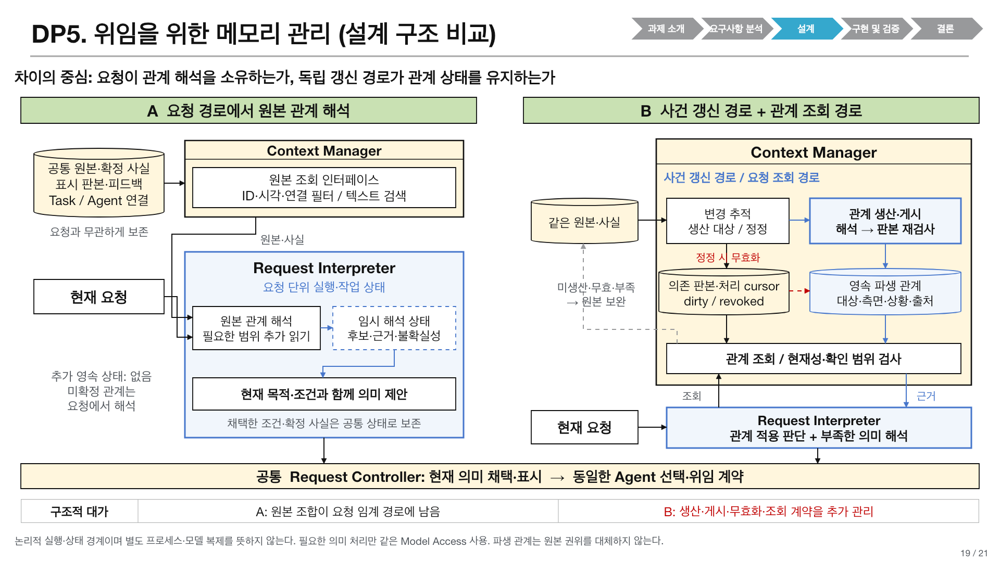

# 발표 DP5: 위임을 위한 메모리 관리

2026-10-20. 사용자 요청에 따라 기존 발표 DP1과 DP4의 지식을 종합한 **두 기본안의 설계 비교**다. 구현, 모델 실행과 성능 측정은 수행하지 않았다. 기본안 선택, QA07의 우선순위와 점수 구간, accepted ADR 변경을 뜻하지 않는다.

발표 DP1~4는 사용자가 지정한 [17장 v4 reference-style 발표](../../../../presentations_files/dp1-dp4-reference-style-20261019/VIA-DP1-DP4-reference-style-17slides-v4-windows.pptx)의 번호다. 발표 DP4는 저장소의 [05-agent-handoff.md](05-agent-handoff.md)이며, 여기의 발표 DP5와 다르다. 현재 최종 자료는 [DP5를 추가한 21장 v5](../../../../presentations_files/dp1-dp4-reference-style-20261019/dp5-v5-review.md)다. 최초 40장 산출물은 다른 기반 파일을 사용했으며 사용자 정정에 따라 이 v5로 바로잡았다.

## 1. 사용자 문제와 결정

사용자는 VIA에게 “고객용으로 좋다고 했던 그 자료 형식으로 다시 만들어 줘. 작성은 그 자료 만든 쪽에 맡겨”라고 요청한다. 자료를 조사한 Agent, 처음 문서를 만든 Agent, 가장 최근 수정한 Agent가 다를 수 있다. VIA는 사용자가 실제 보았던 판본과 평가한 측면, 그 평가의 적용 상황을 연결해야 한다. 최신 결과나 마지막 Agent만 고르면 잘못된 대상과 조건을 채택할 수 있다.

**결정 질문: 위임의 의미를 이해하는 데 필요한 과거 관계를 현재 요청에서 해석할 것인가, 공개 사건이 생겼을 때 미리 해석해 두고 현재 요청에서 적용 여부를 판단할 것인가?**

- **A 요청 시 관계 해석:** 원본과 명시적 사실을 보존하고, 현재 요청에 필요한 범위를 찾아 관계를 해석한다.
- **B 사전 관계 메모리:** 같은 원본과 사실에 더해, 위임 관련 피드백의 대상·측면·범위를 미리 해석한 자료를 관리한다. 현재 요청은 유효한 해석본을 사용하고 부족한 부분은 원본으로 보완한다.

가장 분명한 교환은 **처음 다시 지칭하는 관계를 해석하는 요청 경로의 부담**과 **사용될지 모르는 관계를 미리 생산·갱신하는 모델 비용**이다. 정확도는 양쪽 모두 이익과 실패 가능성이 있어 모델과 사례에 따라 달라진다. 세 개의 독립적 성능 우위가 이미 입증된 DP라고 주장하지 않는다.

## 2. 기존 DP에서 계승한 지식과 경계

| 출처 | 계승한 지식 | DP5에 적용하는 범위 |
| --- | --- | --- |
| DP1의 B 요청별 원본 구성 / C 게시 근거 | 조회 시 해석과 사전 생산, 원본 보완, 출처·coverage·판본 | 위임 관계 해석에 한정해 A/B로 재구성 |
| DP1의 A 대화 작업 문맥 | 이미 읽은 유효 근거와 확정 사실의 재사용 | 두 안의 공통 기능. A를 매번 처음부터 재해석하는 약한 안으로 만들지 않음 |
| DP4의 A 목적별 구성 / B 지속 업무 기록 | 사건 기반 갱신, 원본 설명의 보존, 미소비 생산비용 | VIA가 처음 의미를 채택하기 전에 필요한 관계에만 적용 |
| DP4의 C manifest와 수신자 읽기 | 채택 목표·조건은 명시하고 상세 도메인 자료는 수신자가 선택 | 두 안의 동일한 후속 인계 구조로 고정 가능 |
| DP45 근거 계약 | source span, 판본, 읽기 영수증, 누락, 권한과 철회 | 조회와 생산 모두에 적용. 파생 해석은 원본의 대체 권위가 아님 |

DP5는 DP1 C와 DP4 B에 이미 있던 사전 생산 축을 **위임의 의미 연결**로 구체화한 종합 비교다. 다섯 개의 완전히 독립적인 최적화라고 계산하지 않는다. 기존 DP1 C가 같은 관계를 이미 생산한다면 DP5 B는 그 자료를 사용하며 별도 producer나 같은 생산비용을 중복 추가하지 않는다. 조합을 평가할 때는 기능별 공유 경로와 실제 호출을 한 번씩 계산해야 한다.

DP2의 의미 실행 분리, DP3의 화면·발화 grounding, DP44의 통지·정정 개입 정책은 동일하게 둔다. DP5가 선택하는 것은 근거의 표현과 생산 시점이다. VIA가 상세 조사·보고서 작성·도구 계획까지 대신하는 구조는 범위 밖이다.

## 3. 같은 사건으로 보는 어려움

| 순서 | 관측 가능한 사건 | 보존할 사실 |
| --- | --- | --- |
| 1 | Research Agent R이 조사 D1을 반환 | D1의 실제 생산자 R과 판본, 공개 결과 |
| 2 | Presentation Agent P가 발표 D2를 작성 | D2의 생산자 P와 사용한 D1 참조 |
| 3 | Revision Agent Q가 내부회의용 D3를 작성 | D3의 생산자 Q, D2와의 수정 관계 |
| 4 | 사용자가 D2와 D3를 보고 “외부 고객에게는 처음 만든 쪽의 구성이 더 좋겠어. 이번 내부회의에는 수정본을 쓰자”라고 말함 | 발화, 실제 표시 판본, 이미 채택한 명시적 조건 |
| 5 | 며칠 뒤 “고객용으로 좋다고 했던 그 자료 형식으로 새로 만들어줘. 수치는 이번 조사 결과를 쓰고, 작성은 그 자료 만든 쪽에 맡겨” | 새로운 요청과 해당 revision |

설명용 정답은 **형식 D2, 내용은 이번 조사, 명시적으로 지칭한 작성자 P**다. 최신 수정자 Q나 조사자 R을 고르는 것은 다른 결과다. 과거 피드백은 D2의 “구성”과 “외부 고객”이라는 범위에 관한 것이다. P를 모든 업무에서 선호한다는 뜻으로 넓히지 않는다.

이 예시는 아직 실행한 fixture가 아니다. 실제 평가에서는 display 증거와 발화가 같은 답을 지지하는지 먼저 확인한다. 원본으로도 모호하다면 두 안에 동일한 확인 질문 기회를 주며 정답 Agent를 몰래 주입하지 않는다.

## 4. 공통 기반과 저장 계약

두 안 모두 다음을 보존한다.

1. Task·실행 ID와 실제 Agent의 연결, 공개 결과·자료 판본, 수정·인계의 명시적 연결.
2. 사용자가 실제 본 결과와 당시 화면 증거, 발화·피드백 원문과 시간. 단순 생성 완료를 사용자 열람으로 바꾸지 않는다.
3. 이미 채택한 현재 목표와 조건, 사용자가 허용한 장기 선호, 사용 제한과 삭제 정보.
4. Agent가 공개한 capability, 관측한 수행 결과, 현재 접속·권한·지원 여부를 서로 구분한 정보.
5. source ID/revision/span, 권한 epoch, 확인 범위와 미확인 구간. Task 상태의 원본 소유권은 유지한다.

명시적 taskID 조회, 작성자 조회, 판본 비교, 현재 권한 확인에는 LLM이 필요하지 않다. “D2 생성자=P”가 실제 실행 기록에 있으면 두 안 모두 코드로 읽는다. 사용자가 “앞으로 발표는 P에게 맡겨”라고 명시적으로 확정한 선호도 두 안의 공통 사실이다.

**B만 추가로 관리하는 것은 아직 현재 요청에서 확정되지 않은 의미 관계의 파생 자료**다. 예를 들어 과거 피드백이 지칭한 자료, 좋다고 평가한 측면, 적용 상황과 그 근거를 보존한다. 그 관계가 과거 처리에서 이미 확정돼 공통 상태로 저장됐다면 B만의 사전 생산 이익으로 세지 않는다.

### 4.1 B의 파생 관계 예시

| 필드 | 예시 |
| --- | --- |
| 관계 종류 | feedback-about-artifact |
| 대상과 판본 | D2@v1 |
| 평가 측면 | 구성 |
| 적용 상황 | 외부 고객 대상 |
| 근거 | feedback F7 원문 span, 당시 표시 D2/D3, source revisions |
| 연결 가능한 명시적 사실 | D2@v1의 작성자는 P |
| 의미 상태 | supported / unresolved / disputed |
| 현재성 | valid / dirty / revoked |
| 확인 범위 | 처리한 사건 cursor와 누락 구간 |

`valid`는 의존 원본과 권한이 현재 일치한다는 뜻이며 의미 정답을 보증하지 않는다. source가 그대로여도 잘못 해석한 관계는 `disputed`로 신고할 수 있다. 적용 상황이 새 요청과 맞는지는 요청 해석기가 다시 판단한다. 오래된 capability 관측을 현재 사용 가능성으로 읽지 않는다.

## 5. 두 기본안의 실행

[편집 가능한 v5-r2 PPTX](../../../../presentations_files/dp1-dp4-reference-style-20261019/VIA-DP1-DP5-reference-style-21slides-v5-r2-windows.pptx)의 19장이다. [도형·연결선 원본](../../../../../scripts/presentations/add_dp5_reference_style_v5.mjs)도 보존한다. 회색 점선은 B의 원본 보완, 빨간 점선은 정정에 따른 관계 무효화, A의 점선 상자는 요청 단위 임시 상태를 나타낸다.

### A 요청 시 관계 해석

1. 사건 수신 시 공통 사실과 원본을 기록한다. 이미 사용자와 확정한 사실을 유지한다. 미확정 피드백의 모든 관계를 선제적으로 해석하지 않는다.
2. 새 요청에서 Task ID, 시간, 자료 종류, 명시적 연결을 코드로 좁히고 텍스트 검색으로 후보 원본을 찾는다. 검색 순위는 의미의 정답이 아니다.
3. 현재 요청 해석기가 관련 발화, 표시 판본, 결과 이력을 읽어 피드백과 자료의 관계를 판단한다. 필요한 범위만 추가로 읽는다.
4. 현재 요청의 지칭 대상, 목적과 조건을 처음 채택하고 올바른 구체적 처리 내용을 표시한다. 별도의 Agent 선택 규칙과 현재 eligibility 검사는 공통으로 적용한다.
5. 채택한 조건과 확인된 사실은 다음 요청에서도 재사용한다. 유효 자료를 무조건 버리거나 전체 이력을 반복 입력하지 않는다.

장점은 새 요청의 목적을 알고 필요한 부분에만 해석비용을 쓰는 것이다. 처음 재참조하는 오래된 관계가 여러 기록에 흩어져 있으면 요청 경로에서 그 조합을 기다릴 수 있다.

### B 사전 관계 메모리

1. 같은 원본·사실 기록 후, 결과 공개·의미 있는 피드백·정정 등 관계 생산 대상 사건을 표시한다. 단순 진행률 통지는 코드로 기록한다.
2. 명시적 연결은 코드로 처리한다. 의미 연결이 필요한 경우에만 공통 모델 자원을 사용해 관계와 근거, 미확인 범위를 생산한다.
3. 생산이 읽은 source revision과 권한이 여전히 유효한지 검사해 게시한다. 생산 도중 바뀐 판본은 새 자료로 표시하지 않는다.
4. 새 요청에서 관련 관계를 찾아 현재성·coverage를 코드로 확인한다. 같은 요청 해석기가 현재 목적에 대한 적용 여부를 판단한다.
5. 미생산·오래된·범위 밖·의미 불일치 관계는 원본으로 보완한다. 기존 모델 슬롯과 스케줄러를 사용하므로 갱신이 요청과 경합할 수도 있다.
6. A와 같은 의미 채택과 출력, Agent eligibility 검사, 후속 인계 계약을 거친다.

B의 추가 책임은 파생 관계의 생산·갱신·조회다. 별도 물리 서비스나 모델 가중치 복제를 필수로 요구하지 않는다. 같은 품질의 원본 보완을 허용하며, 보완 비용까지 B에 포함한다.

### 5.1 구조도에서 구분한 책임과 상태 수명

2026-10-20 사용자의 구조도 재작성 요청에 따라 순서도 중심 표현을 책임·인터페이스·상태 경계 중심으로 바꿨다. 기존 Reference Architecture의 정식 Component를 바꾸거나 별도 프로세스를 추가한 결정은 아니다. 아래 내부 책임은 두 안의 메커니즘을 구체화한 설계 제안이다.

| 구조 계약 | A 요청 경로에서 원본 관계 해석 | B 사건 갱신 경로와 관계 조회 경로 |
| --- | --- | --- |
| 관계 해석을 시작하는 주체 | 현재 요청을 처리하는 Request Interpreter | Context Manager의 사건 기반 생산 경로. 현재 요청 도착과 분리 |
| Context Manager 내부 책임 | 공통 원본·사실에 대한 제한된 검색과 조회 인터페이스 | 변경 추적, 관계 생산·게시, 현재성·확인 범위 검사를 수행하는 관계 조회 인터페이스 |
| 요청 해석의 작업 상태 | 후보·근거·불확실성을 요청 단위로 관리하고 현재 목적·조건과 함께 판단 | 이미 생산한 관계를 조회해 현재 목적에 적용하고 부족한 의미만 원본으로 보완 |
| 추가 영속 상태 | 미확정 관계를 미리 저장하지 않음. 채택한 조건·확정 사실은 공통 상태에 보존 | 파생 관계와 출처, 의존 판본, 처리 cursor, 미확인 범위와 dirty/revoked 상태 |
| 정정·삭제 처리 | 공통 원본과 확정 사실을 갱신하고 요청의 읽기·채택에서 현재성 검사 | 동일 공통 처리에 더해 의존 관계를 무효화. 갱신 전 조회는 원본 보완 또는 대기 |
| 게시 계약 | 요청의 현재 의미를 공통 Request Controller가 채택 | 관계 생산 결과를 읽은 판본·권한과 재대조한 후 게시. 현재 의미의 채택은 동일 Request Controller |
| 요청 경로에 주는 변화 | 최초 재참조에 필요한 원본 조합이 요청 임계 경로에 남을 수 있음 | 유효 파생 관계가 해당 조합을 대체할 수 있지만 갱신 실패·미확인 범위에서는 원본 해석이 다시 필요 |

B의 변경 추적은 생산 대상과 처리 진척을 관리하는 논리적 책임이다. 별도 메시지 broker, 역방향 의존 색인, 독립 프로세스나 모델 가중치 복제가 필수라는 뜻은 아니다. 원본과 확정 상태의 소유권은 양쪽에서 동일하게 유지하며 Context Manager의 파생 저장소는 원본을 대체하지 않는다. 생산 시의 원본 읽기는 동일한 허용 근거 조회 계약을 사용한다.

두 안의 전환에는 단순 호출 시점 변경을 넘어 저장 계약과 소비 인터페이스의 변화가 필요하다. A에서 B로 바꾸면 관계 판본·근거·확인 범위를 영속 관리하고 생산/게시/무효화 경로와 이를 해석하는 조회 인터페이스를 추가해야 한다. 이 변화가 요청 대기를 줄일 수 있는 이유인 동시에 미소비 생산·갱신 비용과 추가 상태 관리 부담의 원인이다. 그 사실만으로 QA04 모듈 수나 QA06 RAM의 우열을 확정하지 않는다.

### 5.2 검색과 LLM의 구분

| 단계 | 두 안의 공통 처리 | A | B |
| --- | --- | --- | --- |
| 후보 검색 | ID·시각·연결 필터 + 텍스트 검색 | 원본과 공통 사실 후보 | 파생 관계와 공통 사실 후보 |
| 의미 해석 | 동일 모델·현재 요청 해석 책임 | 원본 사이 관계를 현재 목적에서 해석 | 사전 해석한 관계의 적용 여부 판단, 부족하면 원본 해석 |
| 사건 시 처리 | 명시적 사실과 현재 상태 기록 | 미확정 의미 관계의 선제 생산 없음 | 필요한 의미 관계만 조건부 모델 호출 |
| 검증과 사용 | 판본·권한·coverage 확인, 동일 채택 계약 | 원본 의존 판본 검사 | 파생 자료와 원본 의존 판본 검사 |

Embedding은 선택적인 검색 보완이다. 기본 비교에 넣는다면 두 안에 같은 모델·색인·후보 예산과 비용을 적용한다. **검색은 후보 확보이고 LLM 호출은 의미 해석**이다. A를 반드시 한 번 호출, B를 반드시 여러 번 호출로 정의하지 않는다. A의 관계 해석은 기존 요청 해석 호출 안에서 끝날 수도 있다.

## 6. QA 관련성과 실제 차별화 가능성

전부 설계 가설이다. `관련`을 실제 우위나 course coverage 확보로 세지 않는다.

| QA | 직접 관련 경로 | A에 유리한 조건 | B에 유리한 조건 | 차별화 강도와 한계 |
| --- | --- | --- | --- | --- |
| QA01 첫 응답 지연 | 첫 올바른 채택 내용을 표시하기 전 과거 관계 해결 | 정확한 ID·소수 원본으로 충분하거나 B 갱신이 요청과 경합 | 처음 다시 지칭한 관계가 사전 생산돼 있고 해당 관계가 첫 응답에 필수 | 주요 가설. 관계가 필요 없는 다른 올바른 첫 내용을 먼저 표시할 수 있으면 이익이 없어질 수 있음 |
| QA02 지칭 대상 식별 정확도 | “좋다고 한 자료”, “그 자료 만든 쪽”의 최초 대상 집합 | 새로운 범위·예외가 기존 해석본에 없고 요청에서 원문을 함께 봄 | 관계를 작게 나누고 근거·경쟁 후보를 보존해 대상 혼동을 줄임 | 양방향 가설. 강한 원본 보완 뒤 동점 가능. 모델·사례 의존 |
| QA03 VIA 처리시간 | 요청 내 검색·관계 조합·보완의 실제 임계 경로 | 요청이 단순하거나 B가 원본 보완까지 중복 수행 | 유효한 관계로 원본 탐색·조합을 줄임 | 주요 가설. 사전 작업은 발생 시점과 요청 중 실제 경합을 함께 보고. QA01과 같은 대기의 중복 효과 가능 |
| QA04 변경 모듈 수 | 같은 관계 종류·수정 의미·권한 규칙 추가 과제 | 생산·무효화 경로가 적을 수 있음 | 공통 관계 계약 안에서 새 consumer를 추가할 수 있음 | 우열 미정. 실제 Rust 변경 모듈로만 판정. Component 수로 점수 추정 안 함 |
| QA05 전체 모델 비용 | 미소비 생산·갱신·재시도와 요청·수신자 사용량 | 결과가 많고 재참조가 적음 | 같은 미확정 관계가 여러 다른 요청에서 재사용돼 생산비용을 상쇄 | 가장 분명한 반대 비용. A의 이미 확정한 사실 재사용도 인정하며 전체 episode로 계산 |
| QA06 로컬 peak RAM | 파생 자료·색인·생산 작업 상태와 실제 요청 문맥 | B 상태나 동시 생산의 peak가 큼 | A의 요청 문맥 확장이 더 큰 peak를 만듦 | 우열 미정. 디스크 크기·원격 KV·token 수를 로컬 RAM으로 바꾸지 않음 |
| 새 QA07 요청 의미 해석 정확도 | 대상, 목적, 제약과 기존 요청 관계의 최초 전체 채택 | 새 조건이 기존 해석의 일반화를 뒤집음 | 측면과 적용 상황을 명시해 “구성은 D2, 수치는 신규”를 분리 | 양방향 가설. 자동 최적 Agent 선택 품질, 후속 인계 누락과 실행 성패를 포함하지 않음 |

QA07은 2026-10-20 [INTENT](../../../../../INTENT.md)의 새 요청 의미 정의다. 이전 부하 추가 지연 QA07과 다르다. 우선순위·목표·점수는 미확정이다. QA02의 같은 대상 오류가 QA07도 실패하게 만들 수 있으므로 두 개의 독립적 정확성 개선으로 세지 않는다.

### 6.1 직관적인 교환 사례

**B가 도움이 되는 경우:** 사용자가 처음 “고객용으로 좋다고 한 자료”를 다시 부른다. A는 D2/D3의 실제 표시와 F7의 비교 표현을 현재 요청에서 조합한다. B는 이미 생산한 D2·구성·외부고객 관계와 원문 인용을 읽어 현재 요청에 적용한다. 이 조합이 실제로 첫 응답을 막는다면 QA01/03 개선 가능성이 있다.

**A가 도움이 되는 경우:** 공개 결과와 피드백은 많이 쌓이지만 다시 부르는 업무가 적다. A는 실제 요청된 부분만 해석한다. B는 쓰이지 않은 관계의 생산과 정정 비용까지 부담한다. 이후 요청이 “그때 구성은 좋았지만 이번에는 내부회의용으로”처럼 맥락을 바꾸면 B도 적용 범위를 다시 해석해야 한다.

**정확성의 반대 위험:** A는 여러 원본에서 관계를 놓칠 수 있다. B는 원래 피드백의 범위를 좁히거나 과도하게 일반화한 해석을 반복 재사용할 수 있다. B의 원본 보완은 위험을 줄이지만, 그때 지연·비용 이익도 줄어든다. 자료 최신성 검사만으로 의미 오해는 잡히지 않는다.

## 7. 변경·장애·삭제 처리

- 새 원본 사건과 관계 게시를 분리한다. 원본은 먼저 보존하고, B의 처리 cursor보다 뒤에 있는 사건은 조회 시 미확인 범위로 드러낸다.
- 정정은 source 의존 관계를 dirty로 만든다. 조회자는 갱신 대기 또는 원본 보완을 수행하며, 대기·추가 호출·실패를 결과에 포함한다.
- 실제 의미 불일치 신고는 source revision 변경이 없어도 관계를 무효화한다. 부정확한 해석의 영구 재사용을 피한다.
- 철회·삭제는 두 안의 읽기, 모델 전송, 채택과 Agent 전송에 동일하게 적용한다. 삭제한 선호를 옛 transcript로 복원하지 않는다.
- producer 장애가 나면 공통 원본 경로로 계속할 수 있다. 원본까지 없으면 동일한 불확실성·확인 절차를 따른다. 오래된 관계를 성공으로 채택하지 않는다.
- 과거 Agent capability와 현재 접속·권한 검사는 분리한다. 명시적으로 지칭한 Agent가 불가하면 재확인 등 공통 정책을 적용한다.

## 8. 기본안 이후의 선택적 보완

| 보완 | 바꾸는 부분 | 기대와 대가 |
| --- | --- | --- |
| A1 요청으로 확인한 관계의 재조회 색인 | 이미 확정한 사실의 기본 보존에 더해, 후속 질의용 검색 색인을 관리 | 두 번째 유사 질의의 검색·조합 절약 가능. 색인 갱신·RAM 비용. 첫 재참조의 사전 생산 이익은 없음 |
| B1 같은 업무의 연속 사건 묶음 생산 | 모든 생산 대상 사건 직후 처리하는 대신, 호환되는 사건을 모아 한 번 처리 | 중복 생산 감소 가능. 게시 공백이 길어져 요청 시 원본 보완 증가 |

두 보완은 기본 비교에 미리 포함하지 않는다. 양쪽 기본안의 필수 현재성·삭제·원본 보완과 이미 확정된 사실 재사용은 보완으로 빼지 않는다. A1/B1의 효과 역시 미측정이다. 서로 다른 안의 보완을 같은 추가 기능으로 간주하지 않는다.

## 9. 비교 계획과 선택 조건

동일 사건 순서, 원본·표시 증거, 실제 capability 정보와 권한, 요청 의미 정답, 모델·예산, 검색 기능과 실행 자원으로 비교한다. 현재 LLM이 어느 경로에서 얼마나 실패하는지는 별도 검증해야 한다. 모델을 바꾸는 민감도 비교는 양쪽에 같은 모델을 적용한다.

모집단은 좋은 결과가 나오는 사례에만 맞추지 않는다.

| 사례군 | 확인할 주장 |
| --- | --- |
| 정확한 자료 ID와 이미 확정된 선호 | 추가 의미 생산 없이 두 안이 같은 직접 조회를 쓰는가 |
| 최초의 과거 관계 재참조 | B의 사전 관계가 첫 올바른 응답의 실제 작업을 대체하는가 |
| 이미 처리한 관계의 반복 요청 | A의 확정 사실 재사용 후에도 B의 이익이 남는가 |
| 생산됐지만 끝내 재참조되지 않는 결과 | 미소비 생산비용을 B 전체 비용에 포함하는가 |
| 연속 정정·철회·미처리 구간 | B 원본 보완, A 재조회와 양쪽 실패·경합을 보존하는가 |
| 적용 상황 변경, 부분적으로 좋은 결과 | B의 과도한 일반화와 A의 원본 관계 누락을 모두 드러내는가 |

QA01은 실제 첫 올바른 구체 내용 표시에서 끝낸다. 해당 관계 해결 전에도 가능한 다른 구체 내용을 양쪽이 같은 정책으로 제공할 수 있으면 그 경로를 허용한다. B만 끝까지 기다리게 하거나 A에 무의미한 ack만 허용하지 않는다.

QA03은 공통 목표 단위의 VIA 임계 경로를 사용하고 Downstream 내부 실행·사용자 대기를 분리한다. 요청 이전 작업의 실제 시간과 자원은 단계별 보조 내역에, 전체 모델 비용은 QA05에 남긴다. background를 무료라고 부르지 않는다. QA05는 준비부터 후속 요청까지 같은 episode 구간에서 미소비 생산, 갱신, 실패, 수신자 비용을 모두 집계하며 공유 호출은 한 번만 계산한다.

**조건부 판단:** 단순 사실 조회와 낮은 재참조율이 주된 환경에서는 A가 합리적이다. 처음 재참조하는 과거 의미 관계가 빈번하고 첫 응답을 지연시키며, B가 유효한 관계를 제공해 그 작업을 실제로 줄인다면 추가 비용을 감수할 근거가 생긴다. 최상위 QA01의 이익이 없거나 정확성 손실이 크면 B의 채택 근거는 약해진다. 아직 어느 기본안도 선택하지 않는다.

**이 DP의 강도를 반증하는 조건:** 공통 사실만으로 대부분의 연결을 해결하거나 A의 bounded 검색과 확정 사실 재사용으로 이익이 사라지는 경우, B가 대부분 원본 보완을 수행하는 경우, 기존 DP1 C가 정확히 같은 생산을 이미 담당하는 경우다. 그때는 DP5를 독립 성능 개선으로 확대하지 않고 기존 DP1/4의 위임 특화 설계로 통합해야 한다.

## 10. 근거와 발표 구성

직접 설계 근거는 [DP1](01-evidence-supply.md), [DP4](05-agent-handoff.md), [Agent selection](06-agent-selection.md), 사용자가 지정한 v4 발표와 현재 사용자 지시다. DP5의 성능은 평가 전이며 이전 DP1/4 관측값을 DP5 결과로 옮기지 않았다.

현재 발표는 v4의 기존 17장 뒤에 DP5 4장을 붙인 21장 v5-r2다. 18장 배경, 19장 책임·상태·인터페이스 구조 비교, 20장 선택 기준 및 보완, 21장 QA01~07 tradeoff 비교로 구성한다. 구조도 공간을 확보하기 위해 QA 표를 21장으로 옮겼으며 이전 v5 파일은 보존한다. 기존 서식을 유지하면서 DP5의 실측값 자리는 설계 가설과 검증 조건으로 구별했다.
