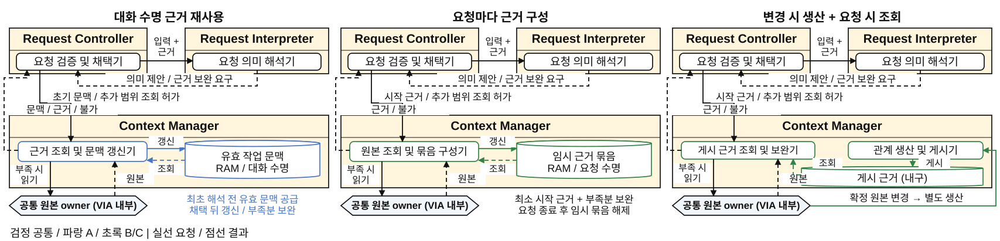
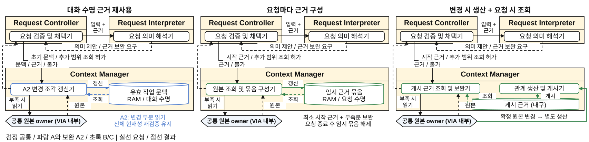
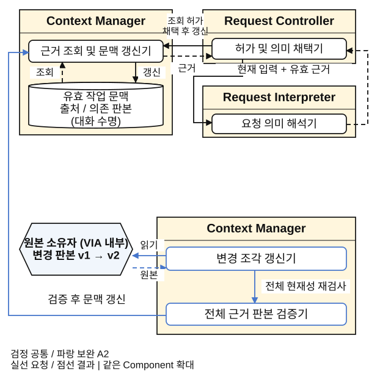
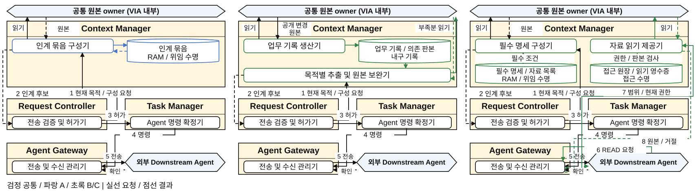
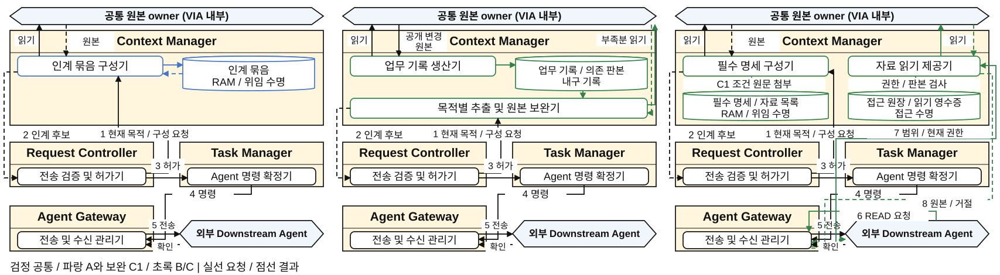
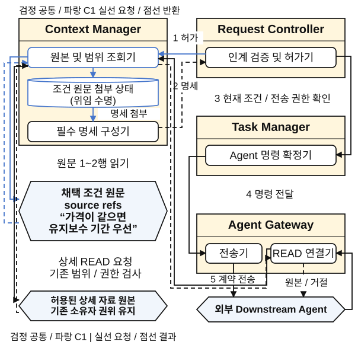
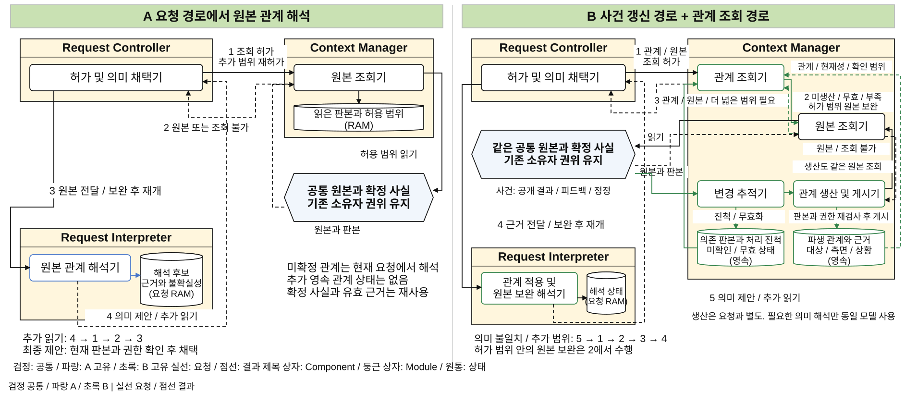
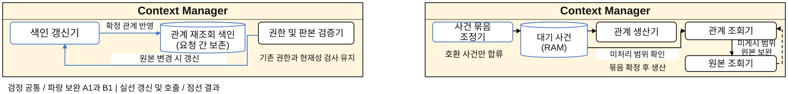

# 통합 발표 v10: 기존 DP 설계 그림의 가이드 정합성

> **2026-10-22 현재 편집 위치:** 사용자 확인 후 이 자료를 [네 DP 통합 패키지의 현재 기준본](../../current/design-review/README.md)으로 이관했다. 후속 수정은 새 위치에서 한다. 아래 내용과 기존 파일은 해당 판본의 출처 및 재현을 위해 보존하며 새 편집본과 동시에 갱신하지 않는다.

2026-10-22. DP44를 추가한 통합 발표 v9를 전체 검토하면서 DP1, DP2, DP4, DP5의 기존 구조 그림 11쪽을 현행 그림 기준에 맞춘 설계 설명이다. 기본안의 기능, QA 정의와 원값, 권고 및 미선택 상태를 바꾸는 작업이 아니다. 이번 그림 재작성으로 VIA 구현, 모델 실행이나 성능 측정을 새로 수행한 것으로 읽지 않는다.

판단 기준은 [INTENT](../../../../../../INTENT.md)와 [설계 대안 그림 작성 기준](../../diagram-design-guide.md)이다. 기존 판단과 평가 범위는 [발표 선택 계약](../16-presentation-selection-contract.md), [기존 발표 결과](../17-presentation-results.md) 및 각 DP의 설계 원문을 따른다. 이 문서는 같은 설계를 그림에서 추적할 수 있도록 보정한 책임, 인터페이스와 상태를 기록한다. 최종 파일의 패키지 보존, 렌더, Windows 검사와 Git 발행 결과는 별도 최종 검토 기록에서 확인한다.

## 1. 수정 범위와 그림 차례

v9의 전체 36쪽과 DP44 번호를 유지한다. DP1~DP5의 기존 본문 안에서 아래 구조 그림을 수정하며, DP44 24~30쪽과 역사 DP3 부록 31~36쪽을 새로운 설계로 재해석하지 않는다. DP3 10~12쪽의 v8 수정 계약은 [기존 DP3 문서](../dp3-grounding-architecture-20261021/README.md)에 유지한다.

비교 및 선택 페이지의 구조 칸, 보완 상세의 좌측 그림, DP5의 구조 비교와 보완 상태 영역이 대상이다. 같은 페이지의 장단점, QA 표, 근거 종류, 조건부 권고와 미평가 표시는 기존 내용을 보존한다. SVG와 draw.io는 수정한 구조 영역의 편집 원본이고, PNG는 해당 도식의 시각 확인 자료다. 통합 PPTX의 나머지 표와 설명은 기존 패키지에서 보존한다.

| 발표 쪽 | 수정한 그림 | 보존하는 판단 |
| --- | --- | --- |
| [2](#dp1-comparison) | DP1 기본 A/B/C의 근거 공급 | 같은 자료의 후속 재사용 조건에서 A 권고. QA01 A/B 우열 미확정 |
| [3](#dp1-selection) | DP1 선택 구조와 A2 표시 | A2는 재조회 감소를 확인한 보완 후보이며 큰 성능 개선으로 채택하지 않음 |
| [4](#dp1-detail) | DP1 기본 A와 A2 좌측 상세 | 별도 정정 사례의 보완 결과와 공통 첫 안내 실험을 합치지 않음 |
| [6](#dp2-comparison) | DP2 하나의 대화 실행과 요청별 실행 | 호출 여유와 겹친 독립 입력이 있는 조건에서 B 권고 |
| [7](#dp2-selection) | DP2 B 선택과 B1 불변 입력 공유 | 기본 실행 구조와 B1의 별도 재생 검증을 구별 |
| [8](#dp2-detail) | DP2 B1 좌측 상태 및 참조 구조 | 개별 가변 상태, revision과 복구 규칙은 유지 |
| [17](#dp4-comparison) | DP4 A/B/C의 구성, 허가, 명령과 전송 | 실제 읽기 지원 수신자에 조건부 C 권고 |
| [18](#dp4-selection) | DP4 C 선택과 C1 원문 첨부 | C1은 필수 조건 본문 누락 위험의 보완 |
| [19](#dp4-detail) | DP4 C1 좌측 상세와 기존 READ 경로 | 조건 출처를 새로 만드는 비용은 미측정이며 기존 원문 출처를 전제 |
| [21](#dp5-comparison) | DP5 원본 관계 해석과 사전 관계 생산의 보완 루프 | 설계 가설이며 미측정, 기본안 미선택 |
| [22](#dp5-tactics) | DP5 A1/B1 상태와 기본 원본 보완 | 두 보완 모두 미평가 후보이며 개선 수치를 추가하지 않음 |

## 2. 모든 그림이 유지하는 책임과 표현

### 책임과 확정 경계

- **Request Controller**는 현재 요청의 허용 범위를 확인하고 읽기 또는 재개를 허가한다. Request Interpreter의 결과는 제안이며, 현재 입력 판본과 근거, 권한을 확인한 뒤 의미를 채택한다. 채택한 인계 후보의 외부 전송을 허가하는 것과 실제 전송은 별도 사건이다.
- **Context Manager**는 허용 범위의 원본과 파생 자료를 공급한다. 원본을 읽을 때 현재 권한, 판본과 미확인 범위를 확인하며, 더 넓은 원본 범위를 요청자가 임의로 확장하지 않는다. 파생 관계와 작업 문맥의 보관은 원본 소유권을 이전하지 않는다.
- **Request Interpreter**는 현재 입력, 허용 근거와 해당 실행의 문맥으로 의미를 해석한다. 추가 원본이 필요하면 그 요구를 Request Controller에 반환한다. 해석기가 직접 권한을 승인하거나 Agent 명령을 보내는 선을 만들지 않는다.
- **Model Access**는 공통 모델 호출과 한도 관리를 담당한다. DP2의 여러 논리 실행은 같은 호출 자원을 공유하며, 실행마다 모델 가중치를 복제하지 않는다. DP1, DP4와 DP5에서 확대도 밖에 둔 모델 연동도 필요한 의미 가공에만 사용한다.
- **Task Manager**가 Agent 명령을 확정하고 **Agent Gateway**가 실제 외부 전송, READ 연결 및 수신 사실을 관리한다. 전송 시도, 수신 확인과 외부 업무 완료를 같은 사건으로 표시하지 않는다.

권한 검사, 현재 판본 확인과 부족한 원본의 보완은 공통 필수 계약이다. 이번 그림에서 이 경로를 새로 드러냈다는 이유로 선택적인 보완 효과나 새로운 모델 호출 비용으로 세지 않는다. 조회 불가, 철회와 모호성은 기존 제한 및 확인 절차로 반환한다. 불충분한 근거를 성공으로 채택하거나 이전 실패를 뒤늦은 정정으로 지우지 않는다.

### 표기와 실행 경계

제목 칸이 있는 크림색 상자는 정식 Component이고, 그 안의 둥근 상자는 내부 Module이다. 상자에는 이름을 쓰고 동작, 데이터, 조건은 연결선에 표시한다. 원통은 상태이며 소유 Component와 수명을 함께 읽는다. 육각형은 이번 확대도에서 내부를 펼치지 않는 원본 소유자, 모델 또는 외부 Agent다. `VIA 내부`라고 표시한 원본 소유자를 원격 서비스나 새 저장소로 바꾸지 않는다.

실선은 요청 또는 전달이고 점선은 결과 또는 반환이다. 선은 실제 Module 또는 상태의 경계에 닿는다. 중간 Component를 경유한다고 각주에만 적어 두고 그림에서 직접 우회하는 표현을 제거한다. 구조 비교에서 동작을 불필요하게 직렬화하는 번호는 강제하지 않는다. DP4와 DP5의 번호는 해당 그림에 명시한 요청 흐름에만 적용하고, 사건 기반 생산을 요청마다 실행하는 단계로 읽지 않는다.

검정은 공통 구성, 파랑은 A 고유 구조, 초록은 B 또는 C에서 교체한 구조다. 선택 및 보완 그림의 파랑 강조는 기존 A2, B1, C1 같은 보완 범례를 따른다. 색은 품질 점수나 측정된 승자를 뜻하지 않는다.

이번 11쪽은 논리 책임과 상태 수명을 보정한 확대도다. 별도 process, thread, 런타임 또는 모델 인스턴스를 추가한 배치 결정이 아니다. 같은 Component를 기본 구조와 확대 구조 또는 보완 전후에 반복한 경우 동일 책임의 다른 보기이며 동시 실행 인스턴스를 늘리지 않는다.

## 3. DP1: 최초 유효 문맥 공급과 허가된 원본 보완

[설계 원문](../01-evidence-supply.md)의 비교는 A/B의 작업 문맥 수명과 B/C의 별도 생산 책임을 구별한다. A와 C의 조합 가능성도 기존대로 남으며, 세 안을 완전히 독립적인 최적화로 계산하지 않는다.

A의 첫 해석은 `Request Controller → Context Manager의 유효 작업 문맥 조회 → Request Controller → Request Interpreter`로 연결된다. 이미 유효한 문맥을 첫 호출 전에 공급하는 A의 장점을 보존한다. 이전 문맥을 주지 않은 채 해석부터 실행하고 실패해야만 읽는 구조로 약화하지 않는다. 판본이나 권한이 바뀌었거나 근거가 부족할 때는 원본을 보완한다.

세 안의 공통 추가 조회는 `Request Interpreter의 보완 요구 → Request Controller의 범위 확인과 허가 → Context Manager의 읽기 → 원본과 조회 상태 반환 → Request Controller → Request Interpreter의 재해석`으로 닫힌다. 현재 범위를 넘으면 재허가가 필요하다. 이 반환과 확정의 중심이 Request Controller라는 사실을 실제 선으로 표시한다.

| 기본안 | Context Manager의 추가 상태 | 수명과 처리 |
| --- | --- | --- |
| A 유효 작업 문맥 유지 | 출처와 의존 판본이 있는 유효 작업 문맥 | 대화 수명의 RAM 상태. 처음 해석에도 공급하고 채택 뒤 갱신하여 다음 입력에서 재사용 |
| B 요청별 원본 구성 | 임시 근거 묶음 | 요청 수명의 RAM 상태. 공통 최소 시작 근거와 필요한 원본을 구성하고 요청 종료 뒤 임시 묶음 해제 |
| C 별도 생산 및 게시 | 게시 근거 | 요청과 별개 수명의 내구 파생 기록. 확정 원본 변경에서 생산하고 요청은 게시 근거를 조회. 미생산, 오류와 부족 범위는 원본으로 보완 |

C의 관계 생산 및 게시기는 확정 원본 변경에서 시작한다. 자유문 의미 해석이 필요할 때만 공통 모델을 사용하며, 미래 요청의 지칭 정답을 미리 안다고 가정하지 않는다. 게시 자료는 파생값이고 기존 원본 권위는 유지한다.

A2는 A의 Context Manager 안에서 변경 구간을 읽고 전체 근거 판본을 다시 검사하는 보완 경로다. 검사 결과를 기존 문맥 갱신기에 전달하며 영향 범위가 불명확하면 기존 전체 재구성으로 돌아간다. 별도 독립 Component나 새 내구 저장소를 추가하지 않는다. A2의 별도 정정 비교를 기본 A 전체 평균과 직접 연결하지 않으며, 다른 첫 안내 보완과의 결합 효과도 새로 주장하지 않는다.

### 3.1 발표 2쪽: 기본안 비교

[draw.io 원본](diagrams/dp1-v10-comparison.drawio) / [PNG](diagrams/dp1-v10-comparison.png)

### 3.2 발표 3쪽: 선택 및 보완

[draw.io 원본](diagrams/dp1-v10-selection.drawio) / [PNG](diagrams/dp1-v10-selection.png)

### 3.3 발표 4쪽: A와 A2 상세

[draw.io 원본](diagrams/dp1-v10-tactic-detail-left.drawio) / [PNG](diagrams/dp1-v10-tactic-detail-left.png)

## 4. DP2: 논리 실행과 공통 모델 호출을 분리

[설계 원문](../02-interpretation-execution.md)의 A는 하나의 대화 의미 실행을 이어 쓴다. 진행 중인 모델 또는 읽기 step이 끝나면 새 입력의 관계와 내용을 같은 문맥에서 판단한다. 앞선 요청 전체나 외부 Agent 업무가 끝날 때까지 기다리는 설계가 아니다.

B는 공통 대화 해석과 요청별 논리 실행을 분리한다. 공통 경로에서 짧은 답을 직접 반환할 수 있고, 긴 판단이 필요할 때 요청별 실행을 만든다. 모든 입력에 공통 해석 호출과 요청별 호출 두 개를 강제하지 않는다. 각 결과는 Request Controller의 반환 검증 및 채택기로 따로 돌아오며 모든 실행의 완료를 기다리는 합류 장벽이 아니다. 현재 관계와 맞지 않으면 필요한 재결합 또는 재판단을 요청한다.

각 해석 Module에서 Model Access의 모델 호출 및 한도 관리기로 실제 요청과 반환을 잇는다. A의 한 대화 실행과 B의 공통 대화 및 R1/R2 실행이 같은 모델 호출 한도를 쓴다는 점을 보인다. 호출 여유가 없으면 B의 병행 이익이 줄어든다는 기존 조건을 유지한다. R1/R2는 논리 실행이며 OS process 또는 모델 복제의 수가 아니다.

| 상태 소유자 | A | B 및 B1 |
| --- | --- | --- |
| Request Controller | 입력, 채택 목표와 판본 | 입력과 실행 ID의 대응, 목표와 판본, 변경 상태 |
| Request Interpreter | 대화 수명의 근거와 요청별 잠정 판단 | 공통 최근 문맥과 요청 참조, 실행별 가변 상태 및 입력 자료 |
| B1이 바꾸는 부분 | 해당 없음 | 실행별 불변 입력과 원본 사본을 공유 참조로 대체. R1/R2의 revision, snapshot, 대기 및 복구 상태는 개별 유지 |

B1은 기존 B의 입력 복제 부담을 줄이는 보완이다. 상태 공유 범위를 불변 자료로 제한한다. 별도 응답 재생의 메모리 관측을 기본 실측값의 전후 개선으로 연결하지 않으며, 새로운 QA01, QA03 또는 정확도 개선으로 확장하지 않는다.

### 4.1 발표 6쪽: 기본안 비교

[draw.io 원본](diagrams/dp2-v10-comparison.drawio) / [PNG](diagrams/dp2-v10-comparison.png)

### 4.2 발표 7쪽: 선택 및 보완

[draw.io 원본](diagrams/dp2-v10-selection.drawio) / [PNG](diagrams/dp2-v10-selection.png)

### 4.3 발표 8쪽: B1 상태 상세

[draw.io 원본](diagrams/dp2-v10-tactic-detail-left.drawio) / [PNG](diagrams/dp2-v10-tactic-detail-left.png)

## 5. DP4: 구성, 허가, 명령과 실제 전송

발표 DP4는 [Agent 간 업무 인계 설계](../05-agent-handoff.md)다. 발표 DP5와 번호를 혼동하지 않는다. 인계에 앞서 채택한 목표와 조건은 원래 권위에 남으며, 후보 자료의 생산이나 보관이 그 권위를 대신하지 않는다.

공통 인계 경로는 다음과 같다.

1. Request Controller가 현재 위임 목적의 자료 구성을 요청한다.
2. Context Manager가 인계 후보를 반환한다.
3. Request Controller가 현재 조건과 권한을 확인하여 전송을 허가한다.
4. Task Manager가 Agent 명령을 확정하고 Agent Gateway로 전달한다.
5. Agent Gateway가 실제 계약을 전송하고 외부 수신 사실을 확인한다.

A는 위임할 때 목적별 인계 묶음을 구성하며 기확보 원문과 유효 참조를 재사용한다. B는 공개 원본 변경에서 업무 설명과 관계를 생산해 내구 업무 기록으로 유지하고, 위임 시 목적별로 추출한다. **B의 목적별 추출 및 원본 보완기에서 원본 소유자로 가는 읽기와 반환을 직접 표시한다.** 기록이 부족할 때 반드시 재생산을 기다리게 하는 약한 B로 바꾸지 않는다.

C는 필수 명세와 자료 목록을 전달하고, 실제 읽기 기능을 지원하는 수신자가 상세 범위를 선택한다. 그림의 READ 경로는 `외부 Downstream Agent → Agent Gateway → Context Manager의 자료 읽기 제공기 → 허용 원본 → 같은 반환 경로`다. 읽기마다 범위와 현재 권한, 판본 및 철회를 확인하며 원본 또는 거절을 반환한다. 필수 목표와 조건까지 수신자가 원본에서 추측하게 하지 않는다.

| 상태 | 의미와 수명 |
| --- | --- |
| A 인계 묶음 | 위임 수명의 RAM 자료. 원본 자체나 기존 권위를 새로 소유하지 않음 |
| B 업무 기록과 의존 판본 | 반복 인계에 사용하는 내구 파생 기록. 생산과 추출, 부족한 원본 보완의 비용은 기존 평가 범위에 포함 |
| C 필수 명세와 자료 목록 | 위임 수명의 RAM 자료. 필수 조건은 VIA가 명시 |
| C 접근 원장과 읽기 영수증 | 허용 범위와 접근 수명 관리. 이번 도식에서 물리 저장 방식을 새로 확정하지 않으며 기존 재시작 복원과 유효성 재검사 계약 유지 |
| C1 조건 원문 첨부 상태 | 해당 위임을 위해 이미 채택된 조건의 원문을 사전 확보한 자료 |

C1은 기존에 조건 출처 참조가 있는 경우에만 원문을 미리 읽어 필수 명세에 첨부하는 보완이다. 새 조건 출처를 생산하는 기능이나 비용을 발명하지 않는다. Context Manager의 원본 조회, 첨부와 명세 구성, Request Controller의 허가, Task Manager의 명령 및 Agent Gateway의 전송을 실제 선으로 연결한다. 일반 상세 자료의 기존 READ 경로는 그대로 남는다. 이 보정은 최종 요청 의미를 새로 해석하는 추가 LLM 호출을 뜻하지 않는다.

### 5.1 발표 17쪽: 기본안 비교

[draw.io 원본](diagrams/dp4-v10-comparison.drawio) / [PNG](diagrams/dp4-v10-comparison.png)

### 5.2 발표 18쪽: 선택 및 보완

[draw.io 원본](diagrams/dp4-v10-selection.drawio) / [PNG](diagrams/dp4-v10-selection.png)

### 5.3 발표 19쪽: C1 상세

[draw.io 원본](diagrams/dp4-v10-tactic-detail-left.drawio) / [PNG](diagrams/dp4-v10-tactic-detail-left.png)

## 6. DP5: 조회, 원본 보완과 관계 게시를 구별

[DP5 설계 원문](../dp5-delegation-memory-20261020.md)의 질문은 위임 의미 이해에 필요한 미확정 과거 관계를 현재 요청에서 해석할지, 공개 사건 발생 시 파생 관계로 생산할지다. Agent의 도메인 계획이나 자동 Agent 선택 품질을 새로 이 비교에 넣지 않는다.

### A의 요청 경로

Request Controller의 조회 허가를 받은 Context Manager가 같은 공통 원본과 확정 사실을 읽고, 원본이나 조회 불가를 반환한다. Request Controller가 원본을 Request Interpreter에 전달하면 원본 관계 해석기가 현재 요청의 대상, 목적과 조건에 적용한다. 의미 제안 또는 추가 읽기 요구는 Request Controller로 돌아온다. 그림의 추가 읽기 루프는 `4 → 1 → 2 → 3`이며, 최종 제안의 현재성 및 권한을 확인한 뒤 채택한다.

A는 미확정 관계를 선제적으로 관리하는 추가 영속 저장소를 두지 않는다. 이것은 이미 채택한 사실, 유효 근거와 공통 원본을 버린다는 뜻이 아니다. 그림은 읽은 판본과 허용 범위, 해석 후보와 불확실성을 요청 처리의 RAM 상태로 구분한다.

### B의 요청 경로와 별도 생산

관계 조회기는 유효 관계와 현재성 및 확인 범위를 읽는다. 미생산, 무효 또는 부족 범위가 있으면 **현재 허가 범위 안에서 원본 조회기로 직접 보완**한다. 더 넓은 범위가 필요하면 Request Controller로 반환하여 재허가를 받는다. 현재 요청에 관계를 적용하다 의미 불일치나 추가 근거 요구가 생기면 `5 → 1 → 2 → 3 → 4`로 다시 해석한다. 조회 불가와 모호성을 정상 성공으로 채택하지 않는다.

별도의 사건 경로는 공개 결과, 피드백과 정정을 변경 추적기에 전달한다. 관계 생산 및 게시기는 같은 원본 조회 계약을 사용하고, 필요한 의미 해석에만 공통 모델 자원을 사용한다. 읽은 판본과 현재 권한을 재검사한 뒤 파생 관계를 게시한다. 이 사건 생산은 사용자 요청 처리 번호에 포함되지 않으며 요청마다 의무적으로 선행하는 단계도 아니다.

B가 추가하는 영속 상태는 파생 관계와 근거, 의존 판본 및 처리 진척, 미확인 또는 무효 상태다. 현재 요청의 해석 상태는 RAM으로 따로 둔다. 자료가 최신이라는 기술적 검사는 의미가 정확하다는 보장이 아니며, 원본이 같아도 의미 불일치가 있으면 기존 이의 및 보완 계약을 적용한다. 파생 자료는 원본의 권위를 대신하지 않는다.

A1은 요청으로 확인한 관계의 재조회 색인을 관리하는 미평가 후보다. 색인은 요청 사이에 보존하지만 이번 도식은 디스크 형식이나 재시작 복원 계약을 새로 정하지 않는다. B1은 호환되는 연속 사건을 묶는 미평가 후보다. 생산 전 대기 사건의 RAM 상태와 게시된 영속 관계를 구별하며, 미게시 범위를 기다릴 수 없는 요청은 기본 B의 원본 보완을 계속 사용한다. 보완 후보의 개선 수치나 기본안 선택을 추가하지 않는다.

### 6.1 발표 21쪽: 기본안 비교와 보완 루프

[draw.io 원본](diagrams/dp5-v10-query-and-fallback-loops.drawio) / [PNG](diagrams/dp5-v10-query-and-fallback-loops.png)

### 6.2 발표 22쪽: 미평가 보완의 상태

[draw.io 원본](diagrams/dp5-v10-tactic-state-fragments.drawio) / [PNG](diagrams/dp5-v10-tactic-state-fragments.png)

## 7. 평가와 근거를 바꾸지 않는 범위

이번 변경은 그림 표현과 설계 설명의 정합성 보정이다. 호출선, 상태 원통과 Module을 정확히 그렸다는 사실만으로 속도, 정확도, 비용, 변경 범위 또는 RAM의 수치가 개선됐다고 말하지 않는다. Component 수나 선의 수로 QA04를 재계산하지 않는다. 모델 또는 프로세스 배치를 새로 확정하거나 로컬 메모리 한도를 발명하지 않는다.

- DP1, DP2와 DP4의 기존 제한된 PoC, 별도 재생 및 보완 실험은 원래 결과와 분모, 실패 및 제외 경계를 유지한다. 별도 캠페인 수치를 기본안의 전후 비교로 연결하지 않는다.
- DP3와 DP44의 작성된 합성 근거를 실측으로 바꾸지 않는다. 이번 11쪽의 그림 수정은 그 합성 값의 재평가도 아니다.
- DP5는 기존대로 설계 가설이며 미측정과 미선택 상태다. A1/B1도 미평가 후보로 남는다.
- QA01의 첫 올바른 내용 표시와 단순 안내, QA02의 최초 지칭 집합 확정, 새 QA07의 최초 요청 의미 전체 확정을 구별한다. 이후 인계 누락을 QA02나 QA07로 재분류하지 않는다. 기존 N-R, N-H 등 별도 진단도 공통 정확도 QA로 이름만 바꾸지 않는다.
- 최종 렌더 및 파일 검사 결과는 표현과 패키지의 검증이다. 실제 VIA 실행, 모델 추론, native Windows PowerPoint의 화면 재현을 확인한 범위와 혼동하지 않는다.

## 8. 같은 원본에서 유지하는 산출물

| 원본 | 포함하는 수정 |
| --- | --- |
| [기본 구조 Scene](../../../../../../scripts/presentations/legacy_dp_structure_scenes.mjs) | DP1 2/3쪽, DP2 6/7쪽, DP4 17/18쪽의 비교 및 선택 구조 |
| [보완 상세 Scene](../../../../../../scripts/presentations/legacy_tactic_detail_fragments.mjs) | DP1 4쪽, DP2 8쪽, DP4 19쪽의 좌측 확대 그림 |
| [DP5 Scene](../../../../../../scripts/presentations/dp5_v10_grounding_loops.mjs) | DP5 21쪽의 조회와 보완 루프, 22쪽의 보완 상태 |
| [Scene 표기와 검증](../../../../../../scripts/presentations/dp3_v8_scene.mjs) | Module 소유, 실제 끝점, 직교 연결과 무관 노드 관통 검사에 사용하는 공통 구조 |

각 Scene의 식별자, Component 소유와 좌표, 연결 끝점에서 SVG, draw.io와 PPTX 도형을 함께 만든다. 기존 표와 숫자는 원본 발표 패키지의 보존 대상으로 관리한다. 새 SVG만 따로 편집하거나 PPTX 도형을 고친 뒤 원본과 문서를 그대로 두지 않는다. 이 문서의 그림 차례, 각 SVG 미리보기 및 draw.io와 PNG 링크도 함께 유지한다.
