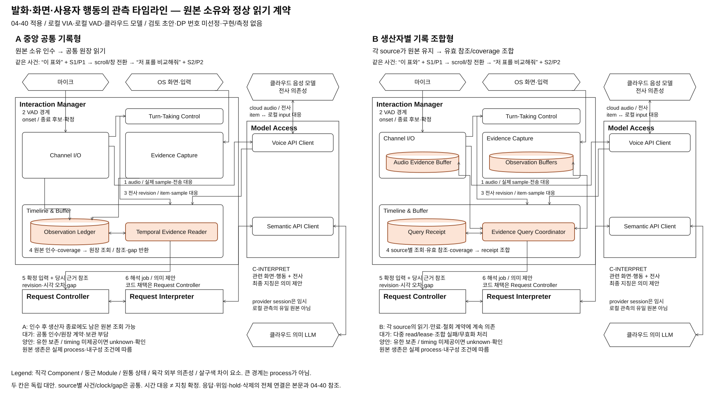

# 발화·화면·사용자 행동의 관측 타임라인 — 구조 대안 검토 초안

> **후속 논의 반영:** 중앙 기록 / 생산자별 기록 조합은 45와 비교축이 유사해 별도 주요 DP로 진행하지 않는다. 본문과 도식은 초기 탐색 이력 및 공통 관측 계약 참고로 보존한다. 사용자가 요청한 최신 확장 검토안은 기존 45를 보존한 [46](./04-46-input-and-context-evidence.md)이며, 요청별 근거 구성 / 공통 파생 근거 생산과 조회를 비교한다. 아래 미선정 표현은 초기 초안 당시의 상태다.

> 상태: **STRUCTURAL_EXPLORATION_DRAFT / 사용자 검토 전 / DP 번호·대안 미선정 / 구현·측정 없음** / 2026-10-09
> 적용 전제: [04-40 공통 실행 계약](./04-40-common-execution-contract.md). 04-40의 승인된 전제와 상세 계약 초안을 구별한다.
> 이번 요청: 발화 타이밍에 맞는 화면·pointer·click·drag·선택 근거의 구성 문제를 04-40 형식으로 정제한다. 기존 32 제외 결론을 유지하며 새로운 구조 검토를 별도 초안에 남긴다. 다른 세션의 41 수정, 공통 40, 기존 비교와 발표 package는 수정하지 않는다.

## 1. 문제와 비교 경계

사용자가 첫 문서의 표를 가리키며 **“이 표와”**라고 말하고, 스크롤하거나 창을 바꾼 뒤 두 번째 표를 가리키며 **“저 표를 비교해줘”**라고 한다. 전사는 화면 변경 뒤 도착하고 나중에 수정될 수도 있다. 요청 해석에는 문장 전체와 마지막 화면 하나가 아니라, 각 발화 구간에 대응하는 당시 관측이 필요하다.

고정 기능은 [UC-03·04](../../05-representative-use-cases.md#uc-04)다. 사전 선택, 복수 순차 지시, 원형 경로, drag, 집합과 단일 대상, 정정과 창 이동을 포함한다. 시간 대응은 의미 확정이 아니다. pointer 아래 객체가 의도한 대상인지, 경로가 의도적인 집합 지정인지, 어느 Task와 연결되는지는 Request Interpreter가 판단한다.

**이번 구조 질문은 “사라지는 관측의 원본을 공통 기록이 인수하고 읽기 계약을 제공할 것인가, 입력 생산자별 원본 소유를 유지하고 소비 때 여러 기록을 조합할 것인가”다.** 원본 인수, 정상 읽기 의존성, 임시 상태, 만료·철회와 복구가 달라지는 두 안을 비교한다. capture Hz, 매칭 알고리즘, watermark 대기값, thread·queue·SDK 선택과 process 수는 공통 또는 후속 tactic이다.

[32](./04-32-screen-grounding.md)는 동일한 기록의 Core/독립 runtime 소유 비교를 주요 후보에서 제외했다. 이번 B는 같은 기록 모듈의 process 이동이 아니라 **여러 원본 owner의 조회/보존 계약이 정상 읽기에 남는 구조**다. 이 차이가 중요한 품질에 충분히 큰 효과를 만드는지는 아직 미확인이다. 32의 제외를 번복하거나 새 DP 승격을 선언하지 않는다.

## 2. 04-40에 따른 공통 전제

| 항목 | 양안에 동일하게 적용할 계약 |
| --- | --- |
| 배치와 권위 | VIA와 관측 원본·입력 채택 권위는 로컬. 음성/전사와 의미 LLM은 Model Access를 통한 클라우드 의존성. 이전 공유 on-device Omni·독립 ASR 배치를 이번 안에 가져오지 않음 |
| 발화 경계 | Interaction Manager의 Turn-Taking Control에 로컬 VAD. 발화 시작, 종료 후보, 로컬 종료 확정, 원격 전사 완료를 구별. local stop은 네트워크나 근거 조회를 기다리지 않음 |
| 관측 범위 | 같은 OS 취득 수단, 지원 앱/화면, 유효 수집 범위, 시작 상태, 총보존 예산·시간 정밀도 사용. 04-40의 허용된 관측/pre-roll 범위를 공통 입력 조건으로 기록하며 길이·화면 상시 수집을 새로 확정하지 않음 |
| 기록과 모델 | capture·기록·sample mapping·시각 대응·coverage 확인은 코드. 관측마다 LLM을 호출하지 않음. 화면 의미/지칭 판단이 필요할 때 Request Interpreter가 C-INTERPRET 사용 |
| 음성 시간 근거 | Channel I/O의 로컬 sample 범위, Model Access의 실제 전송/resampling mapping, provider item ID와 전사 revision을 연결. 서버 도착 시각으로 단어 시각을 대체하지 않음 |
| 단어/구간 시각 | provider가 제공한 span timing의 방법·오차를 명시. 미제공이면 발화 전체만 대응 가능하며 복수 지칭의 정확한 시간 대응을 확보했다고 하지 않음. alignment helper는 미선정 의존성이고 양안 동일하게 적용해야 함 |
| 계속 입력 | 모델 응답·전사·근거 조회가 지연돼도 유한 buffer 안에서 다음 입력을 받음. 넘친 구간은 gap. capture 종료와 보관 만료는 별개 |
| 입력 채택 | Input + Evidence Record를 Interaction Manager가 생산하고 Request Controller가 확정 revision으로 채택. InputFinal은 의미 정확성이나 지칭 확정 선언이 아님 |
| 실행/응답 | 위임은 Task Manager·Agent Gateway, 실제 응답은 Response Manager·Interaction Manager. 입력 근거 원장은 Task/Command/Publication 원장이 아님 |

04-40의 새 전제가 이 초안의 우선 기준이다. [참조 §9](../target-architecture/architecture.md#9-contextcachestale-처리)의 timeline 계약은 기능·실패 설계의 참고로 읽으며 기존 모델 배치·보관 수치를 그대로 적용하지 않는다. 32의 발화 시작 수집 전제와 04-40의 허용된 pre-roll도 서로 다른 검토 시점으로 구별한다.

## 3. 메인 비교 — 같은 입력, 다른 원본 쓰기와 읽기

[편집 가능한 draw.io](./diagrams/input-evidence-timeline-structure.drawio) · [PNG](./diagrams/input-evidence-timeline-structure.png)

그림은 입력 근거 범위의 확대도다. A/B 각각 로컬 capture·VAD·전사 반환·관측 기록·시간 조회·Request Controller 채택·Request Interpreter의 클라우드 해석까지 자기 칸 안에서 연결한다. Model Access는 각 칸의 한 Component이며 내부 Voice API Client와 Semantic API Client는 두 역할이다. 차이 Module/상태만 살구색, Component 경계는 공통 흰색이다. 독립 서비스나 process는 선택하지 않는다. 응답/위임/hold의 나머지 실행 연결은 04-40을 따른다.

### 3.1 Component·Module과 상태 소속

아래 영문 내부 이름은 이번 초안의 설계 이름이다. 공통 정식 Component를 개명하거나 Module을 새 Component로 승격하지 않는다.

| Component / 공통 Module | A 중앙 공통 기록형 | B 생산자별 기록 조합형 |
| --- | --- | --- |
| Interaction Manager / Channel I/O | audio sample/time 생산. 관측 원장 인수 전 bounded 전달 buffer | Audio Evidence Buffer의 원본 소유. sample 구간 읽기·유효 참조·coverage·만료 제공 |
| Interaction Manager / Evidence Capture | 화면·입력 사건 생산. 원장 인수 전 bounded 전달 buffer | Observation Buffers의 원본 소유. 화면 기록과 pointer/click/drag/selection 기록은 각 sequence·coverage·수명 구별 |
| Interaction Manager / Turn-Taking Control | 공통 로컬 VAD·input boundary·즉시 stop | 같은 기능과 계약 |
| Interaction Manager / Timeline & Buffer | Observation Ledger와 Temporal Evidence Reader. 원장을 기준으로 시간 구간별 근거 읽기 | Evidence Query Coordinator와 Query Receipt. 생산자별 조회 결과를 잠정 조합. 중앙 원본 원장 없음 |
| Model Access / Voice API Client | 공통 cloud audio·전사 adapter, provider item/sample mapping·timeout·cancel·usage | 같은 계약. 업무 원본이나 과거 화면 owner가 아님 |
| Model Access / Semantic API Client | 공통 C-INTERPRET adapter | 같은 계약 |
| Request Controller | 확정 input revision, 의미/질문 채택 및 admission 원본 | 같은 권위. B의 원본 원장 역할을 대신 가져오지 않음 |
| Request Interpreter | 당시 근거를 읽어 지칭·의도·관계 등의 의미 제안 | 같은 의미 책임. 41 A/B를 이 문서에서 선택하지 않음 |
| Context Manager | Interaction Manager의 허용 읽기 계약을 사용해 목적별 근거 구성 | 같은 외부 port. 생산자 저장 구조를 직접 조회하지 않음 |
| Policy Manager / State Store | 실제 읽기·제공 권한/철회, owner별 내구 저장 수단 | 공통. RAM 원본의 무조건 재시작 복원을 약속하지 않음 |

### 3.2 A: 중앙 기록의 인수와 정상 읽기

1. Channel I/O와 Evidence Capture가 원본 또는 제한된 소유 참조와 source sequence·시각·gap을 Observation Ledger에 전달한다. Ledger가 **소유 인수와 실제 확보 범위**를 확인한 뒤 생산자는 전달용 자료를 회수할 수 있다.
2. Timeline & Buffer가 공통 전사 revision·provider item/sample mapping·clock epoch를 유지한다. Temporal Evidence Reader는 Observation Ledger의 음성·화면·입력 기록을 읽어 지정 시간 구간의 근거 묶음을 구성한다.
3. 관측 참조를 인수하더라도 생산자 재조회에 의존하지 않고 Ledger가 이후 읽기 수명을 책임져야 A다. 생산자만 살아 있어야 읽을 수 있는 handle을 중앙에 모은 정도라면 B에 가깝다.
4. 읽기 결과에는 읽은 원본 ID/revision, 확보 범위·누락·시각 오차와 유효 참조가 들어간다. 늦은 관측은 기존 기록을 덮지 않고 새 revision으로 반영한다.
5. 만료·철회·consumer 종료는 Ledger가 인수한 원본과 읽기 참조를 회수하는 계약으로 처리한다. 참조 보존이 정책 철회를 막지 못한다.

강한 A에는 분할 저장·zero-copy 소유 인수·선택적 조회·index·부분 갱신을 허용한다. 모든 화면/음성을 여러 번 복제하거나 모든 source를 한 전역 mutex로 막는 A를 만들지 않는다. 원장이 공통이라는 사실만으로 모든 source가 동시 취득됐다고 하지 않는다.

### 3.3 B: 생산자별 원본과 조합 읽기

1. Channel I/O가 Audio Evidence Buffer에 sample/time 원본을 보관한다. Evidence Capture가 화면 및 사용자 행동 기록을 Observation Buffers에 보관한다. 각 원본 저장의 수락·coverage·회수 권위는 해당 Module에 있다.
2. Timeline & Buffer는 전사 revision·provider item/sample mapping·clock epoch를 공통으로 유지한다. Evidence Query Coordinator가 필요한 구간을 음성/화면/입력 기록 소유자에게 조회하고 **유효 읽기 참조를 각각 획득**한다.
3. Coordinator는 source별 generation·revision·coverage·누락을 Query Receipt에 기록한다. 뒤늦은 자료나 만료·철회는 새 조합 revision 또는 명시적 오류로 반환한다. 서로 다른 source 조회를 한 공동 snapshot으로 표현하지 않는다.
4. consumer가 사용하는 동안 각 원본 owner가 유한 읽기 참조를 관리한다. Coordinator가 참조를 release하고, 실패한 coordinator의 참조는 owner가 상한에 따라 회수한다. 느린 consumer가 원본을 무한 보존하지 못한다.
5. Context Manager·Request Interpreter는 생산자별 내부 저장 계약 대신 Timeline & Buffer의 공통 외부 읽기 port를 사용한다. 조합 실패를 소비자마다 제각각 구현하게 하지 않는다.

B의 화면과 입력 기록이 같은 process에 있어도 두 source의 coverage·revision은 구별한다. 별도 process는 필수가 아니다. Coordinator가 장기적으로 모든 원본을 인수하고 유일한 읽기 기준이 되면 A로 전환한 것이다. 선택적 결과 cache는 B에도 허용하되 원본 owner의 철회와 만료를 따라야 한다.

### 3.4 같은 source 관측이 실제로 다른 경로를 타는 곳

| 계약 | A | B |
| --- | --- | --- |
| 원본 확보 완료 | Ledger가 소유를 인수하고 coverage 갱신 | 각 생산자 buffer가 보관 수락하고 자기 coverage 갱신 |
| 정상 과거 읽기 | Reader → Ledger | Coordinator → Audio/Screen/Input owner, 읽기 참조와 receipt 조합 |
| 만료·철회 권위 | 인수된 원본과 참조는 Ledger가 관리 | 각 source가 관리, Coordinator가 조합/파생 사본 무효화 |
| 읽기 중 생산자 종료 | 인수된 원본과 Ledger가 남으면 읽기 가능 | 해당 원본 저장의 생존/내구성에 따라 실패. process 배치만으로 판정하지 않음 |
| 결합 모듈 종료 | Ledger 원본 생존 범위에서 Reader 재구성 | source 원본 생존 범위에서 Coordinator/Receipt 재구성 |
| 새 source 추가 | 공통 원본 인수/표현/삭제 계약 확장 | 새 source의 read/coverage/lease/revocation adapter 추가 |

## 4. 데이터·시간·수명의 공통 계약 초안

| 자료 / owner | 최소 내용과 수명 |
| --- | --- |
| Observation Record / A Ledger, B 각 source | source ID·generation·monotonic sequence, clock domain/epoch, 사건 또는 capture 시작/끝·receive 시각·오차, window/display/document/viewport·좌표 변환 revision, 원본/locator, permission revision·gap. 생산자 교체 전후 sequence를 이어 붙이지 않음 |
| Audio Mapping / Channel I/O 생산·Model Access 변환 대응·Timeline & Buffer 이용 | 로컬 sample 범위/속도, 실제 전송 sample 범위/속도, resampling mapping·오차, provider session/item과 input ID. reconnect 전후 provider ID를 분리. Model Access는 adapter 대응을 소유하며 Input Record는 그 versioned 참조를 남김 |
| Transcript Revision / Timeline & Buffer 잠정·Request Controller 확정 | input ID/revision, 원문·대체 범위·final/failed 상태, provider item, 가능한 acoustic span/method/uncertainty. timing 없음은 `TIMING_UNAVAILABLE`; 수신 시각을 삽입하지 않음 |
| Temporal Evidence Result / Timeline & Buffer | 조회 구간·input/transcript revision, source별 실제 확보 범위·최종화 기준과 gap, clock mapping revision·uncertainty, 원본 ID/revision·읽기 참조. 시간 중첩 후보를 제공하며 의미상 referent 정답은 없음 |
| Read Reference / A Ledger, B 각 source | 원본 generation·허용 범위·expiry·release와 철회 epoch. 유효 참조는 일반 만료 중 읽기 유지에 쓰지만 보존 상한·접근 철회를 무시하지 않음 |
| Input + Evidence Record / Interaction Manager 생산 → Request Controller 채택 | 04-40 §5의 필드와 위 결과 참조. `SEALED` 뒤 변경은 새 revision으로 보고하며 오래된 의미 job 무효화. 메타데이터만 저장했다고 원본까지 복구 가능하다고 하지 않음 |

화면 capture는 한 순간의 완전 동시 snapshot을 보장하지 않을 수 있으므로 capture 구간·오차를 보존한다. click/drag/selection은 화면의 같은 숫자 좌표만으로 연결하지 않는다. pointer 경로를 단일 최신 위치로 축약하면 원형·drag UC를 잃을 수 있다. 단순 이동과 의도적인 범위 지정의 구분은 의미 판단으로 남긴다.

watermark는 source가 해당 범위까지 결과/공백을 보고했다는 최종화 근거다. **그 범위의 무손실 보증이 아니며**, gap과 함께 읽는다. 실제 대기 한도까지 source 상태를 확보하지 못하면 그 source의 coverage를 unknown/gap으로 표시한다. clock 재설정·sleep·장치 교체에는 새 epoch와 mapping이 필요하고 연속성을 확인하지 못한 범위는 gap이다.

물리 보관은 양안 모두 유한 RAM을 기본 비교 조건으로 두고 같은 선택적 내구 보관을 별도 조건으로 비교한다. producer staging, 원장/버퍼, 조합 결과·cache·lease metadata와 cloud 전송용 사본을 총자원에 포함한다. 삭제된 원본은 현재 화면이나 LLM 기억으로 복구하지 않는다.

## 5. 같은 입력의 정상·정정·실패 흐름

E 번호는 사용자 사건 순서다. 그림의 1~6은 입력 경로 번호이며 고정 직렬 실행 순서가 아니다. 상대 시각은 설명용이고 측정값/대기 목표가 아니다.

| 사건 | A | B | 공통 소비 결과 |
| --- | --- | --- | --- |
| E1 발화 시작, 첫 표 지시 | VAD input ID, Ledger에 당시 화면 S1/행동 P1/audio 확보 | 같은 input ID, 각 source에 S1/P1/audio 확보 | input onset·hold/local stop는 공통. Task 연결 미정 |
| E2 “이 표와” 발화 | 해당 sample 구간과 S1/P1을 Ledger에 유지 | 각 source 기록에 유지 | 전사 도착 전에 관측 확보. 단어 timestamp는 아직 있다고 가정하지 않음 |
| E3 scroll/창 이동, “저 표를 비교해줘” | S2/P2와 전환 사건을 같은 원장에 추가 | 화면/입력 source가 각 기록 갱신 | S1과 S2의 viewport/document·시간 구별 |
| E4 종료 확정, 늦은 전사 final | Model Access mapping → Reader가 Ledger 구간 조회 | 같은 mapping → Coordinator가 source별 참조/coverage 조회 | timing이 있으면 두 acoustic span에 당시 관측 후보 제공. timing 없고 대상 순서를 확정할 근거가 부족하면 확인 질문 |
| E5 실제 의미 처리 | Request Controller input revision 채택 → Request Interpreter | 같은 경로 | C-INTERPRET에서 지칭·비교 역할 판단. 충분한 당시 근거와 모호한 근거 구별 |
| E6 전사 수정 또는 늦은 S1 관측 | 새 Ledger/입력 revision, 영향 구간 다시 읽기 | 새 source/Receipt/입력 revision, 영향 source 다시 조회 | 전송 전 오래된 job/admission 무효화 후 재판단. 이미 외부 전송됐으면 후속 정정으로 처리하며 rollback을 주장하지 않음 |
| E7 새 발화/해석 취소 | 옛 consumer 해제, 공통 보존 한도 안에서 원본 재사용 | 옛 source 참조 해제, 같은 한도 안에서 원본 재사용 | 취소된 job 결과 채택 금지. 취소가 무관한 관측 삭제나 Task 취소는 아님 |
| E8 일부 source 지연/유실 | Ledger에 실제 접수 coverage/gap | Coordinator에 source별 실제 coverage/gap | missing을 무한 대기로 숨기지 않고 관련 지칭 보류/질문 |
| E9 네트워크/전사 실패 | 로컬 Ledger 관측은 범위 안에서 유지 | 로컬 source 관측은 범위 안에서 유지 | 원격 전사 성공 없이 InputFinal을 만들어 의미 전송하지 않음. bounded 재연결, overflow gap, text/재발화 안내 |
| E10 만료 중 조회/권한 철회 | Ledger 읽기 참조 검사·폐기 | 각 source 참조 검사, 조합/cache 폐기 | 후속 cloud 업로드·채택에도 정책 epoch 검사. 이미 제공한 원격 사본 삭제 능력은 provider 계약 별도 미확인 |
| E11 원본 owner crash/PC 재시작 | RAM Ledger 소실 가능 | 해당 source RAM 소실 가능 | 같은 내구성 조건으로 비교. 다른 process라고 자동 생존 주장 금지; 확보 못한 자료는 `EVIDENCE_LOST` |

모호함을 질문으로 처리한 것은 원래 요청 완료 성공이 아니다. timing 미지원으로 복수 지칭을 처리하지 못한 경우도 V-03 기능 손실과 사용자 재지칭 부담으로 남긴다.

## 6. 모델 호출·cloud payload·비용 지도

| 역할 / owner | A와 B의 공통 호출 조건 | 실제 입력과 비용 |
| --- | --- | --- |
| C-VOICE-IN / Interaction Manager → Model Access | 지속 음성/설정 전사. 기록 구조만 바꿨다고 호출을 없애지 않음 | 같은 실제 audio·전사 역할/usage. 로컬 sample과 실제 전송 중복·retry를 대응. session context는 로컬 업무 원본 아님 |
| capture/기록/시간 조회 / Interaction Manager | **모델 호출 없음**. A 원장 쓰기·읽기 / B source 쓰기·조회·참조 조합 | 로컬 CPU/RAM/복사·저장/IPC를 따로 기록. IPC는 배치 시 생기며 B에 필수 WAN은 없음 |
| C-INTERPRET / Request Interpreter → Model Access | 당시 화면/행동 후보를 포함한 의미 판단이 필요할 때 | 같은 관련 화면 이미지/영역·행동 구간·전사/span·uncertainty만 허용 제공. B의 여러 source를 여러 LLM 호출로 나눌 필요는 없음 |
| C-CONTEXT / Context Manager, 필요 시 | 별도 자유문 의미 가공이 필요한 경우 | 구조적 시간 join만으로 추가 호출을 만들지 않음. 45 배경 생산을 이번 관측 생산에 섞지 않음 |
| C-RESPONSE / Response Manager, 필요 시 | 확인 질문·직접 설명 내용 준비 | 정형 실패 안내는 template 가능. 질문과 재지칭에 따른 추가 해석/음성 비용도 포함 |
| C-VOICE-OUT / Response Manager → Model Access | 준비된 응답을 음성으로 제공할 때 | 실제 음성 job·usage/cancel/stale와 전달 receipt는 04-40 계약. 모델 생성과 실제 전달 구별 |
| alignment helper / 미선정 | provider span timing이 부족할 때 추가 필요성 검토 | local/cloud 위치·실제 호출·audio 보관·추가 네트워크·자원/요금 모두 미결. 양안에 같은 helper 조건 제공; 이미 확보된 기능으로 표시하지 않음 |

**A/B 저장 구조 자체로 모델 호출 수·요금의 우위를 주장하지 않는다.** 같은 근거와 의미 workload이면 cloud payload와 C-INTERPRET 비용은 같게 구성할 수 있다. 차이가 생기는 경로는 근거 손실/조합 실패로 인한 재전사·재해석·clarification, serialization payload·재업로드와 cache 적용의 실제 차이다. 장기 원본을 cloud에 모두 복제하는 전제는 없다.

Model Access는 04-40의 call/job/role ID·input/source revision·provider/model/version·send/first/terminal 시각·status/usage와 단가 version을 기록한다. 청구된 stale·cancel·retry도 남긴다. 사용량 미제공은 0원이 아니다. provider별 실제 pricing·timing 기능·API 채택은 이 문서에서 조사하거나 확정하지 않았다.

시간은 actual speech end, 로컬 종료 판정, 전사 final, source 확보/조회, input 채택, 의미 job·추가 읽기, 음성 생성과 실제 출력으로 나눈다. 겹친 구간은 단순 합하지 않고 네트워크 지연을 임의로 빼지 않는다. 기존 [측정 endpoint 계약](../../11-measurement/event-boundary-contract.md)은 보존하고 새 cloud 구성의 실제 freeze는 하지 않는다.

## 7. 중요한 품질과 V-01~13의 조건부 비교

기준은 [03-00의 13개 관점](./03-00-quality-scenarios.md#2-어떤-품질을-보고-있는가)과 04-40의 모델 비용이다. 기존 QA 정의·우선순위/diagnostic 지위를 이번 초안에서 바꾸지 않는다. 아래는 측정 결과나 점수가 아니다.

| 관점 | A와 B의 실제 품질 경로·비용과 미확인 |
| --- | --- |
| V-01 기능 정확성 | 같은 관측·timing이면 시간 후보의 정보량은 같을 수 있음. A는 인수 누락, B는 source별 조회/만료 불일치가 근거 손실을 만들 수 있음. 소유 구조 자체가 의미 정확도를 높이지 않음 |
| V-02 기능 적절성 | 실제 확보했지만 읽기 경로에서 잃은 근거가 재지칭·질문을 늘림. 같은 근거를 정상 공급한다면 사용자 단계 차이를 주장할 수 없음 |
| V-03 기능 완전성 | 양안 모두 UC-03·04의 변형을 목표로 함. 단어 timing 미확보·원형 경로 손실·source 미지원의 부분 지원 공개. A/B 저장 구조와 provider 지원 한계를 구별 |
| V-04 상호작용 반응성 | A의 원장 인수와 B의 source 참조/조합이 입력 준비 경로에 추가하는 대기 비교. 양안 비동기·부분 조회 허용. local stop 경로는 동일 |
| V-05 VIA 귀속 요청 완료 시간 | 늦은 전사 대기는 공통. 실제 source read/재조합·근거 실패 질문·재해석이 전체 경로에 미치는 차이만 비교. cloud 왕복과 overlap 포함 |
| V-06 자원 활용성과 수용량 | A의 인수 기록/index와 B의 개별 buffer/lease/receipt/결과 cache 비용. A zero-copy, B 공통 reader/cache 허용. 동일 총예산에서 backlog와 유실을 비교 |
| V-07 결함 허용성과 복구성 | A 인수 후 생산자 종료, B 조합자 종료에서 살아 있는 원본을 이용할 조건이 다름. 동일 process/내구성에서는 함께 사라질 수 있음. 독립 장애 배치를 별도 조건으로 공개 |
| V-08 변경 용이성과 모듈성 | 새 입력 source·time 표현 변화가 A의 공통 인수/원장 계약 또는 B의 read/coverage/lease adapter에 퍼짐. A도 extensible records, B도 공통 facade 가능. 단순 상자 수로 비교하지 않음 |
| V-09 분석 및 시험 용이성 | A의 인수 기록으로 보관 시점 확인, B의 source receipt로 query 시점 확인. 양안 sequence·clock/gap 추적은 필요. 그 기록의 자원/보관 비용도 포함 |
| V-10 기밀성 | A는 인수 원본/읽기 참조·파생 사본, B는 source별 원본/lease·조합 사본의 철회 전파. 같은 허용범위로 비교. cloud 제공/삭제는 별도 실제 계약 필요 |
| V-11 상호운용성과 공존성 | provider timing/resampling·OS 좌표 계약을 보존하는 공통 adapter 필요. A 인수 부하/B 다중 조회 부하가 다른 앱과 공존에 미치는 효과는 미측정 |
| V-12 조작 용이성과 사용자 오류 방지 | 당시 지칭과 현재 Action 대상 검증을 분리. 같은 좌표의 새 화면이나 모호한 후보로 자동 실행하지 않음. 적절한 재지칭 안내는 공통 의무 |
| V-13 설치 용이성 | 추가 서비스·helper 설치를 어느 안에도 필수로 두지 않음. 같은 로컬 프로그램 배치라면 설치 차이를 만들지 않음. helper/process 추가 시 실제 dependency 공개 |
| 모델 호출 비용 / 04-40 | 기본 cloud 역할은 같음. 실제 재해석·재전사·질문·업로드/usage 차이가 생길 때만 금액 차이를 주장. 기존 QA에 신규 비용 ID를 임의 부여하지 않음 |

중요 검토 순서는 당시 대상·역할을 판단할 근거의 정확한 보존/공급, 유효 응답까지의 대기, 총자원·호출 비용, 계약 변경과 복구다. 단일 weighted score로 축을 합치거나 중요하지 않은 장애 예시 하나로 주요 DP를 정당화하지 않는다.

## 8. 앞서 제안한 네 방향의 정제 결과와 가장 싼 전환

| 채팅 제안 | 이번 초안의 처리 | 이유 |
| --- | --- | --- |
| 중앙 공통 관측 기록 | A로 상세화 | 실제 원본 인수·정상 읽기·만료 권위가 공통 Ledger에 있음 |
| 생산자별 기록 연합 조회 | B로 상세화 | 각 원본 owner의 조회·coverage·유효 참조에 정상 소비가 의존 |
| 입력 구간별 복합 기록 | **A/B에 적용 가능한 기록/view tactic으로 보류** | turn별 묶음·revision만으로 원본 소유/읽기 의존성을 바꾸지 않음. 별도 원본 인수로 중앙화하면 A의 구현이 될 수 있어 세 번째 주요 대안으로 부풀리지 않음 |
| 복합 관측을 모델에 직접 입력 | **이번 관측 타임라인 주 비교에 포함하지 않음** | 04-40의 로컬 입력 근거/코드 연결과 달리 모델에 시간 대응 책임까지 넓히며 41/43 의미 해석과 겹침. 현재 승인된 cloud의 span/video/event 처리 capability를 확인하지 않음. 복합 payload 제공은 양안 C-INTERPRET에도 가능하므로 그 자체는 독립 구조가 아님 |

| 가장 싼 보완/전환 | 실제로 얻는 것과 남는 차이 |
| --- | --- |
| A의 선택적 읽기·source별 shard·zero-copy | B의 불필요한 복사/읽기 감소 이익 일부를 얻을 수 있음. 인수 원본의 수명·폐기·정상 읽기 권위는 Ledger에 남음 |
| B의 공통 query facade·일괄 lease·결과 cache | 소비자의 다중 source 결합 부담/반복 조회를 줄일 수 있음. 원본 만료·철회와 읽기 성공은 source owner에 의존 |
| A에서 원본을 생산자에게 남기고 Ledger를 참조 목록으로 축소 | source별 read/coverage/lease/revocation 계약과 실패 처리 도입. 인수와 source 종료 계약을 바꾸므로 B 전환. 단순 포인터 저장과 구별 |
| B에서 Coordinator가 모든 유효 원본을 인수 | 생산자의 과거 조회 계약을 정상 경로에서 제거하고 중앙 수명/폐기 권위로 이행하면 A 전환. cache 추가만으로 원본 권위가 이전되지 않음 |
| 일부 source만 중앙 인수 | 현실적인 혼합. 중앙/분산 source별 owner·coverage·철회 및 읽기 비용을 공개. 양안 이익을 무료로 동시에 얻었다고 하지 않음 |

전환 시 원본을 다시 취득해 과거를 채울 수 없다. 기존 구간은 옛 owner에서 만료까지 drain하거나 유효 자료와 참조를 명시적으로 이전한다. 동일 원본의 회수 권위를 두 곳에 동시에 두지 않는다.

**작성자 판단:** A/B는 실제 저장/읽기 계약의 차이가 있어 검토 가능한 후보지만, 주요 DP로 남길 중요 품질 영향은 아직 입증하지 않았다. 정상 UC workload에서 강한 A의 인수/읽기와 강한 B의 참조/조합이 비슷한 대기·자원·정확성을 보이면 공통 상세 설계로 정리할 수 있다. source별 보존/변경 계약 때문에 차이가 반복적으로 나타나면 독립 구조 비교의 근거가 된다. 현재 승자와 새 DP 번호를 선택하지 않는다.

| 안 | 유리할 수 있는 조건 | 감수할 비용 | 선택 근거를 반박하는 조건 |
| --- | --- | --- | --- |
| A | 복수 해석·정정이 같은 원본을 반복 사용하며 생산자 과거 조회의 가용성과 수명을 소비 경로에서 제거할 가치가 큼 | 소유 인수/공통 표현·회수 계약, 원장 유지 및 ingestion 실패 처리 | B의 공통 facade·유효 참조만으로 같은 근거 제공/수명과 대기를 더 낮은 총비용에 얻음. A의 인수/표현 변경 비용이 지속적으로 커짐 |
| B | 입력 경로마다 원본 표현·읽기/삭제 계약이 독립적으로 바뀌고 그 저장 기능을 유지할 실질적인 가치가 큼 | source별 read/lease·coverage·철회 조정, 조합 실패와 조회 중 만료 처리 | A의 source별 shard/typed reference로 같은 변경 범위와 자원 사용을 저렴하게 얻음. B의 분산 읽기가 정상 UC의 근거 손실·재지칭/지연을 반복적으로 증가시킴 |

이 조건들은 검토할 가설이다. 생산자 종료나 coordinator crash의 조건부 이익만으로 정상 사용의 주요 품질 영향을 입증했다고 하지 않는다. 이후 검증이 승인되면 같은 관측·타이밍/오차·source 변화·보존 예산·cloud 조건을 고정하고 실패도 보존해야 한다.

## 9. 41·42·43·44·45와 연결되는 port

| 비교 | 이번 초안의 출력과 남는 경계 |
| --- | --- |
| 41 | 같은 Input + Evidence Record와 temporal read port를 제공. 모델/코드 어느 안도 최종 referent가 미리 확정된 입력을 받지 않음. 원본이 만료됐으면 조회 실패를 받으며 모델의 조회 반복으로 과거를 복원하지 않음 |
| 43 | 지칭 대상 생산의 입력 근거. 시간 후보/관측과 F2의 의미 제안을 구별. 이번 cloud 전제로 43 전체를 동기화한 것으로 표시하지 않음 |
| 44 | InputStarted, InputFinal/new revision, evidence ready/gap/failure를 기존 owner 사건으로 반환. A/B 어느 실행 조직에도 동일 port 제공. InputFinal이나 source watermark가 InputSettled/응답 게시 허가를 대신하지 않음 |
| 45 | 현재 transient 원본은 Interaction Manager 소유. Context Manager는 목적별 허용 읽기/파생 자료 관리. 원본을 장기 기억에 자동 승격하거나 과거 관계 게시로 누락 화면을 메우지 않음 |
| 42 | 입력/근거 소유 Component의 배치를 결정할 때 read port와 참조 수명/세대 재연결 고려. 원본 source별 분리와 대화/업무 서비스 분리는 독립 축. 42B+44 전송 경합의 미결 프로토콜은 그대로 미결 |

## 10. 사용자 리뷰 쟁점과 검증 범위

1. **기능 경계:** 당시 관측 제공과 지칭 의미 판단의 구분이 UC-03·04를 충분히 설명하는가?
2. **구조 차이:** A의 소유 인수와 B의 source별 read/lease 의존성이 실제 계약 차이인가? 같은 내부 library와 view만으로 저렴하게 환원되는가?
3. **중요성:** 정상 화면 지칭·정정 workload에서 반복적으로 나타날 품질 손익이 있는가? process crash나 box 개수만으로 major 후보를 주장하지 않았는가?
4. **cloud 시간 근거:** 단어 timing을 확보할 실제 dependency와 비용은 미결이다. 이를 원본 저장 대안의 정확성 우위로 숨기지 않았는가?

코드/schema·capture API·provider·helper·수치·process 배치·내구 저장과 비용 freeze는 미선정이다. 본문과 그림의 문서 검증 결과는 [검수 기록](./input-evidence-timeline-review-notes.md)에 남긴다. 검토 통과를 사용자 승인, 구현 성공, 모델 capability 확보나 품질 측정으로 표현하지 않는다.
