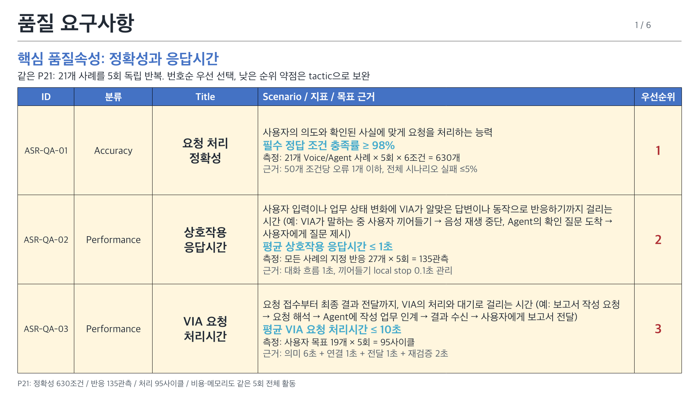
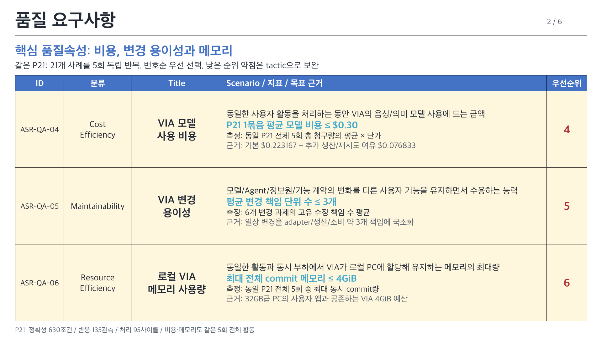
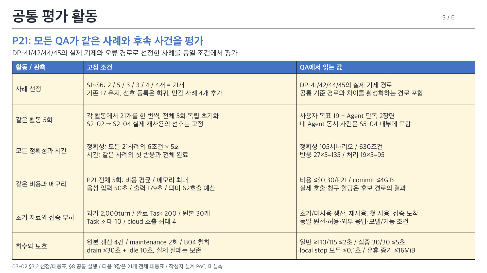
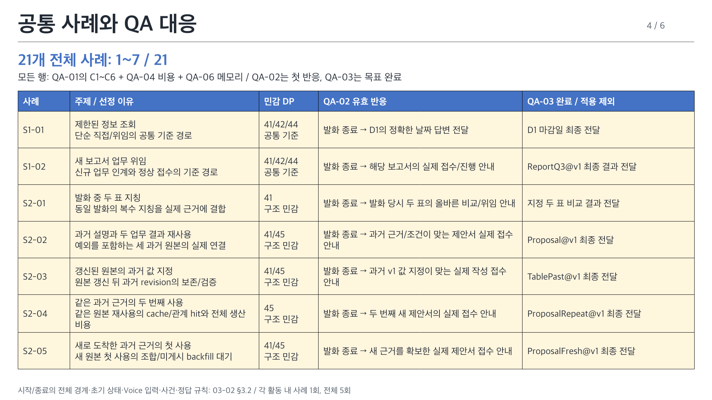
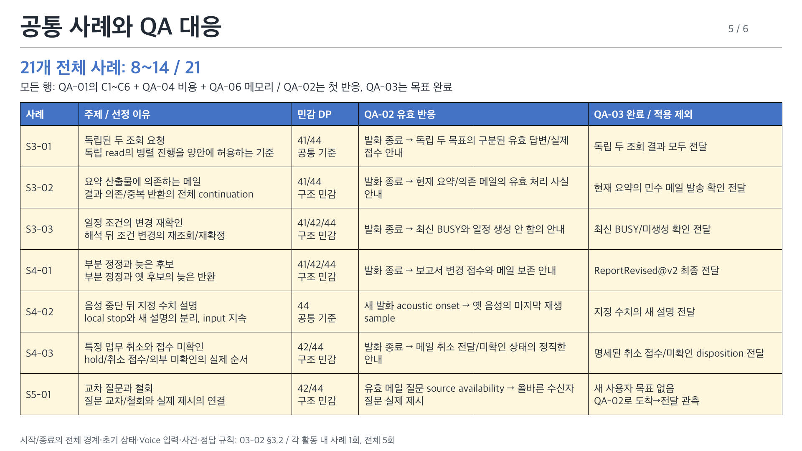
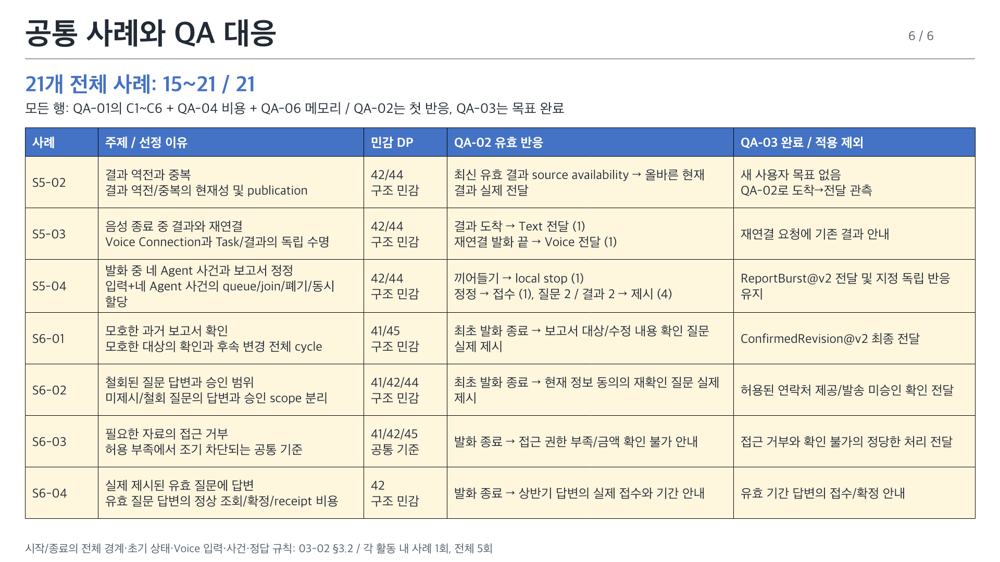

# VIA 중요 품질속성 발표 요약

[정의 원본 03-02](../architecture/12-decisions/decision-packages/03-02-quality-attribute-definitions.md)의 ASR-QA-01~06을 세 장으로 요약한다. 번호순 우선순위는 01 → 02 → 03 → 04 → 05 → 06이며 낮은 순위의 약점은 tactic으로 보완한다.

> ASR-QA-v6 / 2026-10-11 / 작성자 정의와 참조 계산. 후보 성능과 Windows 실측 결과는 아직 없다.

[편집 가능한 PPTX, 6장](quality-attributes/VIA-quality-attributes.pptx) / [PNG 미리보기](quality-attributes/index.html) / [QA별 근거와 등급, 6장](quality-metrics.md)

| ID | 이름 | 정의 | 대표 측정 지표 | 목표값 | 과제 차원의 목표 근거 |
| --- | --- | --- | --- | --- | --- |
| ASR-QA-01 | 요청 처리 정확성 | 사용자의 의도와 확인된 사실에 맞게 요청을 처리하는 능력 | 필수 정답 조건 충족률(%) = P21의 21개 × 5회 × C1~C6, 630조건 | 98% 이상, 정답 618/630 이상 | 조건 오류 50개당 1개 이내. 전체 시나리오/상황군/조건 유형 ≥95%, 필수 위반 0건. 재사용·동시 부하·최종 tail도 채점 (§3) |
| ASR-QA-02 | 상호작용 응답시간 | 사용자 입력이나 업무 상태 변화에 VIA가 알맞은 답변이나 동작으로 반응하기까지 걸리는 시간 (예: VIA가 말하는 중 사용자 끼어들기 → 음성 재생 중단, Agent의 확인 질문 도착 → 사용자에게 질문 제시) | 평균 유효 반응시간(초) = 전 21개 사례의 지정 반응 27개 × 5회, 135관측 | 1.0초 이하, 모든 local stop 0.1초 이하 | 대화 흐름 유지의 1초/즉각 제어 0.1초 참조. 일반 반응 2초 이내 ≥95%, 집중 도착 5초 이내, 미전달 0건. 모든 사례의 적용 경계를 대응표로 공개 (§4) |
| ASR-QA-03 | VIA 요청 처리시간 | 요청 접수부터 최종 결과 전달까지, VIA의 처리와 대기로 걸리는 시간 (예: 보고서 작성 요청 → 요청 해석 → Agent에 작성 업무 인계 → 결과 수신 → 사용자에게 보고서 전달) | 평균 VIA 귀속 사이클 시간(초) = 사용자 목표가 있는 19개 × 5회, 95관측 | 10초 이하 | 의미6 + 연결1 + 전달1 + 재검증2초의 작성자 예산. 15초 이내 ≥95%, 미전달 0건. Agent 발신 두 사례는 QA-02에 적용 (§4) |
| ASR-QA-04 | VIA 모델 사용 비용 | 동일한 사용자 활동을 처리하는 동안 VIA의 음성/의미 모델 사용에 드는 금액 | P21 1묶음 평균 총 모델 비용(USD/P21) = 동일 활동 5회 총액의 평균 | $0.30/P21 이하 | 동일 21사례의 의미 62호출/음성 입력 50초/출력 179초 예산에서 기본 $0.223167, 여유 $0.076833. 호출·출력은 작성자 가정이며 실제 사용량으로 대체 (§5) |
| ASR-QA-05 | VIA 변경 용이성 | 모델/Agent/정보원/기능 계약의 변화를 다른 사용자 기능을 유지하면서 수용하는 능력 | 평균 변경 기능 책임 단위 수(개/과제) = 6개 변경의 고유 수정 책임 수 합/6 | 평균 3개 이하, 과제별5개 이하 | adapter/생산/소비 약3개 책임에 일상 변경을 국소화. 동일 U01~18 registry와 기존 기능/권한/P21 회귀 유지 (§6) |
| ASR-QA-06 | 로컬 VIA 메모리 사용량 | 동일한 활동과 동시 부하에서 VIA가 로컬 PC에 할당해 유지하는 메모리의 최대량 | 최대 전체 commit 메모리(MiB) = 동일 P21 5회 중 전체 process/고유 공유 allocation 동시 합 최대 | 4,096MiB(4GiB) 이하 | 32GB급 Windows PC의 OS8/업무앱16/VIA4/여유4GiB 계획. 공통 allocation1792 + 추가여유2304MiB, 실제 RAM residency와 구별 (§7) |

**공통 P21:** 메커니즘과 오류 경로로 선정한 21개(상황군별 2/5/3/3/4/4)를 5회 독립 초기화한다. 모든 실행을 정확성에 채점하고 같은 장면의 27반응/19사이클을 관측한다. 비용은 같은 5개 활동 평균, 메모리는 같은 5개 활동 최대다. 실제 일일 사용 빈도를 주장하지 않는다.

정확성 105시나리오/630조건, 반응 135관측, 처리 95사이클이다. 입력 음성 50초/출력 179초와 의미 62호출은 예산이고 실제 사용량으로 대체한다. 초기 자료, 재사용, 네 사건 집중 도착, 미사용 생산/철회도 모두 포함한다.

## 모든 사례의 QA 대응표

전부 정확성 C1~C6와 비용/메모리에 포함한다. 아래 QA-02는 사건별 첫 반응, QA-03는 사용자 목표의 완료다. S5-01/02만 새 사용자 목표가 없어 QA-03에 적용하지 않는다. [21개 상세 명세](quality-attributes/functional-coverage.json), [평가 규모](quality-attributes/evaluation-plan.json), [원문 연결](quality-attributes/measurement-design.md)을 따른다.

| 사례 | 주제 | 선정 이유 / DP | QA-02 | QA-03 |
| --- | --- | --- | --- | --- |
| S1-01 | 제한된 정보 조회 | 단순 직접/위임의 공통 기준 경로; 41/42/44 | 발화 종료 → D1의 정확한 날짜 답변 전달 | D1 마감일 최종 전달 |
| S1-02 | 새 보고서 업무 위임 | 신규 업무 인계와 정상 접수의 기준 경로; 41/42/44 | 발화 종료 → 해당 보고서의 실제 접수/진행 안내 | ReportQ3@v1 최종 결과 전달 |
| S2-01 | 발화 중 두 표 지칭 | 동일 발화의 복수 지칭을 실제 근거에 결합; 41 | 발화 종료 → 발화 당시 두 표의 올바른 비교/위임 안내 | 지정 두 표 비교 결과 전달 |
| S2-02 | 과거 설명과 두 업무 결과 재사용 | 예외를 포함하는 세 과거 원본의 실제 연결; 41/45 | 발화 종료 → 과거 근거/조건이 맞는 제안서 실제 접수 안내 | Proposal@v1 최종 전달 |
| S2-03 | 갱신된 원본의 과거 값 지정 | 원본 갱신 뒤 과거 revision의 보존/검증; 41/45 | 발화 종료 → 과거 v1 값 지정이 맞는 실제 작성 접수 안내 | TablePast@v1 최종 전달 |
| S2-04 | 같은 과거 근거의 두 번째 사용 | 같은 원본 재사용의 cache/관계 hit와 전체 생산 비용; 45 | 발화 종료 → 두 번째 새 제안서의 실제 접수 안내 | ProposalRepeat@v1 최종 전달 |
| S2-05 | 새로 도착한 과거 근거의 첫 사용 | 새 원본 첫 사용의 조합/미게시 backfill 대기; 41/45 | 발화 종료 → 새 근거를 확보한 실제 제안서 접수 안내 | ProposalFresh@v1 최종 전달 |
| S3-01 | 독립된 두 조회 요청 | 독립 read의 병렬 진행을 양안에 허용하는 기준; 41/44 | 발화 종료 → 독립 두 목표의 구분된 유효 답변/실제 접수 안내 | 독립 두 조회 결과 모두 전달 |
| S3-02 | 요약 산출물에 의존하는 메일 | 결과 의존/중복 반환의 전체 continuation; 41/44 | 발화 종료 → 현재 요약/의존 메일의 유효 처리 사실 안내 | 현재 요약의 민수 메일 발송 확인 전달 |
| S3-03 | 일정 조건의 변경 재확인 | 해석 뒤 조건 변경의 재조회/재확정; 41/42/44 | 발화 종료 → 최신 BUSY와 일정 생성 안 함의 안내 | 최신 BUSY/미생성 확인 전달 |
| S4-01 | 부분 정정과 늦은 후보 | 부분 정정과 옛 후보의 늦은 반환; 41/42/44 | 발화 종료 → 보고서 변경 접수와 메일 보존 안내 | ReportRevised@v2 최종 전달 |
| S4-02 | 음성 중단 뒤 지정 수치 설명 | local stop와 새 설명의 분리, input 지속; 44 | 새 발화 acoustic onset → 옛 음성의 마지막 재생 sample | 지정 수치의 새 설명 전달 |
| S4-03 | 특정 업무 취소와 접수 미확인 | hold/취소 접수/외부 미확인의 실제 순서; 42/44 | 발화 종료 → 메일 취소 전달/미확인 상태의 정직한 안내 | 명세된 취소 접수/미확인 disposition 전달 |
| S5-01 | 교차 질문과 철회 | 질문 교차/철회와 실제 제시의 연결; 42/44 | 유효 메일 질문 source availability → 올바른 수신자 질문 실제 제시 | Agent 발신 질문/결과 처리이며 새 사용자 목표 시작이 아님; 전달 지연은 QA-02로 관측 |
| S5-02 | 결과 역전과 중복 | 결과 역전/중복의 현재성 및 publication; 42/44 | 최신 유효 결과 source availability → 올바른 현재 결과 실제 전달 | Agent 발신 질문/결과 처리이며 새 사용자 목표 시작이 아님; 전달 지연은 QA-02로 관측 |
| S5-03 | 음성 종료 중 결과와 재연결 | Voice Connection과 Task/결과의 독립 수명; 42/44 | Voice OFF 결과 source availability → 실제 Text 결과 표시 재연결 요청 발화 종료 → 같은 보고서 결과의 실제 Voice 안내 | 재연결 요청에 기존 결과 안내 |
| S5-04 | 발화 중 네 Agent 사건과 보고서 정정 | 입력+네 Agent 사건의 queue/join/폐기/동시 할당; 42/44 | 새 발화 acoustic onset → 옛 음성의 마지막 재생 sample 정정 발화 종료 → 올바른 보고서 변경 접수와 메일 보존 안내 질문A source availability → 질문A 실제 제시 결과A source availability → 결과A 실제 전달 질문B source availability → 질문B 실제 제시 결과B source availability → 결과B 실제 전달 | ReportBurst@v2 전달 및 지정 독립 반응 유지 |
| S6-01 | 모호한 과거 보고서 확인 | 모호한 대상의 확인과 후속 변경 전체 cycle; 41/45 | 최초 발화 종료 → 보고서 대상/수정 내용 확인 질문 실제 제시 | ConfirmedRevision@v2 최종 전달 |
| S6-02 | 철회된 질문 답변과 승인 범위 | 미제시/철회 질문의 답변과 승인 scope 분리; 41/42/44 | 최초 발화 종료 → 현재 정보 동의의 재확인 질문 실제 제시 | 허용된 연락처 제공/발송 미승인 확인 전달 |
| S6-03 | 필요한 자료의 접근 거부 | 허용 부족에서 조기 차단되는 공통 기준; 41/42/45 | 발화 종료 → 접근 권한 부족/금액 확인 불가 안내 | 접근 거부와 확인 불가의 정당한 처리 전달 |
| S6-04 | 실제 제시된 유효 질문에 답변 | 유효 질문 답변의 정상 조회/확정/receipt 비용; 42 | 발화 종료 → 상반기 답변의 실제 접수와 기간 안내 | 유효 기간 답변의 접수/확정 안내 |

이전 자료는 [archive](../archive/qa-presentations-before-asr-20261011/README.md)에 보존했다. 기존 QA catalog/V ID/ADR/참조 설계는 유지한다. 지표와 보호 조건은 원본을 함께 개정하며 QA 등급은 합산하지 않는다.

