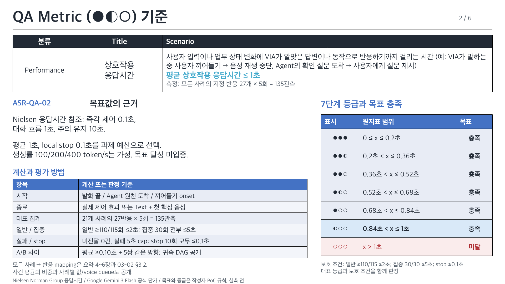
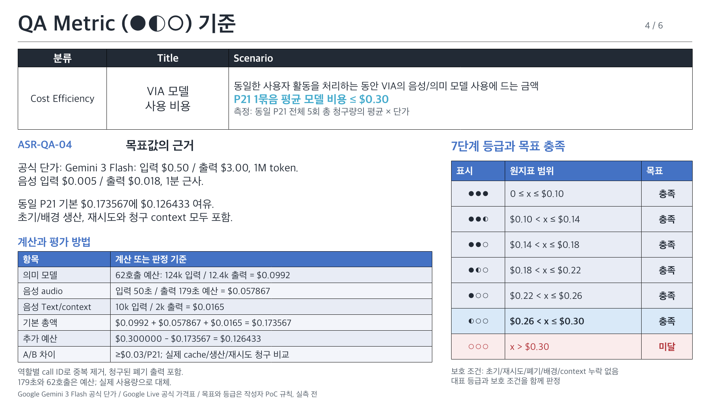
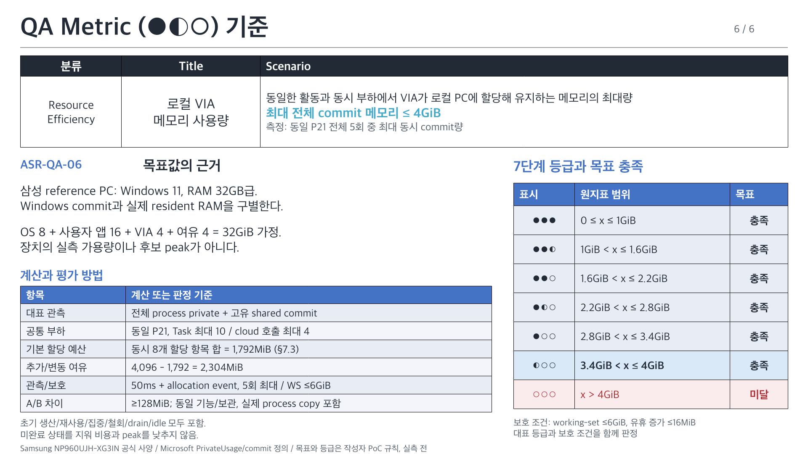

# VIA QA 목표 근거와 7단계 등급

[03-02 원본](../architecture/12-decisions/decision-packages/03-02-quality-attribute-definitions.md)을 여섯 장으로 설명한다. [편집 가능한 PPTX, 6장](quality-metrics/VIA-quality-metrics.pptx) / [PNG 미리보기](quality-metrics/index.html) / [요약표](quality-attributes.md).

제공한 레퍼런스의 상단 요약표, 목표 근거/계산과 오른쪽 등급표 구성을 따른다. 타 과제의 수치/요구사항은 가져오지 않았다. 목표와 등급 경계는 작성자의 VIA PoC 예산이며 출처의 보장 수치와 구별한다.

등급 6~0의 표시는 ●●● / ●●◐ / ●●○ / ●◐○ / ●○○ / ◐○○ / ○○○다. 원지표의 개선 여유를 나타내며 QA 간 합산하지 않는다. 1~6점은 대표 목표를 만족하지만 보호 조건 실패가 있으면 전체 목표는 미달이다. 실측 전은 0점이 아니며 현재 후보 점수는 생성하지 않았다.

## ASR-QA-01 요청 처리 정확성

**정의:** 사용자의 의도와 확인된 사실에 맞게 요청을 처리하는 능력

**대표 지표:** 필수 정답 조건 충족률(%) = P21의 21개 × 5회 × C1~C6, 630조건

**목표:** 98% 이상, 정답 618/630 이상

**목표 근거:** 조건 오류 50개당 1개 이내. 전체 시나리오/상황군/조건 유형 ≥95%, 필수 위반 0건. 재사용·동시 부하·최종 tail도 채점 (§3)

| 항목 | 계산/평가 규칙 |
| --- | --- |
| 대표 분모 | 21 × 5 × 6 = 630조건, 모든 필수 사실 통과 시 1 |
| 대표 목표 | 정답 618개 이상 / 오답 최대 12개 |
| 시나리오 보호 | 6조건 모두 정답인 시나리오 ≥100/105 |
| S / C 보호 | 상황군별 / 조건 유형별 각각 ≥95% |
| 필수 위반 | 무관 업무/중복 효과/잘못된 승인/무허용 사용 0건 |
| A/B 차이 | 평균 ≥1pp + 5쌍 같은 방향; 원값/최소/최대 공개 |

**보호 조건:** 전체/S/C ≥95%, 필수 위반 0건

21개 명세/6조건/최종 tail은 03-02 §3·8.2. 실제 출력으로 채점하며 가정 정답률을 생성하지 않음.

| 점수/표시 | 원지표 범위 | 대표 목표 |
| --- | --- | --- |
| 6 / ●●● | x = 100% | 충족 |
| 5 / ●●◐ | 99.6% ≤ x < 100% | 충족 |
| 4 / ●●○ | 99.2% ≤ x < 99.6% | 충족 |
| 3 / ●◐○ | 98.8% ≤ x < 99.2% | 충족 |
| 2 / ●○○ | 98.4% ≤ x < 98.8% | 충족 |
| 1 / ◐○○ | 98% ≤ x < 98.4% | 충족 |
| 0 / ○○○ | 0% ≤ x < 98% | 미달 |

출처: [VIA 고정 기능/UC](../architecture/05-representative-use-cases.md), [03-02 공통 QA 계약 v6](../architecture/12-decisions/decision-packages/03-02-quality-attribute-definitions.md). 숫자/목표 선택과 상세 경계는 03-02 §3 및 §8.7.

## ASR-QA-02 상호작용 응답시간

**정의:** 사용자 입력이나 업무 상태 변화에 VIA가 알맞은 답변이나 동작으로 반응하기까지 걸리는 시간 (예: VIA가 말하는 중 사용자 끼어들기 → 음성 재생 중단, Agent의 확인 질문 도착 → 사용자에게 질문 제시)

**대표 지표:** 평균 유효 반응시간(초) = 전 21개 사례의 지정 반응 27개 × 5회, 135관측

**목표:** 1.0초 이하, 모든 local stop 0.1초 이하

**목표 근거:** 대화 흐름 유지의 1초/즉각 제어 0.1초 참조. 일반 반응 2초 이내 ≥95%, 집중 도착 5초 이내, 미전달 0건. 모든 사례의 적용 경계를 대응표로 공개 (§4)

| 항목 | 계산/평가 규칙 |
| --- | --- |
| 시작 | 발화 끝 / Agent 원천 도착 / 끼어들기 onset |
| 종료 | 실제 제어 효과 또는 Text + 첫 핵심 음성 |
| 대표 집계 | 21개 사례의 27반응 × 5회 = 135관측 |
| 일반 / 집중 | 일반 ≥110/115회 ≤2초; 집중 30회 전부 ≤5초 |
| 실패 / stop | 미전달 0건, 실패 5초 cap; stop 10회 모두 ≤0.1초 |
| A/B 차이 | 평균 ≥0.10초 + 5쌍 같은 방향; 귀속 DAG 공개 |

**보호 조건:** 일반 ≥110/115 ≤2초; 집중 30/30 ≤5초; stop ≤0.1초

모든 사례 → 반응 mapping은 요약 4~6장과 03-02 §3.2. 사건 평균의 비중과 사례별 값/voice queue도 공개.

| 점수/표시 | 원지표 범위 | 대표 목표 |
| --- | --- | --- |
| 6 / ●●● | 0 ≤ x ≤ .2 초 | 충족 |
| 5 / ●●◐ | .2 < x ≤ .36 초 | 충족 |
| 4 / ●●○ | .36 < x ≤ .52 초 | 충족 |
| 3 / ●◐○ | .52 < x ≤ .68 초 | 충족 |
| 2 / ●○○ | .68 < x ≤ .84 초 | 충족 |
| 1 / ◐○○ | .84 < x ≤ 1 초 | 충족 |
| 0 / ○○○ | x > 1 초 | 미달 |

출처: [Nielsen Norman Group 응답시간](https://www.nngroup.com/articles/website-response-times/), [Google Gemini 3 Flash 공식 단가](https://ai.google.dev/gemini-api/docs/pricing#gemini-3-flash-preview), [03-02 공통 QA 계약 v6](../architecture/12-decisions/decision-packages/03-02-quality-attribute-definitions.md). 숫자/목표 선택과 상세 경계는 03-02 §4 및 §8.7.

## ASR-QA-03 VIA 요청 처리시간

**정의:** 요청 접수부터 최종 결과 전달까지, VIA의 처리와 대기로 걸리는 시간 (예: 보고서 작성 요청 → 요청 해석 → Agent에 작성 업무 인계 → 결과 수신 → 사용자에게 보고서 전달)

**대표 지표:** 평균 VIA 귀속 사이클 시간(초) = 사용자 목표가 있는 19개 × 5회, 95관측

**목표:** 10초 이하

**목표 근거:** 의미6 + 연결1 + 전달1 + 재검증2초의 작성자 예산. 15초 이내 ≥95%, 미전달 0건. Agent 발신 두 사례는 QA-02에 적용 (§4)

| 항목 | 계산/평가 규칙 |
| --- | --- |
| 전체 사이클 | 요청 → 해석 → 인계 → 결과 수신 → 실제 전달 |
| 대표 집계 | 19개 사용자 목표 × 5회 = 95사이클 |
| 적용 제외 | Agent 단독 S5-01/02: 새 사용자 목표 시작 없음 |
| 귀속 계산 | 같은 DAG의 외부 업무/사람 입력·대기만 0 |
| 실패 처리 | 30초 cap + 미전달 기록; ≥91/95회 ≤15초 |
| A/B 차이 | 평균 ≥0.50초 + 5쌍 같은 방향; 최종 결과 관측 |

**보호 조건:** ≥91/95 ≤15초, 미전달 0건

19개 전체 사이클을 동일 사례에서 관측한다. wall-clock / 제외 구간 / 병렬 DAG를 함께 보고.

| 점수/표시 | 원지표 범위 | 대표 목표 |
| --- | --- | --- |
| 6 / ●●● | 0 ≤ x ≤ 2 초 | 충족 |
| 5 / ●●◐ | 2 < x ≤ 3.6 초 | 충족 |
| 4 / ●●○ | 3.6 < x ≤ 5.2 초 | 충족 |
| 3 / ●◐○ | 5.2 < x ≤ 6.8 초 | 충족 |
| 2 / ●○○ | 6.8 < x ≤ 8.4 초 | 충족 |
| 1 / ◐○○ | 8.4 < x ≤ 10 초 | 충족 |
| 0 / ○○○ | x > 10 초 | 미달 |

출처: [Nielsen Norman Group 응답시간](https://www.nngroup.com/articles/website-response-times/), [03-02 공통 QA 계약 v6](../architecture/12-decisions/decision-packages/03-02-quality-attribute-definitions.md). 숫자/목표 선택과 상세 경계는 03-02 §4 및 §8.7.

## ASR-QA-04 VIA 모델 사용 비용

**정의:** 동일한 사용자 활동을 처리하는 동안 VIA의 음성/의미 모델 사용에 드는 금액

**대표 지표:** P21 1묶음 평균 총 모델 비용(USD/P21) = 동일 활동 5회 총액의 평균

**목표:** $0.30/P21 이하

**목표 근거:** 동일 21사례의 의미 62호출/음성 입력 50초/출력 179초 예산에서 기본 $0.173567, 여유 $0.126433. 호출·출력은 작성자 가정이며 실제 사용량으로 대체 (§5)

| 항목 | 계산/평가 규칙 |
| --- | --- |
| 의미 모델 | 62호출 예산: 124k 입력 / 12.4k 출력 = $0.0992 |
| 음성 audio | 입력 50초 / 출력 179초 예산 = $0.057867 |
| 음성 Text/context | 10k 입력 / 2k 출력 = $0.0165 |
| 기본 총액 | $0.0992 + $0.057867 + $0.0165 = $0.173567 |
| 추가 예산 | $0.300000 - $0.173567 = $0.126433 |
| A/B 차이 | ≥$0.03/P21; 실제 cache/생산/재시도 청구 비교 |

**보호 조건:** 초기/재시도/폐기/배경/context 누락 없음

역할별 call ID로 중복 제거, 청구된 폐기 출력 포함. 179초와 62호출은 예산; 실제 사용량으로 대체.

| 점수/표시 | 원지표 범위 | 대표 목표 |
| --- | --- | --- |
| 6 / ●●● | 0 ≤ x ≤ .10 USD/P21 | 충족 |
| 5 / ●●◐ | .10 < x ≤ .14 USD/P21 | 충족 |
| 4 / ●●○ | .14 < x ≤ .18 USD/P21 | 충족 |
| 3 / ●◐○ | .18 < x ≤ .22 USD/P21 | 충족 |
| 2 / ●○○ | .22 < x ≤ .26 USD/P21 | 충족 |
| 1 / ◐○○ | .26 < x ≤ .30 USD/P21 | 충족 |
| 0 / ○○○ | x > .30 USD/P21 | 미달 |

출처: [Google Gemini 3 Flash 공식 단가](https://ai.google.dev/gemini-api/docs/pricing#gemini-3-flash-preview), [Google Live 공식 가격표](https://ai.google.dev/gemini-api/docs/pricing), [03-02 공통 QA 계약 v6](../architecture/12-decisions/decision-packages/03-02-quality-attribute-definitions.md). 숫자/목표 선택과 상세 경계는 03-02 §5 및 §8.7.

## ASR-QA-05 VIA 변경 용이성

**정의:** 모델/Agent/정보원/기능 계약의 변화를 다른 사용자 기능을 유지하면서 수용하는 능력

**대표 지표:** 평균 변경 기능 책임 단위 수(개/과제) = 6개 변경의 고유 수정 책임 수 합/6

**목표:** 평균 3개 이하, 과제별5개 이하

**목표 근거:** adapter/생산/소비 약3개 책임에 일상 변경을 국소화. 동일 U01~18 registry와 기존 기능/권한/P21 회귀 유지 (§6)

| 항목 | 계산/평가 규칙 |
| --- | --- |
| 공통 과제 | provider / Agent / source 교체, 관계/질문/철회 |
| 공통 단위 | U01~18 기능 책임 registry, 동일 수정 중복 금지 |
| 대표 집계 | 여섯 수정 집합의 크기 합 / 6 |
| 설명 예시 | M-04 A: U01/U03/U07, B: U01/U02/U03/U07 |
| 완료 조건 | 새 요구 충족 + P21/선호/권한/중복 회귀 유지 |
| A/B 차이 | 평균 ≥0.5개, 여섯 과제 합계 차이 ≥3개 |

**보호 조건:** 과제별 ≤5개, 6개 완료/필수 회귀 충족

구체 patch/diff와 완료 oracle로 수정 책임 검수. 개발 시간이나 Component 수로 점수를 만들지 않음.

| 점수/표시 | 원지표 범위 | 대표 목표 |
| --- | --- | --- |
| 6 / ●●● | 0 ≤ x ≤ 1 개/과제 | 충족 |
| 5 / ●●◐ | 1 < x ≤ 1.4 개/과제 | 충족 |
| 4 / ●●○ | 1.4 < x ≤ 1.8 개/과제 | 충족 |
| 3 / ●◐○ | 1.8 < x ≤ 2.2 개/과제 | 충족 |
| 2 / ●○○ | 2.2 < x ≤ 2.6 개/과제 | 충족 |
| 1 / ◐○○ | 2.6 < x ≤ 3 개/과제 | 충족 |
| 0 / ○○○ | x > 3 개/과제 | 미달 |

출처: [VIA 고정 기능/UC](../architecture/05-representative-use-cases.md), [03-02 공통 QA 계약 v6](../architecture/12-decisions/decision-packages/03-02-quality-attribute-definitions.md). 숫자/목표 선택과 상세 경계는 03-02 §6 및 §8.7.

## ASR-QA-06 로컬 VIA 메모리 사용량

**정의:** 동일한 활동과 동시 부하에서 VIA가 로컬 PC에 할당해 유지하는 메모리의 최대량

**대표 지표:** 최대 전체 commit 메모리(MiB) = 동일 P21 5회 중 전체 process/고유 공유 allocation 동시 합 최대

**목표:** 4,096MiB(4GiB) 이하

**목표 근거:** 32GB급 Windows PC의 OS8/업무앱16/VIA4/여유4GiB 계획. 공통 allocation1792 + 추가여유2304MiB, 실제 RAM residency와 구별 (§7)

| 항목 | 계산/평가 규칙 |
| --- | --- |
| 대표 관측 | 전체 process private + 고유 shared commit |
| 공통 부하 | 동일 P21, Task 최대 10 / cloud 호출 최대 4 |
| 기본 할당 예산 | 동시 8개 할당 항목 합 = 1,792MiB (§7.3) |
| 추가/변동 여유 | 4,096 - 1,792 = 2,304MiB |
| 관측/보호 | 50ms + allocation event, 5회 최대 / WS ≤6GiB |
| A/B 차이 | ≥128MiB; 동일 기능/보관, 실제 process copy 포함 |

**보호 조건:** working-set ≤6GiB, 유휴 증가 ≤16MiB

초기 생산/재사용/집중/철회/drain/idle 모두 포함. 미완료 상태를 지워 비용과 peak를 낮추지 않음.

| 점수/표시 | 원지표 범위 | 대표 목표 |
| --- | --- | --- |
| 6 / ●●● | 0 ≤ x ≤ 1024 MiB | 충족 |
| 5 / ●●◐ | 1024 < x ≤ 1638.4 MiB | 충족 |
| 4 / ●●○ | 1638.4 < x ≤ 2252.8 MiB | 충족 |
| 3 / ●◐○ | 2252.8 < x ≤ 2867.2 MiB | 충족 |
| 2 / ●○○ | 2867.2 < x ≤ 3481.6 MiB | 충족 |
| 1 / ◐○○ | 3481.6 < x ≤ 4096 MiB | 충족 |
| 0 / ○○○ | x > 4096 MiB | 미달 |

출처: [Samsung NP960UJH-XG3IN 공식 사양](https://www.samsung.com/in/computers/galaxy-book/galaxy-book6-ultra-ultra-7-32gb-1tb-np960ujh-xg3in/), [Microsoft PrivateUsage/commit 정의](https://learn.microsoft.com/en-us/windows/win32/api/psapi/ns-psapi-process_memory_counters_ex), [03-02 공통 QA 계약 v6](../architecture/12-decisions/decision-packages/03-02-quality-attribute-definitions.md). 숫자/목표 선택과 상세 경계는 03-02 §7 및 §8.7.

## 변경과 재생성

이전 자료는 [archive](../archive/qa-presentations-before-asr-20261011/README.md)에 보존했다. [입력 원장](../architecture/12-decisions/decision-packages/03-02-poc-inputs.json), [검산 보고](../architecture/12-decisions/decision-packages/03-02-poc-calculation-report.md)와 [재생성 안내](quality-metrics/README.md)를 따른다. 상세 정의는 03-02 하나에서 유지하고 문안/JSON/PPTX의 원본 hash를 함께 갱신한다.
