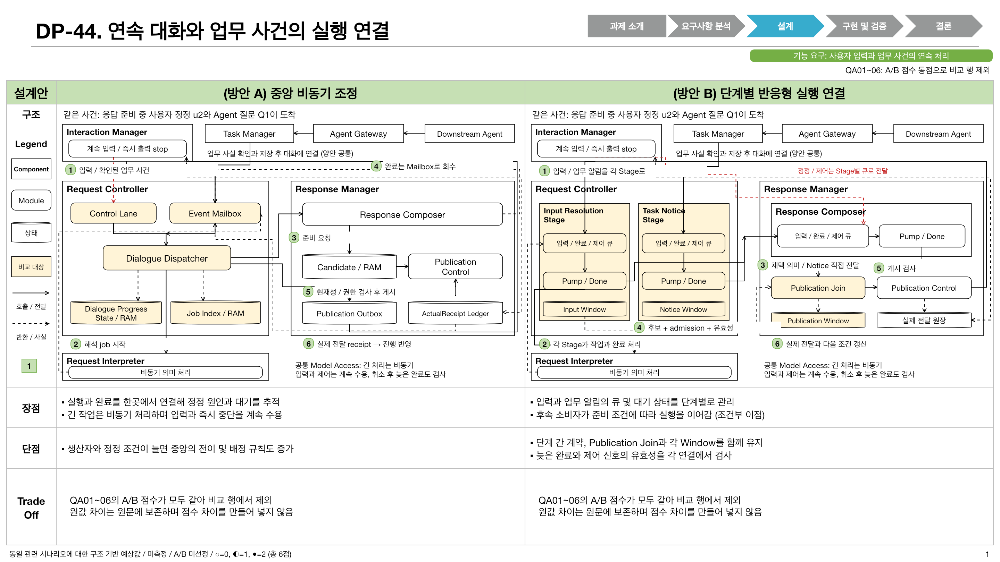
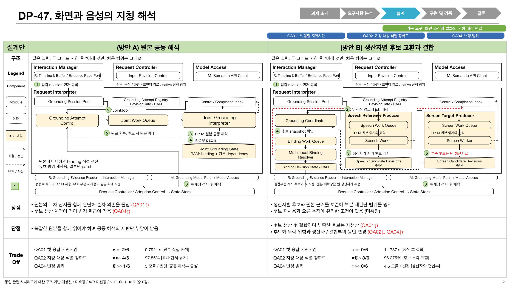
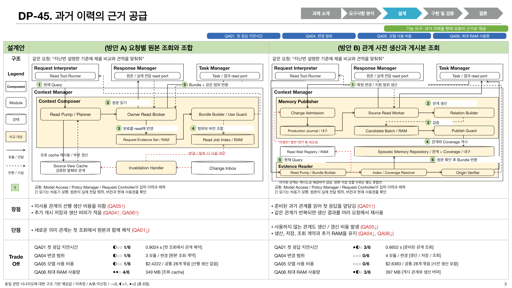
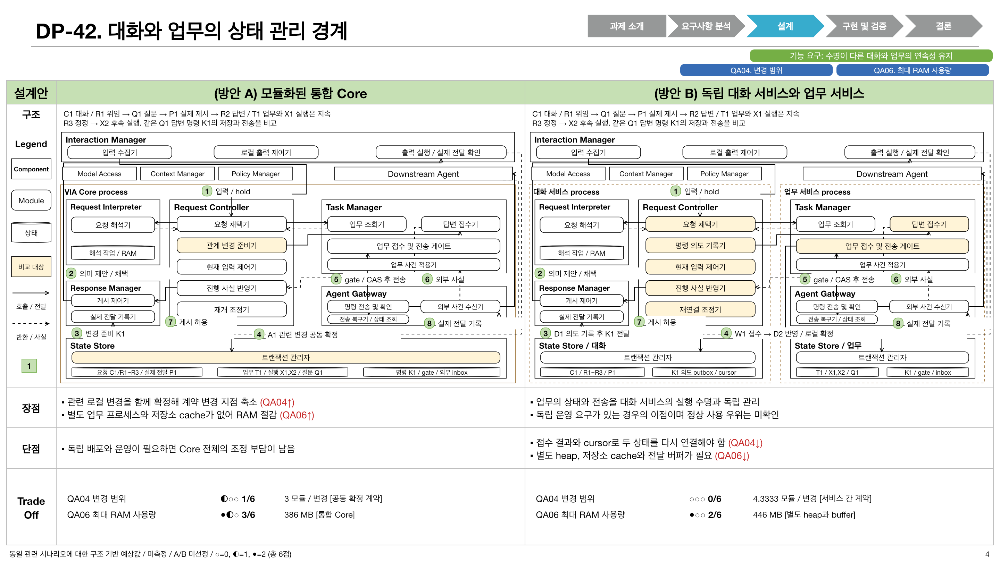

# DP-44, 47, 45, 42 레퍼런스 형식 비교 발표

사용자가 제공한 DP 설명 PNG 네 장의 구성에 맞춘 **편집 가능한 PPTX 4장**이다. 2026-10-15에 커밋된 구현 구조와 QA 사고실험 v2를 반영했다. 순서는 44 → 47 → 45 → 42다. 기존 통합 발표와 개별 구현 구조 발표는 보존한다.

[PPTX 열기](../VIA-DP-comparisons-reference_v1.pptx) / [검토와 보완 기록](./review.md) / [입력 및 수치 스냅샷](./content.json) / [도형 scene](./scene.json) / [패키지 검증](./validation.json)

## 레퍼런스에서 유지한 구성

- 상단 DP 번호와 제목, 단계 화살표, 기능 요구와 관련 QA 배지
- 좁은 행 이름 열과 같은 폭의 A/B 두 열, 연녹색 설계안 머리행
- 페이지의 가장 큰 영역에 Component, Module, 상태, 번호와 호출 및 반환선
- 같은 높이의 장점, 단점 행과 붉은 QA 영향 표기
- 하단 Trade-off에 같은 QA 순서, A/B 원값, 0~6점 원형 표시와 원인 메모

원본의 기능 요구 ID는 다른 프로젝트의 ID이므로 복사하지 않고 VIA의 기능 요구를 문장으로 표시했다. 범례도 실제 쓰는 Component, Module, 상태와 비교 대상에 맞췄다. 수치는 측정 결과가 아닌 작성자 예상치이며 승자를 선택하지 않았다.

## QA 포함 기준

`qa-dp-thought-experiment.md`의 QA01~06만 검토하고 **A/B 점수가 같은 QA는 제외**했다. 원값이 달라도 점수가 같으면 제외한다. 제외된 원값과 점수도 `content.json`의 `excluded`에 보존한다. 표시 수를 채우기 위해 점수 구간이나 수치를 바꾸지 않았다.

| 장 | DP | 표시 QA | 점수 동점으로 제외 |
| --- | --- | --- | --- |
| 1 | 44 | 없음. 모두 동점이라는 설명 표시 | QA01~06 |
| 2 | 47 | QA01, QA02, QA04 | QA03, QA05, QA06 |
| 3 | 45 | QA01, QA04, QA05, QA06 | QA02, QA03 |
| 4 | 42 | QA04, QA06 | QA01, QA02, QA03, QA05 |

QA01과 QA03은 관련 사건의 산술평균이다. QA04는 예정 Rust 모듈 변경 범위의 설계 분석이며 실제 코드 변경 실측이 아니다. QA05의 단위는 공통 28개 활동 묶음 전체 비용이다. QA06은 해당 에피소드의 동시 최대 RAM이다. 표시 반올림은 원문의 소수 넷째 자리 표기와 맞췄으며 점수는 원 JSON 값을 사용한다.

## 커밋된 입력

전체 입력 스냅샷은 `f9dd00802596d2e13c7fddfc6cda926e0938674a`다. 다음 구조 커밋과 QA 커밋이 원격 main에 포함된 뒤 작성했다.

| 자료 | 사용한 커밋과 원문 |
| --- | --- |
| 44 구현 구조 | `6901a1deb`와 큐 연결 보완 `f9dd00802` / [04-44](../../architecture/12-decisions/decision-packages/04-44-continuous-interaction.md) |
| 47 구현 구조 | `a6a101a2c` / [04-47](../../architecture/12-decisions/decision-packages/04-47-screen-voice-grounding.md) |
| 45 구현 구조 | `fcd347a19` / [04-45](../../architecture/12-decisions/decision-packages/04-45-memory-and-context.md) |
| 42 구현 구조 | `c1b84b2e7` / [04-42](../../architecture/12-decisions/decision-packages/04-42-lifecycle-ownership.md) |
| QA 예상 원값과 점수 | `f9f6684ee` / [사고실험 v2](../../architecture/12-decisions/decision-packages/qa-candidate-package/qa-dp-thought-experiment.md) |

## 미리보기와 편집 원본

PPTX의 표, 모듈, 텍스트와 선은 네이티브 객체다. 아래 PNG는 **최종 PPTX를 다시 import한 뒤 렌더링**했다. SVG와 draw.io는 같은 scene으로 생성하며 글꼴 대체 환경에서는 텍스트 폭이 달라질 수 있다. 그림의 번호는 한 장 발표용 요약 순서이며 상세 계약의 전체 호출 번호를 대체하지 않는다.

### DP-44



[SVG](./dp44-reference-comparison_v1.svg) / [draw.io](./dp44-reference-comparison_v1.drawio)

### DP-47



[SVG](./dp47-reference-comparison_v1.svg) / [draw.io](./dp47-reference-comparison_v1.drawio)

### DP-45



[SVG](./dp45-reference-comparison_v1.svg) / [draw.io](./dp45-reference-comparison_v1.drawio)

### DP-42



[SVG](./dp42-reference-comparison_v1.svg) / [draw.io](./dp42-reference-comparison_v1.drawio)

## 재생성

번들 Node와 `@oai/artifact-tool`을 사용한다. 전역 패키지를 설치하지 않는다. 아래 변수는 작업 환경의 `load_workspace_dependencies` 결과로 설정한다. `VIA_PRESENTATION_SKILL_DIR`는 Presentations SKILL.md가 있는 디렉터리다. 빌드 경로는 매번 새로 만들어 이전 최종본을 보존한다.

```sh
VIA_REPO="$PWD"
VIA_BUILD="$(mktemp -d /tmp/via-dp-reference.XXXXXX)"
ln -s "$RUNTIME_NODE_MODULES" "$VIA_BUILD/node_modules"
cp scripts/presentations/build_reference_dp_comparisons.mjs "$VIA_BUILD/build.mjs"
"$VIA_RUNTIME_NODE" scripts/presentations/reference_dp_comparison_content.mjs \
  "$VIA_REPO" "$VIA_BUILD/content.json" score f9dd00802596d2e13c7fddfc6cda926e0938674a
export RUNTIME_NODE_MODULES VIA_PRESENTATION_SKILL_DIR VIA_RUNTIME_PYTHON
"$VIA_RUNTIME_NODE" "$VIA_BUILD/build.mjs" "$VIA_REPO" "$VIA_BUILD/output" "$VIA_BUILD/content.json"
```

최종 산출물은 새 빌드 경로의 `output/final/`에 생긴다. 모든 슬라이드를 검토한 뒤 새 판본으로 반영한다. 상세 구조의 전체 API, 예외와 복구 계약은 각 DP 원문을 따른다.
