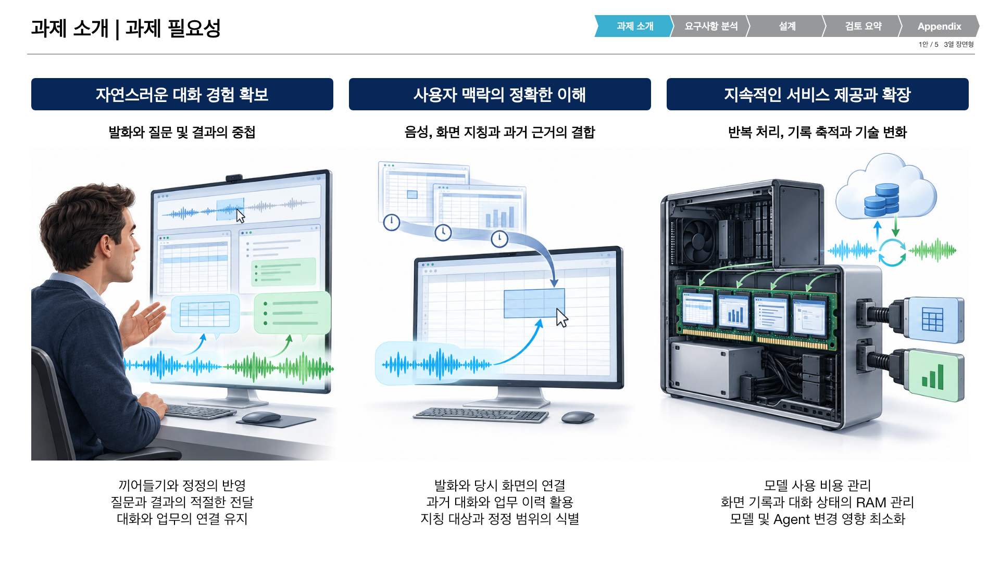
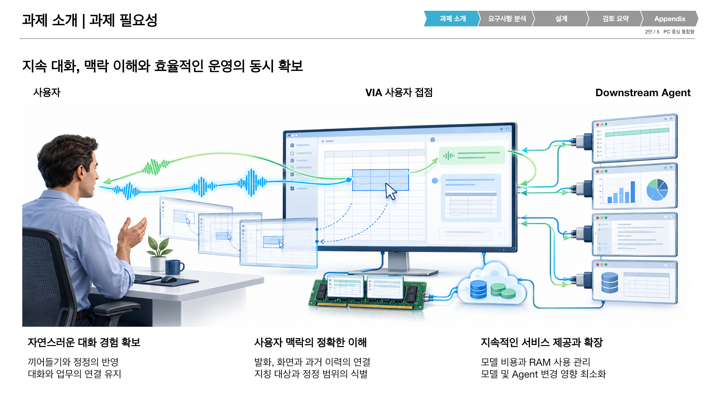
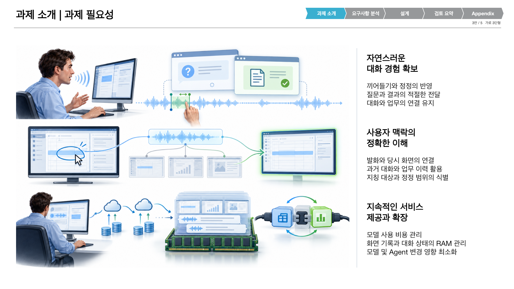
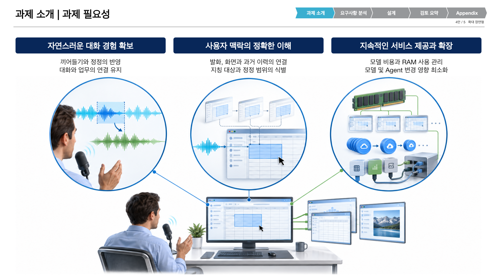
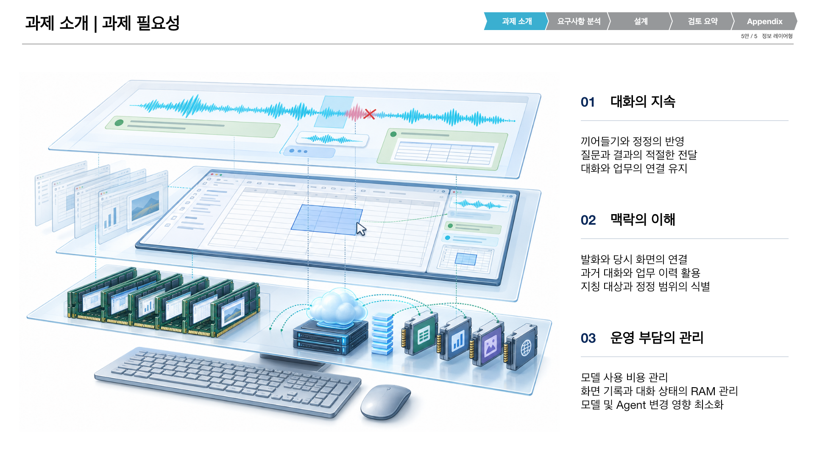

# 필요성 페이지의 시각 대안 5개

2026-10-15. 사용자 요청에 따라 [v11 통합본](../VIA-architecture-presentation_v11.pptx)의 2장 필요성을 서로 다른 시각 구성으로 작성. [5장 비교 PPTX](../VIA-necessity-options_v12.pptx)와 [확대 가능한 미리보기](./index.html) 제공. 최신 통합본은 v11이며 이번 v12는 선택용 비교본. v11의 33장과 QA 내용은 변경하지 않음.

| 안 | 구성 | 설명 방식 |
| --- | --- | --- |
| 1 | 3열 장면형 | 기존 남색 제목 서식에 세 장면을 크게 배치 |
| 2 | PC 중심 통합형 | 사용자, VIA와 Downstream Agent를 하나의 연결된 장면으로 표현 |
| 3 | 가로 3단형 | 대화, 맥락과 운영 부담을 각각 넓은 그림으로 설명 |
| 4 | 확대 장면형 | 같은 PC 사용 장면의 세 부분을 확대 |
| 5 | 정보 레이어형 | 대화, 맥락과 운영 부담을 층별로 펼친 그림 |

다섯 안 모두 대화 지속, 음성과 당시 화면 및 과거 이력 연결, 모델 비용과 RAM 사용 및 기술 변경 부담을 포함. 본문은 명사형 핵심 문구로 축약. 생성 그림은 실제 제품 화면이나 측정 근거가 아닌 설명용 일러스트. RAM과 연결 플러그는 자원 사용과 연동 변경의 시각적 비유이며 특정 HW 배치나 교체를 요구하지 않음. 레이어는 설명 관점이며 선택된 SW Architecture 구조가 아님.

그림은 내장 `image_gen.imagegen`으로 생성. [전체 생성 지시문](./prompts.json)과 [원본 PNG](./assets/) 보존. 사용자에게 보이는 제목과 본문은 Calibri 정수 pt의 편집 가능한 PowerPoint 텍스트. 일러스트 자체는 래스터 PNG.

## 미리보기

### 1안: 3열 장면형

### 2안: PC 중심 통합형

### 3안: 가로 3단형

### 4안: 확대 장면형

### 5안: 정보 레이어형

## 재현

[작성기](../../../scripts/presentations/build_necessity_options_v12.mjs), [v11 서식 이식기](../../../scripts/presentations/package_necessity_options_v12.py), [검증 및 렌더링](../../../scripts/presentations/finalize_necessity_options_v12.mjs) 사용. v11 파일 해시를 고정해 이후 다른 세션의 갱신을 실수로 덮어쓰지 않음. 이미지 재사용 시 추가 모델 호출 불필요.

새 private build에 bundled `node_modules` 연결, mjs 사본 배치 및 `VIA_PRESENTATION_SKILL_DIR`, `VIA_RUNTIME_PYTHON`, `RUNTIME_NODE_MODULES` 설정 후 다음 순서로 실행.

1. bundled Node로 `build_necessity_options_v12.mjs REPO BUILD`
2. 저장소 Python으로 `package_necessity_options_v12.py REPO BUILD`
3. bundled Node로 `finalize_necessity_options_v12.mjs BUILD`

[파일 구성과 기준 해시](./manifest.json), [검수 기록](./review.md) 참조. 선택한 안을 v11 이후 최신 통합본에 반영하는 작업은 선택 후 별도 진행.
