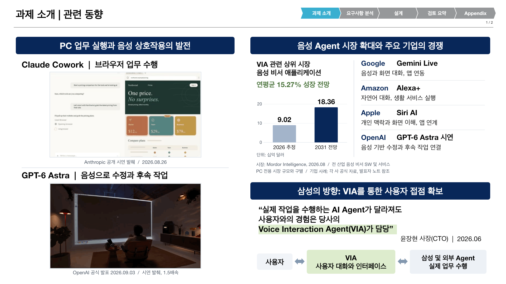
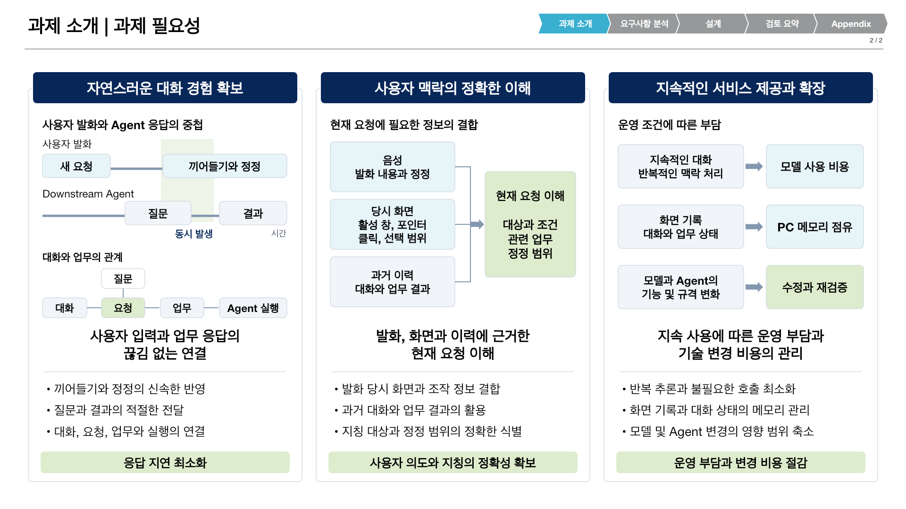

# 과제 소개 2장 v10

2026-10-15, v9에 남긴 사용자 주석 10건의 반영본. [두 장 PPTX](../VIA-project-introduction_v10.pptx)와 [63장 통합본](../VIA-architecture-presentation_v10.pptx) 제공. 통합본의 실제 1~2장만 수정. 기존 v9와 나머지 61장 보존.

## 관련 동향

사용자와 VIA, VIA와 삼성 및 외부 Agent 사이를 양방향 화살표로 수정. OpenAI 시연 캡션에는 공식 발표일 2026.09.03 추가. 발표일은 영상 촬영일을 뜻하지 않음.

시장 그래프는 **VIA 관련 상위 시장**으로 명확화. 음성 상호작용 소프트웨어라는 기능적 관련성은 있지만 PC용 VIA의 직접 시장 규모는 아님. [Mordor Intelligence의 시장 정의](https://www.mordorintelligence.com/industry-reports/voice-assistant-application-market)는 여러 산업의 음성 비서 애플리케이션 소프트웨어와 관련 서비스를 포함하고 하드웨어를 제외. PC 전용 TAM/SAM, 삼성 매출 또는 확보 가능한 점유율의 근거로 해석 불가. 수치는 v9의 2026 추정 90.2억 달러, 2031 전망 183.6억 달러와 연평균 15.27% 유지.

OpenAI 날짜는 [공식 ChatGPT 발표 이력](https://help.openai.com/en/articles/6825453-chatgpt-release-notes)의 2026-09-03 GPT-6 Astra 항목과 [공식 영상](https://www.youtube.com/watch?v=1QNsdr-Qx_I) 기준. 기존 GIF의 발췌와 재생 조건 보존. 기타 기업 사례, CTO 인용과 시연 출처는 [v9 근거 자료](../project-introduction-v9/README.md) 및 각 슬라이드의 발표자 노트에 수록.

## 과제 필요성

세 개의 개념 일러스트를 편집 가능한 정보 도식으로 교체. 각 영역의 보충 설명을 세 항목으로 확장.

| 영역 | 도식에 포함한 정보 | 관련 요구사항 |
| --- | --- | --- |
| 대화 경험 | 같은 시간축의 사용자 발화와 Agent 질문 및 결과, 대화와 요청 및 업무와 실행의 연결 관계 | FR1, FR4 |
| 맥락 이해 | 음성의 발화와 정정, 당시 화면의 활성 창과 포인터 및 클릭과 선택 범위, 과거 대화와 업무 결과의 결합 | FR2, FR3 |
| 지속 제공과 확장 | 반복적 맥락 처리와 모델 비용, 기록 및 상태와 PC 메모리, 기술 변화와 수정 및 재검증 부담 | 운영 비용, 메모리, 변경 범위 |

구체적인 업무 시나리오를 추가하지 않고 명사형 유지. 도식은 공통 요구의 배경이며 선택된 설계 구조, 측정 결과나 확정된 QA 수치의 표현이 아님. 관계도는 정보 연결의 축약 표현이며 엄격한 소유 관계, 카디널리티나 처리 순서를 규정하지 않음.

## 편집과 재현

[작성 스크립트](../../../scripts/presentations/build_project_intro_v10.mjs), [패키징 스크립트](../../../scripts/presentations/package_project_intro_v10.py), [검증 및 렌더링 스크립트](../../../scripts/presentations/finalize_project_intro_v10.mjs) 사용. 첫 장은 v9의 이름으로 식별한 도형 6개와 노트만 수정. 원래 native 차트와 내장 workbook, 두 GIF 보존. 둘째 장은 Artifact Tool로 도식과 native bullet 목록을 작성하고 원본 머리글 및 탐색 표시 적용.

새 private build에 bundled `node_modules` 연결 후 `RUNTIME_NODE_MODULES`, `VIA_PRESENTATION_SKILL_DIR`, `VIA_RUNTIME_PYTHON` 설정. 작성과 검증 mjs 사본을 build에 배치한 뒤 아래 순서로 실행.

1. 저장소 Python으로 `package_project_intro_v10.py prepare REPO BUILD`
2. bundled Node로 `build_project_intro_v10.mjs BUILD`
3. 저장소 Python으로 `package_project_intro_v10.py standalone REPO BUILD`
4. bundled Node로 `finalize_project_intro_v10.mjs BUILD standalone`
5. 저장소 Python으로 `package_project_intro_v10.py integrated REPO BUILD`
6. bundled Node로 `finalize_project_intro_v10.mjs BUILD integrated`

검수 범위는 [v10 검수 기록](../full-presentation/review-v10-2026-10-15.md), 보존 결과와 해시는 [보존 검사](../full-presentation/preservation-v10.json) 참조. 기존 FR/QA/DP 상세 페이지의 최신 정의 반영은 이번 두 장 편집 범위 밖.
