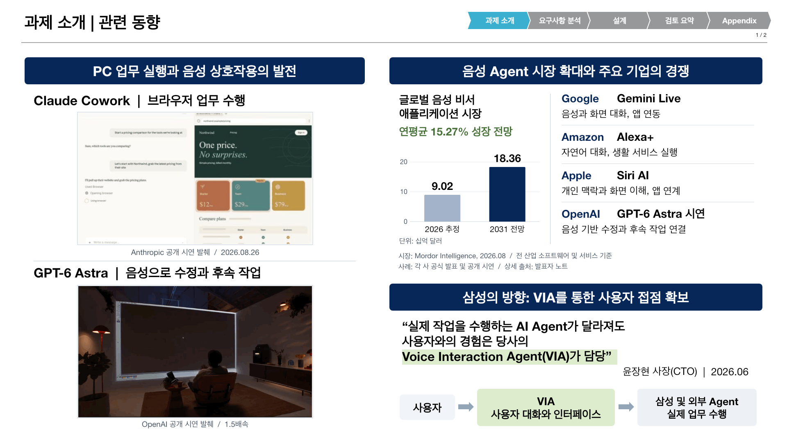
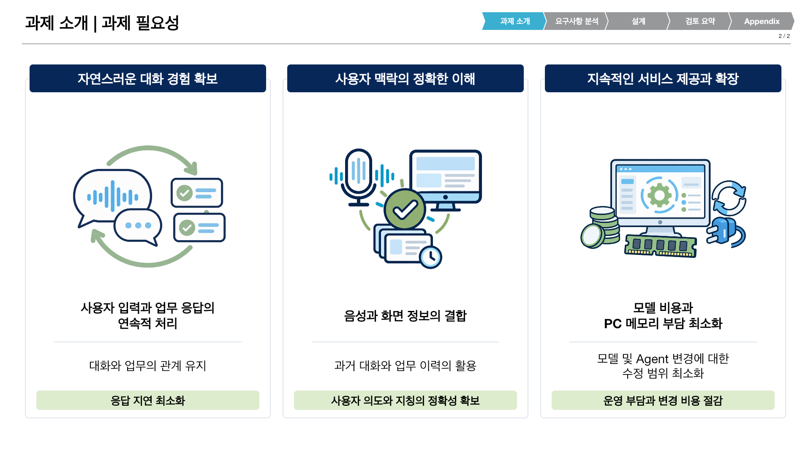

# 과제 소개 2장 v9

2026-10-14 사용자 검토 반영본. [두 장 PPTX](../VIA-project-introduction_v9.pptx)와 [63장 통합본 v9](../VIA-architecture-presentation_v9.pptx) 제공. v8의 실제 1~2장인 관련 동향과 과제 필요성만 교체. 나머지 61장, 발표자 노트, 원본 GIF와 마스터 보존. 기존 FR 및 QA 슬라이드의 최신 정의 반영은 이번 편집 범위 밖.

## 관련 동향

왼쪽: Claude Cowork Computer use 시연과 GPT-6 Astra 음성 수정 시연의 위아래 배치. 오른쪽 상단: 시장 전망 그래프와 Google, Amazon, Apple, OpenAI 사례. 오른쪽 하단: CTO 메시지와 사용자, VIA, 삼성 및 외부 Agent의 역할 관계. Bixby, Galaxy Book 생산성 자료와 Copilot Vision 제외.

시장 그래프는 편집 가능한 PowerPoint 차트와 내장 데이터 workbook으로 작성. 추정과 전망을 구분하고 전 산업 기준을 명시. 수치나 기업 사례는 VIA의 구현 결과 또는 PC 전용 시장 규모의 증거가 아님.

## 과제 필요성

대화 경험, 맥락 이해, 지속적인 서비스 제공과 확장의 세 영역. 구체적인 대화나 업무 예시 없이 개념 일러스트와 명사형 문구로 구성. 첫 영역은 FR1과 FR4, 둘째 영역은 FR2와 FR3의 문제 배경에 연결. 셋째 영역은 모델 비용, PC 메모리와 기술 변경 부담에 연결. QA 목표나 DP 대안 선정에 대한 신규 합의 없음.

## 근거와 자원

| 항목 | 출처 | 사용 범위 |
| --- | --- | --- |
| 시장 전망 | [Mordor Intelligence](https://www.mordorintelligence.com/industry-reports/voice-assistant-application-market), 2026-08-05 갱신 | 2026 추정 90.2억 달러, 2031 전망 183.6억 달러, CAGR 15.27%. 전 산업의 음성 비서 애플리케이션 소프트웨어와 서비스, 하드웨어 제외 |
| Google | [Gemini Live 공식 발표](https://blog.google/products-and-platforms/products/gemini/gemini-live-updates-august-2025/), 2025-08-20 | 음성과 화면 대화, Google 앱 연동 |
| Amazon | [Alexa+ 공식 발표](https://www.aboutamazon.com/news/devices/alexa-plus-available-free-prime-members-us), 2026-09-01 갱신 | 미국 제공, 자연어 대화와 서비스 실행 |
| Apple | [Siri AI 공식 발표](https://www.apple.com/newsroom/2026/09/siri-ai-a-profoundly-more-capable-and-personal-assistant-is-here/), 2026-09-14 | 개인 맥락, 화면 이해와 앱 동작. 출시 시 영어 베타, 지역 및 언어별 단계적 제공 |
| OpenAI | [공개 시연](https://www.linkedin.com/posts/this-gpt-6-astra-ugcPost-7501364077496221696-H8XE) | v8의 GPT-6 Astra GIF와 발췌 조건 보존. 일반 상용 서비스 전체의 제공 범위 주장 아님 |
| Anthropic | [Cowork built-in browser](https://claude.com/resources/articles/cowork-built-in-browser), [공개 영상](https://www.youtube.com/watch?v=63GVebZvqok), 2026-08-26 | v8의 68프레임 GIF 바이트 보존 |
| CTO 메시지 | 사용자가 제공한 윤장현 사장(CTO), 2026.06 발언 | 사용자 제공 문구 그대로 인용. 공개 기사에서 검증된 발언으로 주장하지 않음 |
| CTO 직책 | [삼성전자 사장단 인사](https://news.samsung.com/kr/473579-2), 2025-11-21 | 직책 확인 보조 자료. 위 인용 발언의 출처가 아님 |
| 개념 그림 | [생성 지시문](./assets/prompts.json) | imagegen 생성 투명 PNG 3장. 실제 제품 화면이나 성능 근거가 아닌 개념 일러스트 |

상세 출처와 해석 한계는 PPTX 발표자 노트에도 수록. 자료 확인일 2026-10-14.

## 편집과 재현

[작성 스크립트](../../../scripts/presentations/build_project_intro_v9.mjs), [패키징 스크립트](../../../scripts/presentations/package_project_intro_v9.py), [검증과 렌더링 스크립트](../../../scripts/presentations/finalize_project_intro_v9.mjs) 사용. Artifact Tool 작성 후 v8의 공통 머리글과 탐색 표시 이식. 통합 시 변경하지 않는 슬라이드의 XML, 관계, 노트와 원본 자원의 바이트 동일성 검사.

새 private build와 bundled Node/Python 사용. build에 bundled `node_modules`를 연결하고 `RUNTIME_NODE_MODULES`, `VIA_PRESENTATION_SKILL_DIR`, `VIA_RUNTIME_PYTHON` 설정. 작성 및 검증 mjs 사본을 build에 배치한 뒤 다음 순서로 실행. 기존 candidate와 final 파일 덮어쓰기 금지.

1. 저장소 `.venv/bin/python package_project_intro_v9.py prepare REPO BUILD`
2. bundled Node로 `build_project_intro_v9.mjs BUILD`
3. 저장소 Python으로 `package_project_intro_v9.py standalone REPO BUILD`
4. bundled Node로 `finalize_project_intro_v9.mjs BUILD standalone`
5. 저장소 Python으로 `package_project_intro_v9.py integrated REPO BUILD`
6. bundled Node로 `finalize_project_intro_v9.mjs BUILD integrated`

그림은 제공 PNG 재사용. 재현 과정에서 모델 호출 불필요. 수정 문구, 네이티브 차트와 도형은 PPTX에서 편집 가능. GIF와 개념 그림은 래스터 자원.

검증 결과와 PowerPoint 직접 실행 여부는 [v9 검수 기록](../full-presentation/review-v9-2026-10-14.md) 참조.
