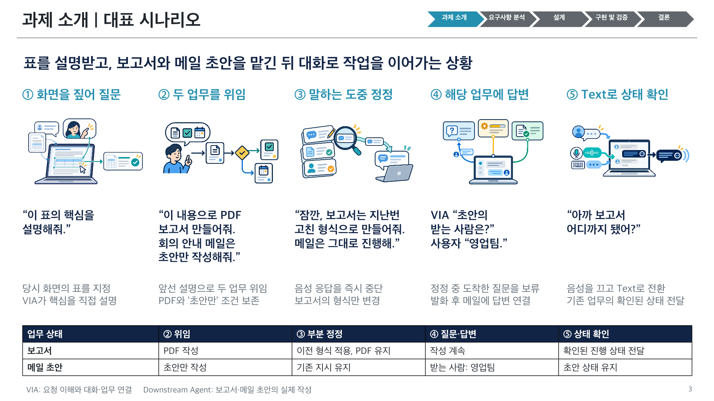

# 과제 소개: 대표 시나리오

> **현재 발표 편집본:** [전체 통합 PPTX](../VIA-architecture-presentation.pptx)의 4장이다. 아래 개별 PPTX/PNG는 최초 통합 시점의 참고본이다. 발표 수정은 [부분 편집 안내](../full-presentation/README.md)를 따른다. 아래 생성 절차는 이전 구성의 재현 이력이다.

- [편집 가능한 PPTX, 1장](../VIA-representative-scenario.pptx)
- [PNG 미리보기](./representative-scenario.png)
- [문안과 그림 목록](./scenario.json)
- [생성 스크립트](../../../scripts/presentations/generate_representative_scenario.mjs)

기존 [과제 소개 자료](../VIA_과제배경_필요성_검토반영_v3.pptx)의 ‘VIA의 역할과 범위’ 뒤에 삽입할 한 장이다. 같은 16:9 크기, Apple SD Gothic Neo 글꼴과 상단 탐색 표시를 사용한다. 개별 참고본의 표시 번호는 3이며, 현재 통합본에서는 실제 위치에 맞춰 4로 고쳤다.

다섯 사례를 하나의 연속 대화로 구성했다. 표 설명을 요청한 뒤 그 설명으로 PDF 보고서와 메일 초안을 맡긴다. 음성 응답 도중 보고서 형식만 정정하고, 메일의 수신자 질문에 답한다. 마지막에는 음성을 끄고 Text로 기존 보고서의 상태를 확인한다. 실제 보고서 및 메일 작성은 Downstream Agent가 맡고 VIA는 요청 이해, 상호작용과 업무 연결을 맡는다.

제목, 발화, 설명과 역할 문구는 텍스트 개체다. 하단 업무 흐름은 3행 5열의 PowerPoint 표다. 다섯 그림은 [기존 요구사항 일러스트](../requirements-assets/index.html)를 각각 독립 이미지 개체로 넣어 이동과 크기 조절 및 교체가 가능하다. 그림 내부의 요소는 래스터 이미지다.



## 뒤의 품질속성과 DP 연결

[ASR-QA-v6 원본](../../architecture/12-decisions/decision-packages/03-02-quality-attribute-definitions.md)의 여섯 품질속성과 현재 네 DP에 연결한다. 아래 대응은 기능상 유사성이다. 이 다섯 장면은 P21의 21개 원천 입력과 동일한 fixture가 아니며 평가 결과를 대신하지 않는다.

| 장면 | 확인할 품질속성 | 관련 설계 | P21의 유사 경로와 한계 |
| --- | --- | --- | --- |
| ① 화면의 표를 짚어 설명 요청 | ASR-QA-01 요청 처리 정확성, 02 상호작용 응답시간, 03 VIA 요청 처리시간 | [41 요청 해소 제어](../../architecture/12-decisions/decision-packages/04-41-request-resolution-control.md), [44 연속 상호작용](../../architecture/12-decisions/decision-packages/04-44-continuous-interaction.md) | S2-01 발화 중 표 지칭과 S1-01 제한 조회의 유사 경로. 화면 내용과 당시 지칭을 보존한다. |
| ② 앞선 설명으로 보고서와 메일 초안 위임 | ASR-QA-01, 02, 03 | 41, 44, [45 과거 근거](../../architecture/12-decisions/decision-packages/04-45-memory-and-context.md), [42 수명과 상태 소유](../../architecture/12-decisions/decision-packages/04-42-lifecycle-ownership.md) | 독립 목표는 S3-01, 과거 설명 재사용은 S2-02와 유사하다. 보고서의 PDF와 메일의 초안 조건을 보존한다. 결과 의존을 가진 S3-02와는 구별한다. |
| ③ 끼어들어 보고서 형식만 정정 | ASR-QA-01, 02, 03 | 41, 44, 45, 42 | S4-01 부분 정정과 S4-02 local stop에 연결한다. 과거 형식 활용은 S2-02/04/05의 근거 재사용과 유사하다. PDF와 메일 지시 보존, 즉시 음성 중단을 따로 확인한다. |
| ④ 정정 중 도착한 메일 질문에 답변 | ASR-QA-01, 02, 03 | 41, 44, 42 | S5-01/S5-04 질문 도착과 집중 부하, S6-04 실제 제시된 유효 질문 답변의 유사 경로다. 질문 전달과 사용자 답변 처리의 endpoint는 다르다. |
| ⑤ Voice 종료 후 Text로 보고서 상태 확인 | ASR-QA-01, 02, 03 | 42, 44 | S5-03의 Voice OFF 결과 전달 및 UC-15의 정상 채널 전환과 유사하다. VIA 재시작이나 장애 복구 성공의 증거는 아니다. |

**ASR-QA-04 모델 비용과 06 로컬 메모리**는 다섯 장면을 포함한 전체 활동에서 평가한다. 준비, 초기/미사용 생산, 재사용, 원천 갱신, 폐기와 tail을 누락하지 않는다. **ASR-QA-05 변경 용이성**은 M-01~06의 여섯 변경 과제와 기능 회귀로 별도 평가한다. 이 대화만으로 변경 용이성이나 메모리 목표를 입증하지 않는다.

공통 P21은 21개 사례 전체를 5회 독립 초기화한다. 정확성은 630조건(목표 정답 618개 이상), 반응시간은 135개(평균 1초 이하와 모든 local stop 0.1초 이하), VIA 처리시간은 95개(평균 10초 이하)다. 비용은 전체 활동의 평균 $0.50/P21 이하, 변경은 평균 3개/과제 이하와 과제별 5개 이하, 메모리는 모든 로컬 VIA 할당의 동시 commit 최대 4,096MiB 이하다. 정확성의 필수 위반, 시간의 일반/집중 보호 조건, 비용의 전체 청구와 메모리의 working-set/idle 보호 조건도 원본대로 별도 판정한다.

시간은 실제 유효 전달 endpoint까지 계산한다. 외부 Agent 업무, 사용자 답변 대기와 필수 사용자 발화 구간만 causal DAG에서 0으로 바꾸고 선후 관계와 경합을 유지한다. 전사 확정, 모델, queue, IPC, 저장과 음성 차례 대기는 VIA 시간에 포함한다. 후보 실측과 A/B 최종 선택은 아직 없다.

모델 배치는 [04-40](../../architecture/12-decisions/decision-packages/04-40-common-execution-contract.md)의 로컬 VIA/로컬 VAD 및 별도 클라우드 음성 모델과 의미 LLM을 따른다. 발표용 공급자 reference와 기능 요구를 구별한다.

## 재생성

번들 Node.js 및 Python과 `@oai/artifact-tool`을 사용한다. 새 private build 폴더에 스크립트를 복사하고 번들 `node_modules`를 연결한다. 다음 환경변수를 절대 경로로 지정한다.

- `VIA_PRESENTATION_SKILL_DIR`: Presentations skill 폴더
- `VIA_RUNTIME_PYTHON`: 번들 Python 실행 파일
- `RUNTIME_NODE_MODULES`: 번들 Node 패키지 폴더

```text
<bundled-node> <build>/generate_representative_scenario.mjs <repo> <build>
```

생성기는 한 장 PPTX를 내보내고 패키지, 크기, 글꼴과 native table을 검사한 뒤 재가져온 PPTX로 PNG를 렌더링한다. 출력은 최상위 PPTX와 이 폴더의 PNG다. 문안은 `scenario.json`에서 변경한다. 시각 검수는 별도로 수행한다.
